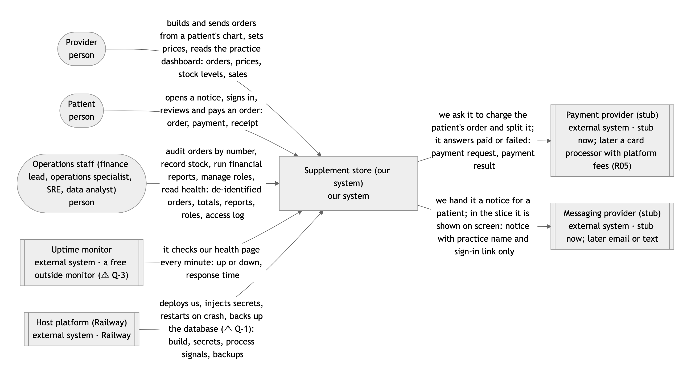
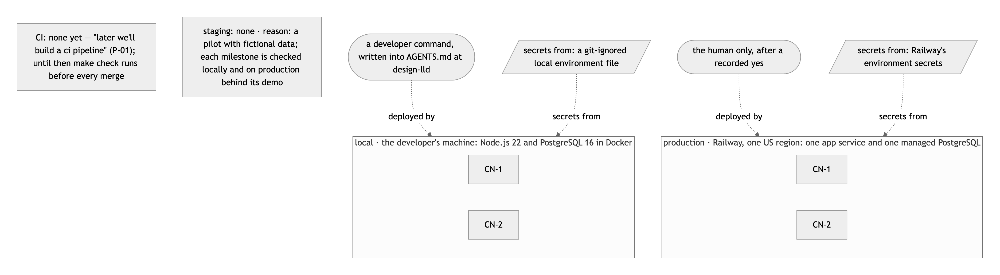

# Cerbo supplement store

A supplement-ordering slice for Cerbo, a functional-medicine EHR. A provider builds a supplement order for a patient,
the patient pays the platform once, and every cent of the split (item cost, provider payout, platform fee) is recorded
in an append-only ledger. Operations staff get stock, finance, health and access screens with no patient identity.

- **Live demo:** https://web-v2-production-6640.up.railway.app (synthetic people only; demo accounts in
  [docs/REVIEWER_GUIDE.md](docs/REVIEWER_GUIDE.md))
- **Start here:** [docs/REVIEWER_GUIDE.md](docs/REVIEWER_GUIDE.md) · every artifact: [docs/README.md](docs/README.md)
- **Design:** [HLD](docs/architecture/hld.md) · [LLD](docs/architecture/lld.md) · [all diagrams](docs/architecture/diagrams/README.md) · [API contract](docs/architecture/contracts/openapi.yaml)
- **AI usage (decisions, cuts, what the AI got wrong):** [docs/AI_USAGE.md](docs/AI_USAGE.md)
- **Demo video:** ⚠ upload link pending; script and teleprompter in [docs/demo/SCRIPT.md](docs/demo/SCRIPT.md)
- **Decisions:** [decision journal](docs/decisions/DECISION_JOURNAL.md) · [by topic](docs/decisions/REVIEW.md)
- **Milestones:** [MILESTONES.md](MILESTONES.md) and the reports in [docs/milestones/](docs/milestones/)
- **Security:** [threat model](docs/security/THREAT_MODEL.md) · [checklist](docs/security/CHECKLIST.md) · [EHR embedding plan](docs/architecture/embedding-plan.md)
- **Run it:** see the Commands table in [AGENTS.md](AGENTS.md) (`make setup`, `make db-test-up`, `make check`).

Stack: TypeScript on Node 22, Nuxt 4 (Vue 3), PostgreSQL 16 through Kysely, Vitest. Built with an AI-agent workflow
where every phase has a human gate; see [AGENTS.md](AGENTS.md) and [CLAUDE.md](CLAUDE.md).

<!-- pictures:start -->
## How it works

Click any picture to open it full size. Every diagram is listed in [docs/architecture/diagrams/README.md](docs/architecture/diagrams/README.md).

**System context: who uses the store and which outside systems it talks to**

**Containers: one web app and one database, with the trust boundaries between them**

**Data model (ERD): every table, key and money column**

**Sequence: a patient reviews and pays an order (lock, idempotency, split, ledger)**

**State machine: an order (sent, in checkout, paid, cancelled, needs review)**

**Deployment: local machine vs. production on Railway**

<!-- pictures:end -->
