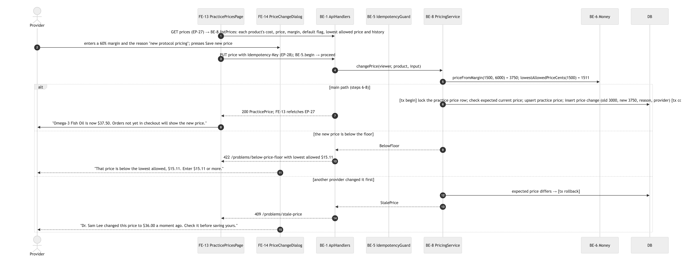
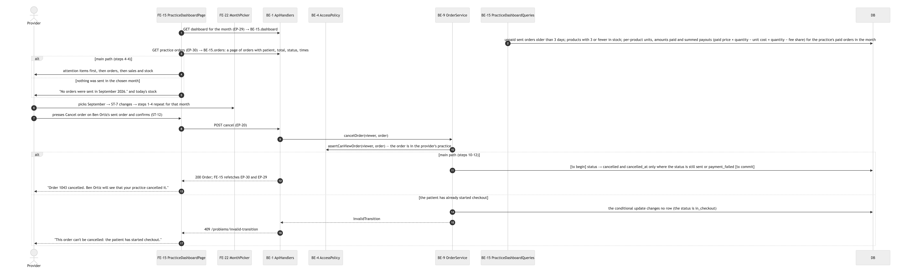
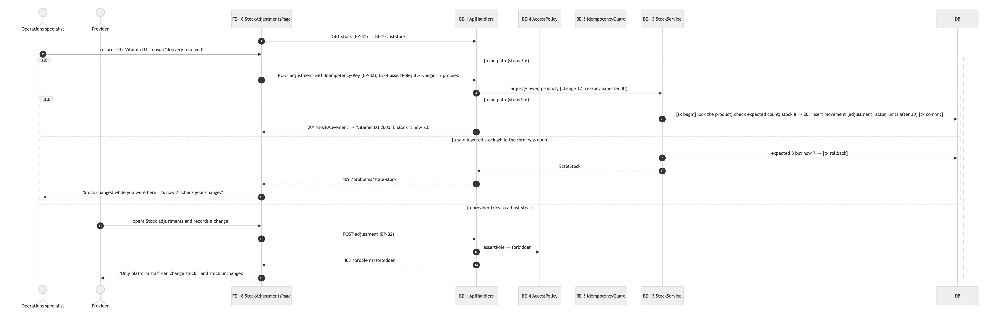
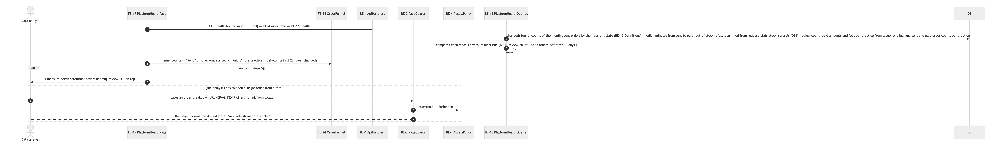
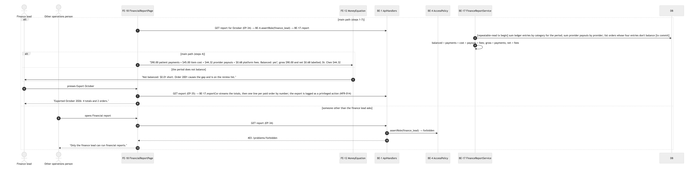
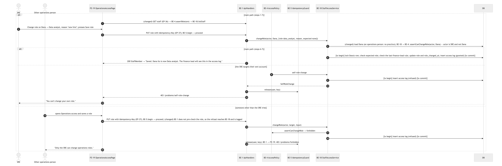
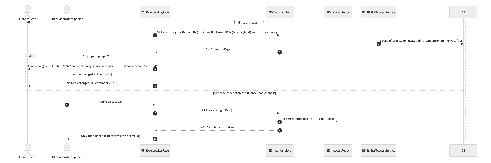
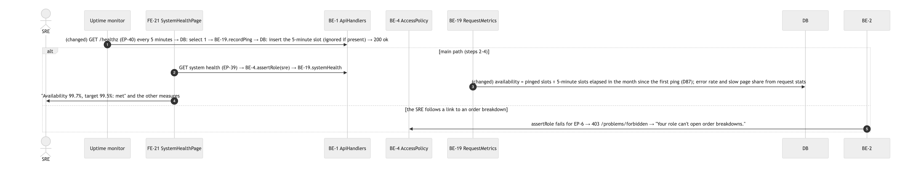

# Diagrams

Every diagram has a Mermaid source (`<name>.mmd`, the source of truth, drawn by `draw-diagrams` and embedded in
`hld.md` and `lld.md` by `scripts/embed-diagrams.sh`) and a picture (`img/<name>.png`, rendered at 2x by GitLab's own
Mermaid 11 renderer). Click a picture to open it full size; the wide ones (ERD, components, long sequences) are meant
to be zoomed.

| Diagram | Source | Picture |
|---|---|---|
| System context: who uses the store and which outside systems it talks to | [hld-context.mmd](hld-context.mmd) | [hld-context.png](img/hld-context.png) |
| Containers: one web app and one database, with the trust boundaries between them | [hld-container.mmd](hld-container.mmd) | [hld-container.png](img/hld-container.png) |
| Deployment: local machine vs. production on Railway | [deployment.mmd](deployment.mmd) | [deployment.png](img/deployment.png) |
| Data model (ERD): every table, key and money column | [erd.mmd](erd.mmd) | [erd.png](img/erd.png) |
| Backend components: every service and its public methods | [be-class.mmd](be-class.mmd) | [be-class.png](img/be-class.png) |
| Frontend components: every screen and the parts it is built from | [fe-components.mmd](fe-components.mmd) | [fe-components.png](img/fe-components.png) |
| Sequence: a provider builds and sends an order | [sequence-send-order.mmd](sequence-send-order.mmd) | [sequence-send-order.png](img/sequence-send-order.png) |
| Sequence: a patient reviews and pays an order (lock, idempotency, split, ledger) | [sequence-pay-order.mmd](sequence-pay-order.mmd) | [sequence-pay-order.png](img/sequence-pay-order.png) |
| Sequence: a reviewer checks where every cent went | [sequence-audit-order.mmd](sequence-audit-order.mmd) | [sequence-audit-order.png](img/sequence-audit-order.png) |
| Sequence: a provider changes a price on purpose | [sequence-change-price.mmd](sequence-change-price.mmd) | [sequence-change-price.png](img/sequence-change-price.png) |
| Sequence: the practice dashboard (orders, sales, stock) | [sequence-practice-dashboard.mmd](sequence-practice-dashboard.mmd) | [sequence-practice-dashboard.png](img/sequence-practice-dashboard.png) |
| Sequence: operations records a stock change | [sequence-adjust-stock.mmd](sequence-adjust-stock.mmd) | [sequence-adjust-stock.png](img/sequence-adjust-stock.png) |
| Sequence: sign in and idle sign-out | [sequence-sign-in.mmd](sequence-sign-in.mmd) | [sequence-sign-in.png](img/sequence-sign-in.png) |
| Sequence: platform health (where orders get stuck) | [sequence-platform-health.mmd](sequence-platform-health.mmd) | [sequence-platform-health.png](img/sequence-platform-health.png) |
| Sequence: finance closes the month | [sequence-financial-report.mmd](sequence-financial-report.mmd) | [sequence-financial-report.png](img/sequence-financial-report.png) |
| Sequence: the SRE grants or removes an operations role | [sequence-change-role.mmd](sequence-change-role.mmd) | [sequence-change-role.png](img/sequence-change-role.png) |
| Sequence: reviewing the staff access log | [sequence-access-log.mmd](sequence-access-log.mmd) | [sequence-access-log.png](img/sequence-access-log.png) |
| Sequence: checking system health | [sequence-system-health.mmd](sequence-system-health.mmd) | [sequence-system-health.png](img/sequence-system-health.png) |
| State machine: an order (sent, in checkout, paid, cancelled, needs review) | [state-order.mmd](state-order.mmd) | [state-order.png](img/state-order.png) |
| State machine: a payment attempt | [state-payment-attempt.mmd](state-payment-attempt.mmd) | [state-payment-attempt.png](img/state-payment-attempt.png) |
| State machine: an idempotency key | [state-idempotency-key.mmd](state-idempotency-key.mmd) | [state-idempotency-key.png](img/state-idempotency-key.png) |

### System context: who uses the store and which outside systems it talks to

### Containers: one web app and one database, with the trust boundaries between them

### Deployment: local machine vs. production on Railway

### Data model (ERD): every table, key and money column

### Backend components: every service and its public methods

### Frontend components: every screen and the parts it is built from

### Sequence: a provider builds and sends an order

### Sequence: a patient reviews and pays an order (lock, idempotency, split, ledger)

### Sequence: a reviewer checks where every cent went

### Sequence: a provider changes a price on purpose

### Sequence: the practice dashboard (orders, sales, stock)

### Sequence: operations records a stock change

### Sequence: sign in and idle sign-out

### Sequence: platform health (where orders get stuck)

### Sequence: finance closes the month

### Sequence: the SRE grants or removes an operations role

### Sequence: reviewing the staff access log

### Sequence: checking system health

### State machine: an order (sent, in checkout, paid, cancelled, needs review)

### State machine: a payment attempt

### State machine: an idempotency key

