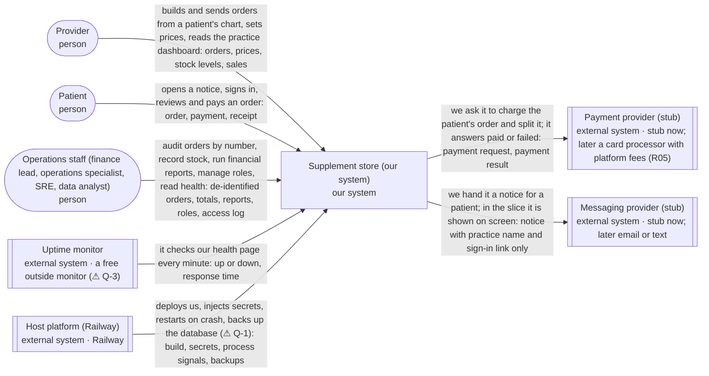
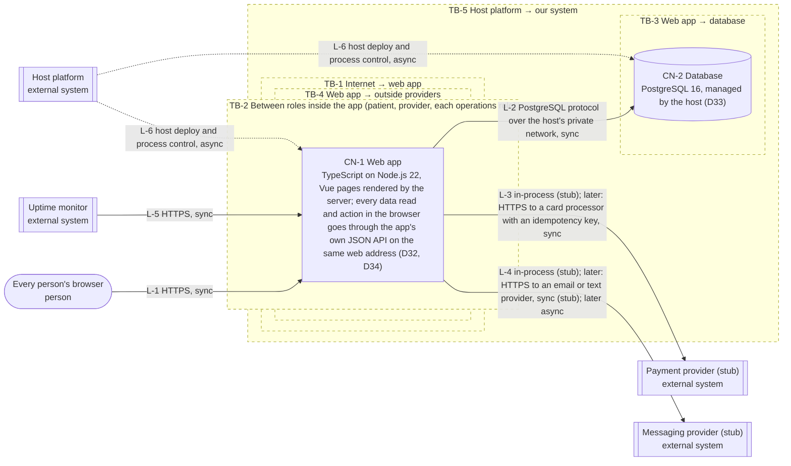
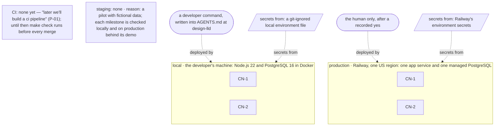

# In-EHR supplement orders — High-level design

| Field | Value |
|---|---|
| PRD | `docs/product/prd.md` @ ab9f181 |
| Milestone | M3 design, covering build milestones M4, M5 and M6 |
| Mode | greenfield |
| Last updated | 2026-10-09 23:10 CDT |
| Written by | design-hld (Claude Code, claude-opus-5-5) |
| Approval | G2 — recorded in `.handoff/TRACKER.md ## Approvals` (never in this file); decisions in `docs/decisions/DECISION_JOURNAL.md` |

**How to read this HLD.** A *container* is something that runs or stores data on its own (an app, a database, a
queue). A *connection* is an arrow between two of them and how it talks (sync = the caller waits for the answer;
async = it hands off a message and moves on). A *trust boundary* is a line where data passes to a party with
different permissions. An *invariant* is a rule that must always hold, or data, money or trust is corrupted. A
*D<n>* is a decision put to you at G2: Type 1 = one-way door, expensive to undo; Type 2 = two-way door, cheap to
change later. Anything not known yet carries a warning sign and a Q-n id; §13 lists every one with a recommended
answer.

## Inputs read

| Path | Version (sha or date) | Used for |
|---|---|---|
| `docs/product/prd.md` | ab9f181 (G1 approved 2026-10-09 22:16) | drivers, constraints, non-goals, milestone cut |
| `AGENTS.md` | e8c6621 | stack undecided until M3 (AGENTS.md:56), integer cents (AGENTS.md:57) |
| `docs/decisions/DECISION_JOURNAL.md` | 7c5ad05 | accepted D18-D31 as givens (D22 main set aside, D25 HIPAA-ready scope) |
| `specs/M1-in-ehr-supplement-orders/brief.md` | e8c6621 | appetite (1-2 days guidance, deadline waived), parking lot P-01 (CI later) |
| `docs/research/R01`-`R15`, `docs/research/sources.md` | 8c5081c | Cerbo stack (R01), payment split (R05), load profile (R13), clusters (R12), reports (R14), roles (R15) |
| `docs/design/flows.md`, `docs/design/screens.md` | 675f650 (G-ux approved 2026-10-09 22:33) | journeys for load, latency and the pages each role reaches |
| Railway pricing page | checked 2026-10-09 | unit prices in §12 |
| design-hld interview (this session) | 2026-10-09 22:07 | host, $20 ceiling, RPO/RTO and the production data-loss target (Approvals rows) |

**Not read:** `main@778e788` (the earlier one-shot build) — set aside by D22, never an input; write-prd's "Parked
for design-hld" line (snackbar style and rounding mechanics) — UX settled the first, the second is §10 Money.

## 1. Context & goals

The system lets a provider build a supplement order inside a patient's chart, lets the patient sign in and pay once
(a stand-in payment), records exactly where every cent went (item cost, provider payout, 0.75% platform fee), and
gives operations staff a de-identified health dashboard, a balancing financial report and role-based access. The
quality that matters most is **money integrity**: every paid order and every reporting period must add up to the
cent and stay auditable, because that is what the partner grades (REQ-05) and what finance relies on (US-9).

### Drivers

| Id | Requirement (short) | Kind | How it shapes the design |
|---|---|---|---|
| FR-010, FR-011, FR-012, FR-013 | Record the split in whole cents; fee = 0.75% half-up once per order; parts must add to the payment | FR | Money is written once, in one transaction, and the database refuses a split that doesn't add up (INV-1, INV-3) |
| FR-008 | No second charge for one order | FR | Payment carries an idempotency key the database keeps unique (INV-2) |
| FR-015, FR-021, NFR-014 | Paid amounts and histories are never edited | FR | Append-only records; the app's database user can't change them (INV-4) |
| FR-023, FR-024, FR-037 | Prices fixed at checkout start for 30 minutes | FR | Prices are copied onto the order when checkout starts; expiry is checked when the order is read, so no scheduler is needed |
| FR-026, FR-027 | Never sell more than is in stock | FR | Stock decrement and payment share one transaction (INV-5) |
| FR-009, FR-050, NFR-004, NFR-012 | People see only their own orders; ops never see patient identity | FR | One access check in the app on every read, plus de-identified views for ops (INV-7) |
| FR-039 to FR-041, NFR-007, NFR-008 | Personal sign-in, 15-minute idle sign-out | FR | Server-side sessions with an idle timeout (§10 Authentication) |
| FR-043, FR-044 | Patient notice with no health details | FR | A messaging seam that only ever receives the practice name and a link |
| FR-060 to FR-065, NFR-013 | Period financial report that balances; kept 3 years | FR | A money ledger that reports sum, kept at least 3 years (D35) |
| FR-051 to FR-059 | Four operations roles, separated duties, access log | FR | Role checks on every ops page; access log append-only (INV-4, INV-10) |
| FR-059 | SRE sees availability, errors, slow pages | FR | The app records request outcomes; an outside uptime check sees downtime the app can't (L-5) |
| NFR-001, NFR-002 | p95 ≤ 2 s at 60 req/s, 270 concurrent users | NFR | One app process meets it with headroom (§8); no cache or queue needed |
| NFR-005 | 99.5% a month, downtime only 05:00-11:00 UTC | NFR | One instance on a managed host is enough at this target (§8) |
| NFR-010, NFR-011 | No patient details in logs; fictional data only | NFR | Logs carry order numbers and ids, never names or items (§10) |

### Given constraints (fixed inputs, not decisions)

| Source (C-n, AGENTS.md:line or accepted D<n>) | Constraint | Design consequence |
|---|---|---|
| C-1, C-2 (REQ-14) | No technology mandated; Cerbo's TypeScript, JavaScript, Vue, MySQL, Postgres, AWS are context only | The stack is an open decision (D32, D33), informed by R01 |
| C-3 (REQ-07) | Payments, sign-in, email and shipping are stand-ins with clean seams | Payment and messaging are in-process stubs behind a seam; their real protocols are named "later" |
| C-4 (REQ-04) | Platform fee 75 bps of the transaction | Fee computed in one place (§10 Money) |
| C-5 (REQ-08, REQ-10) | US only; no tax, shipping cost or compliance work; platform holds inventory | One US region; stock is ours; no tax service |
| C-7 (D22) | The earlier one-shot build in main is not an input | Nothing reused from main |
| AGENTS.md:57 | Money in integer cents only | INV-3 |
| D25, NG-10 | HIPAA-ready, not HIPAA-compliant; fictional data only | Safeguards designed in (§5, §10); no business associate agreement needed with the host |
| Human, design-hld interview 2026-10-09 | Host: one PaaS region on the existing Railway account; $20 a month ceiling; pilot RPO 24 h / RTO 4 h; production target zero data loss with cross-region replicas and disaster recovery | §8, §11, §12 |

### Non-goals carried from the PRD

- NG-1 → no real payment provider, sign-in provider, email or shipping integration; stubs only (L-3, L-4)
- NG-5, NG-7 → no campaigns, refunds or corrections in the money flow yet (FR-016, FR-033, FR-034 are Later)
- NG-6 → no recurring orders, so no scheduler or worker container
- NG-8 → no warehouses: one stock count per product
- NG-10 → no BAA, risk analysis or policies; the design is HIPAA-ready only
- NG-11 → alerts show on dashboards only; no outbound alert channel

## 2. System context (C4 level 1)

<!-- diagram: hld-context -->

<!-- /diagram -->

| Element | Kind | Interaction with our system | Data exchanged | Owner | Basis |
|---|---|---|---|---|---|
| Supplement store (our system) | our system | — | — | us | FR-001 to FR-065 |
| Provider | person | builds and sends orders from a patient's chart, sets prices, reads the practice dashboard | orders, prices, stock levels, sales | — | US-1, US-4, US-5 |
| Patient | person | opens a notice, signs in, reviews and pays an order | order, payment, receipt | — | US-2, US-8 |
| Operations staff (finance lead, operations specialist, SRE, data analyst) | person | audit orders by number, record stock, run financial reports, manage roles, read health | de-identified orders, totals, reports, roles, access log | Cerbo | US-3, US-6, US-9, US-10 |
| Payment provider (stub) | external system | we ask it to charge the patient's order and split it; it answers paid or failed | payment request, payment result | stub now; later a card processor with platform fees (R05) | FR-006, FR-035, C-3 |
| Messaging provider (stub) | external system | we hand it a notice for a patient; in the slice it is shown on screen | notice with practice name and sign-in link only | stub now; later email or text | FR-043, FR-044, C-3 |
| Uptime monitor | external system | it checks our health page every minute | up or down, response time | a free outside monitor (⚠ Q-3) | FR-059 |
| Host platform (Railway) | external system | deploys us, injects secrets, restarts on crash, backs up the database (⚠ Q-1) | build, secrets, process signals, backups | Railway | human answer 2026-10-09, NFR-005 |

## 3. Containers (C4 level 2)

A container is a separately running or deployable runtime boundary that runs code or stores data: a web app, an
API, a background worker, a database, a queue, a cache, an object store. It is not a Docker container.

<!-- diagram: hld-container -->

<!-- /diagram -->

| Id | Container | Technology | Responsibility | Data owned | Scaling unit | Basis |
|---|---|---|---|---|---|---|
| CN-1 | Web app | TypeScript on Node.js 22, Vue pages rendered by the server; every data read and action in the browser goes through the app's own JSON API on the same web address (D32, D34) | Every page for every role, and the API those pages use, with the role check on every API call; order building, pricing, checkout, the payment and messaging stubs, the split, reports, roles, request statistics | none of its own: stateless between requests | another identical app instance | FR-001 to FR-065, D32, D34 |
| CN-2 | Database | PostgreSQL 16, managed by the host (D33) | Keeps every record and refuses money, stock and history records that break an invariant | people and roles, sessions, practices, fictional patients, products, prices and price history, stock and stock history, orders and lines, payments, the money ledger, notices, access log, request statistics | one primary, grown vertically; a cross-region replica in production (§12) | FR-010 to FR-015, FR-026, NFR-013, D33, D35 |

## 4. Connections

| Id | From → To | Protocol | Sync / async | Auth | Payload (nouns) | On failure | Basis |
|---|---|---|---|---|---|---|---|
| L-1 | Every person's browser → CN-1 | HTTPS | sync | session cookie set at sign-in, ended after 15 idle minutes | pages; the pages' data requests and actions through our own JSON API; order choices, payment confirmation, report requests, exports | Page shows the screen's Error state from screens.md; input kept; no retry by the app | FR-039, FR-041, NFR-001, NFR-009 |
| L-2 | CN-1 → CN-2 | PostgreSQL protocol over the host's private network | sync | one database user per environment, no update or delete rights on append-only records | reads and writes of every record | 5 s timeout; the request fails with the screen's Our failure message; money writes roll back as one transaction, so nothing half-written | NFR-006, INV-1, INV-4 |
| L-3 | CN-1 → Payment provider (stub) | in-process (stub); later: HTTPS to a card processor with an idempotency key | sync | none in the stub; later the processor's secret key from the host's secret store | amount, order number, idempotency key; result paid or failed | Stub can simulate failure or no answer; the order stays unpaid and the patient sees "No money was taken" (FR-035); later a 10 s timeout, then the same message and a safe retry with the same key | FR-006, FR-008, FR-035, R05 |
| L-4 | CN-1 → Messaging provider (stub) | in-process (stub); later: HTTPS to an email or text provider | sync (stub); later async | none in the stub; later an API key from the secret store | practice name and sign-in link only | Stub can't fail; later a failed send leaves the order sent and the provider dashboard shows the notice as not delivered | FR-043, FR-044 |
| L-5 | Uptime monitor → CN-1 | HTTPS | sync | none; the health page reveals only up or down and the version | up or down, response time | A missed check counts as downtime in system health (FR-059); three in a row mark the system down | FR-059, NFR-005 |
| L-6 | Host platform → CN-1 and CN-2 | host deploy and process control | async | the human's host account (deploys are human-only) | build, environment secrets, restart signal, database backups | A failed deploy keeps the previous release running; a crashed app is restarted by the host | NFR-005, §11 |

## 5. Trust boundaries & threats

### Boundaries

| Id | Boundary | Less trusted side | More trusted side | Crossing connections |
|---|---|---|---|---|
| TB-1 | Internet → web app | any browser, signed in or not | CN-1 | L-1, L-5 |
| TB-2 | Between roles inside the app (patient, provider, each operations role) | a signed-in person of one role | CN-1's role and ownership check on every API call, guarding another role's or practice's data and actions | L-1 |
| TB-3 | Web app → database | CN-1 code, which can have bugs | CN-2 records | L-2 |
| TB-4 | Web app → outside providers | the provider's network (stub now) | CN-1 | L-3, L-4 |
| TB-5 | Host platform → our system | the host account and its secret store | CN-1, CN-2 | L-6 |

### Threats per boundary

| Id | Boundary | STRIDE | Threat (an attacker could ...) | Design mitigation | Residual risk | Basis |
|---|---|---|---|---|---|---|
| TH-1 | TB-1 | S | steal or guess a session and act as someone else | Sessions live on the server; the cookie is secure, HTTP-only and same-site; idle sign-out at 15 minutes; sign-in attempts are rate-limited | low: stand-in sign-in has no second factor (A-12) | NFR-007, NFR-008 |
| TH-2 | TB-1 | T | change a price or amount in the page before submitting | The server ignores prices sent by the browser and computes every amount from its own records | low | FR-002, FR-011 |
| TH-3 | TB-1 | D | flood sign-in or payment pages | Rate limits per person and per address on sign-in and pay; the payment is idempotent | med: one app instance has no autoscale | NFR-002 |
| TH-4 | TB-2 | I | open another patient's or practice's order by changing a number in the link or in an API call | Every API call is checked against the signed-in person's own orders or practice; unknown and forbidden look the same ("no such order") | low, proven by AE-007, AE-008 | FR-009, NFR-004 |
| TH-5 | TB-2 | I | operations staff learn who a patient is | Operations pages read de-identified views that never hold patient names or contact details | low | FR-050, NFR-012 |
| TH-6 | TB-2 | E | the SRE grants themself the finance role, or a non-SRE changes roles | Only the SRE can change roles and never their own; every change and refused attempt goes to the access log the finance lead reviews | low | FR-055, FR-056, FR-057, R15 |
| TH-7 | TB-2 | R | someone denies changing a price, stock or role | Append-only histories record who, when and why (INV-4) | low | NFR-003, NFR-014 |
| TH-8 | TB-3 | T | a bug or a bad query edits a paid order's money | The app's database user has no rights to change or delete append-only records; the database checks the split adds up | low | FR-015, INV-1, INV-4 |
| TH-9 | TB-3 | I | the database password leaks | It lives only in the host's secret store; the database is reachable only on the host's private network | med: the host account becomes the key (TB-5) | NFR-009 |
| TH-10 | TB-4 | S | fake a "paid" answer from the payment provider (later, real integration) | Later: verify the provider's signature on every answer and confirm by asking the provider; the stub runs in-process | low now, med later until verified | FR-006, R05 |
| TH-11 | TB-4 | I | read health details from a patient's email or text | Notices carry only the practice name and a sign-in link | low | FR-044, R14 |
| TH-12 | TB-5 | E | someone with the host account deploys bad code or reads secrets | Deploys are human-only; the host account uses two-factor sign-in (the human's setting) | med: outside this design's control | AGENTS.md human-only actions |

## 6. Quality-attribute scenarios

| Id | NFR | Quality | Source | Stimulus | Environment | Response | Measure |
|---|---|---|---|---|---|---|---|
| QA-1 | NFR-001 | performance | patients and providers | open order and checkout pages | peak, 60 req/s | each page shows its result | p95 ≤ 2 s; p95 ≤ 300 ms inside CN-1 + CN-2 |
| QA-2 | NFR-002 | capacity | all roles | 270 people active at once | peak | journeys keep meeting QA-1 | 0 failed requests caused by capacity |
| QA-3 | NFR-005 | availability | uptime monitor | checks the health page every minute | normal month | the system answers | ≥ 99.5% of minutes up; planned work only 05:00-11:00 UTC |
| QA-4 | NFR-006 | reliability | the host | restarts the app while a payment is being saved | degraded: app restart | the payment and its split are saved together or not at all; a retry with the same key finds the first result | 0 orders lost after a receipt; 0 double charges |
| QA-5 | FR-035 | reliability | payment provider (stub) | fails or doesn't answer | degraded: provider down | order stays unpaid; patient told no money was taken | 0 charges recorded for failed payments |
| QA-6 | NFR-004, NFR-012 | privacy | an operations person | opens any ops page or export | normal | only order numbers and business data show | 0 records with a patient's name or contact details |
| QA-7 | NFR-008 | security | any signed-in person | stops using the system | normal | session ends | sign-out after 15 minutes idle, 100% of sessions |
| QA-8 | NFR-013 | auditability | finance lead | runs a report for a period 3 years back | normal | the report builds from kept records | 100% of paid orders of the last 3 years present |
| QA-9 | NFR-005 | availability | the host | the database host fails | degraded: database down | every page shows Our failure; no money written | restore within 4 h, at most 24 h of data lost (pilot) |

## 7. Invariants

| Id | Invariant (always true) | What breaks if violated | Enforcer | Enforced in | Basis |
|---|---|---|---|---|---|
| INV-1 | For every paid order, item cost + provider payout + platform fee = amount paid, to the cent | the audit and the financial report | DB constraint: the database refuses a paid order whose parts don't add up; the split is written in the same transaction as the payment | CN-2 | FR-013, FR-061 |
| INV-2 | An order is paid at most once | patients charged twice | DB constraint: one payment per order and one per idempotency key | CN-2 | FR-008 |
| INV-3 | Every amount is whole cents, never a fraction | rounding drift in totals | DB constraint: amounts stored as whole numbers of cents | CN-2 | FR-010, AGENTS.md:57 |
| INV-4 | Paid money records, ledger entries, price history, stock history and the access log are never changed or deleted | the audit trail can be forged | DB permissions: the app's database user can only add these records; plus a test that tries to change one | CN-2 | FR-015, FR-021, NFR-014 |
| INV-5 | Stock is never below zero | selling what we don't have | DB constraint plus a transaction: stock is lowered in the payment's transaction only if enough remains | CN-2 | FR-026, FR-027 |
| INV-6 | A provider's payout after the fee is never below $0.00 | providers paying to sell | code + test at send and at price change (FR-004, FR-020); DB constraint at payment | CN-1, CN-2 | FR-004, FR-020 |
| INV-7 | A person sees only their own orders or their practice's; operations never see patient identity | a privacy breach | code + test: one access check every read passes through, and de-identified views for operations | CN-1 | FR-009, FR-050 |
| INV-8 | A patient in checkout pays the prices fixed at checkout start | patients surprised by the charge | transaction: prices are copied onto the order when checkout starts and the payment reads only those | CN-1, CN-2 | FR-023, FR-024 |
| INV-9 | A period's report totals equal the sum of that period's ledger entries | books that don't match orders | code + test: the report only ever sums ledger entries | CN-1 | FR-060, FR-061, D35 |
| INV-10 | Only the SRE changes operations roles, never their own | escalation of privilege | code + test on the one role-change path; every change logged | CN-1 | FR-055, FR-056 |

## 8. Scale budget

### Budget

- **Usage model:** at 12 months: provider-side users 2,200 (1,100 practitioners + 1,100 staff) × about 2.6 orders built per practitioner per working day; patients 88,000 a year × 1 order a month each; operations 4 people × a few pages a day.
  WHY: R13 I1 (5,000 Cerbo practitioners × 22% adopting = 1,100; 1 staff each; 80 ordering patients each) and R13 I2 (12 orders a year per patient); 88,000 × 12 ÷ 365 ≈ 2,900 orders a day ÷ 1,100 practitioners ≈ 2.6.
- **Users (total / daily active):** about 90,000 / about 4,000
  WHY: 2,200 + 88,000 + 4 ≈ 90,000; daily active = 1,100 providers + 2,900 paying patients + 4 ops ≈ 4,000. Checks: 2,900 orders a day ≤ 4,000 DAU × several actions; DAU ≥ the 2,900 patients each order needs.
- **Peak concurrent users:** 160 (range 70-270)
  WHY: R13 I5: 330 providers × 20 min ÷ 60 + 580 patients × 5 min ÷ 60 ≈ 160 in the busiest hour.
- **Peak request rate:** 31 req/s (range 14-60)
  WHY: R13 I3: (330 × 20 + 580 × 10 actions) × 3 requests ÷ 3,600 s × burst 3 ≈ 31.
- **Data growth:** about 8.5 million records a year ≈ 4 GB a year
  WHY: 2,900 orders a day × 365 ≈ 1.06 million orders; each paid order writes about 8 records (order, 2 lines, payment, 4 ledger entries) ≈ 8.5 million; × about 0.5 KB ≈ 4.2 GB a year (assumed, ⚠ Q-2).
- **User-facing latency budget (p95):** 2,000 ms = 300 ms in CN-1 + CN-2 + 1,700 ms network and browser
  WHY: NFR-001 sets 2 s at the 95th percentile; the stubs run in-process, so no outside call is on the hot path; a later real payment provider gets its own 10 s timeout behind the "Processing your payment" state.
- **Availability target:** 99.5% ≈ 216 minutes of downtime a month
  WHY: NFR-005; 30 days × 1,440 minutes = 43,200 × 0.5% = 216, spent in the 05:00-11:00 UTC window (R12 I2).
- **Recovery (RPO / RTO):** pilot: at most 24 h of data lost / restored within 4 h · production target: no data lost / restored within 1 h with a replica in a second region (assumed, ⚠ Q-5)
  WHY: the human, design-hld interview 2026-10-09: "yes to the recommendation" for the pilot, and "the real system would have 0 data loss with cross region replicas, backups, disaster recovery an redundancy in mind".
- **Monthly run-cost ceiling:** $20 for the pilot
  WHY: the human's answer, design-hld interview 2026-10-09: "$20"; §12 shows the pilot at about $14.

### What breaks first at 10×

| Rank | Component (CN/L id) | Why it breaks (the number) | First mitigation |
|---|---|---|---|
| 1 | CN-2 | 10× = 310 req/s; a small database with a 20-connection pool per app instance saturates around 150-200 simple queries a second (assumed, ⚠ Q-2) | Bigger database plan; a connection pooler; then a read replica for reports |
| 2 | CN-1 | one Node.js process handles roughly 100-200 server-rendered pages a second (assumed, ⚠ Q-2); 310 req/s needs 2-3 instances | Run 2-3 app instances; the app is stateless, so this is a host setting |
| 3 | CN-1 financial report | 10× = 85 million records a year; summing a month of ledger entries on every report run gets slow | Keep daily totals that are added once a day is closed |
| 4 | L-3 later | a real payment provider's rate limit and 1-2 s answers at 310 req/s | Payments are a small share of requests; keep the timeout and idempotent retry |

### How you'd know in prod

| Signal (metric or log) | Threshold | Watched where | Action |
|---|---|---|---|
| p95 page time (request statistics) | > 2 s for 5 minutes | system health page (S14) | add an app instance; look for slow queries |
| database connections in use | > 80% of the pool for 5 minutes | host metrics | add a pooler or a bigger plan |
| uptime monitor failures | 3 checks in a row | uptime monitor alert | SRE on call |
| orders on the review list | ≥ 1 | platform health (S10), alert line 1 | operations specialist investigates the split |
| report build time | > 10 s | request statistics | add daily totals |

## 9. Key decisions

### D32 Application language and page approach  [status: proposed]

- **Question:** which language and page approach the web app uses.
- **Forces:** C-1, C-2, R01 (Cerbo's portal is TypeScript/JavaScript with Vue), R07 (paired coding in TypeScript/JavaScript), NFR-001, appetite 1-2 days
- **Reversibility:** Type 1 one-way · **Confidence:** med

| Option | Pros | Cons | Cost (build + run) | Basis |
|---|---|---|---|---|
| Do nothing / simplest: clickable mock-up with no server | fastest to show screens | no money, no invariants, nothing the partner grades | 0.5 day; $0 | REQ-01 |
| TypeScript on Node.js with Vue pages rendered by the server | the language Cerbo's portal uses and interviews in; one language end to end; Vue matches Cerbo's front end | the money rules need care: TypeScript numbers are floats, so cents must stay whole numbers everywhere | 1-2 days; same host cost | R01 F1, R07, AGENTS.md:57 |
| PHP with Laravel | Cerbo's job posts name it for the back end; strong conventions | the human chose not to use it for this restart (D22); a second language from the portal's | 1-2 days; same host cost | R01 F2 |
| Java with Spring | named in one Cerbo job post; strong typing for money | heaviest setup for a 1-2 day slice | 2-3 days; more memory, about $5 a month more | R01 F3 |

- **Recommendation:** TypeScript on Node.js with Vue pages rendered by the server
- **Why (Y-statement):** In the context of a 1-2 day slice for a partner whose portal runs TypeScript and Vue and who pair-programs in TypeScript, facing the need to show money integrity live, we choose TypeScript on Node.js with server-rendered Vue over Laravel or Spring to get one language the interviewers read and write, accepting that cents must be kept as whole numbers by discipline and tests.
- **In plain words:** Build it in the same language Cerbo's own web app uses, so their engineers can read it and pair on it.
- **First proposal (instead of):** same as recommendation.
- **Revisit if:** the partner says the work would land in their PHP back end.
- **Interview line:** "I picked TypeScript and Vue because that's Cerbo's portal stack and the language of their paired interview, and I kept every amount in whole cents because TypeScript numbers are floats."

### D33 Database engine  [status: proposed]

- **Question:** which database keeps the records and enforces the money invariants.
- **Forces:** INV-1 to INV-5, NFR-013, C-2, R01 (Cerbo runs MySQL and Postgres), host Railway
- **Reversibility:** Type 1 one-way · **Confidence:** high

| Option | Pros | Cons | Cost (build + run) | Basis |
|---|---|---|---|---|
| Do nothing / simplest: SQLite file inside the app | no second container; zero setup | the file lives on one app instance; host restarts and a second instance break it; weak managed backups | 0 days; about $0 extra | NFR-005 |
| PostgreSQL, managed by the host | strong constraints and permissions for INV-1 to INV-5; one of Cerbo's two databases; one click on the host | a second container to pay for and back up | 0.25 day; about $7 a month (§12) | R01 F1, INV-1 |
| MySQL, managed by the host | the other database Cerbo runs | weaker support for the checks INV-1 needs in older versions | 0.25 day; about $7 a month | R01 F1 |

- **Recommendation:** PostgreSQL, managed by the host
- **Why (Y-statement):** In the context of a money system that must refuse a split that doesn't add up, facing invariants that must hold whatever code path runs, we choose managed PostgreSQL over SQLite or MySQL to get database-enforced checks and permissions, accepting a second container to run and back up.
- **In plain words:** Use a database that can itself say no to bad money, and that Cerbo already runs.
- **First proposal (instead of):** same as recommendation.
- **Revisit if:** the partner wants the slice to run on their MySQL.
- **Interview line:** "The database itself refuses a paid order whose parts don't add up, so no bug in the app can write bad money."

### D34 One deployable, built API-first  [status: proposed]

- **Question:** whether pages and server logic deploy as one app or as two, and how the front end gets its data.
- **Forces:** NFR-001, NFR-002, NFR-004, NFR-007, NFR-014, R01 (Cerbo's portal is Vue; back-end teams PHP and Java), R15 F2 (activity review), appetite 1-2 days, $20 ceiling
- **Reversibility:** Type 2 two-way · **Confidence:** high

| Option | Pros | Cons | Cost (build + run) | Basis |
|---|---|---|---|---|
| Do nothing / simplest: one app, server-rendered pages that read the database directly | one deploy, one thing to secure; no cross-origin sign-in; fits $20 | embedding in Cerbo's portal later means building an API then; data access mixed into page code is harder to audit | baseline; about $7 a month | NFR-001, §8 |
| One deployable, API-first: the Vue front end reads and acts only through our own JSON API on the same web address | one deploy and one session cookie as above; the API exists from day one, so Cerbo's own Vue screens can call it when the feature moves inside their EHR; every data access is one loggable API call | a thin API layer to build and test; the API's shape becomes a contract to keep stable | +0.5 day; $0 more | R01, R15 F2, NFR-014 |
| A separate single-page front end and an API app, two deploys | front and back release separately; each of Cerbo's teams could own a side; the API could serve a mobile app | two deploys and pipelines; token sign-in with expiry and refresh; cross-origin rules; patient data held in browser memory; a larger attack surface for a HIPAA-ready slice | +1 day; about $5-7 a month more | R01 |
| Separate services per area (orders, payments, reports) | each scales on its own | nothing in §8 needs it; many moving parts | +3 days or more; $20+ a month more | — |

- **Recommendation:** one deployable, API-first
- **Why (Y-statement):** In the context of an EHR add-on that will one day live inside Cerbo's Vue portal, built by a small team for 31 requests a second under a $20 ceiling, facing HIPAA-ready access rules and an activity review, we choose one deployable built API-first over server-rendered pages alone or a split front end and API to get today's small attack surface and single deploy together with an API Cerbo can embed later, accepting a thin API layer whose shape we must keep stable.
- **In plain words:** One app to run and secure today, but its screens already talk to it through an API, so Cerbo can plug its own screens into that API tomorrow.
- **First proposal (instead of):** one app with server-rendered pages reading the database directly (approved, then revised by the human after comparing it with a split front end and API: "c, then /design-hld").
- **Revisit if:** Cerbo's front-end team takes over the screens, or a second client (mobile, partner) needs the API, then split into two deploys behind the same API.
- **Interview line:** "I kept one deployable for security and ops simplicity, but built it API-first, because inside an EHR the feature eventually becomes their screens calling our API."

### D35 How money is recorded: split on the order plus an append-only ledger  [status: proposed]

- **Question:** how the payment, its split and the period reports are recorded.
- **Forces:** FR-010 to FR-015, FR-060 to FR-065, NFR-013, NFR-014, R14
- **Reversibility:** Type 1 one-way · **Confidence:** med

| Option | Pros | Cons | Cost (build + run) | Basis |
|---|---|---|---|---|
| Do nothing / simplest: the three split amounts kept on the paid order only | fewest records; easy to read for one order | period reports must re-add every order; corrections later (NG-7) would edit money in place | baseline | FR-010 |
| Split on the paid order plus an append-only ledger: one entry each for the payment, item cost, provider payout and platform fee | the order view stays simple; reports sum ledger entries per category, like the payment provider's own reports; later refunds and corrections become new entries, never edits | four more records per order; the two must agree (INV-1, INV-9) | +0.5 day; about 2 GB a year more | R14 F1, F2, F4, FR-016 |
| Full double-entry bookkeeping with accounts and balances | the shape accountants use; every movement balances | more concepts than the slice needs; slower to build and explain | +2 days | R14 |

- **Recommendation:** split on the paid order plus an append-only ledger
- **Why (Y-statement):** In the context of a split that must be auditable to the cent and a finance lead who closes periods, facing future refunds and corrections, we choose an append-only ledger beside the order's split over split-only or full double-entry to get reports that sum categories the way payment providers report them, accepting four extra records per order.
- **In plain words:** Every cent gets its own line that is never edited, and the monthly report just adds those lines up.
- **First proposal (instead of):** same as recommendation.
- **Revisit if:** finance asks for accounts and balances (double-entry) or a refund flow is built.
- **Interview line:** "The order shows the split; the ledger proves it, and corrections are new lines, never edits."

### D36 Sign-in approach for the slice  [status: proposed]

- **Question:** how people sign in while sign-in is a stand-in (C-3, A-12).
- **Forces:** FR-039 to FR-041, NFR-007, NFR-008, C-3
- **Reversibility:** Type 2 two-way · **Confidence:** high

| Option | Pros | Cons | Cost (build + run) | Basis |
|---|---|---|---|---|
| Do nothing / simplest: a "choose who you are" picker with no password | quickest demo switching | anyone can be anyone; breaks NFR-007 and the HIPAA-ready stance | 0.25 day | — |
| Email and password for seeded test accounts, server-side sessions with a 15-minute idle limit | real per-person sign-in; idle sign-out; no outside service | passwords to store safely (hashed); no second factor | 0.5 day; $0 | NFR-007, NFR-008, A-12 |
| An outside identity provider | real login features (two-factor, resets) | an outside account and sign-up; cost; outside the stand-in rule | +1 day; $0-25 a month | C-3 |

- **Recommendation:** email and password for seeded test accounts with server-side sessions
- **Why (Y-statement):** In the context of a stand-in sign-in that must still be personal and time out, facing a demo that switches between nine fictional people, we choose seeded test accounts with server-side sessions over a picker or an outside provider to get real per-person access rules at no cost, accepting no two-factor sign-in in the slice.
- **In plain words:** Each fictional person has their own login, and you're signed out after 15 idle minutes.
- **First proposal (instead of):** same as recommendation.
- **Revisit if:** the slice moves toward real users, then an identity provider replaces it behind the same seam.
- **Interview line:** "Sign-in is a stand-in, but every person still has their own account and session, because the access rules are what I'm proving."

## 10. Cross-cutting concerns

| Concern | Design approach | Enforced in | Basis |
|---|---|---|---|
| Authentication | Email and password for seeded fictional accounts; passwords stored hashed; a server-side session per sign-in, carried by a secure cookie; ended after 15 idle minutes (D36) | CN-1, CN-2 | FR-039, FR-041, NFR-007, NFR-008 |
| Authorization | Deny by default; each page and each API call names the roles allowed; every API call that reads an order checks ownership or practice; operations pages read de-identified views; the SRE alone changes roles, never their own | CN-1 | FR-009, FR-050 to FR-058, INV-7, INV-10 |
| Errors | People see the screen's exact Error copy from screens.md; no codes or internals; details go to the log with a request id | CN-1 | screens.md States, NFR-010 |
| Logging & observability | One structured log line per request and per API call with a request id, role, outcome and time taken, giving the activity review R15 F2 requires; request statistics kept for system health; never log names, contact details, items or amounts | CN-1, CN-2 | FR-059, NFR-010 |
| Config & secrets | Names only: database address, session secret; from the host's secret store in production and a git-ignored local file in development | CN-1 | NFR-009, TH-9 |
| Idempotency | Pay carries an idempotency key per checkout; a double click, a retry or a later redelivery finds the first result (INV-2); Send order and Save role ignore a second press of the same form | CN-1, CN-2 | FR-008, AE-006 |
| Time | Stored in UTC; shown in the viewer's local time; the database's clock is trusted for "when"; the 30-minute checkout hold is checked when the order is read | CN-2 | FR-031, FR-037 |
| Money | Whole cents as integers with currency USD; fee = 0.75% of the amount paid, rounded half-up once per order, computed in one place; payout = paid − item cost − fee; the database checks the parts add up (INV-1); the ledger is the source for reports (D35) | CN-1, CN-2 | FR-010 to FR-013, AGENTS.md:57 |
| Sensitive data | Fictional patients only (NFR-011); patient names live only in records patients and their practice can read; operations views and exports carry order numbers; notices carry no items or amounts; financial records kept at least 3 years | CN-1, CN-2 | NFR-004, NFR-011 to NFR-013, FR-044 |

## 11. Deployment view

<!-- diagram: deployment -->

<!-- /diagram -->

| Environment | Runs on | Containers | Deployed by | Secrets from | Data | Basis |
|---|---|---|---|---|---|---|
| local | the developer's machine: Node.js 22 and PostgreSQL 16 in Docker | CN-1, CN-2 | a developer command, written into AGENTS.md at design-lld | a git-ignored local environment file | seeded fictional data | D32, D33 |
| CI | none yet — "later we'll build a ci pipeline" (P-01); until then `make check` runs before every merge | none | n/a | n/a | n/a | P-01 |
| staging | none — reason: a pilot with fictional data; each milestone is checked locally and on production behind its demo | none | n/a | n/a | n/a | appetite |
| production | Railway, one US region: one app service and one managed PostgreSQL | CN-1, CN-2 | the human only, after a recorded yes | Railway's environment secrets | seeded fictional data | human answer 2026-10-09, NFR-005 |

- **Release & rollback:** the human deploys a tagged commit; rollback redeploys the previous release on the host; database changes only ever add, so the previous release still runs.
- **Health:** a health page answers up or down and the running version, checked by the uptime monitor every minute.

## 12. Cost projection

| Tier (users) | Monthly cost (USD) | WHY | Architecture change needed at this tier |
|---|---|---|---|
| 100 | 14 | Railway Hobby $5 including $5 of usage; app 0.5 GB × $10 + 0.1 vCPU × $20 = $7; database 0.5 GB × $10 + 0.1 vCPU × $20 + 1 GB × $0.15 = $7.15; total $14.15 − $5 credit + $5 fee ≈ $14 (pricing page checked 2026-10-09; quantities ⚠ estimate (Q-2)) | none — baseline (§3 as drawn) |
| 1K | 31 | Pro $20 including $20 of usage; app 1 GB + 0.25 vCPU = $15; database 1 GB + 0.25 vCPU + 5 GB = $15.75; ≈ $31 (⚠ estimate (Q-2)) | Pro plan for backups and support; above the $20 ceiling, so a decision for the human |
| 10K | 86 | 2 app instances × (1 GB + 0.5 vCPU) = $40; database 2 GB + 1 vCPU + 20 GB = $43; egress 50 GB × $0.05 = $2.50 (⚠ estimate (Q-2)) | a second app instance for availability; a connection pooler |
| 100K | 400 | 4 app instances × (1 GB + 1 vCPU) = $120; database 8 GB + 2 vCPU = $120; a replica in a second region of the same size = $120; 100 GB storage $15; egress $25 (⚠ estimate (Q-2)) | the production target: cross-region replica and disaster recovery for zero data loss (Q-5); daily report totals; a managed database with point-in-time recovery, possibly on AWS where Cerbo runs (R01) |

## 13. Risks & open questions

### Risks

| Id | Risk | Likelihood | Impact | Mitigation | Basis |
|---|---|---|---|---|---|
| AR-1 | A float creeps into money in TypeScript and a cent drifts | M | H | integers only (INV-3); the database refuses splits that don't add up (INV-1); tests with half-cent cases (AE-010, AE-011) | D32 |
| AR-2 | One app instance and one database are single points of failure | M | M | the host restarts crashed apps; 99.5% allows 216 minutes; second instance at 10K users | NFR-005, §12 |
| AR-3 | Pilot backups are daily, so a disaster loses up to 24 h, against the production target of zero loss | L | H | stated openly as pilot vs production (§8); the production tier adds a cross-region replica | human answer 2026-10-09 |
| AR-4 | The host account is the key to code, secrets and data | L | H | human-only deploys; two-factor on the host account (TH-12) | TB-5 |
| AR-5 | The payment stub hides real-world failures (timeouts, disputes) | M | M | the stub simulates failure and no answer (FR-035); the seam keeps the real protocol's idempotency key | C-3, R05 |

### Open questions

| Id | Question | Blocks | Recommended answer | Who answers |
|---|---|---|---|---|
| Q-1 | ⚠ Does the Railway plan back up the managed PostgreSQL daily? The pricing page doesn't say | §8 Recovery, QA-9 | Check the host's database docs; if not included, a nightly database dump to the host's object storage ($0.015 per GB a month) | human or evidence |
| Q-2 | ⚠ The memory, CPU and per-record sizes behind §8 and §12 are estimates | §8, §12 | Use them until the first week of real traffic, then replace with the host's metrics | evidence after launch |
| Q-3 | ⚠ Which outside uptime monitor checks the health page? | FR-059, L-5 | A free outside monitor that checks every minute; without one, system health can't see downtime | human |
| Q-4 | ⚠ How is an order's one platform fee shared across its products on the practice dashboard (FR-028)? | FR-028, S6 | In proportion to each line's amount | clarify-spec docs/product/prd.md |
| Q-5 | ⚠ What exact recovery targets does the production system commit to? | §8 Recovery, §12 100K | No data lost (a synchronous replica in a second region) and restored within 1 h | human / partner |

## 14. Diagram requests

Each job is one `draw-diagrams` run. It writes `docs/architecture/diagrams/<type>.mmd` from the sections in "Draw
from" and nothing else; the supervisor then embeds each file under its placeholder line with
`scripts/embed-diagrams.sh`. A box or arrow missing from the section is missing from the diagram: fix the section,
never the picture.

| Job | Draw from | Must show | Placeholder line in |
|---|---|---|---|
| `draw-diagrams hld-context` | `docs/architecture/hld.md#2-system-context-c4-level-1` | our system as one box; every §2 row; arrows labelled with the interaction | §2 |
| `draw-diagrams hld-container` | `docs/architecture/hld.md#3-containers-c4-level-2`, `docs/architecture/hld.md#4-connections`, `docs/architecture/hld.md#5-trust-boundaries--threats` | every CN id; every L id labelled protocol + sync/async; TB ids as dashed boundaries | §3 |
| `draw-diagrams deployment` | `docs/architecture/hld.md#11-deployment-view` | each environment's runtime and which CN ids it hosts | §11 |

## Change log

| Date | Change | Ids affected | Approval |
|---|---|---|---|
| 2026-10-09 22:34 CDT | First draft | all | pending G2 |
| 2026-10-09 23:10 CDT | Revision (G2 Revise of D34, "c, then /design-hld"): D34 now one deployable built API-first; CN-1, L-1, TH-4 and §10 Authorization and Logging follow it; TB-2's trusted side named as CN-1's role check (gap from diagram job M3-D02) | D34, CN-1, L-1, TB-2, TH-4 | pending G2 |
