# In-EHR supplement orders — Low-level design

| Field | Value |
|---|---|
| HLD | `docs/architecture/hld.md` @ fea2e18 |
| PRD | `docs/product/prd.md` @ ab9f181; M6 delta read @ 92d4a5f |
| UX | `docs/design/screens.md`, `docs/design/flows.md` @ 675f650; M6 delta read screens.md @ ae9c38e |
| Milestone | M4-M6 (M4 tracer bullet, M5 prices and stock, M6 measurement and operations), one pass by the human's choice (Q1 of this run) |
| Mode | greenfield — from `specs/M1-in-ehr-supplement-orders/brief.md` ## Track ("Greenfield or brownfield: greenfield") |
| Pass | first; revise 2026-10-10 20:10 CDT (M5-R01 catch-up to the code M4 shipped, FINDINGS F20); delta 2026-10-11 09:25 CDT for M6-measurement-and-operations (job M6-LLD: rows reconciled with the code M4, M5 and M5.1 shipped, plus the routed M5 review catch-up) |
| Stack | TypeScript 5 on Node.js 22.22 or later (D32; Nuxt 4 needs 22.22+, 24.15+ or 26+), Nuxt 4 with Vue 3 server rendering and server API routes in one app (D34, proposed D38), PostgreSQL 16 (D33) through Kysely with plain SQL migrations (proposed D39), tests in Vitest against a real PostgreSQL 16 |
| Contract | `docs/architecture/contracts/openapi.yaml` (OpenAPI 3.1) |
| Last updated | 2026-10-11 09:25 CDT |
| Written by | design-lld (Claude Code, claude-opus-5-5) |
| Approval | G3 — recorded in `.handoff/TRACKER.md ## Approvals` (never in this file); decisions in `docs/decisions/DECISION_JOURNAL.md` |

## Inputs read

| Path | Version (sha or date) | Used for |
|---|---|---|
| `docs/architecture/hld.md` | fea2e18 (G2 approved 2026-10-09 23:24) | containers CN-1, CN-2; connections; trust boundaries; INV-1 to INV-10; §10 cross-cutting rules; D32-D36 |
| `docs/product/prd.md` | ab9f181 (G1 approved 2026-10-09 22:16) | M4, M5 and M6 milestone rows (62 FRs), stories, AE and EC ids, NFR numbers |
| `docs/design/screens.md`, `docs/design/flows.md` | 675f650 (G-ux approved 2026-10-09 22:33) | S1-S14 screens, their six states and copy, F1-F12 flows |
| `AGENTS.md` | e8c6621 | integer cents (AGENTS.md:57); stack undecided until M3 (filled here from D32, D33) |
| `docs/decisions/DECISION_JOURNAL.md` | e9e63bc | accepted D32 (TypeScript, server-rendered Vue), D33 (PostgreSQL), D35 (split + append-only ledger), D36 (one deployable, API-first), D37 (seeded accounts, server sessions) |
| `docs/research/R05-basis-point-fee-and-split.md`, `R14-financial-reports-and-reconciliation.md`, `R15-ops-roles-and-separation.md` | 8c5081c | fee rounding, report shape, separation of duties |
| design-lld interview (this run) | 2026-10-09 23:4x | Q1 scope M4-M6 ("lets do this one"), Q-1 cancel ("yes"), Q-2 fee split ("b") |
| M4 code on main @ 158fb11 (server/services, db/migrations, server/routes, server/tasks); `specs/M4-tracer-bullet/acceptance.md` Q-1 to Q-4; `.handoff/reviews/M4-pass1`, `pass6`, `pass7` | 2026-10-10 | M5-R01 catch-up: rows marked (changed) or (new) match what M4 built and the review rows routed to design-lld (Approvals 2026-10-10 18:31 CDT, "Approve, accept all as listed"; F20) |
| M6 delta (job `.handoff/runs/M6-LLD/task.md`): code on `design/m6-lld` @ 9b581cb (`server/**`, `app/**`, `db/migrations/**`), `docs/ops/HEALTH.md`, `.handoff/reviews/M5-pass1` to `pass7`, `.handoff/TRACKER.md ## Approvals` (dispositions 2026-10-10 21:27 to 23:57 CDT), journal @ 1d64386 (D41, D42, D72, D77 accepted; last D81) | 2026-10-11 | rows marked (changed) or (new) in this pass |

**Not read:** `main@778e788` — set aside by D22, never an input; `docs/audit/AUDIT.md` — does not exist (greenfield).

## Requirement trace

| Requirement | Tables | Backend | Endpoints | Frontend / state | Journey | State machine |
|---|---|---|---|---|---|---|
| FR-001 | `products`, `practice_prices`, `users` | BE-7 | EP-3, EP-18 | FE-4, FE-5, ST-8 | SEQ-1 | — |
| FR-002 | `order_lines`, `practice_prices` | BE-6, BE-9 | EP-19 | FE-4, FE-6, ST-3 | SEQ-1 | SM-1 |
| FR-003 | `order_lines` | BE-1, BE-9 | EP-19 | FE-6, FE-23 | SEQ-1 | SM-1 |
| FR-004 | `practice_prices`, `products` | BE-6, BE-9 | EP-19 | FE-6, FE-23 | SEQ-1 | SM-1 |
| FR-005 | `orders`, `order_lines` | BE-9 | EP-4, EP-19, EP-21 | FE-7 | SEQ-1, SEQ-2 | SM-1 |
| FR-006 | `orders`, `payment_attempts` | BE-10, BE-11 | EP-23 | FE-8, FE-9 | SEQ-2 | SM-1, SM-2 |
| FR-007 | — | BE-11 | EP-21, EP-23 | FE-8 | SEQ-2 | — |
| FR-008 | `payment_attempts`, `idempotency_keys` | BE-5, BE-10 | EP-23 | FE-8, ST-4 | SEQ-2 | SM-2, SM-3 |
| FR-009 | `orders`, `users` | BE-4, BE-9 | EP-4, EP-21 | FE-7, FE-23 | SEQ-2 | — |
| FR-010 | `orders`, `ledger_entries` | BE-10 | EP-23 | — | SEQ-2 | SM-1 |
| FR-011 | `orders` | BE-6, BE-10 | EP-23 | — | SEQ-2 | — |
| FR-012 | `orders` | BE-6, BE-10 | EP-23 | — | SEQ-2 | — |
| FR-013 | `orders` | BE-6, BE-10, BE-14 | EP-23, EP-25 | FE-10 | SEQ-2, SEQ-3 | SM-1 |
| FR-014 | `orders`, `order_lines` | BE-14 | EP-6, EP-26 | FE-11, FE-12 | SEQ-3 | — |
| FR-015 | `orders`, `order_lines` (triggers, grants) | — | — (no edit endpoint exists) | — | — | SM-1 |
| FR-017 | `practice_prices`, `products` | BE-6, BE-7 | EP-18, EP-27 | FE-13 | SEQ-4 | — |
| FR-018 | `practice_prices` | BE-6, BE-8 | EP-7, EP-28 | FE-13, FE-14, ST-6 | SEQ-4 | — |
| FR-019 | `price_changes` | BE-8 | EP-27, EP-28 | FE-13 | SEQ-4 | — |
| FR-020 | `practice_prices` | BE-6, BE-8 | EP-28 | FE-14, FE-23 | SEQ-4 | — |
| FR-021 | `price_changes` (grants) | — | — (no edit endpoint exists) | — | SEQ-4 | — |
| FR-022 | `order_lines`, `price_changes` | BE-9 | EP-21, EP-28 | FE-7 | SEQ-2, SEQ-4 | SM-1 |
| FR-023 | `orders`, `order_lines` | BE-9 | EP-22 | FE-8 | SEQ-2 | SM-1 |
| FR-024 | `order_lines` | BE-9, BE-10 | EP-22, EP-23 | FE-8 | SEQ-2 | SM-1 |
| FR-025 | `products` | BE-7, BE-9 | EP-18, EP-19 | FE-5 | SEQ-1 | — |
| FR-026 | `products`, `stock_movements` | BE-10, BE-13 | EP-23 | FE-8, FE-23 | SEQ-2 | SM-2 |
| FR-027 | `products`, `stock_movements` | BE-13 | EP-23 | — | SEQ-2 | SM-2 |
| FR-028 | `order_lines` | BE-6, BE-15 | EP-29 | FE-15 | SEQ-5 | — |
| FR-029 | `products` | BE-13, BE-15 | EP-29, EP-31 | FE-15 | SEQ-5 | — |
| FR-030 | `products`, `stock_movements` | BE-13 | EP-9, EP-31, EP-32 | FE-16, ST-10 | SEQ-6 | — |
| FR-031 | `orders` | BE-9, BE-10 | EP-19, EP-23 | — | SEQ-1, SEQ-2 | SM-1 |
| FR-032 (changed) | `ledger_entries`, `orders`, `practices` | BE-16, BE-22 | EP-33 | FE-17 | SEQ-8 | — |
| FR-035 | `payment_attempts`, `orders` | BE-10, BE-11 | EP-23 | FE-8, FE-23 | SEQ-2 | SM-1, SM-2 |
| FR-036 | `order_lines` | BE-10, BE-14 | EP-23, EP-26 | FE-11 | SEQ-2, SEQ-3 | — |
| FR-037 | `orders` | BE-9 | EP-21, EP-22 | FE-7, FE-8 | SEQ-2 | SM-1 |
| FR-038 | — | BE-4, BE-13 | EP-32 | FE-16 | SEQ-6 | — |
| FR-039 | `users`, `sessions` | BE-3 | EP-1, EP-15, EP-17 | FE-1, FE-2, ST-1 | SEQ-7 | — |
| FR-040 | `sessions` | BE-2, BE-3 | EP-1 | FE-1 | SEQ-7 | — |
| FR-041 | `sessions` | BE-3 | EP-16, EP-17 | FE-1, ST-2 | SEQ-7 | — |
| FR-042 | `notices` | BE-2, BE-3 | EP-1, EP-15 | FE-2 | SEQ-2, SEQ-7 | — |
| FR-043 | `notices` | BE-9, BE-12 | EP-2, EP-19, EP-24 | FE-3 | SEQ-1, SEQ-2 | — |
| FR-044 | `notices` | BE-12 | EP-2, EP-24 | FE-3 | SEQ-1 | — |
| FR-045 | `orders` | BE-15 | EP-8, EP-30 | FE-15 | SEQ-5 | SM-1 |
| FR-046 | `orders` | BE-15 | EP-29 | FE-15 | SEQ-5 | — |
| FR-047 | `products` | BE-15 | EP-29 | FE-15 | SEQ-5 | — |
| FR-048 (changed) | `orders`, `ledger_entries`, `request_stats` (`stock_refusals`, D85) | BE-16, BE-19 | EP-10, EP-33 | FE-17, FE-24 | SEQ-8 | — |
| FR-049 | — | BE-16 | EP-33 | FE-17 | SEQ-8 | — |
| FR-050 | `orders`, `users` | BE-14, BE-16, BE-17 | EP-25, EP-26 | FE-10, FE-11 | SEQ-3 | — |
| FR-051 | `users` | BE-4, BE-17 | EP-11, EP-34, EP-35 | FE-18 | SEQ-9 | — |
| FR-052 | `users` | BE-4 | EP-25, EP-32 | FE-10, FE-16 | SEQ-3, SEQ-6 | — |
| FR-053 | `users` | BE-4, BE-16 | EP-33 | FE-17 | SEQ-8 | — |
| FR-054 (changed) | `users`, `access_log` | BE-4, BE-18 | EP-12, EP-36, EP-37 | FE-19, ST-11 | SEQ-10 | — |
| FR-055 | `access_log` | BE-4, BE-18 | EP-37 | FE-19 | SEQ-10 | — |
| FR-056 | `access_log` | BE-4, BE-18 | EP-37 | FE-19 | SEQ-10 | — |
| FR-057 (changed) | `access_log` | BE-18, BE-22 | EP-13, EP-38 | FE-20, ST-7 | SEQ-11 | — |
| FR-058 (changed) | — | BE-2, BE-4 | EP-5 to EP-14 (wrong role: the page's API call answers 403 and the page shows only its Permission denied state), EP-25 to EP-39 | FE-23 | SEQ-3, SEQ-8, SEQ-12 | — |
| FR-059 (changed) | `request_stats`, `health_pings` (5-minute slots, D86) | BE-19, BE-22 | EP-14, EP-39, EP-40 | FE-21, ST-7 | SEQ-12 | — |
| FR-060 | `ledger_entries` | BE-17 | EP-11, EP-34 | FE-18, FE-12, ST-7 | SEQ-9 | — |
| FR-061 | `ledger_entries` | BE-17 | EP-34 | FE-12 | SEQ-9 | — |
| FR-062 | `ledger_entries` | BE-17 | EP-34 | FE-18 | SEQ-9 | — |
| FR-063 | `ledger_entries`, `orders` | BE-17 | EP-35 | FE-18 | SEQ-9 | — |
| FR-064 | `ledger_entries`, `users` | BE-17 | EP-34 | FE-18 | SEQ-9 | — |
| FR-065 | `ledger_entries` | BE-17 | EP-34 | FE-12 | SEQ-9 | — |
| FR-066 (changed) | `orders` | BE-9 | EP-20, EP-21 | FE-15, FE-7, ST-12 | SEQ-5 | SM-1 |
| FR-067 (changed) | `orders` | BE-4, BE-9 | EP-20 | FE-15, FE-23 | SEQ-5 | SM-1 |
| FR-068 (changed) | `order_lines` (no API path changes a sent order's items or quantities) | BE-9 | — (no edit endpoint exists) | — | — | SM-1 |
| FR-069 (changed) | `order_lines` (`fee_share_cents`) | BE-6, BE-10, BE-15 | EP-23, EP-29 | FE-15 | SEQ-2, SEQ-5 | — |
| NFR-001 | `request_stats` | BE-19 | EP-39 | — | — | — |
| NFR-003 | `price_changes`, `stock_movements`, `ledger_entries` | BE-8, BE-10, BE-13 | EP-28, EP-32 | — | SEQ-4, SEQ-6 | — |
| NFR-004 | `orders`, `users` | BE-4 | EP-21, EP-26 | — | SEQ-3 | — |
| NFR-007 | `users`, `sessions` | BE-3 | EP-15 | FE-2 | SEQ-7 | — |
| NFR-008 | `sessions` | BE-3 | EP-17 | FE-1, ST-2 | SEQ-7 | — |
| NFR-010 | `request_stats` | BE-19 | — | — | — | — |
| NFR-012 | — | BE-14, BE-16, BE-17 | EP-25, EP-26, EP-33, EP-34, EP-35 | — | SEQ-3, SEQ-8, SEQ-9 | — |
| NFR-013 | all history tables (no deletes) | — | — | — | — | — |
| NFR-014 | `access_log`, `price_changes`, `stock_movements` | BE-8, BE-13, BE-17, BE-18 | EP-28, EP-32, EP-35, EP-37 | — | SEQ-10 | — |
| INV-1 | `orders` | BE-6, BE-10 | EP-23 | — | SEQ-2 | SM-1 |
| INV-2 | `payment_attempts` | BE-5, BE-10 | EP-23 | ST-4 | SEQ-2 | SM-2 |

## 1. Data model

<!-- diagram: erd -->
```mermaid
%% diagram: erd
%% source: docs/architecture/lld.md#1-data-model @ ef9f129
%% drawn: 2026-10-11T14:40:51Z by draw-diagrams (claude, claude-opus-5-5)
%% render: unverified
%% render-check: mmdc not on PATH
%% missing: 0
%% Generated from the source section. Do not edit by hand: fix the section, then re-run `draw-diagrams erd`.
erDiagram
    practices |o..o{ users : "practice_id"
    users ||..o{ sessions : "user_id"
    practices ||--o{ practice_prices : "practice_id"
    products ||--o{ practice_prices : "product_id"
    practices ||..o{ price_changes : "practice_id"
    products ||..o{ price_changes : "product_id"
    users ||..o{ price_changes : "changed_by"
    users ||..o{ practice_prices : "set_by"
    practices ||..o{ orders : "practice_id"
    users ||..o{ orders : "provider_id, practice_id"
    users ||..o{ orders : "patient_id, practice_id"
    orders ||..|{ order_lines : "order_id"
    products ||..o{ order_lines : "product_id"
    orders ||..o{ payment_attempts : "order_id"
    orders ||..o{ ledger_entries : "order_id"
    payment_attempts ||..o{ ledger_entries : "payment_attempt_id"
    practices ||..o{ ledger_entries : "practice_id"
    users ||..o{ ledger_entries : "provider_id"
    products ||..o{ stock_movements : "product_id"
    orders |o..o{ stock_movements : "order_id"
    users |o..o{ stock_movements : "actor_id"
    orders ||..o| notices : "order_id"
    users ||..o{ notices : "patient_id"
    practices ||..o{ notices : "practice_id"
    users ||..o{ access_log : "actor_id"
    users ||..o{ access_log : "target_user_id"
    users ||--o{ idempotency_keys : "user_id"
    practices {
        bigint id PK "not null · identity"
        text name "not null"
        timestamptz created_at "not null"
    }
    users {
        bigint id PK, UK "not null · identity · uq_users_id_practice (id, practice_id)"
        text email UK "not null · uq_users_email_lower (lower(email))"
        text password_hash "not null"
        text display_name "not null"
        varchar role "not null · (30)"
        bigint practice_id FK, UK "nullable · ref practices.id · uq_users_id_practice (id, practice_id)"
        timestamptz role_changed_at "nullable"
        timestamptz created_at "not null"
    }
    sessions {
        bigint id PK "not null · identity"
        bytea token_hash UK "not null · uq_sessions_token_hash"
        bigint user_id FK "not null · ref users.id"
        timestamptz created_at "not null"
        timestamptz last_seen_at "not null"
        timestamptz ended_at "nullable"
    }
    products {
        bigint id PK "not null · identity"
        text sku UK "not null · uq_products_sku"
        text name "not null"
        integer unit_cost_cents "not null"
        integer units_in_stock "not null"
        timestamptz created_at "not null"
    }
    practice_prices {
        bigint practice_id PK, FK "not null · ref practices.id"
        bigint product_id PK, FK "not null · ref products.id"
        integer price_cents "not null"
        bigint set_by FK "not null · ref users.id"
        timestamptz set_at "not null"
    }
    price_changes {
        bigint id PK "not null · identity"
        bigint practice_id FK "not null · ref practices.id"
        bigint product_id FK "not null · ref products.id"
        integer old_price_cents "not null"
        integer new_price_cents "not null"
        text reason "not null"
        bigint changed_by FK "not null · ref users.id"
        timestamptz changed_at "not null"
    }
    orders {
        bigint id PK "not null · identity (starts at 1001)"
        bigint practice_id FK "not null · ref practices.id · ref users.practice_id"
        bigint provider_id FK "not null · ref users.id"
        bigint patient_id FK "not null · ref users.id"
        varchar status "not null · (20)"
        timestamptz sent_at "not null"
        timestamptz checkout_started_at "nullable"
        timestamptz prices_held_until "nullable"
        timestamptz paid_at "nullable"
        timestamptz cancelled_at "nullable"
        integer amount_paid_cents "nullable"
        integer item_cost_cents "nullable"
        integer provider_payout_cents "nullable"
        integer platform_fee_cents "nullable"
    }
    order_lines {
        bigint id PK "not null · identity"
        bigint order_id FK, UK "not null · ref orders.id · uq_order_lines_order_product (order_id, product_id)"
        bigint product_id FK, UK "not null · ref products.id · uq_order_lines_order_product (order_id, product_id)"
        text product_name "not null"
        integer quantity "not null"
        integer sent_unit_price_cents "not null"
        integer held_unit_price_cents "nullable"
        integer paid_unit_price_cents "nullable"
        integer unit_cost_cents_at_payment "nullable"
        integer fee_share_cents "nullable"
    }
    payment_attempts {
        bigint id PK "not null · identity"
        bigint order_id FK, UK "not null · ref orders.id · uq_payment_attempts_order_key (order_id, idempotency_key) · uq_payment_attempts_one_success partial (order_id) WHERE status = 'succeeded' · uq_payment_attempts_one_processing partial (order_id) WHERE status = 'processing'"
        text idempotency_key UK "not null · uq_payment_attempts_order_key (order_id, idempotency_key)"
        varchar status "not null · (20)"
        integer amount_cents "not null"
        varchar failure_reason "nullable · (40)"
        timestamptz created_at "not null"
        timestamptz finished_at "nullable"
    }
    ledger_entries {
        bigint id PK "not null · identity"
        bigint order_id FK, UK "not null · ref orders.id · uq_ledger_entries_order_category (order_id, category)"
        bigint payment_attempt_id FK "not null · ref payment_attempts.id"
        bigint practice_id FK "not null · ref practices.id"
        bigint provider_id FK "not null · ref users.id"
        varchar category UK "not null · (20) · uq_ledger_entries_order_category (order_id, category)"
        integer amount_cents "not null"
        timestamptz occurred_at "not null"
    }
    stock_movements {
        bigint id PK "not null · identity"
        bigint product_id FK "not null · ref products.id"
        integer change "not null"
        varchar kind "not null · (20)"
        text reason "not null"
        bigint order_id FK "nullable · ref orders.id"
        bigint actor_id FK "nullable · ref users.id"
        integer units_after "not null"
        timestamptz created_at "not null"
    }
    notices {
        bigint id PK "not null · identity"
        bigint order_id FK, UK "not null · ref orders.id · uq_notices_order"
        bigint patient_id FK "not null · ref users.id"
        bigint practice_id FK "not null · ref practices.id"
        text token UK "not null · uq_notices_token"
        timestamptz created_at "not null"
    }
    access_log {
        bigint id PK "not null · identity"
        bigint actor_id FK "not null · ref users.id"
        bigint target_user_id FK "not null · ref users.id"
        varchar from_role "not null · (30)"
        varchar to_role "not null · (30)"
        text reason "not null"
        varchar outcome "not null · (10)"
        timestamptz created_at "not null"
    }
    idempotency_keys {
        bigint user_id PK, FK "not null · ref users.id"
        text key PK "not null"
        text route "not null"
        bytea request_hash "not null"
        varchar status "not null · (20)"
        smallint response_status "nullable"
        jsonb response_body "nullable"
        timestamptz created_at "not null"
        timestamptz expires_at "not null"
    }
    request_stats {
        timestamptz hour PK "not null"
        text route_group PK "not null"
        integer requests "not null"
        integer errors "not null"
        integer slow "not null"
        integer stock_refusals "not null"
    }
    health_pings {
        timestamptz slot PK "not null"
        timestamptz first_seen_at "not null"
    }
    sign_in_attempts {
        bigint id PK "not null · identity"
        text email "not null"
        text ip "not null"
        timestamptz attempted_at "not null"
    }
    pay_rate_attempts {
        bigint id PK "not null · identity"
        bigint user_id "not null"
        text ip "not null"
        timestamptz attempted_at "not null"
    }
```
<!-- /diagram -->

All money columns are whole US cents in `integer` (max about $21 million per value, far above any order); the PRD fixes one currency (C-5, US only), so no currency column. All times are `timestamptz` stored in UTC (HLD §10 Time). Primary keys are `bigint` identity columns (proposed D40). No table is ever deleted from by the app except the short-lived `idempotency_keys` and `sessions` rows (Q-5); every history table is append-only by database permission (INV-4).

### Tables

#### `practices` — one clinic using the store · owner BE-18 (seeded) · new

| Column | Type | Null | Default | Constraint | Notes |
|---|---|---|---|---|---|
| `id` | bigint identity | no | generated | PK `pk_practices` | |
| `name` | text | no | — | CHECK `ck_practices_name_len` | fictional names only (NFR-011) |
| `created_at` | timestamptz | no | now() | — | |

- **Primary key:** `id` — surrogate (D40)
- **Foreign keys:** none
- **Indexes:** none beyond the primary key (looked up by id only)
- **Unique:** none
- **Checks:** `ck_practices_name_len`: name length 1-120
- **Sensitive data:** none
- **Basis:** HLD CN-2 "practices"; FR-001, FR-045

#### `users` — one person who signs in (patient, provider or operations staff) · owner BE-18 (roles), BE-3 (sign-in) · new

| Column | Type | Null | Default | Constraint | Notes |
|---|---|---|---|---|---|
| `id` | bigint identity | no | generated | PK `pk_users` | |
| `email` | text | no | — | UNIQUE `uq_users_email_lower` | (changed) compared case-insensitively through `uq_users_email_lower` (lower(email)), so `Maya@…` and `maya@…` are one account; seeded lower-case; fictional `@example.test` addresses only |
| `password_hash` | text | no | — | — | (changed) `scrypt$<N>$<r>$<p>$<salt base64>$<hash base64>` from Node's built-in scrypt, 16-byte salt, 64-byte hash; the stored value carries its own cost, so SEAM-6 can lower it in tests (acceptance Q-1); never logged |
| `display_name` | text | no | — | CHECK `ck_users_display_name_len` | fictional names only |
| `role` | varchar(30) | no | — | CHECK `ck_users_role` | patient, provider, finance_lead, operations_specialist, sre, data_analyst, none |
| `practice_id` | bigint | yes | null | FK `fk_users_practice`; CHECK `ck_users_practice_matches_role` | null for operations staff, required for patients and providers |
| `role_changed_at` | timestamptz | yes | null | — | null until the first role change (S12 "Since"); (changed) written only by BE-18.changeRole, through a column-level UPDATE grant on (`role`, `role_changed_at`) |
| `created_at` | timestamptz | no | now() | — | |

- **Primary key:** `id` — surrogate (D40)
- **Foreign keys:** `fk_users_practice`: `practice_id` → `practices.id` ON DELETE RESTRICT — a practice with people can't vanish
- **Indexes:** `ix_users_practice_role` (practice_id, role) — serves EP-18 patient lookup and the provider scope check; `ix_users_role` (role) — serves EP-36 operations staff list
- **Unique:** `uq_users_email_lower` (lower(email)) — sign-in lookup EP-15; `uq_users_id_practice` (id, practice_id) — target of the composite foreign keys that tie an order's provider and patient to its practice (LINV-3)
- **Checks:** `ck_users_role`: role in the seven values above; `ck_users_practice_matches_role`: practice_id is present exactly when role is patient or provider; `ck_users_display_name_len`: length 1-120
- **Sensitive data:** `email`, `display_name` — personal data class (fictional in this slice, NFR-011); never selected by any operations query (INV-7)
- **Role `none` (changed, M6):** an operations person whose role was removed keeps the row (access history points at it) and cannot sign in: EP-15 refuses `none` with 403 `/problems/forbidden` and opens no session (Q-11). A live session whose role changes takes the new role on its next request, because BE-3.resolve reads `users.role` every time.
- **Basis:** FR-039, FR-051 to FR-056; D37; HLD CN-2 "people and roles"

#### `sessions` — one signed-in browser session · owner BE-3 · new

| Column | Type | Null | Default | Constraint | Notes |
|---|---|---|---|---|---|
| `id` | bigint identity | no | generated | PK `pk_sessions` | |
| `token_hash` | bytea | no | — | UNIQUE `uq_sessions_token_hash` | SHA-256 of the random cookie value; the raw token is never stored |
| `user_id` | bigint | no | — | FK `fk_sessions_user` | |
| `created_at` | timestamptz | no | now() | — | (changed) absolute limit: a session also ends 12 hours after sign-in however active it is (SEC-6, M4-T011) |
| `last_seen_at` | timestamptz | no | now() | — | idle limit: a session is live only while now() − last_seen_at < 15 min (NFR-008) |
| `ended_at` | timestamptz | yes | null | — | set on sign-out or idle expiry |

- **Primary key:** `id`
- **Foreign keys:** `fk_sessions_user`: `user_id` → `users.id` ON DELETE CASCADE — a session means nothing without its person
- **Indexes:** `ix_sessions_user` (user_id) — FK lookups
- **Unique:** `uq_sessions_token_hash` — every request's cookie lookup
- **Checks:** none
- **Sensitive data:** `token_hash` — credential material (hashed)
- **Basis:** FR-039 to FR-041, NFR-007, NFR-008, D37

#### `products` — one supplement the platform holds in stock · owner BE-13 (stock), seeded · new

| Column | Type | Null | Default | Constraint | Notes |
|---|---|---|---|---|---|
| `id` | bigint identity | no | generated | PK `pk_products` | |
| `sku` | text | no | — | UNIQUE `uq_products_sku` | |
| `name` | text | no | — | CHECK `ck_products_name_len` | |
| `unit_cost_cents` | integer | no | — | CHECK `ck_products_cost_positive` | what the platform paid (item cost) |
| `units_in_stock` | integer | no | 0 | CHECK `ck_products_stock_nonneg` | INV-5; one count for the whole platform (NG-8) |
| `created_at` | timestamptz | no | now() | — | |

- **Primary key:** `id`
- **Foreign keys:** none
- **Indexes:** none beyond PK and unique (under 100 seeded products; EP-18 reads all)
- **Unique:** `uq_products_sku` — natural key
- **Checks:** `ck_products_cost_positive`: unit_cost_cents > 0; `ck_products_stock_nonneg`: units_in_stock >= 0; `ck_products_name_len`: length 1-120
- **Sensitive data:** none
- **Basis:** FR-001, FR-017, FR-025 to FR-027, FR-029; HLD CN-2 "products", "stock"

#### `practice_prices` — a practice's current price for one product, when it differs from the default · owner BE-8 · new

| Column | Type | Null | Default | Constraint | Notes |
|---|---|---|---|---|---|
| `practice_id` | bigint | no | — | PK part; FK `fk_practice_prices_practice` | |
| `product_id` | bigint | no | — | PK part; FK `fk_practice_prices_product` | |
| `price_cents` | integer | no | — | CHECK `ck_practice_prices_positive` | no row = the default price, cost plus a 50% margin, i.e. 2 × cost (FR-017) |
| `set_by` | bigint | no | — | FK `fk_practice_prices_set_by` | the provider who set it |
| `set_at` | timestamptz | no | now() | — | |

- **Primary key:** (`practice_id`, `product_id`) `pk_practice_prices` — one current price per practice and product (A-2)
- **Foreign keys:** `fk_practice_prices_practice` → `practices.id` ON DELETE RESTRICT; `fk_practice_prices_product` → `products.id` ON DELETE RESTRICT; `fk_practice_prices_set_by` → `users.id` ON DELETE RESTRICT — history must not vanish
- **Indexes:** the primary key serves EP-18 and EP-27 (all prices for one practice)
- **Unique:** the primary key
- **Checks:** `ck_practice_prices_positive`: price_cents > 0. The price floor (payout ≥ $0.00 after the fee, FR-020) depends on rounding and is checked in BE-8 (INV-6)
- **Sensitive data:** none
- **Basis:** FR-017, FR-018, FR-020; A-2

#### `price_changes` — one recorded price change (append-only) · owner BE-8 · new

| Column | Type | Null | Default | Constraint | Notes |
|---|---|---|---|---|---|
| `id` | bigint identity | no | generated | PK `pk_price_changes` | |
| `practice_id` | bigint | no | — | FK `fk_price_changes_practice` | |
| `product_id` | bigint | no | — | FK `fk_price_changes_product` | |
| `old_price_cents` | integer | no | — | CHECK `ck_price_changes_positive` | the default when there was no practice price yet |
| `new_price_cents` | integer | no | — | CHECK `ck_price_changes_positive` | |
| `reason` | text | no | — | CHECK `ck_price_changes_reason_len` | |
| `changed_by` | bigint | no | — | FK `fk_price_changes_changed_by` | |
| `changed_at` | timestamptz | no | now() | — | |

- **Primary key:** `id`
- **Foreign keys:** to `practices`, `products`, `users` — all ON DELETE RESTRICT (audit history)
- **Indexes:** `ix_price_changes_practice_changed` (practice_id, changed_at DESC, id DESC) — serves EP-27 history, newest first, cursor pagination; `ix_price_changes_practice_product_changed` (practice_id, product_id, changed_at) — serves EP-21 "price changed since sent" lookup
- **Unique:** none
- **Checks:** `ck_price_changes_positive`: both prices > 0; `ck_price_changes_reason_len`: reason length 1-200
- **Sensitive data:** none
- **Basis:** FR-019, FR-021, FR-022, NFR-003, NFR-013, NFR-014

#### `orders` — one supplement order for one patient · owner BE-9 (lifecycle), BE-10 (payment and split) · new

| Column | Type | Null | Default | Constraint | Notes |
|---|---|---|---|---|---|
| `id` | bigint identity (starts at 1001) | no | generated | PK `pk_orders` | also the order number people see (D40) |
| `practice_id` | bigint | no | — | FK `fk_orders_practice` | |
| `provider_id` | bigint | no | — | FK `fk_orders_provider_in_practice` | composite with practice_id (LINV-3) |
| `patient_id` | bigint | no | — | FK `fk_orders_patient_in_practice` | composite with practice_id (LINV-3) |
| `status` | varchar(20) | no | `'sent'` | CHECK `ck_orders_status` | state machine SM-1 |
| `sent_at` | timestamptz | no | now() | — | FR-031 |
| `checkout_started_at` | timestamptz | yes | null | — | set by the latest checkout start |
| `prices_held_until` | timestamptz | yes | null | CHECK `ck_orders_hold_when_in_checkout` | checkout start + 30 min (FR-037) |
| `paid_at` | timestamptz | yes | null | CHECK `ck_orders_paid_fields` | FR-031 |
| `cancelled_at` | timestamptz | yes | null | — | Q-1 |
| `amount_paid_cents` | integer | yes | null | CHECK `ck_orders_split_balances` | null until paid |
| `item_cost_cents` | integer | yes | null | CHECK `ck_orders_split_balances` | FR-010 |
| `provider_payout_cents` | integer | yes | null | CHECK `ck_orders_payout_nonneg` | FR-012, INV-6 |
| `platform_fee_cents` | integer | yes | null | CHECK `ck_orders_split_balances` | FR-011 |

- **Primary key:** `id` — bigint identity starting at 1001 (D40)
- **Foreign keys:** `fk_orders_practice`: practice_id → `practices.id` ON DELETE RESTRICT; `fk_orders_provider_in_practice`: (provider_id, practice_id) → `users`(id, practice_id) ON DELETE RESTRICT; `fk_orders_patient_in_practice`: (patient_id, practice_id) → `users`(id, practice_id) ON DELETE RESTRICT — an order's provider and patient always belong to its practice (LINV-3); paid history never vanishes
- **Indexes:** `ix_orders_practice_sent` (practice_id, sent_at DESC, id DESC) — serves EP-30 and EP-29; `ix_orders_patient` (patient_id) — FK and patient order lookups; `ix_orders_status_paid` (status, paid_at DESC, id DESC) — serves EP-25 paid list; `ix_orders_needs_review` partial (id) WHERE status = 'needs_review' — serves the review count; `ix_orders_sent_at` (sent_at) — serves EP-33 funnel by month
- **Unique:** none beyond PK
- **Checks:** `ck_orders_status`: status in ('sent','in_checkout','payment_failed','paid','needs_review','cancelled'); `ck_orders_hold_when_in_checkout`: status = 'in_checkout' requires prices_held_until; `ck_orders_paid_fields`: status = 'paid' exactly when paid_at and all four amounts are present; `ck_orders_split_balances`: when paid, amount_paid_cents = item_cost_cents + provider_payout_cents + platform_fee_cents (INV-1); `ck_orders_payout_nonneg`: provider_payout_cents >= 0 when present (INV-6); all amounts >= 0 when present
- **Trigger:** `tg_orders_paid_frozen` (BEFORE UPDATE): refuses any change to a paid order's amounts, paid_at or status (FR-015, INV-4); the app's database user also has no DELETE right on this table
- **Sensitive data:** `patient_id` links to a person's name through `users`; operations queries never join it (FR-050)
- **Basis:** FR-002 to FR-015, FR-023, FR-031, FR-035, FR-037; D35; INV-1, INV-2, INV-6, INV-8

#### `order_lines` — one product and quantity in an order · owner BE-9 (create, hold), BE-10 (paid snapshot) · new

| Column | Type | Null | Default | Constraint | Notes |
|---|---|---|---|---|---|
| `id` | bigint identity | no | generated | PK `pk_order_lines` | |
| `order_id` | bigint | no | — | FK `fk_order_lines_order` | |
| `product_id` | bigint | no | — | FK `fk_order_lines_product` | |
| `product_name` | text | no | — | — | snapshot at send, so a renamed product doesn't rewrite history |
| `quantity` | integer | no | — | CHECK `ck_order_lines_quantity_positive` | FR-003 |
| `sent_unit_price_cents` | integer | no | — | CHECK `ck_order_lines_prices_positive` | practice price when sent; the "old price" of FR-022 notices |
| `held_unit_price_cents` | integer | yes | null | CHECK `ck_order_lines_prices_positive` | copied at checkout start (FR-023, INV-8); cleared when the hold ends |
| `paid_unit_price_cents` | integer | yes | null | CHECK `ck_order_lines_prices_positive` | equals the held price at payment |
| `unit_cost_cents_at_payment` | integer | yes | null | CHECK `ck_order_lines_prices_positive` | FR-036, EC-11 |
| `fee_share_cents` | integer | yes | null | CHECK `ck_order_lines_fee_share_nonneg` | this line's share of the order's one fee (Q-2, LINV-1) |

- **Primary key:** `id`
- **Foreign keys:** `fk_order_lines_order` → `orders.id` ON DELETE RESTRICT (orders are never deleted); `fk_order_lines_product` → `products.id` ON DELETE RESTRICT
- **Indexes:** `ix_order_lines_product` (product_id) — FK, and per-product sales in EP-29
- **Unique:** `uq_order_lines_order_product` (order_id, product_id) — one line per product per order (LINV-4); also serves "lines of an order"
- **Checks:** `ck_order_lines_quantity_positive`: quantity >= 1; `ck_order_lines_prices_positive`: every present price and cost > 0; `ck_order_lines_fee_share_nonneg`: fee_share_cents >= 0
- **Trigger:** covered by `tg_orders_paid_frozen`'s companion `tg_order_lines_paid_frozen`: refuses changes to lines of a paid order
- **Sensitive data:** a line's product, together with the order's patient, is health information; operations views show it only under an order number (FR-050)
- **Basis:** FR-002, FR-022 to FR-024, FR-028, FR-036; Q-2

#### `payment_attempts` — one try at charging an order · owner BE-10 · new

| Column | Type | Null | Default | Constraint | Notes |
|---|---|---|---|---|---|
| `id` | bigint identity | no | generated | PK `pk_payment_attempts` | |
| `order_id` | bigint | no | — | FK `fk_payment_attempts_order` | |
| `idempotency_key` | text | no | — | UNIQUE `uq_payment_attempts_order_key` | the patient's Idempotency-Key for this pay press |
| `status` | varchar(20) | no | `'processing'` | CHECK `ck_payment_attempts_status` | state machine SM-2 |
| `amount_cents` | integer | no | — | CHECK `ck_payment_attempts_amount_positive` | the held total |
| `failure_reason` | varchar(40) | yes | null | — | (changed) declined or no_answer: the gateway's answer, which moves the order to payment_failed; null on a failed attempt means the failure was not the gateway's (FM-3) and the order was left as it was; never card or personal data |
| `created_at` | timestamptz | no | now() | — | |
| `finished_at` | timestamptz | yes | null | — | |

- **Primary key:** `id`
- **Foreign keys:** `fk_payment_attempts_order` → `orders.id` ON DELETE RESTRICT
- **Indexes:** the unique keys below serve every lookup
- **Unique:** `uq_payment_attempts_order_key` (order_id, idempotency_key) — replay lookup; `uq_payment_attempts_one_success` partial (order_id) WHERE status = 'succeeded' — at most one successful payment per order (INV-2); `uq_payment_attempts_one_processing` partial (order_id) WHERE status = 'processing' — at most one payment in flight per order (LINV-6)
- **Checks:** `ck_payment_attempts_status`: status in ('processing','succeeded','failed'); `ck_payment_attempts_amount_positive`: amount_cents > 0
- **Sensitive data:** none (no card data: the payment is a stand-in, and later the provider keeps card data)
- **Basis:** FR-006, FR-008, FR-035; INV-2; R05

#### `ledger_entries` — one never-edited money line of a paid order · owner BE-10 · new

| Column | Type | Null | Default | Constraint | Notes |
|---|---|---|---|---|---|
| `id` | bigint identity | no | generated | PK `pk_ledger_entries` | |
| `order_id` | bigint | no | — | FK `fk_ledger_entries_order` | |
| `payment_attempt_id` | bigint | no | — | FK `fk_ledger_entries_payment_attempt` | |
| `practice_id` | bigint | no | — | FK `fk_ledger_entries_practice` | copied for report grouping |
| `provider_id` | bigint | no | — | FK `fk_ledger_entries_provider` | copied for payouts by provider (FR-064) |
| `category` | varchar(20) | no | — | CHECK `ck_ledger_entries_category` | patient_payment, item_cost, provider_payout, platform_fee |
| `amount_cents` | integer | no | — | CHECK `ck_ledger_entries_amount_nonneg` | |
| `occurred_at` | timestamptz | no | — | — | the payment time; reports group by it |

- **Primary key:** `id`
- **Foreign keys:** to `orders`, `payment_attempts`, `practices`, `users` — all ON DELETE RESTRICT
- **Indexes:** `ix_ledger_entries_occurred_category` (occurred_at, category) — serves EP-34 and EP-35 period sums; `ix_ledger_entries_provider_occurred` (provider_id, occurred_at) — payouts by provider; `ix_ledger_entries_practice_occurred` (practice_id, occurred_at) — EP-33 volume per practice
- **Unique:** `uq_ledger_entries_order_category` (order_id, category) — one entry of each category per order while refunds and corrections are Later (NG-7)
- **Checks:** `ck_ledger_entries_category`: the four values; `ck_ledger_entries_amount_nonneg`: amount_cents >= 0
- **Trigger:** `ct_ledger_entries_balance` — a constraint trigger, deferred to commit, that refuses the transaction unless the order's patient_payment equals item_cost + provider_payout + platform_fee and each equals the order's own amounts (LINV-2, INV-9); the app's database user may only INSERT and SELECT here (INV-4)
- **Sensitive data:** none (order numbers and provider ids only)
- **Basis:** D35; FR-010 to FR-012, FR-060 to FR-065; NFR-013; R14

#### `stock_movements` — one never-edited stock change · owner BE-13 · new

| Column | Type | Null | Default | Constraint | Notes |
|---|---|---|---|---|---|
| `id` | bigint identity | no | generated | PK `pk_stock_movements` | |
| `product_id` | bigint | no | — | FK `fk_stock_movements_product` | |
| `change` | integer | no | — | CHECK `ck_stock_movements_change_nonzero` | negative for sales and write-offs |
| `kind` | varchar(20) | no | — | CHECK `ck_stock_movements_kind` | sale (reserved when payment starts), sale_release (returned when the payment fails), adjustment |
| `reason` | text | no | — | CHECK `ck_stock_movements_reason_len` | for sales: "Order 1042" |
| `order_id` | bigint | yes | null | FK `fk_stock_movements_order`; CHECK `ck_stock_movements_kind_refs` | present exactly for sales and releases |
| `actor_id` | bigint | yes | null | FK `fk_stock_movements_actor`; CHECK `ck_stock_movements_kind_refs` | present exactly for adjustments |
| `units_after` | integer | no | — | CHECK `ck_stock_movements_units_after_nonneg` | stock count after this change |
| `created_at` | timestamptz | no | now() | — | |

- **Primary key:** `id`
- **Foreign keys:** to `products`, `orders`, `users` — ON DELETE RESTRICT
- **Indexes:** `ix_stock_movements_created` (created_at DESC, id DESC) — serves EP-31 history, cursor pagination; `ix_stock_movements_product` (product_id) — FK
- **Unique:** none
- **Checks:** `ck_stock_movements_change_nonzero`: change <> 0; `ck_stock_movements_kind`: kind in ('sale','sale_release','adjustment'); `ck_stock_movements_kind_refs`: a sale or sale_release has order_id and no actor_id, an adjustment has actor_id and no order_id; `ck_stock_movements_units_after_nonneg`: units_after >= 0; `ck_stock_movements_reason_len`: length 1-200
- **Sensitive data:** none
- **Basis:** FR-027, FR-030, FR-038; NFR-003, NFR-013

#### `notices` — one stand-in message telling a patient an order is waiting · owner BE-12 · new

| Column | Type | Null | Default | Constraint | Notes |
|---|---|---|---|---|---|
| `id` | bigint identity | no | generated | PK `pk_notices` | |
| `order_id` | bigint | no | — | FK `fk_notices_order`; UNIQUE `uq_notices_order` | |
| `patient_id` | bigint | no | — | FK `fk_notices_patient` | |
| `practice_id` | bigint | no | — | FK `fk_notices_practice` | the only thing the notice names |
| `token` | text | no | — | UNIQUE `uq_notices_token` | 32 random bytes, base64url; unguessable link part |
| `created_at` | timestamptz | no | now() | — | |

- **Primary key:** `id`
- **Foreign keys:** to `orders`, `users`, `practices` — ON DELETE RESTRICT
- **Indexes:** the unique keys serve EP-2 and EP-24 (by token)
- **Unique:** `uq_notices_order` — one notice per order; `uq_notices_token` — link lookup
- **Checks:** none. The table has no column for items, amounts or health details, so a notice can't carry them (LINV-5, FR-044)
- **Sensitive data:** none in the row; the token only leads to a sign-in page
- **Basis:** FR-043, FR-044; HLD L-4

#### `access_log` — one operations role change or refused attempt (append-only) · owner BE-18 · (changed)

| Column | Type | Null | Default | Constraint | Notes |
|---|---|---|---|---|---|
| `id` | bigint identity | no | generated | PK `pk_access_log` | |
| `actor_id` | bigint | no | — | FK `fk_access_log_actor` | |
| `target_user_id` | bigint | no | — | FK `fk_access_log_target` | |
| `from_role` | varchar(30) | no | — | CHECK `ck_access_log_roles` | (changed) the target's role when the attempt was made |
| `to_role` | varchar(30) | no | — | CHECK `ck_access_log_roles` | (changed) the role asked for (also on a refused row) |
| `reason` | text | no | — | CHECK `ck_access_log_reason_len` | |
| `outcome` | varchar(10) | no | — | CHECK `ck_access_log_outcome` | granted, refused; (changed) a refused row is written only for a request whose body passed validation and whose target exists, so every column has a true value |
| `created_at` | timestamptz | no | now() | — | |

- **Primary key:** `id`
- **Foreign keys:** to `users` (actor, target) — ON DELETE RESTRICT
- **Indexes:** `ix_access_log_created` (created_at DESC, id DESC) — serves EP-38 by month, cursor pagination
- **Unique:** none
- **Checks:** `ck_access_log_roles`: both roles in the users role set; `ck_access_log_outcome`: granted or refused; `ck_access_log_reason_len`: length 1-200
- **Grants (changed):** `supplements_app` may SELECT and INSERT only (INV-4)
- **Sensitive data:** staff display names (fictional)
- **Basis:** FR-054 to FR-057; NFR-014; R15

#### `idempotency_keys` — one remembered mutating request · owner BE-5 · new

| Column | Type | Null | Default | Constraint | Notes |
|---|---|---|---|---|---|
| `user_id` | bigint | no | — | PK part; FK `fk_idempotency_keys_user` | keys are scoped to the signed-in person |
| `key` | text | no | — | PK part; CHECK `ck_idempotency_keys_key_len` | client UUID |
| `route` | text | no | — | — | method + route template, e.g. "POST /api/orders" |
| `request_hash` | bytea | no | — | — | SHA-256 of the canonical body + path params |
| `status` | varchar(20) | no | `'in_flight'` | CHECK `ck_idempotency_keys_status` | state machine SM-3 |
| `response_status` | smallint | yes | null | — | present when completed |
| `response_body` | jsonb | yes | null | — | the stored response replayed on repeats |
| `created_at` | timestamptz | no | now() | — | |
| `expires_at` | timestamptz | no | — | — | created_at + 24 h |

- **Primary key:** (`user_id`, `key`) `pk_idempotency_keys`
- **Foreign keys:** `fk_idempotency_keys_user` → `users.id` ON DELETE CASCADE — keys mean nothing without their person
- **Indexes:** `ix_idempotency_keys_expires` (expires_at) — serves the purge on write (Q-5)
- **Unique:** the primary key
- **Checks:** `ck_idempotency_keys_status`: in_flight or completed; `ck_idempotency_keys_key_len`: length 1-255
- **Sensitive data:** `response_body` can hold a fictional patient's order view for 24 h; same access as the order itself
- **Basis:** D41; HLD §10 Idempotency; FR-008

#### `request_stats` — request counts per hour and route group · owner BE-19 · (changed)

| Column | Type | Null | Default | Constraint | Notes |
|---|---|---|---|---|---|
| `hour` | timestamptz | no | — | PK part | truncated to the hour, UTC |
| `route_group` | text | no | — | PK part | e.g. "api.orders", "page.S2"; never ids or names (NFR-010); (changed) named by BE-19.routeGroup; `/healthz`, `/version` and built assets are not counted |
| `requests` | integer | no | 0 | CHECK `ck_request_stats_nonneg` | |
| `errors` | integer | no | 0 | CHECK `ck_request_stats_nonneg` | 5xx responses |
| `slow` | integer | no | 0 | CHECK `ck_request_stats_nonneg` | responses slower than 2 s (NFR-001) |
| `stock_refusals` | integer | no | 0 | CHECK `ck_request_stats_nonneg` | (new, D85) EP-23 answers of 422 `/problems/insufficient-stock`; the platform health "Out-of-stock refusals" count (FR-048) |

- **Primary key:** (`hour`, `route_group`) `pk_request_stats` — serves EP-39 by month and the upsert
- **Foreign keys:** none
- **Indexes:** the primary key
- **Unique:** the primary key
- **Checks:** `ck_request_stats_nonneg`: all counts >= 0
- **Grants (changed):** `supplements_app` may SELECT, INSERT and UPDATE (the per-request upsert adds to the counts)
- **Sensitive data:** none
- **Basis:** FR-059, FR-048 (D85); HLD §10 Logging

#### `health_pings` — one 5-minute slot in which the uptime monitor reached the app · owner BE-19 · (changed)

| Column | Type | Null | Default | Constraint | Notes |
|---|---|---|---|---|---|
| `slot` | timestamptz | no | — | PK `pk_health_pings` | (changed, D86; was `minute`) the probe time truncated down to its 5-minute slot, UTC, matching the 5-minute probe in `docs/ops/HEALTH.md` §4 |
| `first_seen_at` | timestamptz | no | now() | — | |

- **Primary key:** `slot` — (changed) availability = slots with a ping ÷ slots elapsed in the period, counting from the first ping ever recorded so the time before monitoring began is not called downtime (FR-059, D86)
- **Foreign keys:** none
- **Indexes:** the primary key serves EP-39
- **Unique:** the primary key (a second ping in the same slot is ignored)
- **Checks:** none
- **Grants (changed):** `supplements_app` may SELECT and INSERT
- **Written by (changed):** EP-40 `/healthz`, only after its `select 1` succeeds, so a slot with a ping is a slot in which the app reached its database. Anyone can call `/healthz`, so a stranger can only fill a slot that was up anyway; a ping never marks a down slot up
- **Sensitive data:** none
- **Basis:** FR-059; HLD L-5; D86

#### `sign_in_attempts` — one sign-in try, kept for the rate-limit window · owner BE-3 · (new)

| Column | Type | Null | Default | Constraint | Notes |
|---|---|---|---|---|---|
| `id` | bigint identity | no | generated | PK `pk_sign_in_attempts` | |
| `email` | text | no | — | — | the email as typed (lower-cased); may name nobody |
| `ip` | text | no | — | — | the client address from BE-3.clientAddress |
| `attempted_at` | timestamptz | no | now() | — | |

- **Primary key:** `id`
- **Foreign keys:** none — a typed email may match no account
- **Indexes:** `ix_sign_in_attempts_email` (email, attempted_at) and `ix_sign_in_attempts_ip` (ip, attempted_at) — the EP-15 count per email and per address; `ix_sign_in_attempts_attempted_at` (attempted_at) — pruning
- **Unique:** none · **Checks:** none
- **Retention:** rows older than 15 minutes are deleted by BE-3 on each attempt and by BE-21 every 15 minutes (SEC-11)
- **Sensitive data:** `email`, `ip` — personal data class; never shown on any screen
- **Basis:** EP-15 rate limit (10 tries per 15 minutes per email or per address), FR-039, SEC-11

#### `pay_rate_attempts` — one payment try, kept for the rate-limit window · owner BE-10 · (new)

| Column | Type | Null | Default | Constraint | Notes |
|---|---|---|---|---|---|
| `id` | bigint identity | no | generated | PK `pk_pay_rate_attempts` | |
| `user_id` | bigint | no | — | — | the patient who pressed Pay |
| `ip` | text | no | — | — | the client address from BE-3.clientAddress |
| `attempted_at` | timestamptz | no | now() | — | |

- **Primary key:** `id`
- **Foreign keys:** none — rows live at most 15 minutes
- **Indexes:** `ix_pay_rate_attempts_user` (user_id, attempted_at) and `ix_pay_rate_attempts_ip` (ip, attempted_at) — the EP-23 count per person and per address; `ix_pay_rate_attempts_attempted_at` (attempted_at) — pruning
- **Unique:** none · **Checks:** none
- **Retention:** as `sign_in_attempts` (BE-10 on each attempt, BE-21 every 15 minutes)
- **Sensitive data:** `ip` — personal data class
- **Basis:** EP-23 rate limit (SEC-9, threat TH-3), FR-006

### Relationships

| From | To | Cardinality | Via | Required? | Basis |
|---|---|---|---|---|---|
| `practices` | `users` | 0..1 — 0..N | `users.practice_id` (FK, nullable) | a patient or provider has exactly one practice; operations staff have none (`ck_users_practice_matches_role`) | A-5, FR-001 |
| `users` | `sessions` | 1 — 0..N | `sessions.user_id` (FK) | every session has a person | FR-039 |
| `practices` | `practice_prices` | 1 — 0..N | `practice_prices.practice_id` (FK) | a missing row means the default price | FR-017, FR-018 |
| `products` | `practice_prices` | 1 — 0..N | `practice_prices.product_id` (FK) | — | FR-018 |
| `practices` | `price_changes` | 1 — 0..N | `price_changes.practice_id` (FK) | — | FR-019 |
| `products` | `price_changes` | 1 — 0..N | `price_changes.product_id` (FK) | — | FR-019 |
| `users` (provider) | `price_changes` | 1 — 0..N | `price_changes.changed_by` (FK) | every change names who made it | FR-019 |
| `users` (provider) | `practice_prices` | 1 — 0..N | `practice_prices.set_by` (FK) | every practice price names who set it | FR-019 |
| `practices` | `orders` | 1 — 0..N | `orders.practice_id` (FK) | every order has a practice | A-5 |
| `users` (provider) | `orders` | 1 — 0..N | (`orders.provider_id`, `orders.practice_id`) (composite FK) | same practice (LINV-3) | A-5 |
| `users` (patient) | `orders` | 1 — 0..N | (`orders.patient_id`, `orders.practice_id`) (composite FK) | same practice (LINV-3) | A-5 |
| `orders` | `order_lines` | 1 — 1..N | `order_lines.order_id` (FK) | an order has ≥ 1 line: enforced in BE-9.sendOrder (the engine can't require children) | FR-003 |
| `products` | `order_lines` | 1 — 0..N | `order_lines.product_id` (FK) | — | FR-002 |
| `orders` | `payment_attempts` | 1 — 0..N | `payment_attempts.order_id` (FK) | at most one succeeded (`uq_payment_attempts_one_success`) | FR-008 |
| `orders` | `ledger_entries` | 1 — 0..N | `ledger_entries.order_id` (FK) | none before payment and exactly four once paid (`uq_ledger_entries_order_category`, `ct_ledger_entries_balance`) | D35 |
| `payment_attempts` | `ledger_entries` | 1 — 0..N | `ledger_entries.payment_attempt_id` (FK) | entries only for the succeeded attempt | D35 |
| `practices` | `ledger_entries` | 1 — 0..N | `ledger_entries.practice_id` (FK) | — | FR-032 |
| `users` (provider) | `ledger_entries` | 1 — 0..N | `ledger_entries.provider_id` (FK) | — | FR-064 |
| `products` | `stock_movements` | 1 — 0..N | `stock_movements.product_id` (FK) | — | FR-027, FR-030 |
| `orders` | `stock_movements` | 0..1 — 0..N | `stock_movements.order_id` (FK, nullable) | sales and releases only (`ck_stock_movements_kind_refs`) | FR-027 |
| `users` (operations specialist) | `stock_movements` | 0..1 — 0..N | `stock_movements.actor_id` (FK, nullable) | adjustments only (`ck_stock_movements_kind_refs`) | FR-030 |
| `orders` | `notices` | 1 — 0..1 | `notices.order_id` (FK, unique) | one per sent order | FR-043 |
| `users` (patient) | `notices` | 1 — 0..N | `notices.patient_id` (FK) | — | FR-043 |
| `practices` | `notices` | 1 — 0..N | `notices.practice_id` (FK) | — | FR-044 |
| `users` | `access_log` | 1 — 0..N (as actor and as target) | `access_log.actor_id`, `access_log.target_user_id` (FKs) | — | FR-054 |
| `users` | `idempotency_keys` | 1 — 0..N | `idempotency_keys.user_id` (FK) | — | D41 |

### Invariants the database enforces

| Constraint | Table | Enforces | Engine note |
|---|---|---|---|
| `ck_orders_split_balances` | `orders` | INV-1 | PostgreSQL 16 CHECK on columns of one row: supported |
| `uq_payment_attempts_one_success` | `payment_attempts` | INV-2 | partial unique index: supported in PostgreSQL |
| `uq_payment_attempts_one_processing` | `payment_attempts` | LINV-6 | partial unique index |
| all `integer` money columns | every money table | INV-3 | integer type; no fractions possible |
| `tg_orders_paid_frozen`, `tg_order_lines_paid_frozen` + database grants to `supplements_app` (INSERT and SELECT only on `ledger_entries`, `price_changes`, `stock_movements`, `access_log`; no DELETE on orders or lines) (changed) | `orders`, `order_lines`, history tables | INV-4 | triggers and grants: supported; migrations run as a separate owner user |
| `ck_products_stock_nonneg` | `products` | INV-5 | CHECK |
| `ck_orders_payout_nonneg` | `orders` | INV-6 (at payment) | CHECK |
| `ck_orders_hold_when_in_checkout` | `orders` | INV-8 (a hold exists in checkout) | CHECK |
| `ct_ledger_entries_balance` | `ledger_entries` | LINV-2, INV-9 (ledger matches the order) | deferrable constraint trigger, checked at commit |
| `fk_orders_provider_in_practice`, `fk_orders_patient_in_practice` | `orders` | LINV-3 | composite foreign keys onto `uq_users_id_practice` |
| `uq_order_lines_order_product` | `order_lines` | LINV-4 | unique |
| `ck_order_lines_fee_share_nonneg` + `ct_order_lines_fee_shares_sum` | `order_lines` | LINV-1 | constraint trigger at commit: a paid order's fee shares add up to its platform fee |

### Database roles and migrations (new)

- **Roles (acceptance Q-3):** `supplements_owner` owns every table and runs the migrations; the app connects as `supplements_app`, which may only SELECT and INSERT on the history tables (`ledger_entries`, `price_changes`, `stock_movements`, `access_log`), may never DELETE from `orders` or `order_lines`, and may SELECT, INSERT and DELETE on the two attempt tables.
- **M6 grants (new):** one migration creates `access_log`, `request_stats` and `health_pings` and grants `supplements_app`: SELECT, INSERT on `access_log`; SELECT, INSERT, UPDATE on `request_stats`; SELECT, INSERT on `health_pings`; UPDATE (`role`, `role_changed_at`) on `users` (column-level, as M5 did for `products.units_in_stock`). No DELETE on any of them.
- **Migrations (acceptance Q-4, D39):** plain SQL files in `db/migrations/*.sql`, applied with `npx node-pg-migrate up -m db/migrations` as `supplements_owner`; each file has an up and a down part; a migration that already ran in production is never edited.
- **Split proof at the database (acceptance Q-2):** FR-013 is proved by direct writes against `ck_orders_split_balances` and the commit-time `ct_ledger_entries_balance` (LINV-2), because no API can write an unbalanced order.

## 2. Backend components

<!-- diagram: be-class -->
```mermaid
%% diagram: be-class
%% source: docs/architecture/lld.md#2-backend-components @ ef9f129
%% drawn: 2026-10-11T14:41:14Z by draw-diagrams (claude, claude-opus-5-5)
%% render: unverified
%% render-check: mmdc not on PATH
%% missing: 1
%% Generated from the source section. Do not edit by hand: fix the section, then re-run `draw-diagrams be-class`.
classDiagram
    class BE1["BE-1 ApiHandlers"]
    <<route handlers>> BE1
    BE1 : +defineApiHandler~T~(fn: (event: H3Event) => Promise~T~)
    %% ⚠ missing: signature of sendProblem — docs/architecture/lld.md#2-backend-components does not state it
    class BE2["BE-2 PageGuards"]
    <<route middleware>> BE2
    BE2 : +defineNuxtRouteMiddleware(to => …)
    BE2 : +safeNext(next: unknown) string | null
    class BE3["BE-3 SessionService"]
    <<service>> BE3
    BE3 : +signIn(email: string, password: string, ip: string) Promise~{ viewer: Viewer#59; cookieToken: string }~
    BE3 : +resolve(cookieToken: string | undefined) Promise~Viewer | null~
    BE3 : +clientAddress(event: H3Event) string
    BE3 : +signOut(cookieToken: string) Promise~void~
    class BE4["BE-4 AccessPolicy"]
    <<policy>> BE4
    BE4 : +assertRole(viewer: Viewer | null, allowed: Role[]) asserts viewer is Viewer
    BE4 : +assertIsOrderPatient(viewer: Viewer, order: OrderOwnership) void
    BE4 : +ORDER_REVIEWER_ROLES Role[]
    BE4 : +PLATFORM_HEALTH_ROLES Role[]
    BE4 : +FINANCE_ROLES Role[]
    BE4 : +SRE_ROLES Role[]
    BE4 : +assertCanViewOrder(viewer: Viewer, order: OrderOwnership) void
    BE4 : +assertCanActOnPatient(viewer: Viewer, patient: PatientRef) void
    BE4 : +assertCanChangeRole(actor: Viewer, target: StaffRef) void
    class BE5["BE-5 IdempotencyGuard"]
    <<middleware service>> BE5
    BE5 : +begin(userId: bigint, key: string | undefined, route: string, requestHash: Buffer) Promise~{ replay: StoredResponse } | { proceed: true }~
    BE5 : +complete(userId: bigint, key: string, status: number, body: unknown) Promise~void~
    BE5 : +release(userId: bigint, key: string) Promise~void~
    class BE6["BE-6 Money"]
    <<pure module>> BE6
    BE6 : +platformFeeCents(amountPaidCents: number) number
    BE6 : +payoutCents(amountPaidCents: number, itemCostCents: number, feeCents: number) number
    BE6 : +allocateFee(lineAmountsCents: number[], feeCents: number) number[]
    BE6 : +defaultPriceCents(unitCostCents: number) number
    BE6 : +priceFromMargin(unitCostCents: number, marginBasisPoints: number) number
    BE6 : +lowestAllowedPriceCents(unitCostCents: number) number
    BE6 : +belowFloorProductIds~T~(lines: { id: T#59; unitPriceCents: number#59; unitCostCents: number#59; quantity: number }[]) T[]
    BE6 : +unitCostFromLowestAllowedPrice(lowestAllowedCents: number) number
    BE6 : +assertSplitBalances(split: Split) void
    class BE7["BE-7 CatalogService"]
    <<service>> BE7
    BE7 : +catalogForPatient(viewer: Viewer, patientId: bigint) Promise~Catalog~
    BE7 : +currentPrices(practiceId: bigint, productIds: bigint[]) Promise~Map~bigint, number~~
    class BE8["BE-8 PricingService"]
    <<service>> BE8
    BE8 : +changePrice(viewer: Viewer, productId: bigint, input: PriceChangeInput) Promise~PracticePrice~
    BE8 : +listPrices(viewer: Viewer, historyCursor?: string) Promise~PriceList~
    class BE9["BE-9 OrderService"]
    <<service>> BE9
    BE9 : +sendOrder(viewer: Viewer, input: SendOrderInput) Promise~Order~
    BE9 : +getOrderForViewer(viewer: Viewer, orderId: bigint) Promise~OrderView~
    BE9 : +startCheckout(viewer: Viewer, orderId: bigint) Promise~Checkout~
    BE9 : +cancelOrder(viewer: Viewer, orderId: bigint) Promise~Order~
    BE9 : +expireHoldIfDue(orderId: bigint) Promise~void~
    class BE10["BE-10 PaymentService"]
    <<service>> BE10
    BE10 : +countPayAttempt(userId: bigint, ip: string) Promise~void~
    BE10 : +pay(viewer: Viewer, orderId: bigint, idempotencyKey: string) Promise~Receipt~
    class BE11["BE-11 PaymentGateway"]
    <<adapter (stub)>> BE11
    BE11 : +charge(request: { orderId: bigint#59; amountCents: number#59; idempotencyKey: string }) Promise~{ outcome: 'succeeded' } | { outcome: 'failed'#59; reason: 'declined' | 'no_answer' }~
    class BE12["BE-12 MessagingGateway"]
    <<adapter (stub)>> BE12
    BE12 : +sendOrderNotice(input: { orderId: bigint#59; patientId: bigint#59; practiceId: bigint }) Promise~{ token: string }~
    BE12 : +getNotice(token: string) Promise~Notice~
    class BE13["BE-13 StockService"]
    <<service>> BE13
    BE13 : +adjust(viewer: Viewer, productId: bigint, input: StockAdjustmentInput) Promise~StockMovement~
    BE13 : +reserveForOrder(tx: Transaction~Database~, orderId: bigint) Promise~void~
    BE13 : +releaseForOrder(tx: Transaction~Database~, orderId: bigint) Promise~void~
    BE13 : +listStock(viewer: Viewer, historyCursor?: string) Promise~StockList~
    class BE14["BE-14 OpsOrderQueries"]
    <<read model>> BE14
    BE14 : +listOrders(viewer: Viewer, filter: { status: 'paid' | 'needs_review'#59; number?: bigint#59; cursor?: string#59; limit: number }) Promise~OpsOrderPage~
    BE14 : +getBreakdown(viewer: Viewer, orderId: bigint) Promise~OrderBreakdown~
    class BE15["BE-15 PracticeDashboardQueries"]
    <<read model>> BE15
    BE15 : +dashboard(viewer: Viewer, month: YearMonth) Promise~PracticeDashboard~
    BE15 : +orders(viewer: Viewer, month: YearMonth, cursor?: string, limit?: number) Promise~PracticeOrderPage~
    class BE16["BE-16 PlatformHealthQueries"]
    <<read model>> BE16
    BE16 : +health(viewer: Viewer, month: YearMonth) Promise~PlatformHealth~
    class BE17["BE-17 FinanceReportService"]
    <<read model>> BE17
    BE17 : +report(viewer: Viewer, period: Period) Promise~FinancialReport~
    BE17 : +exportCsv(viewer: Viewer, period: Period) AsyncIterable~string~
    class BE18["BE-18 StaffAccessService"]
    <<service>> BE18
    BE18 : +listStaff(viewer: Viewer) Promise~StaffList~
    BE18 : +changeRole(actor: Viewer, targetUserId: bigint, input: RoleChangeInput) Promise~StaffMember~
    BE18 : +accessLog(viewer: Viewer, month: YearMonth, cursor?: string, limit?: number) Promise~AccessLogPage~
    class BE19["BE-19 RequestMetrics"]
    <<middleware + read model>> BE19
    BE19 : +routeGroup(path: string) string | null
    BE19 : +record(routeGroup: string, status: number, durationMs: number, stockRefusal: boolean) Promise~void~
    BE19 : +recordPing() Promise~void~
    BE19 : +systemHealth(viewer: Viewer, month: YearMonth) Promise~SystemHealth~
    class BE20["BE-20 Clock"]
    <<seam>> BE20
    BE20 : +now() Date
    class BE21["BE-21 PruneAttempts"]
    <<scheduled task>> BE21
    BE21 : +run() Promise~{ result: 'ok' }~
    class BE22["BE-22 Paging"]
    <<pure module>> BE22
    BE22 : +encodeCursor(key: string | null, id: string) string
    BE22 : +decodeCursor(cursor: string, pointer: string, keyed: boolean) { key: string | null#59; id: string }
    BE22 : +parseLimit(raw: unknown, pointer: string) number
    BE22 : +parseMonth(raw: unknown, pointer: string) YearMonth
    BE22 : +parsePeriod(query: { month?: unknown#59; from?: unknown#59; to?: unknown }) Period
    BE1 ..> BE3 : depends on
    BE1 ..> BE4 : depends on
    BE1 ..> BE5 : depends on
    BE1 ..> BE7 : depends on
    BE1 ..> BE8 : depends on
    BE1 ..> BE9 : depends on
    BE1 ..> BE10 : depends on
    BE1 ..> BE12 : depends on
    BE1 ..> BE13 : depends on
    BE1 ..> BE14 : depends on
    BE1 ..> BE15 : depends on
    BE1 ..> BE16 : depends on
    BE1 ..> BE17 : depends on
    BE1 ..> BE18 : depends on
    BE1 ..> BE19 : depends on
    BE2 ..> BE3 : depends on
    BE2 ..> BE4 : depends on
    BE3 ..> BE20 : depends on
    note for BE3 "depends on: Node's crypto (randomBytes for tokens, scrypt for passwords#59; D72)"
    BE5 ..> BE20 : depends on
    BE7 ..> BE4 : depends on
    BE7 ..> BE6 : depends on
    BE8 ..> BE6 : depends on
    BE8 ..> BE7 : depends on
    BE8 ..> BE20 : depends on
    BE8 ..> BE22 : depends on
    BE9 ..> BE4 : depends on
    BE9 ..> BE6 : depends on
    BE9 ..> BE7 : depends on
    BE9 ..> BE12 : depends on
    BE9 ..> BE20 : depends on
    BE10 ..> BE6 : depends on
    BE10 ..> BE9 : depends on
    BE10 ..> BE11 : depends on
    BE10 ..> BE13 : depends on
    BE10 ..> BE20 : depends on
    note for BE11 "depends on: none in the stub#59; later an HTTPS client and a secret from the host's store (HLD L-3)"
    note for BE12 "depends on: SEAM-2 random tokens"
    BE13 ..> BE4 : depends on
    BE13 ..> BE20 : depends on
    BE13 ..> BE22 : depends on
    BE14 ..> BE4 : depends on
    BE14 ..> BE22 : depends on
    BE15 ..> BE4 : depends on
    BE15 ..> BE20 : depends on
    BE15 ..> BE22 : depends on
    BE16 ..> BE4 : depends on
    BE16 ..> BE20 : depends on
    BE16 ..> BE22 : depends on
    BE17 ..> BE4 : depends on
    BE17 ..> BE20 : depends on
    BE17 ..> BE22 : depends on
    BE18 ..> BE4 : depends on
    BE18 ..> BE20 : depends on
    BE18 ..> BE22 : depends on
    BE19 ..> BE4 : depends on
    BE19 ..> BE20 : depends on
    BE19 ..> BE22 : depends on
    BE21 ..> BE20 : depends on
    note for BE21 "depends on: the Nitro task scheduler (cron */15 * * * *, in the same process#59; no new container)"
    BE22 ..> BE20 : depends on
    note for BE22 "depends on: Zod (installed)"
```
<!-- /diagram -->

**Layering:** Nuxt server routes (`server/api/**`, BE-1) and page route guards (BE-2) only translate HTTP: they read the session (BE-3), ask the access policy (BE-4), wrap mutations in the idempotency guard (BE-5), call one service, and map its typed errors to problem details. Services (BE-7 to BE-19) hold the rules and own their tables. Pure money arithmetic lives in BE-6, with no I/O. Every outside system is reached through exactly one adapter (BE-11 payments, BE-12 messaging), each a §9 seam. Validation runs in the route handler with Zod schemas generated from the same shapes as `openapi.yaml`. Every component is in container CN-1.

### BE-1 ApiHandlers · route handlers · CN-1 · (changed)

- **Responsibility:** translate each JSON endpoint EP-15 to EP-40 into one service call and its problem response.
- **Depends on:** BE-3, BE-4, BE-5, and per route one service: BE-7 (EP-18), BE-8 (EP-27, EP-28), BE-9 (EP-19 to EP-22), BE-10 (EP-23), BE-12 (EP-24), BE-13 (EP-31, EP-32), BE-14 (EP-25, EP-26), BE-15 (EP-29, EP-30), BE-16 (EP-33), BE-17 (EP-34, EP-35), BE-18 (EP-36 to EP-38), BE-19 (EP-39, EP-40)
- **Tables:** none (services own them) · **Transactions:** none
- **Basis:** HLD D34 (API-first), FR-039 to FR-065

| Public method (signature only) | Called by | Returns | Raises (problem type) | Covers |
|---|---|---|---|---|
| (changed, as built) one file per EP under `server/api/**`, named `<path>.<method>.ts`, whose default export is `defineApiHandler<T>(fn: (event: H3Event) => Promise<T>)` from `server/utils/problem.ts`; EP-40 and EP-41 are plain `defineEventHandler` routes under `server/routes/` | Nitro router | the EP row's response schema | the EP row's problem types: a thrown `ProblemError(slug, extensions)` becomes `application/problem+json`; any other error → `/problems/internal` with `instance` `urn:uuid:<random>` | every EP-15 to EP-41 |
| (new) `sendProblem` also stores the slug on `event.context.problem`, so BE-19's response hook can count `insufficient-stock` on EP-23 (D85) | BE-1 | — | — | FR-048 |
| (new) EP-37's handler skips `BE-4.assertRole`: it passes every signed-in caller to BE-18.changeRole, which decides and logs the refusal (FR-055, NFR-014) | BE-1 | — | — | FR-055 |

### BE-2 PageGuards · route middleware · CN-1 · (changed)

- **Responsibility:** decide whether a server-rendered page EP-1 to EP-14 may render for the signed-in person.
- **Depends on:** BE-3, BE-4
- **Tables:** none · **Transactions:** none
- **Basis:** FR-039, FR-040, FR-042, FR-058

| Public method (signature only) | Called by | Returns | Raises (problem type) | Covers |
|---|---|---|---|---|
| (changed, as built) `app/middleware/auth.global.ts`: `defineNuxtRouteMiddleware(to => …)` on every page except EP-1 and EP-2 | Nuxt router, server and client | — | signed out: 303 to EP-1 `?next=<page>` (`&idle=1` when a session had existed), nothing of the page rendered; it checks the session only, never the role | FR-040, FR-041 |
| (new, as built) `safeNext(next: unknown): string \| null` | the middleware, FE-2 | a same-site path, else null | — | FR-042 |
| (changed) wrong role on EP-3 to EP-14: no guard method; the page's own API call answers 403 `/problems/forbidden` (BE-4), and the page renders only its Permission denied state with no data (FR-058) | each page | — | — | FR-058 |

### BE-3 SessionService · service · CN-1 · (changed)

- **Responsibility:** prove who is making each request through server-side sessions with a 15-minute idle limit and a 12-hour absolute limit (changed, SEC-6), and limit sign-in tries.
- **Depends on:** BE-20 Clock, Node's crypto (`randomBytes` for tokens, `scrypt` for passwords; D72) (changed)
- **Tables:** reads `users`; writes `sessions`, `sign_in_attempts` (changed)
- **Transactions:** none (each write is one statement)
- **Basis:** FR-039 to FR-042, NFR-007, NFR-008, D37

| Public method (signature only) | Called by | Returns | Raises (problem type) | Covers |
|---|---|---|---|---|
| `signIn(email: string, password: string, ip: string): Promise<{ viewer: Viewer; cookieToken: string }>` | BE-1 via EP-15 | the viewer and a new random cookie token | `/problems/sign-in-failed`, `/problems/rate-limited`, (changed, M6) `/problems/forbidden` for role `none` after the password matched (Q-11) | FR-039 |
| `resolve(cookieToken: string \| undefined): Promise<Viewer \| null>` | BE-1, BE-2 on every request | the viewer, after moving `last_seen_at` forward; null when missing, ended, idle 15 min or more, or signed in 12 hours ago or more (changed) | — | FR-040, FR-041 |
| `clientAddress(event: H3Event): string` (new) | BE-1 for EP-15 and EP-23, which passes the address to BE-3.signIn and BE-10.countPayAttempt | the client address the limits count: the last `X-Forwarded-For` entry when `TRUST_PROXY=1` (behind the platform proxy), else the socket address | — | FR-039, SEC-9 |
| `signOut(cookieToken: string): Promise<void>` | BE-1 via EP-16 | — | — | FR-041 |

### BE-4 AccessPolicy · policy · CN-1 · (changed)

- **Responsibility:** answer, in one place, whether a viewer may see or do something (deny by default).
- **Depends on:** none (pure, reads rows the caller loaded)
- **Tables:** none · **Transactions:** none
- **Basis:** FR-009, FR-050 to FR-058, INV-7, INV-10, HLD TB-2

| Public method (signature only) | Called by | Returns | Raises (problem type) | Covers |
|---|---|---|---|---|
| `assertRole(viewer: Viewer \| null, allowed: Role[]): asserts viewer is Viewer` (changed, as built) | BE-1 and the read models | — | `/problems/unauthenticated`, `/problems/forbidden` | FR-051 to FR-053, FR-058 |
| `assertIsOrderPatient(viewer: Viewer, order: OrderOwnership): void` (new, as built) | BE-9.startCheckout, BE-10.pay | — | `/problems/not-found` | FR-009 |
| role lists (new): `ORDER_REVIEWER_ROLES` = operations_specialist, finance_lead (as built; EP-5, EP-6, EP-25, EP-26); `PLATFORM_HEALTH_ROLES` = finance_lead, operations_specialist, data_analyst (EP-10, EP-33); `FINANCE_ROLES` = finance_lead (EP-11, EP-13, EP-34, EP-35, EP-38); `SRE_ROLES` = sre (EP-12, EP-14, EP-36, EP-39) | BE-1 | `Role[]` constants | — | FR-051, FR-053, FR-058 |
| `assertCanViewOrder(viewer: Viewer, order: OrderOwnership): void` | BE-9 | — | `/problems/not-found` (unknown and forbidden look the same) | FR-009 |
| `assertCanActOnPatient(viewer: Viewer, patient: PatientRef): void` | BE-7, BE-9 | — | `/problems/not-found` | FR-009, LINV-3 |
| `assertCanChangeRole(actor: Viewer, target: StaffRef): void` (changed: `StaffRef` = `{ id: bigint; role: Role; practiceId: bigint \| null }`) | BE-18 | — | `/problems/forbidden` (actor not sre), `/problems/self-role-change` (target is the actor), checked in that order | FR-055, FR-056 |

### BE-5 IdempotencyGuard · middleware service · CN-1 · new

- **Responsibility:** make a repeated mutating request return the first request's stored response.
- **Depends on:** BE-20 Clock
- **Tables:** reads and writes `idempotency_keys`
- **Transactions:** `begin` and `complete` are each one statement; the guarded work runs in its service's own transaction between them
- **Basis:** D41, HLD §10 Idempotency, FR-008

| Public method (signature only) | Called by | Returns | Raises (problem type) | Covers |
|---|---|---|---|---|
| `begin(userId: bigint, key: string \| undefined, route: string, requestHash: Buffer): Promise<{ replay: StoredResponse } \| { proceed: true }>` | BE-1 for EP-19, EP-23, EP-28, EP-32, EP-37 | a stored response to replay, or permission to proceed | `/problems/idempotency-key-missing`, `/problems/idempotency-in-flight`, `/problems/idempotency-mismatch` | FR-008 |
| `complete(userId: bigint, key: string, status: number, body: unknown): Promise<void>` | BE-1 after the service returns | — | — | FR-008 |
| `release(userId: bigint, key: string): Promise<void>` | BE-1 when the service fails with 5xx or a retryable problem | — (deletes the in-flight row so a retry can run) | — | FR-035 |

### BE-6 Money · pure module · CN-1 · new

- **Responsibility:** do every money calculation in whole cents with one rounding rule.
- **Depends on:** none
- **Tables:** none · **Transactions:** none
- **Basis:** FR-011, FR-012, FR-017, FR-018, FR-020, FR-028; AGENTS.md:57; Q-2

| Public method (signature only) | Called by | Returns | Raises (problem type) | Covers |
|---|---|---|---|---|
| `platformFeeCents(amountPaidCents: number): number` | BE-9, BE-10 | 0.75% of the amount, rounded half-up once (integer arithmetic: (amount × 75 + 5000) ÷ 10000, floored) | — | FR-011 |
| `payoutCents(amountPaidCents: number, itemCostCents: number, feeCents: number): number` | BE-9, BE-10 | amount − cost − fee | — | FR-012 |
| `allocateFee(lineAmountsCents: number[], feeCents: number): number[]` | BE-10 | each line's share, proportional, leftover cents to the largest remainders (ties: earlier line); sums to feeCents exactly | — | FR-028, FR-069 (changed) |
| `defaultPriceCents(unitCostCents: number): number` | BE-7, BE-8 | cost plus a 50% margin of the price, i.e. 2 × cost | — | FR-017 |
| `priceFromMargin(unitCostCents: number, marginBasisPoints: number): number` | BE-8 | cost ÷ (1 − margin), rounded half-up to a cent | — | FR-018 |
| `lowestAllowedPriceCents(unitCostCents: number): number` | BE-7, BE-8 | the smallest price whose payout on one unit after its fee is ≥ 0 | — | FR-020 |
| `belowFloorProductIds<T>(lines: { id: T; unitPriceCents: number; unitCostCents: number; quantity: number }[]): T[]` (new) | BE-9.sendOrder | the products priced below their own floor (per unit, `lowestAllowedPriceCents`); when every product is at or above its floor but the one order fee still rounds the order's payout below $0.00, every product (none is singly at fault) | — | FR-004, FR-020 |
| `unitCostFromLowestAllowedPrice(lowestAllowedCents: number): number` (new) | FE-4 (live payout from the Catalog) | the unit cost behind a floor: floor − its fee, because the payout at the floor is exactly $0.00 | — | FR-002 |
| `assertSplitBalances(split: Split): void` | BE-10 | — | `SplitMismatch` (mapped to `/problems/order-under-review`) | FR-013 |

### BE-7 CatalogService · service · CN-1 · new

- **Responsibility:** list the products a provider can order for a patient, at the practice's current prices with stock.
- **Depends on:** BE-4, BE-6
- **Tables:** reads `products`, `practice_prices`, `users`
- **Transactions:** none
- **Basis:** FR-001, FR-017, FR-025, FR-029

| Public method (signature only) | Called by | Returns | Raises (problem type) | Covers |
|---|---|---|---|---|
| `catalogForPatient(viewer: Viewer, patientId: bigint): Promise<Catalog>` | BE-1 via EP-18 | products with current price, stock and lowest allowed price | `/problems/not-found` | FR-001, FR-017, FR-025 |
| `currentPrices(practiceId: bigint, productIds: bigint[]): Promise<Map<bigint, number>>` | BE-9, BE-8 | practice price, else the default | — | FR-017, FR-022 |

### BE-8 PricingService · service · CN-1 · (changed)

- **Responsibility:** change a practice's price for a product only through a recorded, floor-checked change.
- **Depends on:** BE-6, BE-7, BE-20, BE-22 (changed: history cursor)
- **Bounds (new, proposed D82):** a requested or margin-computed price above 10,000,000 cents ($100,000.00) is refused with 422 `/problems/validation` (pointer `#/price_cents` or `#/margin_basis_points`) before any write, so the `integer` column never overflows into a 500
- **Tables:** reads `products`; writes `practice_prices`, `price_changes`
- **Transactions:** `changePrice` opens one around the price upsert and the history insert, locking the practice price row
- **Basis:** FR-017 to FR-022, NFR-003

| Public method (signature only) | Called by | Returns | Raises (problem type) | Covers |
|---|---|---|---|---|
| `changePrice(viewer: Viewer, productId: bigint, input: PriceChangeInput): Promise<PracticePrice>` | BE-1 via EP-28 | the new practice price | `/problems/below-price-floor`, `/problems/stale-price`, `/problems/validation`, `/problems/not-found` | FR-018 to FR-020 |
| `listPrices(viewer: Viewer, historyCursor?: string): Promise<PriceList>` | BE-1 via EP-27 | prices plus a page of history | (changed) `/problems/validation` for a cursor BE-22 can't decode | FR-017, FR-019 |

### BE-9 OrderService · service · CN-1 · new

- **Responsibility:** create, show, hold and cancel orders according to state machine SM-1.
- **Depends on:** BE-4, BE-6, BE-7, BE-12, BE-20
- **Tables:** reads `products`, `practice_prices`, `price_changes`, `users`; writes `orders`, `order_lines`
- **Transactions:** `sendOrder` (order + lines + notice row); `startCheckout` (status + held prices, conditional on the current status); `cancelOrder` (conditional status update); `expireHoldIfDue` (conditional status update)
- **Basis:** FR-002 to FR-005, FR-009, FR-022 to FR-025, FR-031, FR-037, FR-043; Q-1

| Public method (signature only) | Called by | Returns | Raises (problem type) | Covers |
|---|---|---|---|---|
| `sendOrder(viewer: Viewer, input: SendOrderInput): Promise<Order>` | BE-1 via EP-19 | the sent order | `/problems/validation`, `/problems/below-price-floor`, `/problems/insufficient-stock`, `/problems/not-found` | FR-002 to FR-005, FR-025, FR-031, FR-043 |
| `getOrderForViewer(viewer: Viewer, orderId: bigint): Promise<OrderView>` | BE-1 via EP-21 | lines at current or held prices, price-change notices, hold time, `hold_ended` (changed: true when the order is `sent` and `checkout_started_at` is set, i.e. a hold ended unpaid; S2 "Your 30-minute price hold ended") | `/problems/not-found` | FR-005, FR-009, FR-022, FR-037 |
| `startCheckout(viewer: Viewer, orderId: bigint): Promise<Checkout>` | BE-1 via EP-22 | the hold (same hold when repeated while live) | `/problems/invalid-transition`, `/problems/not-found` | FR-023, FR-024, FR-037 |
| `cancelOrder(viewer: Viewer, orderId: bigint): Promise<Order>` | BE-1 via EP-20 | the cancelled order | `/problems/invalid-transition`, `/problems/not-found` | FR-066, FR-067 (changed) |
| `expireHoldIfDue(orderId: bigint): Promise<void>` | `getOrderForViewer`, `startCheckout`, BE-10.pay | — | — | FR-037 |

### BE-10 PaymentService · service · CN-1 · (changed)

- **Responsibility:** take one payment for a held order and record its split, ledger, stock and status as one unit.
- **Depends on:** BE-6, BE-9, BE-11, BE-13, BE-20
- **Tables:** reads `orders`, `order_lines`, `products`; writes `payment_attempts`, `orders`, `order_lines`, `ledger_entries`, `stock_movements`, `products`, `pay_rate_attempts` (changed)
- **Transactions:** `pay` uses two short transactions around the gateway call: (1) (changed, as built, M5-pass3 R3) lock the order row, check status and hold, compute the split and check it, insert the `processing` attempt (a second Pay while one is processing loses here on `uq_payment_attempts_one_processing` and gets 409 `/problems/invalid-transition`, before it can take any stock, LINV-6), then lock the product rows in id order and reserve the stock (BE-13.reserveForOrder); short stock throws and rolls the whole transaction back, so the attempt row vanishes with it and nothing is charged (AE-024); (2a) on success, write the split, unit costs, fee shares and ledger entries, mark the attempt succeeded and the order paid; (2b) on failure, return the stock (BE-13.releaseForOrder), mark the attempt failed and the order `payment_failed`. The gateway call sits outside any transaction so a slow answer never holds locks
- **Before charging (changed, D47):** a split that balances but leaves a payout below $0.00 (unit costs rose since the order was sent) moves the order to `needs_review` in transaction (1) with no attempt and no charge, as a split mismatch does (FM-5); `ck_orders_payout_nonneg` stays the backstop.
- **Failures that are not the gateway's (changed, FM-3):** any throw after transaction (1) closes the `processing` attempt as `failed` with no `failure_reason` and leaves the order as it was, so the next Pay is not blocked by `uq_payment_attempts_one_processing`.
- **Basis:** FR-006 to FR-013, FR-026, FR-027, FR-035, FR-036; D35; D47; INV-1, INV-2, INV-5; SEC-9

| Public method (signature only) | Called by | Returns | Raises (problem type) | Covers |
|---|---|---|---|---|
| `countPayAttempt(userId: bigint, ip: string): Promise<void>` (new) | BE-1 via EP-23, inside BE-5's guarded work (replays and in-flight duplicates are not counted) | — after recording the attempt in `pay_rate_attempts`, under per-person then per-address advisory locks | `/problems/rate-limited` (more than 10 tries in 15 minutes for one person or one address; `retryAfterSeconds`) | FR-006, SEC-9 |
| `pay(viewer: Viewer, orderId: bigint, idempotencyKey: string): Promise<Receipt>` | BE-1 via EP-23 | the receipt | `/problems/invalid-transition`, `/problems/checkout-expired`, `/problems/insufficient-stock`, `/problems/order-under-review`, `/problems/payment-failed`, `/problems/not-found`, `/problems/rate-limited` (changed) | FR-006 to FR-013, FR-026, FR-027, FR-035, FR-036 |

### BE-11 PaymentGateway · adapter (stub) · CN-1 · new

- **Responsibility:** ask the payment provider to charge an amount, behind the one seam the real integration will replace.
- **Depends on:** none in the stub; later an HTTPS client and a secret from the host's store (HLD L-3)
- **Tables:** none · **Transactions:** none
- **Basis:** C-3, FR-006, FR-007, FR-035; HLD L-3; SEAM-3

| Public method (signature only) | Called by | Returns | Raises (problem type) | Covers |
|---|---|---|---|---|
| `charge(request: { orderId: bigint; amountCents: number; idempotencyKey: string }): Promise<{ outcome: 'succeeded' } \| { outcome: 'failed'; reason: 'declined' \| 'no_answer' }>` | BE-10 | the outcome; the stub answers by its configured mode, and times out after 10 s as `no_answer` | — | FR-006, FR-035 |

### BE-12 MessagingGateway · adapter (stub) · CN-1 · new

- **Responsibility:** deliver a detail-free notice to a patient, behind the one seam real email or text will replace.
- **Depends on:** SEAM-2 random tokens
- **Tables:** writes `notices`
- **Transactions:** joins `sendOrder`'s transaction in the stub (the notice is a row); later the real send happens after commit
- **Basis:** FR-043, FR-044; HLD L-4; SEAM-4

| Public method (signature only) | Called by | Returns | Raises (problem type) | Covers |
|---|---|---|---|---|
| `sendOrderNotice(input: { orderId: bigint; patientId: bigint; practiceId: bigint }): Promise<{ token: string }>` | BE-9.sendOrder | the notice link token; the input type has no field for items or amounts | — | FR-043, FR-044 |
| `getNotice(token: string): Promise<Notice>` | BE-1 via EP-24 | the practice name and sign-in path | `/problems/not-found` | FR-043 |

### BE-13 StockService · service · CN-1 · (changed)

- **Responsibility:** change stock counts only through recorded movements that never go below zero.
- **Depends on:** BE-4, BE-20, BE-22 (changed: history cursor from the shared helper, no longer imported from BE-8, M5-pass5 R7)
- **Product row lock (changed, proposed D83):** `FOR NO KEY UPDATE`, always in id order, in `reserveForOrder`, `releaseForOrder` and `adjust`; it still stops two writers lowering one count together but no longer blocks foreign-key inserts (`order_lines`, `stock_movements`) that point at the product
- **Bounds (new, proposed D82):** an adjustment whose `change` is outside −1,000,000 to +1,000,000, or whose resulting count would pass 1,000,000 units, is refused with 422 `/problems/validation` (pointer `#/change`)
- **Tables:** reads and writes `products`; writes `stock_movements`
- **Transactions:** `adjust` opens one (lock the product row, check the expected count, update, insert the movement); `reserveForOrder` and `releaseForOrder` run inside BE-10's payment transactions
- **Basis:** FR-025 to FR-027, FR-029, FR-030, FR-038; INV-5

| Public method (signature only) | Called by | Returns | Raises (problem type) | Covers |
|---|---|---|---|---|
| `adjust(viewer: Viewer, productId: bigint, input: StockAdjustmentInput): Promise<StockMovement>` | BE-1 via EP-32 | the movement | `/problems/forbidden`, `/problems/stale-stock`, `/problems/insufficient-stock`, `/problems/validation`, `/problems/not-found` | FR-030, FR-038 |
| `reserveForOrder(tx: Transaction<Database>, orderId: bigint): Promise<void>` (changed, as built, M5-pass3 R5) | BE-10.pay, transaction 1, after the attempt insert | — (reads the order's lines itself, lowers stock and appends `sale` movements) | `ProblemError('insufficient-stock', { productIds, unitsAvailable })` | FR-026, FR-027 |
| `releaseForOrder(tx: Transaction<Database>, orderId: bigint): Promise<void>` (changed) | BE-10.pay, transaction 2b; FM-3 close; FM-7 reconcile | — (returns only what the order took and has not yet returned, with `sale_release` movements, so a second call is harmless) | — | FR-035 |
| `listStock(viewer: Viewer, historyCursor?: string): Promise<StockList>` | BE-1 via EP-31 | products and a page of history | (changed) `/problems/validation` for a cursor BE-22 can't decode | FR-029, FR-030 |

### BE-14 OpsOrderQueries · read model · CN-1 · (changed)

- **Responsibility:** show operations staff orders and breakdowns by order number without any patient identity.
- **Depends on:** BE-4, BE-22 (changed: the id-only cursor)
- **Tables:** reads `orders`, `order_lines`, `practices`, `users` (provider names only, never patients)
- **Transactions:** none
- **Basis:** FR-013, FR-014, FR-036, FR-050, NFR-012

| Public method (signature only) | Called by | Returns | Raises (problem type) | Covers |
|---|---|---|---|---|
| `listOrders(viewer: Viewer, filter: { status: 'paid' \| 'needs_review'; number?: bigint; cursor?: string; limit: number }): Promise<OpsOrderPage>` | BE-1 via EP-25 | a page and the review count | `/problems/validation` | FR-013, FR-014 |
| `getBreakdown(viewer: Viewer, orderId: bigint): Promise<OrderBreakdown>` | BE-1 via EP-26 | the equation, lines, adds-up flag | `/problems/not-found` | FR-014, FR-036, FR-050 |

### BE-15 PracticeDashboardQueries · read model · CN-1 · (changed)

- **Responsibility:** summarise one practice's orders, sales and stock for a month.
- **Depends on:** BE-4, BE-20, BE-22 (changed: month, cursor and limit parsing)
- **Tables:** reads `orders`, `order_lines`, `products`, `users`
- **Transactions:** none
- **Basis:** FR-028, FR-029, FR-045 to FR-047; A-10

| Public method (signature only) | Called by | Returns | Raises (problem type) | Covers |
|---|---|---|---|---|
| `dashboard(viewer: Viewer, month: YearMonth): Promise<PracticeDashboard>` | BE-1 via EP-29 | attention items (unpaid over 3 days, 3 or fewer in stock), sales per product with summed fee shares, stock; (changed, M5-pass6 R4) an awaiting-payment item carries the patient's display name and the order total EP-30 shows, read with the item, so S6 reads "Ben Ortiz · $30.00 · awaiting payment for 4 days" whatever month or page is loaded | `/problems/validation` | FR-028, FR-029, FR-046, FR-047 |
| `orders(viewer: Viewer, month: YearMonth, cursor?: string, limit?: number): Promise<PracticeOrderPage>` | BE-1 via EP-30 | a page of the practice's orders | `/problems/validation` | FR-045 |

### BE-16 PlatformHealthQueries · read model · CN-1 · (changed)

- **Responsibility:** compute the de-identified order funnel, measures with alert lines, and volume per practice.
- **Depends on:** BE-4, BE-20, BE-22 (month parsing)
- **Tables:** reads `orders`, `ledger_entries`, `practices`, `request_stats` (changed: out-of-stock refusals, D85; `payment_attempts` is no longer read)
- **Transactions:** none (one repeatable-read transaction is not needed: the page shows counts, not a balance)
- **Definitions (new; a month is a UTC calendar month, as M5's acceptance Q-3):** sent = orders with `sent_at` in the month; checkout started = those with `checkout_started_at` set; paid = those now `paid`; payment failed = those now `payment_failed`; checkout expired = those now `sent` with `checkout_started_at` set (a hold ended and was not restarted); median time to pay = median of `paid_at − sent_at` over the paid ones, in whole minutes, null when none; orders needing review = all orders now `needs_review` (not month-bound, it is a work queue); out-of-stock refusals = sum of `request_stats.stock_refusals` over the month's hours (D85); per practice: paid and fees = sums of `patient_payment` and `platform_fee` ledger entries with `occurred_at` in the month, orders sent = `sent_at` in the month, orders paid = `paid_at` in the month; every practice is listed, zeros included, by practice id
- **Alert lines (A-11):** orders needing review alerts at 1 or more; every other line is null ("Alert line set after 30 days of orders."), so it never needs attention
- **Basis:** FR-032, FR-048, FR-049, FR-053; A-11; D85

| Public method (signature only) | Called by | Returns | Raises (problem type) | Covers |
|---|---|---|---|---|
| `health(viewer: Viewer, month: YearMonth): Promise<PlatformHealth>` | BE-1 via EP-33 after `assertRole(PLATFORM_HEALTH_ROLES)` | totals only, never order ids or patients; (changed) the whole practice list (under 200 rows), which the page shows 25 at a time | `/problems/validation` (bad month) | FR-032, FR-048, FR-049, FR-053 |

### BE-17 FinanceReportService · read model · CN-1 · (changed)

- **Responsibility:** build a period's financial report from ledger entries alone.
- **Depends on:** BE-4, BE-20, BE-22 (changed: period parsing)
- **Period (changed):** `month` (YYYY-MM) or `from` and `to` (YYYY-MM-DD, inclusive, `from` ≤ `to`, at most 366 days); none given = the current month; both forms given, or a bad date = 422 `/problems/validation`. Entries count by `occurred_at` in UTC
- **Gap orders (changed):** a paid order whose four entries don't satisfy patient_payment = item_cost + provider_payout + platform_fee; `ct_ledger_entries_balance` makes this impossible through the app, so a gap means a direct database write, and the report still names it (FR-065)
- **Export log (changed):** EP-35 writes one structured log line `privileged_action=finance_export` with the actor's user id, the period and the row count, never amounts per order (NFR-014; Q-10)
- **Tables:** reads `ledger_entries`, `orders`, `users`, `practices`
- **Transactions:** the report and the export each read inside one repeatable-read transaction so totals and lines come from the same moment
- **Basis:** FR-051, FR-060 to FR-065; INV-9; R14

| Public method (signature only) | Called by | Returns | Raises (problem type) | Covers |
|---|---|---|---|---|
| `report(viewer: Viewer, period: Period): Promise<FinancialReport>` | BE-1 via EP-34 | totals, balanced flag and gap orders, gross and net, payouts by provider (changed: the whole list, under 50 providers, shown 25 at a time by the page) | `/problems/validation` | FR-060 to FR-062, FR-064, FR-065 |
| `exportCsv(viewer: Viewer, period: Period): AsyncIterable<string>` | BE-1 via EP-35 | CSV lines: totals, then one line per paid order by number | `/problems/validation` | FR-063 |

### BE-18 StaffAccessService · service · CN-1 · (changed)

- **Responsibility:** change operations roles through the SRE alone and log every grant, removal and refusal.
- **Depends on:** BE-4, BE-20
- **Tables:** reads and writes `users` (role, role_changed_at); writes `access_log`
- **Depends on (changed):** BE-4, BE-20, BE-22 (access log month and cursor)
- **Transactions:** `changeRole` opens one (lock the target user row, check the expected role and the last-finance-lead rule, update, insert the log row); a refused attempt writes its log row in its own transaction so the refusal is kept
- **Order of checks (changed):** load the target (unknown, or a patient or provider: 404 `/problems/not-found`, nothing logged) → BE-4.assertCanChangeRole (forbidden or self-role-change: refused row logged) → expected role (409 stale-role, not logged: nothing was attempted against the current role) → last-finance-lead (422, not logged) → update and granted row. Staff are the users with no practice (`practice_id` null)
- **Basis:** FR-054 to FR-058; INV-10; R15

| Public method (signature only) | Called by | Returns | Raises (problem type) | Covers |
|---|---|---|---|---|
| `listStaff(viewer: Viewer): Promise<StaffList>` | BE-1 via EP-36 | operations people (users with no practice, roles finance_lead, operations_specialist, sre, data_analyst, none) by display name, each with `role_since` = `role_changed_at` and `is_you` | — | FR-054 |
| `changeRole(actor: Viewer, targetUserId: bigint, input: RoleChangeInput): Promise<StaffMember>` | BE-1 via EP-37 | the updated person | `/problems/forbidden`, `/problems/self-role-change`, `/problems/stale-role`, `/problems/last-finance-lead`, `/problems/not-found` | FR-054 to FR-056 |
| `accessLog(viewer: Viewer, month: YearMonth, cursor?: string, limit?: number): Promise<AccessLogPage>` | BE-1 via EP-38 | a page of entries, newest first, granted and refused | `/problems/validation` (bad month, cursor or limit) | FR-057 |

### BE-19 RequestMetrics · middleware + read model · CN-1 · (changed)

- **Responsibility:** count requests, errors, slow responses and stock refusals per hour, record uptime pings, and report system health.
- **Depends on:** BE-4, BE-20, BE-22 (month parsing)
- **Wiring (changed):** a Nitro server plugin hooks `request` (start time) and `afterResponse` (status, duration, `event.context.problem`) and calls `record` without awaiting it before the response; EP-40 calls `recordPing` after its `select 1` succeeds
- **Tables:** writes and reads `request_stats`, `health_pings`
- **Transactions:** none (single upserts; a failed write never fails the request, FM-8)
- **System health (changed):** availability = health slots with a ping ÷ 5-minute slots elapsed in the month since the first ping ever (D86), null with no pings; error rate = errors ÷ requests over all counted groups; slow page share = slow ÷ requests over `page.*` groups only (S14 "Pages slower than 2 s"); each null when its denominator is 0; `partial_month` when the month is the current one
- **Basis:** FR-059, NFR-001, NFR-005, NFR-010

| Public method (signature only) | Called by | Returns | Raises (problem type) | Covers |
|---|---|---|---|---|
| `routeGroup(path: string): string \| null` (new) | the plugin | `api.<first segment after /api/>` (e.g. `api.orders`, `api.ops`), `page.S1` to `page.S14` by screen path, null for `/healthz`, `/version`, `/_nuxt/**` and anything else (not counted) | — | FR-059, NFR-010 |
| `record(routeGroup: string, status: number, durationMs: number, stockRefusal: boolean): Promise<void>` (changed) | the plugin, after every counted response; it passes `stockRefusal` true when the request was `POST /api/orders/{orderId}/payments` (EP-23) and `event.context.problem` is `insufficient-stock` | — (upsert into the hour's row: requests + 1; errors + 1 when status ≥ 500; slow + 1 when durationMs > 2000; stock_refusals + 1 when stockRefusal) | — (FM-8) | FR-059, FR-048 |
| `recordPing(): Promise<void>` (changed) | EP-40 after `select 1` succeeds | — (insert the 5-minute slot, ignored if present) | — (FM-8) | FR-059 |
| `systemHealth(viewer: Viewer, month: YearMonth): Promise<SystemHealth>` | BE-1 via EP-39 after `assertRole(SRE_ROLES)` | availability, error rate, slow page share, partial-month flag | `/problems/validation` | FR-059 |

### BE-20 Clock · seam · CN-1 · new

- **Responsibility:** tell every component the current time, so tests can freeze it.
- **Depends on:** none
- **Tables:** none · **Transactions:** none
- **Basis:** SEAM-1; FR-037, FR-041, FR-046

| Public method (signature only) | Called by | Returns | Raises (problem type) | Covers |
|---|---|---|---|---|
| `now(): Date` | BE-3, BE-5, BE-8 to BE-10, BE-13, BE-15 to BE-19, BE-21, BE-22 (changed) | the current UTC time | — | FR-037, FR-041 |

### BE-21 PruneAttempts · scheduled task · CN-1 · (new)

- **Responsibility:** delete sign-in and payment attempt rows older than the 15-minute rate-limit window, even when nobody signs in or pays.
- **Depends on:** BE-20 Clock; the Nitro task scheduler (cron `*/15 * * * *`, in the same process; no new container)
- **Tables:** writes (DELETE) `sign_in_attempts`, `pay_rate_attempts`
- **Transactions:** none (one DELETE per table)
- **Basis:** SEC-11; Q-5 (partly: attempt tables only)

| Public method (signature only) | Called by | Returns | Raises (problem type) | Covers |
|---|---|---|---|---|
| `run(): Promise<{ result: 'ok' }>` | the scheduler every 15 minutes | `{ result: 'ok' }` after both deletes | — | SEC-11 |

### BE-22 Paging · pure module · CN-1 · (new)

- **Responsibility:** parse every list query (month, period, cursor, limit) and make and read every cursor, in one place, so a bad value is always 422 and never a 500 (M5-pass5 R7; M5-pass1 R5, M5-pass5 R5, M5-pass6 R8).
- **Depends on:** BE-20 (the default month), Zod (installed). Lives in `server/utils/paging.ts` and replaces the three cursor helpers in BE-8, BE-14 and BE-15 and the month schema in BE-15
- **Tables:** none · **Transactions:** none
- **Cursor format:** base64url of the JSON array `[key, id]`; `key` is the sort time as PostgreSQL text (microseconds kept) or null for id-only lists (EP-25); `id` is decimal digits (1 to 18). Cursors are short-lived page links, so the earlier per-service formats simply stop decoding (422) and the page starts again from its first page
- **Basis:** design-rules §API (cursor pagination, max page size); §4 Pagination; D77 revisit (the cursor half)

| Public method (signature only) | Called by | Returns | Raises (problem type) | Covers |
|---|---|---|---|---|
| `encodeCursor(key: string \| null, id: string): string` | BE-8, BE-13, BE-14, BE-15, BE-18 | the opaque cursor | — | FR-019, FR-030, FR-045, FR-057 |
| `decodeCursor(cursor: string, pointer: string, keyed: boolean): { key: string \| null; id: string }` | the same | the key and id; a keyed cursor's key must match `YYYY-MM-DD HH:MM:SS[.ffffff]+00` and name a real calendar instant (it round-trips through `Date`), so PostgreSQL's cast can't fail later | `/problems/validation` (`errors[0]` = `{ pointer, detail: "Not a cursor from this list." }`) | FR-019, FR-030, FR-045, FR-057 |
| `parseLimit(raw: unknown, pointer: string): number` | the same | 1 to 100, default 25 | `/problems/validation` | — |
| `parseMonth(raw: unknown, pointer: string): YearMonth` | BE-15 to BE-19 | `YYYY-MM`, default the current UTC month from BE-20 | `/problems/validation` ("Pick a month like 2026-10.") | FR-045, FR-048, FR-057, FR-059 |
| `parsePeriod(query: { month?: unknown; from?: unknown; to?: unknown }): Period` | BE-17 | `{ from: Date; toExclusive: Date }` per BE-17's period rule | `/problems/validation` | FR-060, FR-063 |

## 3. Frontend components

<!-- diagram: fe-components -->
```mermaid
%% diagram: fe-components
%% source: docs/architecture/lld.md#3-frontend-components @ ef9f129
%% drawn: 2026-10-11T14:42:17Z by draw-diagrams (claude, claude-opus-5-5)
%% render: unverified
%% render-check: mmdc not on PATH
%% missing: 0
%% Generated from the source section. Do not edit by hand: fix the section, then re-run `draw-diagrams fe-components`.
flowchart TD
    FE1["FE-1 AppShell<br/>owns: ST-1 (fetches), ST-2"]
    FE2["FE-2 SignInPage<br/>owns: none (stateless#59; form fields are local inputs)<br/>reads: ST-1"]
    FE3["FE-3 NoticePage<br/>owns: ST-8 (fetches EP-24)<br/>reads: ST-1"]
    FE4["FE-4 OrderBuilderPage<br/>owns: ST-3, ST-9, ST-8 (fetches EP-18)<br/>reads: ST-1"]
    FE5["FE-5 ProductPicker<br/>owns: none (stateless)<br/>reads: ST-3, ST-8"]
    FE6["FE-6 OrderPanel<br/>owns: none (stateless)<br/>reads: ST-3, ST-8"]
    FE7["FE-7 PatientOrderPage<br/>owns: ST-8 (fetches EP-21)<br/>reads: ST-1"]
    FE8["FE-8 CheckoutStep<br/>owns: ST-4<br/>reads: ST-8"]
    FE9["FE-9 ReceiptView<br/>owns: none (stateless)<br/>reads: ST-8"]
    FE10["FE-10 OpsOrderListPage<br/>owns: ST-5, ST-8 (fetches EP-25)<br/>reads: ST-1"]
    FE11["FE-11 OrderBreakdownPage<br/>owns: ST-8 (fetches EP-26)<br/>reads: ST-1"]
    FE12["FE-12 MoneyEquation<br/>owns: none (stateless)<br/>reads: ST-8"]
    FE13["FE-13 PracticePricesPage<br/>owns: ST-6, ST-8 (fetches EP-27)<br/>reads: ST-1"]
    FE14["FE-14 PriceChangeDialog<br/>owns: none (stateless#59; the draft is lifted to FE-13)<br/>reads: ST-6, ST-8"]
    FE15["FE-15 PracticeDashboardPage<br/>owns: ST-7, ST-12, ST-8 (fetches EP-29, EP-30#59; calls EP-20) (changed)<br/>reads: ST-1"]
    FE16["FE-16 StockAdjustmentsPage<br/>owns: ST-10, ST-8 (fetches EP-31)<br/>reads: ST-1"]
    FE17["FE-17 PlatformHealthPage (changed)<br/>owns: ST-7, ST-8 (fetches EP-33)#59; local UI: how many practice rows are shown (25, then + 25 per #quot;Show 25 more#quot;)<br/>reads: ST-1"]
    FE18["FE-18 FinancialReportPage (changed)<br/>owns: ST-7 (month or from/to), ST-8 (fetches EP-34#59; Export is a plain link to EP-35 with the same query, so the browser downloads it)#59; local UI: provider rows shown (25, then + 25)<br/>reads: ST-1"]
    FE19["FE-19 OperationsAccessPage (changed)<br/>owns: ST-11, ST-8 (fetches EP-36#59; calls EP-37)<br/>reads: ST-1"]
    FE20["FE-20 AccessLogPage (changed)<br/>owns: ST-7, ST-8 (fetches EP-38#59; #quot;Show 25 more#quot; fetches the next cursor and appends, as FE-15 does)<br/>reads: ST-1"]
    FE21["FE-21 SystemHealthPage<br/>owns: ST-7, ST-8 (fetches EP-39)<br/>reads: ST-1"]
    FE22["FE-22 MonthPicker (changed)<br/>owns: none (stateless)<br/>reads: ST-7"]
    FE23["FE-23 ProblemMessage (changed, as built)<br/>owns: none (stateless)"]
    FE24["FE-24 OrderFunnel<br/>owns: none (stateless)<br/>reads: ST-8"]
    FE1 -->|"next?: string"| FE2
    FE2 -.->|"signedIn(next)"| FE1
    FE2 -->|"problem: Problem #124; null#59; copy?: Record#lt;slug, string#gt; (the screen's own copy per problem type)#59; names?: Record#lt;productId, string#gt;"| FE23
    FE23 -.->|"retry()"| FE2
    FE1 -->|"token: string"| FE3
    FE3 -->|"problem: Problem #124; null#59; copy?: Record#lt;slug, string#gt; (the screen's own copy per problem type)#59; names?: Record#lt;productId, string#gt;"| FE23
    FE23 -.->|"retry()"| FE3
    FE1 -->|"patientId: number"| FE4
    FE4 -.->|"orderSent(orderId)"| FE1
    FE4 -->|"items: CatalogItem[]#59; lines: DraftLine[]"| FE5
    FE5 -.->|"add(productId, quantity)"| FE4
    FE4 -->|"lines: DraftLine[]#59; totals: Totals#59; problem?: Problem"| FE6
    FE6 -.->|"remove(productId), send()"| FE4
    FE4 -->|"problem: Problem #124; null#59; copy?: Record#lt;slug, string#gt; (the screen's own copy per problem type)#59; names?: Record#lt;productId, string#gt;"| FE23
    FE23 -.->|"retry()"| FE4
    FE1 -->|"orderId: number"| FE7
    FE7 -->|"order: OrderView"| FE8
    FE8 -.->|"paid(receipt), back()"| FE7
    FE7 -->|"receipt: Receipt"| FE9
    FE7 -->|"problem: Problem #124; null#59; copy?: Record#lt;slug, string#gt; (the screen's own copy per problem type)#59; names?: Record#lt;productId, string#gt;"| FE23
    FE23 -.->|"retry()"| FE7
    FE1 --> FE10
    FE10 -->|"problem: Problem #124; null#59; copy?: Record#lt;slug, string#gt; (the screen's own copy per problem type)#59; names?: Record#lt;productId, string#gt;"| FE23
    FE23 -.->|"retry()"| FE10
    FE1 -->|"orderId: number"| FE11
    FE11 -->|"total: number#59; parts: Part[]#59; balanced: boolean"| FE12
    FE11 -->|"problem: Problem #124; null#59; copy?: Record#lt;slug, string#gt; (the screen's own copy per problem type)#59; names?: Record#lt;productId, string#gt;"| FE23
    FE23 -.->|"retry()"| FE11
    FE1 --> FE13
    FE13 -->|"price: PracticePrice#59; draft: PriceDraft#59; problem?: Problem"| FE14
    FE14 -.->|"change(draft), save(), cancel()"| FE13
    FE13 -->|"problem: Problem #124; null#59; copy?: Record#lt;slug, string#gt; (the screen's own copy per problem type)#59; names?: Record#lt;productId, string#gt;"| FE23
    FE23 -.->|"retry()"| FE13
    FE1 --> FE15
    FE15 -->|"value: string (YYYY-MM)"| FE22
    FE22 -.->|"change(month)"| FE15
    FE15 -->|"problem: Problem #124; null#59; copy?: Record#lt;slug, string#gt; (the screen's own copy per problem type)#59; names?: Record#lt;productId, string#gt;"| FE23
    FE23 -.->|"retry()"| FE15
    FE1 --> FE16
    FE16 -->|"problem: Problem #124; null#59; copy?: Record#lt;slug, string#gt; (the screen's own copy per problem type)#59; names?: Record#lt;productId, string#gt;"| FE23
    FE23 -.->|"retry()"| FE16
    FE1 --> FE17
    FE17 -->|"value: string (YYYY-MM)"| FE22
    FE22 -.->|"change(month)"| FE17
    FE17 -->|"funnel: Funnel"| FE24
    FE17 -->|"problem: Problem #124; null#59; copy?: Record#lt;slug, string#gt; (the screen's own copy per problem type)#59; names?: Record#lt;productId, string#gt;"| FE23
    FE23 -.->|"retry()"| FE17
    FE1 --> FE18
    FE18 -->|"value: string (YYYY-MM)"| FE22
    FE22 -.->|"change(month)"| FE18
    FE18 -->|"total: number#59; parts: Part[]#59; balanced: boolean"| FE12
    FE18 -->|"problem: Problem #124; null#59; copy?: Record#lt;slug, string#gt; (the screen's own copy per problem type)#59; names?: Record#lt;productId, string#gt;"| FE23
    FE23 -.->|"retry()"| FE18
    FE1 --> FE19
    FE19 -->|"problem: Problem #124; null#59; copy?: Record#lt;slug, string#gt; (the screen's own copy per problem type)#59; names?: Record#lt;productId, string#gt;"| FE23
    FE23 -.->|"retry()"| FE19
    FE1 --> FE20
    FE20 -->|"value: string (YYYY-MM)"| FE22
    FE22 -.->|"change(month)"| FE20
    FE20 -->|"problem: Problem #124; null#59; copy?: Record#lt;slug, string#gt; (the screen's own copy per problem type)#59; names?: Record#lt;productId, string#gt;"| FE23
    FE23 -.->|"retry()"| FE20
    FE1 --> FE21
    FE21 -->|"value: string (YYYY-MM)"| FE22
    FE22 -.->|"change(month)"| FE21
    FE21 -->|"problem: Problem #124; null#59; copy?: Record#lt;slug, string#gt; (the screen's own copy per problem type)#59; names?: Record#lt;productId, string#gt;"| FE23
    FE23 -.->|"retry()"| FE21
```
<!-- /diagram -->

**Rendering model:** hybrid, per HLD D34 and D32: Nuxt renders each page on the server for the first view, then the page's components call the JSON API (EP-15 to EP-40) on the same origin for every read and action. Server data lives in each page's fetch (Nuxt `useFetch`), never in a client store.

### Component tree

- FE-1 AppShell (every screen)
  - FE-2 SignInPage (S8)
    - FE-23 ProblemMessage
  - FE-3 NoticePage (S9)
    - FE-23 ProblemMessage
  - FE-4 OrderBuilderPage (S1)
    - FE-5 ProductPicker
    - FE-6 OrderPanel
    - FE-23 ProblemMessage
  - FE-7 PatientOrderPage (S2)
    - FE-8 CheckoutStep
    - FE-9 ReceiptView
    - FE-23 ProblemMessage
  - FE-10 OpsOrderListPage (S3)
    - FE-23 ProblemMessage
  - FE-11 OrderBreakdownPage (S4)
    - FE-12 MoneyEquation
    - FE-23 ProblemMessage
  - FE-13 PracticePricesPage (S5)
    - FE-14 PriceChangeDialog
    - FE-23 ProblemMessage
  - FE-15 PracticeDashboardPage (S6)
    - FE-22 MonthPicker
    - FE-23 ProblemMessage
  - FE-16 StockAdjustmentsPage (S7)
    - FE-23 ProblemMessage
  - FE-17 PlatformHealthPage (S10)
    - FE-22 MonthPicker
    - FE-24 OrderFunnel
    - FE-23 ProblemMessage
  - FE-18 FinancialReportPage (S11)
    - FE-22 MonthPicker
    - FE-12 MoneyEquation
    - FE-23 ProblemMessage
  - FE-19 OperationsAccessPage (S12)
    - FE-23 ProblemMessage
  - FE-20 AccessLogPage (S13)
    - FE-22 MonthPicker
    - FE-23 ProblemMessage
  - FE-21 SystemHealthPage (S14)
    - FE-22 MonthPicker
    - FE-23 ProblemMessage

FE-12, FE-22 and FE-23 are shared, stateless components; each appears under every page that uses it.

### Components

| Id | Component | Screen | Props in | Events out | Owns state | Screen states rendered |
|---|---|---|---|---|---|---|
| **FE-1** | AppShell | all | none | signedOut | ST-1 (fetches), ST-2 | permission denied (signed out after 15 idle minutes), help footer; (changed M5.1) the VL-2 page frame: pale page, centred content, help footer styled by the theme (D81) |
| **FE-2** | SignInPage | S8 | next?: string | signedIn(next) | none (stateless; form fields are local inputs) | empty, loading, error, success, permission denied, edge data |
| **FE-3** | NoticePage | S9 | token: string | none | ST-8 (fetches EP-24) | success, edge data; others n/a per screens.md |
| **FE-4** | OrderBuilderPage | S1 | patientId: number | orderSent(orderId) | ST-3, ST-9, ST-8 (fetches EP-18) | empty, loading, error, success, permission denied, edge data |
| **FE-5** | ProductPicker | S1 | items: CatalogItem[]; lines: DraftLine[] | add(productId, quantity) | none (stateless) | edge data (out of stock, long names) |
| **FE-6** | OrderPanel | S1 | lines: DraftLine[]; totals: Totals; problem?: Problem | remove(productId), send() | none (stateless) | empty, error, success |
| **FE-7** | PatientOrderPage | S2 | orderId: number | none | ST-8 (fetches EP-21) | loading, error, permission denied, edge data |
| **FE-8** | CheckoutStep | S2 | order: OrderView | paid(receipt), back() | ST-4 | loading, error, edge data |
| **FE-9** | ReceiptView | S2 | receipt: Receipt | none | none (stateless) | success |
| **FE-10** | OpsOrderListPage | S3 | none | none | ST-5, ST-8 (fetches EP-25) | empty, loading, error, success, permission denied, edge data |
| **FE-11** | OrderBreakdownPage | S4 | orderId: number | none | ST-8 (fetches EP-26) | loading, error, success, permission denied, edge data |
| **FE-12** | MoneyEquation | S4, S11 | total: number; parts: Part[]; balanced: boolean | none | none (stateless) | success, edge data (not balanced) |
| **FE-13** | PracticePricesPage | S5 | none | none | ST-6, ST-8 (fetches EP-27) | empty, loading, error, success, permission denied, edge data |
| **FE-14** | PriceChangeDialog | S5 | price: PracticePrice; draft: PriceDraft; problem?: Problem | change(draft), save(), cancel() | none (stateless; the draft is lifted to FE-13) | error, edge data |
| **FE-15** | PracticeDashboardPage | S6 | none | none | ST-7, ST-12, ST-8 (fetches EP-29, EP-30; calls EP-20) (changed) | empty, loading, error, success, permission denied, edge data; (changed, M5-pass6 R4) an awaiting-payment line reads its patient name and total from the AttentionItem itself, never from the loaded order rows |
| **FE-16** | StockAdjustmentsPage | S7 | none | none | ST-10, ST-8 (fetches EP-31) | empty, loading, error, success, permission denied, edge data |
| **FE-17** | PlatformHealthPage (changed) | S10 | none | none | ST-7, ST-8 (fetches EP-33); local UI: how many practice rows are shown (25, then + 25 per "Show 25 more") | empty, loading, error, success, permission denied, edge data; no link from any total to a single order (FR-053) |
| **FE-18** | FinancialReportPage (changed) | S11 | none | none | ST-7 (month or from/to), ST-8 (fetches EP-34; Export is a plain link to EP-35 with the same query, so the browser downloads it); local UI: provider rows shown (25, then + 25) | empty, loading, error, success, permission denied, edge data |
| **FE-19** | OperationsAccessPage (changed) | S12 | none | none | ST-11, ST-8 (fetches EP-36; calls EP-37) | empty, loading, error, success, permission denied, edge data; the role dialog keeps focus inside until closed (the M5-pass1 R1 lesson) |
| **FE-20** | AccessLogPage (changed) | S13 | none | none | ST-7, ST-8 (fetches EP-38; "Show 25 more" fetches the next cursor and appends, as FE-15 does) | empty, loading, error, success, permission denied, edge data |
| **FE-21** | SystemHealthPage | S14 | none | none | ST-7, ST-8 (fetches EP-39) | empty, loading, error, success, permission denied, edge data |
| **FE-22** | MonthPicker (changed) | S6, S10, S11, S13, S14 | value: string (YYYY-MM) | change(month) | none (stateless) | — ; a labelled native `<input type="month">` with the theme's control styles, as FE-15 already uses, not a custom widget; an emptied input means the current month |
| **FE-23** | ProblemMessage (changed, as built) | all | problem: Problem \| null; copy?: Record<slug, string> (the screen's own copy per problem type); names?: Record<productId, string> | retry() | none (stateless) | error (maps each problem type to the screen's exact copy; offline when there is no problem body) |
| **FE-24** | OrderFunnel | S10 | funnel: Funnel | none | none (stateless) | edge data (few orders: "read the counts, not the bars") |

**Theme (new, M5.1, D81).** One global stylesheet, `app/assets/css/theme.css`, registered in `nuxt.config.ts` `css`, holds
the screens.md VL-2 visual language as CSS custom properties (colours, radii, shadows, spacing, type sizes; the colour
names are fixed: `--color-page` #F5F9FF, `--color-card` #FFFFFF, `--color-border` #E3EAF6, `--color-ink` #0F172A,
`--color-ink-muted` #475569, `--color-primary` #1D4ED8, `--color-on-primary` #FFFFFF, `--color-danger` #B91C1C,
`--color-band-from` #1D4ED8, `--color-band-to` #2563EB, `--color-band-glow` #8EC5F5, `--color-on-band` #FFFFFF,
`--color-focus` #3B82F6, `--color-control-border` #64748B (input and select borders, 3:1 or better on card and page),
and the status-pill pairs `--color-pill-green` #DCFCE7 / `--color-on-pill-green` #166534, `--color-pill-blue` #DBEAFE /
`--color-on-pill-blue` #1E40AF, `--color-pill-amber` #FEF3C7 / `--color-on-pill-amber` #92400E, `--color-pill-grey` #F1F5F9 /
`--color-on-pill-grey` #334155, each declared once on `:root` as a 6-digit hex) plus a
small set of shared classes every screen uses: `page-band` (the sky header band around a page's title and
subtitle), `card`, `btn-primary`, `btn-secondary`, `btn-danger`, `status-pill` (one modifier per order status),
`focus ring` styling on `:focus-visible`, and the reduced-motion rule. Fonts are self-hosted from the npm packages
`@fontsource-variable/geist` 5.3.0 and `@fontsource/eb-garamond` 5.3.0 (OFL-1.1; checked with `npm view` on
2026-10-11), imported by theme.css so Vite bundles the font files under `/_nuxt/`: same origin, so the CSP stays
`default-src 'self'` / `style-src 'self'` unchanged (NFR-016). Components keep their scoped styles for layout only
and read colours, radii and type from the custom properties; no colour value is written outside theme.css. NFR-015
is proven by an acceptance check that reads the colour custom properties from theme.css and computes each listed
text/background pair's WCAG contrast ratio.

**M6 pages and the theme (new).** FE-17 to FE-21 and FE-24 follow the Theme paragraph: each page opens with the `page-band` title, its sections are `card`s, buttons use `btn-primary` / `btn-secondary`, status and "Refused" or "Needs attention" marks use `status-pill` modifiers, and no colour is written outside theme.css. FE-24's bars are CSS widths on `--color-primary`, with the counts printed beside them ("read the counts, not the bars").

**Site root (new, M5.1 fix, specs/bugs/root-url-404-after-sign-in.md).** `app/pages/index.vue` sends a signed-in person to
their role's home from the shared `ROLE_HOME` table (`app/utils/role-home.ts`, also used by FE-2); if the session
cannot be read it goes to `/sign-in`. It redirects only to fixed paths, never to input. (changed, M6) `ROLE_HOME` already names the M6 homes: finance_lead `/ops/orders`, sre `/ops/system`, data_analyst `/ops/health`; role `none` has no home because it can no longer sign in (Q-11).

### State ownership

| Id | State | Kind | Owner | Consumers | How passed | Persisted? | Why this owner |
|---|---|---|---|---|---|---|---|
| **ST-1** | the signed-in viewer (role, practice, idle expiry) | server | server (`sessions`), fetched by FE-1 from EP-17 | FE-2, FE-3, FE-4, FE-7, FE-10, FE-11, FE-13, FE-15, FE-16, FE-17, FE-18, FE-19, FE-20, FE-21 | context (provide/inject from FE-1; pages sit 1-3 levels down, many consumers) | server | one source for role checks in the UI; the server re-checks every call (BE-4) |
| **ST-2** | idle countdown | local UI | FE-1 | FE-1 | none (local) | none | only shows the sign-in page sooner; the server's 15-minute rule decides |
| **ST-3** | draft order lines (product, quantity) | shared client | FE-4 | FE-5, FE-6 | lifted + props | none (lost on reload; nothing is sent until Send) | lowest common owner of the picker and the panel |
| **ST-4** | the payment's Idempotency-Key | local UI | FE-8 | FE-8 | none (local) | none | minted once per Pay press sequence; a reload makes a new key, and the server's one-success rule (INV-2) still blocks a double charge |
| **ST-5** | ops list filter, order number search and cursor | URL | FE-10 | FE-10 | url | URL | survives reload and sharing |
| **ST-6** | price change draft (price or margin, reason) | shared client | FE-13 | FE-14 | lifted + props | none | the dialog stays stateless; FE-13 sends it |
| **ST-7** | selected month or period (changed) | URL | each page that shows one (FE-15, FE-17, FE-18, FE-20, FE-21) | that page and its FE-22 | url (query `month`, or `from` and `to` on FE-18); FE-15 as built (M5) keeps it in a local ref, which M6 leaves alone | URL | survives reload; MonthPicker only emits changes |
| **ST-8** | each page's server data | server | the page that fetches it (one `useFetch` per EP) | FE-3, FE-4, FE-7, FE-10, FE-11, FE-13, FE-15, FE-16, FE-17, FE-18, FE-19, FE-20, FE-21, and through props FE-5, FE-6, FE-8, FE-9, FE-12, FE-14, FE-24 | props | server | never copied into a store; refetched after that page's mutations |
| **ST-9** | the send-order Idempotency-Key | local UI | FE-4 | FE-4 | none (local) | none | minted when the draft first gets a line; reused for every Send retry of the same draft |
| **ST-10** | stock change form draft and its Idempotency-Key | local UI | FE-16 | FE-16 | none (local) | none | one form on one page |
| **ST-11** | role change dialog draft and its Idempotency-Key | local UI | FE-19 | FE-19 | none (local) | none | one dialog on one page |
| **ST-12** | cancel-order confirmation (which order, dialog open) (changed) | local UI | FE-15 | FE-15 | none (local) | none | one dialog on one page; cancelling needs no idempotency key because cancel is naturally repeat-safe (§4) |

### Data fetching

| Component | Endpoint | Trigger | Cache and invalidation | Loading | Empty | Error |
|---|---|---|---|---|---|---|
| FE-1 | EP-17 | app start and every navigation | refetched on navigation; cleared on 401 | keeps the layout | — | 401 → sign-in page with "You were signed out after 15 minutes without activity." |
| FE-2 (changed) | EP-15 | Sign in pressed | — | "Signing you in…" | — | ProblemMessage (sign-in-failed, rate-limited; forbidden → the Q-11 copy) |
| FE-3 | EP-24 | mount | none | n/a (fixed text) | — | not-found → "We can't find this order." |
| FE-4 | EP-18 | mount | refetched after EP-19 succeeds | "Loading products…" | — | ProblemMessage |
| FE-4 | EP-19 | Send pressed | on success: clear ST-3, refetch EP-18 | Send shows progress | "No supplements added yet. Add one from the list." | ProblemMessage (below-price-floor, insufficient-stock, validation) |
| FE-7 | EP-21 | mount; after the hold ends | refetched after EP-22 and EP-23 | "Loading your order…" | n/a (an order always has lines) | not-found → "We can't find this order." |
| FE-8 | EP-22 | Continue to payment pressed | the returned hold replaces the order total | Continue shows progress | — | ProblemMessage (invalid-transition) |
| FE-8 | EP-23 | Pay pressed | on success: show FE-9 | "Processing your payment…" | — | ProblemMessage (payment-failed, insufficient-stock, checkout-expired, order-under-review) |
| FE-10 | EP-25 | mount; ST-5 change | keyed by ST-5 | "Loading orders…" | "No paid orders yet." / "Nothing needs review." | ProblemMessage |
| FE-11 | EP-26 | mount | none | "Loading order 1042…" | n/a | ProblemMessage |
| FE-13 | EP-27 | mount | refetched after EP-28 succeeds | "Loading prices…" | "No changes yet. Every price is the default." | ProblemMessage |
| FE-13 | EP-28 | Save new price pressed | refetch EP-27 | "Saving…" | — | ProblemMessage (below-price-floor with the lowest allowed price, stale-price, validation) |
| FE-15 | EP-29, EP-30 | mount; ST-7 change | keyed by month | "Loading October 2026…" | "No orders yet. Send one from a patient's chart." | ProblemMessage per section |
| FE-15 | EP-20 (changed) | Cancel order confirmed | refetch EP-30 and EP-29 | the row shows "Cancelling…" | — | ProblemMessage (invalid-transition → "This order can't be cancelled: the patient has started checkout." or "This order is paid, so it can't be cancelled.") |
| FE-16 | EP-31 | mount | refetched after EP-32 succeeds | "Loading stock…" | "No stock changes recorded yet." | ProblemMessage |
| FE-16 | EP-32 | Save stock change pressed | refetch EP-31 | "Saving…" | — | ProblemMessage (stale-stock, insufficient-stock, validation) |
| FE-17 (changed) | EP-33 | mount; ST-7 change | keyed by month; "Show 25 more" reveals rows already fetched | "Loading October 2026…" | "No orders were sent in September 2026." (first use: "No orders yet. Figures appear after the first order is sent.") | ProblemMessage (forbidden → "Only operations staff can see platform health.") |
| FE-18 (changed) | EP-34 | mount; ST-7 change | keyed by period; "Show 25 more" reveals provider rows already fetched | "Building October 2026…" | "No orders were paid in September 2026. Every total is $0.00." | ProblemMessage (forbidden → "Only the finance lead can run financial reports.") |
| FE-18 | EP-35 | Export pressed | browser download | "Preparing your export…" | — | "We couldn't prepare the export. Nothing was downloaded. Try again." |
| FE-19 | EP-36 | mount | refetched after EP-37 succeeds | "Loading people…" | "Only you have a role so far. Give others the role their work needs." | ProblemMessage |
| FE-19 | EP-37 | Save role pressed | refetch EP-36 | "Saving…" | — | ProblemMessage (self-role-change, stale-role, last-finance-lead, validation) |
| FE-20 (changed) | EP-38 | mount; ST-7 change; "Show 25 more" | keyed by month; later pages appended with `next_cursor` | "Loading the access log…" | "No roles changed in September 2026." | ProblemMessage (forbidden → "Only the finance lead reviews the access log.") |
| FE-21 (changed) | EP-39 | mount; ST-7 change | keyed by month | "Loading system health…" | "No traffic in September 2026."; any null measure shows S14's "No data" | ProblemMessage (forbidden → "Only the SRE can see system health.") |

## 4. API design

- **Contract:** `docs/architecture/contracts/openapi.yaml` (OpenAPI 3.1)
- **Base path · media types:** JSON operations under `/api` (EP-15 to EP-39), the health check at `/health` (EP-40), and server-rendered pages at their screen paths (EP-1 to EP-14) · `application/json`; errors `application/problem+json`; pages `text/html`; the export `text/csv`
- **Auth:** the session cookie from HLD §10 and D37 (HTTP-only, Secure, SameSite=Lax, idle limit 15 minutes) plus the role or ownership rule in each row, checked by BE-4 · default deny. Same origin only, so no cross-origin access is allowed
- **Versioning:** none until a second consumer exists (HLD D34 revisit-if)

### Endpoints

| Id | Method | Path | Auth | Request schema | Response schema | Errors (status → problem type) | Idempotency | Pagination | Covers |
|---|---|---|---|---|---|---|---|---|---|
| **EP-1** | GET | `/sign-in` | public | query: next (relative path, optional) | 200 text/html (S8) | — | n/a (safe) | — | FR-039, FR-040, FR-042 |
| **EP-2** | GET | `/notices/{token}` | public (the notice holds no health details) | path: token | 200 text/html (S9) | 404 `/problems/not-found` | n/a (safe) | — | FR-043, FR-044 |
| **EP-3** | GET | `/patients/{patientId}/supplements` | session + role provider of the patient's practice | path: patientId | 200 text/html (S1) | 401 `/problems/unauthenticated`; 404 `/problems/not-found` | n/a (safe) | — | FR-001, FR-002 |
| **EP-4** | GET | `/orders/{orderId}` | session + patient who owns the order | path: orderId | 200 text/html (S2) | 401 `/problems/unauthenticated`; 404 `/problems/not-found` | n/a (safe) | — | FR-005, FR-022, FR-023 |
| **EP-5** | GET | `/ops/orders` | session + role operations_specialist or finance_lead | query: status, number, cursor | 200 text/html (S3) | 401 `/problems/unauthenticated`; 403 `/problems/forbidden` | n/a (safe) | cursor (see EP-25) | FR-014 |
| **EP-6** | GET | `/ops/orders/{orderId}` | session + role operations_specialist or finance_lead | path: orderId | 200 text/html (S4) | 401 `/problems/unauthenticated`; 403 `/problems/forbidden`; 404 `/problems/not-found` | n/a (safe) | — | FR-014, FR-050 |
| **EP-7** | GET | `/practice/prices` | session + role provider | none | 200 text/html (S5) | 401 `/problems/unauthenticated`; 403 `/problems/forbidden` | n/a (safe) | — | FR-018, FR-019 |
| **EP-8** | GET | `/practice/dashboard` | session + role provider | query: month | 200 text/html (S6) | 401 `/problems/unauthenticated`; 403 `/problems/forbidden` | n/a (safe) | — | FR-028, FR-045 |
| **EP-9** | GET | `/ops/stock` | session + role operations_specialist | none | 200 text/html (S7) | 401 `/problems/unauthenticated`; 403 `/problems/forbidden` | n/a (safe) | — | FR-030, FR-038 |
| **EP-10** (changed) | GET | `/ops/health` | session + role finance_lead, operations_specialist or data_analyst | query: month | 200 text/html (S10) | (changed, as built) signed out: 303 to EP-1 `?next=`; wrong role: 200 with only the Permission denied state (the page's API call got 403 `/problems/forbidden`) | n/a (safe) | — | FR-048, FR-053 |
| **EP-11** (changed) | GET | `/ops/finance` | session + role finance_lead | query: period | 200 text/html (S11) | (changed, as built) signed out: 303 to EP-1 `?next=`; wrong role: 200 with only the Permission denied state (the page's API call got 403 `/problems/forbidden`) | n/a (safe) | — | FR-051, FR-060 |
| **EP-12** (changed) | GET | `/ops/access` | session + role sre | none | 200 text/html (S12) | (changed, as built) signed out: 303 to EP-1 `?next=`; wrong role: 200 with only the Permission denied state (the page's API call got 403 `/problems/forbidden`) | n/a (safe) | — | FR-054 |
| **EP-13** (changed) | GET | `/ops/access-log` | session + role finance_lead | query: month | 200 text/html (S13) | (changed, as built) signed out: 303 to EP-1 `?next=`; wrong role: 200 with only the Permission denied state (the page's API call got 403 `/problems/forbidden`) | n/a (safe) | — | FR-057 |
| **EP-14** (changed) | GET | `/ops/system` | session + role sre | query: month | 200 text/html (S14) | (changed, as built) signed out: 303 to EP-1 `?next=`; wrong role: 200 with only the Permission denied state (the page's API call got 403 `/problems/forbidden`) | n/a (safe) | — | FR-059 |
| **EP-15** (changed) | POST | `/api/session` | public; rate-limited per email and per address | `SignInRequest` | 200 `Me` (sets the session cookie) | 401 `/problems/sign-in-failed`; 403 `/problems/forbidden` (right password, role `none`: no session, Q-11); 422 `/problems/validation`; 429 `/problems/rate-limited` | n/a: a repeated sign-in creates a new session and changes nothing else | — | FR-039, FR-042 |
| **EP-16** | DELETE | `/api/session` | session | none | 204 | 401 `/problems/unauthenticated` | idempotent (DELETE) | — | FR-041 |
| **EP-17** | GET | `/api/session` | session (idle limit 15 min) | none | 200 `Me` | 401 `/problems/unauthenticated` | n/a (safe) | — | FR-039, FR-041 |
| **EP-18** | GET | `/api/patients/{patientId}/catalog` | session + provider of the patient's practice | path: patientId | 200 `Catalog` | 401 `/problems/unauthenticated`; 403 `/problems/forbidden`; 404 `/problems/not-found` | n/a (safe) | — (seeded list, under 100 products) | FR-001, FR-017, FR-025, FR-029 |
| **EP-19** | POST | `/api/orders` | session + provider of the patient's practice | `SendOrderRequest` | 201 `Order` | 400 `/problems/idempotency-key-missing`; 401 `/problems/unauthenticated`; 403 `/problems/forbidden`; 404 `/problems/not-found`; 409 `/problems/idempotency-in-flight`; 422 `/problems/validation`; 422 `/problems/below-price-floor`; 422 `/problems/insufficient-stock`; 422 `/problems/idempotency-mismatch` | `Idempotency-Key` required | — | FR-002, FR-003, FR-004, FR-005, FR-025, FR-031, FR-043, FR-044 |
| **EP-20** | POST | `/api/orders/{orderId}/cancel` | session + provider of the order's practice | path: orderId | 200 `Order` | 401 `/problems/unauthenticated`; 404 `/problems/not-found`; 409 `/problems/invalid-transition` | natural: cancelling a cancelled order returns it unchanged | — | FR-066, FR-067 (changed) |
| **EP-21** | GET | `/api/orders/{orderId}` | session + the order's patient, or a provider of its practice | path: orderId | 200 `OrderView` | 401 `/problems/unauthenticated`; 404 `/problems/not-found` | n/a (safe) | — | FR-005, FR-009, FR-022, FR-037 |
| **EP-22** | POST | `/api/orders/{orderId}/checkout` | session + the order's patient | path: orderId | 200 `Checkout` | 401 `/problems/unauthenticated`; 404 `/problems/not-found`; 409 `/problems/invalid-transition` | natural: while the hold is live a repeat returns the same hold | — | FR-023, FR-024, FR-037 |
| **EP-23** | POST | `/api/orders/{orderId}/payments` | session + the order's patient | path: orderId; no body | 201 `Receipt` | 400 `/problems/idempotency-key-missing`; 401 `/problems/unauthenticated`; 404 `/problems/not-found`; 409 `/problems/idempotency-in-flight`; 409 `/problems/invalid-transition`; 409 `/problems/checkout-expired`; 422 `/problems/insufficient-stock`; 422 `/problems/order-under-review`; 422 `/problems/idempotency-mismatch`; 429 `/problems/rate-limited` (changed); 502 `/problems/payment-failed` | `Idempotency-Key` required; plus at most one succeeded payment per order (`uq_payment_attempts_one_success`) | — | FR-006, FR-007, FR-008, FR-010, FR-011, FR-012, FR-013, FR-026, FR-027, FR-035, FR-036 |
| **EP-24** | GET | `/api/notices/{token}` | public | path: token | 200 `Notice` | 404 `/problems/not-found` | n/a (safe) | — | FR-043, FR-044 |
| **EP-25** (changed) | GET | `/api/ops/orders` | session + role operations_specialist or finance_lead | query: status (paid or needs_review), number, cursor, limit | 200 `OpsOrderPage` | 401 `/problems/unauthenticated`; 403 `/problems/forbidden`; 422 `/problems/validation` | n/a (safe) | cursor on id DESC (changed: the order number is the id, D40), default 25, max 100; (changed) cursor made and read by BE-22 | FR-013, FR-014, FR-050, FR-052 |
| **EP-26** | GET | `/api/ops/orders/{orderId}` | session + role operations_specialist or finance_lead | path: orderId | 200 `OrderBreakdown` | 401 `/problems/unauthenticated`; 403 `/problems/forbidden`; 404 `/problems/not-found` | n/a (safe) | — | FR-014, FR-036, FR-050, FR-058 |
| **EP-27** (changed) | GET | `/api/practice/prices` | session + role provider | query: history_cursor | 200 `PriceList` | 401 `/problems/unauthenticated`; 403 `/problems/forbidden`; 422 `/problems/validation` (unknown or malformed history_cursor, M5-pass1 R5) | n/a (safe) | history: cursor, default 25, max 100 | FR-017, FR-019 |
| **EP-28** (changed) | PUT | `/api/practice/prices/{productId}` | session + role provider | `PriceChangeRequest` | 200 `PracticePrice` | 400 `/problems/idempotency-key-missing`; 401 `/problems/unauthenticated`; 403 `/problems/forbidden`; 404 `/problems/not-found`; 409 `/problems/idempotency-in-flight`; 409 `/problems/stale-price`; 422 `/problems/validation` (changed: also a price, given or from the margin, above 10,000,000 cents, proposed D82); 422 `/problems/below-price-floor`; 422 `/problems/idempotency-mismatch` | `Idempotency-Key` required (each change appends history, so a blind repeat would double it) | — | FR-018, FR-019, FR-020, FR-022 |
| **EP-29** (changed) | GET | `/api/practice/dashboard` | session + role provider | query: month (YYYY-MM) | 200 `PracticeDashboard` (changed: `AttentionItem` gains `patient_display_name` and `total_cents`, set on awaiting-payment items) | 401 `/problems/unauthenticated`; 403 `/problems/forbidden`; 422 `/problems/validation` | n/a (safe) | — (one row per product) | FR-028, FR-029, FR-046, FR-047 |
| **EP-30** (changed) | GET | `/api/practice/orders` | session + role provider | query: month, cursor, limit | 200 `PracticeOrderPage` | 401 `/problems/unauthenticated`; 403 `/problems/forbidden`; 422 `/problems/validation` (also a cursor that decodes to an impossible time, M5-pass6 R8) | n/a (safe) | cursor, default 25, max 100 | FR-045 |
| **EP-31** (changed) | GET | `/api/ops/stock` | session + role operations_specialist | query: history_cursor | 200 `StockList` | 401 `/problems/unauthenticated`; 403 `/problems/forbidden`; 422 `/problems/validation` (unknown or malformed history_cursor, M5-pass5 R5) | n/a (safe) | history: cursor, default 25, max 100 | FR-029, FR-030 |
| **EP-32** (changed) | POST | `/api/ops/stock/{productId}/adjustments` | session + role operations_specialist | `StockAdjustmentRequest` | 201 `StockMovement` | 400 `/problems/idempotency-key-missing`; 401 `/problems/unauthenticated`; 403 `/problems/forbidden`; 404 `/problems/not-found`; 409 `/problems/idempotency-in-flight`; 409 `/problems/stale-stock`; 422 `/problems/validation` (changed: also a change outside ±1,000,000 or a count above 1,000,000, proposed D82); 422 `/problems/insufficient-stock`; 422 `/problems/idempotency-mismatch` | `Idempotency-Key` required | — | FR-030, FR-038, FR-052 |
| **EP-33** (changed) | GET | `/api/ops/health` | session + role finance_lead, operations_specialist or data_analyst | query: month | 200 `PlatformHealth` | 401 `/problems/unauthenticated`; 403 `/problems/forbidden`; 422 `/problems/validation` | n/a (safe) | — (changed: the whole practice list, under 200 rows a month; the page shows 25 at a time) | FR-032, FR-048, FR-049, FR-053 |
| **EP-34** (changed) | GET | `/api/ops/finance/report` | session + role finance_lead | query: from, to (dates) or month | 200 `FinancialReport` | 401 `/problems/unauthenticated`; 403 `/problems/forbidden`; 422 `/problems/validation` (both forms, a bad date, from after to, or over 366 days) | n/a (safe) | — (changed: the whole provider list, under 50 rows; the page shows 25 at a time) | FR-051, FR-060, FR-061, FR-062, FR-064, FR-065 |
| **EP-35** | GET | `/api/ops/finance/export` | session + role finance_lead | query: from, to or month | 200 text/csv (totals, then one line per paid order) | 401 `/problems/unauthenticated`; 403 `/problems/forbidden`; 422 `/problems/validation` | n/a (safe; logged as a privileged action) | — (streamed) | FR-051, FR-063 |
| **EP-36** | GET | `/api/ops/staff` | session + role sre | none | 200 `StaffList` | 401 `/problems/unauthenticated`; 403 `/problems/forbidden` | n/a (safe) | — (operations team, under 50 people) | FR-054 |
| **EP-37** (changed) | PUT | `/api/ops/staff/{userId}/role` | session; BE-18 refuses and logs anyone but the sre, and the sre on their own account (BE-1 does not pre-check the role) | `RoleChangeRequest` | 200 `StaffMember` | 400 `/problems/idempotency-key-missing`; 401 `/problems/unauthenticated`; 403 `/problems/forbidden`; 403 `/problems/self-role-change`; 404 `/problems/not-found`; 409 `/problems/idempotency-in-flight`; 409 `/problems/stale-role`; 422 `/problems/validation`; 422 `/problems/last-finance-lead`; 422 `/problems/idempotency-mismatch` | `Idempotency-Key` required | — | FR-054, FR-055, FR-056 |
| **EP-38** (changed) | GET | `/api/ops/access-log` | session + role finance_lead | query: month, cursor, limit | 200 `AccessLogPage` | 401 `/problems/unauthenticated`; 403 `/problems/forbidden`; 422 `/problems/validation` (bad month, cursor or limit) | n/a (safe) | cursor on (created_at DESC, id DESC) by BE-22, default 25, max 100 | FR-057 |
| **EP-39** (changed) | GET | `/api/ops/system-health` | session + role sre | query: month | 200 `SystemHealth` (changed: availability over 5-minute slots, D86) | 401 `/problems/unauthenticated`; 403 `/problems/forbidden`; 422 `/problems/validation` | n/a (safe) | — | FR-059 |
| **EP-40** | GET | `/healthz` (changed) | public; reveals only up or down | none | 200 text `ok` after one `select 1` within 2 s, then (changed, M6) BE-19.recordPing records the 5-minute slot without delaying or failing the answer; 503 text `unavailable` (no ping); `Cache-Control: no-store` | — | n/a (safe) | — | FR-059 |
| **EP-41** | GET | `/version` (new) | public; reveals only the build identity | none | 200 `BuildInfo` (`commit`, `built_at`, read from `build-info.json` written at deploy); 503 text `unknown build`; `Cache-Control: no-store` | — | n/a (safe) | — | FR-059 |

### Problem types (RFC 9457)

| type | title | status | When | Extension members |
|---|---|---|---|---|
| `/problems/validation` | Some fields are invalid | 422 | the request body or query fails its schema (empty order, quantity below 1, both price and margin, no reason); (changed) a cursor, month, period or limit BE-22 can't read; a price or stock change past the D82 bounds | `errors[]` (`pointer`, `detail`) |
| `/problems/unauthenticated` | Please sign in | 401 | no live session (signed out, or idle 15 minutes) | none |
| `/problems/forbidden` | You can't open this | 403 | signed in, but the role does not allow the page or action (FR-058); (changed) a sign-in by an account whose role is `none` (Q-11) | none |
| `/problems/not-found` | We can't find this | 404 | the record doesn't exist, or exists but isn't the viewer's (same answer, FR-009) | none |
| `/problems/sign-in-failed` | That email and password don't match | 401 | wrong email or password (one message for both) | none |
| `/problems/rate-limited` | Too many tries | 429 | (changed) more than 10 sign-in attempts in 15 minutes for one email or one address (EP-15), or more than 10 payment attempts in 15 minutes for one person or one address (EP-23) | `retryAfterSeconds` |
| `/problems/idempotency-key-missing` | Idempotency-Key is required | 400 | a guarded mutation arrives without its key | none |
| `/problems/idempotency-in-flight` | This request is still being processed | 409 | the same key's first request has not finished | none |
| `/problems/idempotency-mismatch` | This key was used for a different request | 422 | same key, different body | none |
| `/problems/invalid-transition` | This order can't do that now | 409 | an SM-1 transition is not allowed from the current status | (changed, proposed D84) `from`: the order's status when refused (an `OrderStatus`); `event`: `start_checkout`, `pay` or `cancel`. A second Pay losing on LINV-6 sends `from` `in_checkout`, `event` `pay`. Not sent by the M4/M5 code yet (Q-8) |
| `/problems/checkout-expired` | Your price hold ended | 409 | Pay pressed after the 30-minute hold ended (FR-037) | none |
| `/problems/below-price-floor` | That price is below the lowest allowed | 422 | a price or an order would leave the provider a payout below $0.00 after the fee (FR-004, FR-020) | `lowestAllowedPriceCents`, `productIds` |
| `/problems/insufficient-stock` | Not enough in stock | 422 | a quantity or a payment needs more units than are in stock, or an adjustment would go below zero (FR-025, FR-026) | `productIds`, `unitsAvailable` |
| `/problems/order-under-review` | We couldn't complete this payment | 422 | the split did not add up, so the order moved to the review list before any charge (FR-013) | none |
| `/problems/payment-failed` | Your payment didn't go through. No money was taken. | 502 | the payment provider declined or did not answer (FR-035) | none |
| `/problems/stale-price` | This price changed a moment ago | 409 | another provider changed the price after this form loaded | `currentPriceCents`, `changedBy` |
| `/problems/stale-stock` | Stock changed while you were here | 409 | the stock count moved after the form loaded | `unitsInStock` |
| `/problems/stale-role` | This person's role changed a moment ago | 409 | another change landed after the dialog opened | `currentRole` |
| `/problems/self-role-change` | You can't change your own role | 403 | the SRE targets their own account (FR-056) | none |
| `/problems/last-finance-lead` | No one would be able to run financial reports | 422 | removing the last finance lead without `confirm_no_finance_lead` | none |
| `/problems/internal` | Something went wrong on our side | 500 | any unexpected error | none (the correlation id is in `instance`) |

### Idempotency

- **Mutations a client can repeat:** EP-19 send order, EP-23 pay, EP-28 change price, EP-32 adjust stock, EP-37 change role (double press, network retry) → `Idempotency-Key` header (the Vue pages are JSON clients of their own API, so no hidden form field is needed), scoped to the signed-in user, stored in `idempotency_keys` with a SHA-256 request fingerprint and the response, kept 24 h (D41).
- **Replays:** same key + same body → stored response; same key + different body → 422 `/problems/idempotency-mismatch`; same key still processing → 409 `/problems/idempotency-in-flight` (an in-flight row older than 60 s is treated as abandoned, FM-6); key missing → 400 `/problems/idempotency-key-missing`.
- **Safe without a key:** every GET (EP-1 to EP-14, EP-17, EP-18, EP-21, EP-24 to EP-27, EP-29 to EP-31, EP-33 to EP-36, EP-38 to EP-40); EP-16 (DELETE is idempotent); EP-20 cancel (natural: a cancelled order stays cancelled); EP-22 checkout start (natural: a live hold is returned unchanged); EP-15 sign-in (a repeat only creates another session). Backstops behind the key for payment: `uq_payment_attempts_one_success` (INV-2) and `uq_payment_attempts_one_processing` (LINV-6).

### Pagination

- (changed) one helper, BE-22, makes and reads every cursor and parses every `limit`; an unknown, malformed or impossible cursor is 422 `/problems/validation` with a pointer to the cursor parameter, never a 500, and every listed EP says so.
- cursor (keyset) for every list that can grow: EP-25, EP-27 history, EP-30, EP-31 history, EP-38 · default 25, max 100 · order (time DESC, id DESC) with id as the unique tie-breaker · response carries `next_cursor` (an opaque base64url of the last row's time and id), null on the last page. Cursor keeps pages correct while new orders arrive and stays fast deep into history (design-rules §API). Small fixed lists (catalog, staff, per-product sales; (changed) EP-33 practices, EP-34 providers) are unpaginated with their size limit stated in the row; the page reveals 25 rows at a time where screens.md says "Show 25 more". (changed) EP-25 is the exception: it orders by id DESC alone, because the order number is the id (D40) and the paid list reads newest number first; its cursor is the last id.

## 5. Core journeys

### SEQ-1 Build and send an order · `sequence-send-order` · covers US-1, F1, FR-001 to FR-005, FR-025, FR-043, AE-001 to AE-004

<!-- diagram: sequence-send-order -->
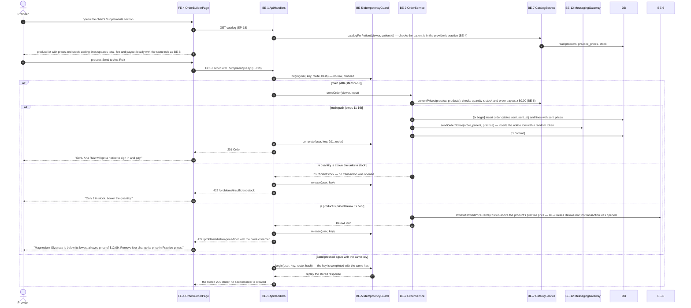
<!-- /diagram -->

- **Trigger:** Dr. Chen opens the Supplements section of Ana Ruiz's chart and presses Send to Ana Ruiz
- **Participants:** Provider (actor), FE-4 OrderBuilderPage, BE-1 ApiHandlers, BE-5 IdempotencyGuard, BE-9 OrderService, BE-7 CatalogService, BE-12 MessagingGateway, DB
- **Preconditions:** signed in as a provider of Ana's practice; at least one product in stock

1. Provider → FE-4: opens the chart's Supplements section
2. FE-4 → BE-1: GET catalog (EP-18)
3. BE-1 → BE-7: catalogForPatient(viewer, patientId) — checks the patient is in the provider's practice (BE-4)
4. BE-7 → DB: read products, practice_prices, stock
5. FE-4 → Provider: product list with prices and stock; adding lines updates total, fee and payout locally with the same rule as BE-6
6. Provider → FE-4: presses Send to Ana Ruiz
7. FE-4 → BE-1: POST order with Idempotency-Key (EP-19)
8. BE-1 → BE-5: begin(user, key, route, hash) — no row, proceed
9. BE-1 → BE-9: sendOrder(viewer, input)
10. BE-9 → BE-7: currentPrices(practice, products); checks quantity ≤ stock and order payout ≥ $0.00 (BE-6)
11. BE-9 → DB: [tx begin] insert order (status sent, sent_at) and lines with sent prices
12. BE-9 → BE-12: sendOrderNotice(order, patient, practice) — inserts the notice row with a random token
13. BE-9 → DB: [tx commit]
14. BE-1 → BE-5: complete(user, key, 201, order)
15. BE-1 → FE-4: 201 Order
16. FE-4 → Provider: "Sent. Ana Ruiz will get a notice to sign in and pay."

**alt a quantity is above the units in stock** (replaces steps 11-16)

- a1. BE-9 → BE-1: InsufficientStock — no transaction was opened
- a2. BE-1 → BE-5: release(user, key)
- a3. BE-1 → FE-4: 422 `/problems/insufficient-stock`
- a4. FE-4 → Provider: "Only 2 in stock. Lower the quantity."

**alt a product is priced below its floor** (replaces steps 11-16)

- a1. BE-9 → BE-6: lowestAllowedPriceCents(cost) is above the product's practice price — BE-9 raises BelowFloor; no transaction was opened
- a2. BE-9 → BE-1: BelowFloor
- a3. BE-1 → BE-5: release(user, key)
- a4. BE-1 → FE-4: 422 `/problems/below-price-floor` with the product named
- a5. FE-4 → Provider: "Magnesium Glycinate is below its lowest allowed price of $12.09. Remove it or change its price in Practice prices."

**alt Send pressed again with the same key** (replaces steps 9-16)

- a1. BE-1 → BE-5: begin(user, key, route, hash) — the key is completed with the same hash
- a2. BE-5 → BE-1: replay the stored response
- a3. BE-1 → FE-4: the stored 201 Order; no second order is created

- **Postconditions:** one `orders` row in `sent` with its lines and one `notices` row; a retried Send with the same key returns the same order
- **Invariants touched:** INV-6, INV-7, LINV-3, LINV-4, LINV-5

### SEQ-2 Review and pay an order · `sequence-pay-order` · covers US-2, US-8, F2, FR-005 to FR-013, FR-022, FR-023, FR-026, FR-027, FR-035 to FR-037, FR-042, AE-005 to AE-012, AE-020, AE-021, AE-023, AE-031

<!-- diagram: sequence-pay-order -->
```mermaid
%% diagram: sequence-pay-order
%% source: docs/architecture/lld.md#seq-2-review-and-pay-an-order-sequence-pay-order-covers-us-2-us-8-f2-fr-005-to-fr-013-fr-022-fr-023-fr-026-fr-027-fr-035-to-fr-037-fr-042-ae-005-to-ae-012-ae-020-ae-021-ae-023-ae-031 @ ef9f129
%% drawn: 2026-10-11T14:42:55Z by draw-diagrams (claude, claude-opus-5-5)
%% render: unverified
%% render-check: mmdc not on PATH
%% missing: 0
%% Generated from the source section. Do not edit by hand: fix the section, then re-run `draw-diagrams sequence-pay-order`.
sequenceDiagram
    autonumber
    actor Patient
    participant FE3 as FE-3 NoticePage
    participant FE2 as FE-2 SignInPage
    participant FE7 as FE-7 PatientOrderPage
    participant FE8 as FE-8 CheckoutStep
    participant BE1 as BE-1 ApiHandlers
    participant BE3 as BE-3 SessionService
    participant BE5 as BE-5 IdempotencyGuard
    participant BE9 as BE-9 OrderService
    participant BE10 as BE-10 PaymentService
    participant BE11 as BE-11 PaymentGateway
    participant BE13 as BE-13 StockService
    participant DB
    Patient->>FE3: opens the notice link (EP-2, EP-24)#59; sees only the practice name
    Patient->>FE2: signs in (EP-15 → BE-3.signIn)#59; lands on her order (FR-042)
    FE7->>BE1: GET order (EP-21) → BE-9.getOrderForViewer: lines at current prices, plus a notice for any price changed since sending
    Patient->>FE8: presses Continue to payment
    FE8->>BE1: POST checkout (EP-22) → BE-9.startCheckout: [tx begin] status sent → in_checkout only if still sent#59; copy current prices into held prices#59; hold until now + 30 min [tx commit]
    FE8-->>Patient: #quot;Your prices are held for 30 minutes, until 2:30 PM.#quot;
    Patient->>FE8: presses Pay $60.00
    FE8->>BE1: POST payment with Idempotency-Key (EP-23)#59; BE-5.begin → proceed
    alt main path (steps 9-15)
        BE1->>BE10: pay(viewer, order, key)
        alt main path (steps 10-15)
            BE10->>DB: (changed, as built, M5-pass3 R3) [tx begin] lock the order#59; check in_checkout and hold live#59; compute the split with BE-6 and check it balances#59; insert attempt processing (LINV-6: a second Pay already in flight loses here with 409 /problems/invalid-transition before touching stock)#59; BE-13.reserveForOrder locks products in id order, lowers stock and appends sale movements [tx commit]
            BE10->>BE11: charge(amount, order, key) — outside any transaction
            alt main path (steps 12-15)
                BE11-->>BE10: succeeded
                BE10->>DB: [tx begin] lock the order#59; write the split, paid prices, unit costs and fee shares on lines#59; insert four ledger entries#59; attempt → succeeded#59; order → paid, paid_at [tx commit — deferred ledger and fee-share checks run here]
                BE1->>BE5: complete(user, key, 201, receipt)
                BE1-->>FE8: 201 Receipt → FE-9 shows #quot;Paid $60.00 on Oct 13, 2026 at 7:30 PM.#quot;
            else the payment provider declines or does not answer
                BE11-->>BE10: failed (declined, or no answer after 10 s)
                BE10->>DB: [tx begin] BE-13.releaseForOrder returns the stock#59; attempt → failed#59; order → payment_failed [tx commit]
                BE1->>BE5: release(user, key)
                BE1-->>FE8: 502 /problems/payment-failed
                FE8-->>Patient: #quot;Your payment didn't go through. No money was taken. Try again.#quot;
            end
        else an item sold out before Ana paid
            BE13->>BE10: (changed) insufficient-stock from reserveForOrder, after the attempt insert, inside transaction 1 → [tx rollback] removes the attempt too#59; no attempt row, no charge#59; the order stays in_checkout#59; BE-19 counts the refusal (D85)
            BE1->>BE5: release(user, key)
            BE1-->>FE8: 422 /problems/insufficient-stock
            FE8-->>Patient: #quot;Omega-3 Fish Oil sold out before you paid. Nothing was charged. Contact your practice to change your order.#quot;
        else the split does not add up
            BE10->>DB: [tx begin] order → needs_review [tx commit]#59; no attempt, no charge
            BE1->>BE5: release(user, key)
            BE1-->>FE8: 422 /problems/order-under-review
            FE8-->>Patient: #quot;We couldn't complete this payment. No money was taken. Your practice will contact you.#quot;
        end
    else Pay pressed again with the same key
        BE1->>BE5: begin(user, key, route, hash) — the key is completed with the same hash
        BE5-->>BE1: replay the stored response
        BE1-->>FE8: the stored 201 Receipt#59; no second charge
    end
```
<!-- /diagram -->

- **Trigger:** Ana opens her notice and signs in
- **Participants:** Patient (actor), FE-3 NoticePage, FE-2 SignInPage, FE-7 PatientOrderPage, FE-8 CheckoutStep, BE-1 ApiHandlers, BE-3 SessionService, BE-5 IdempotencyGuard, BE-9 OrderService, BE-10 PaymentService, BE-11 PaymentGateway, BE-13 StockService, DB
- **Preconditions:** a `sent` order and its notice exist

1. Patient → FE-3: opens the notice link (EP-2, EP-24); sees only the practice name
2. Patient → FE-2: signs in (EP-15 → BE-3.signIn); lands on her order (FR-042)
3. FE-7 → BE-1: GET order (EP-21) → BE-9.getOrderForViewer: lines at current prices, plus a notice for any price changed since sending
4. Patient → FE-8: presses Continue to payment
5. FE-8 → BE-1: POST checkout (EP-22) → BE-9.startCheckout: [tx begin] status sent → in_checkout only if still sent; copy current prices into held prices; hold until now + 30 min [tx commit]
6. FE-8 → Patient: "Your prices are held for 30 minutes, until 2:30 PM."
7. Patient → FE-8: presses Pay $60.00
8. FE-8 → BE-1: POST payment with Idempotency-Key (EP-23); BE-5.begin → proceed
9. BE-1 → BE-10: pay(viewer, order, key)
10. (changed, as built, M5-pass3 R3) BE-10 → DB: [tx begin] lock the order; check in_checkout and hold live; compute the split with BE-6 and check it balances; insert attempt `processing` (LINV-6: a second Pay already in flight loses here with 409 `/problems/invalid-transition` before touching stock); BE-13.reserveForOrder locks products in id order, lowers stock and appends sale movements [tx commit]
11. BE-10 → BE-11: charge(amount, order, key) — outside any transaction
12. BE-11 → BE-10: succeeded
13. BE-10 → DB: [tx begin] lock the order; write the split, paid prices, unit costs and fee shares on lines; insert four ledger entries; attempt → succeeded; order → paid, paid_at [tx commit — deferred ledger and fee-share checks run here]
14. BE-1 → BE-5: complete(user, key, 201, receipt)
15. BE-1 → FE-8: 201 Receipt → FE-9 shows "Paid $60.00 on Oct 13, 2026 at 7:30 PM."

**alt the payment provider declines or does not answer** (replaces steps 12-15)

- a1. BE-11 → BE-10: failed (declined, or no answer after 10 s)
- a2. BE-10 → DB: [tx begin] BE-13.releaseForOrder returns the stock; attempt → failed; order → payment_failed [tx commit]
- a3. BE-1 → BE-5: release(user, key)
- a4. BE-1 → FE-8: 502 `/problems/payment-failed`
- a5. FE-8 → Patient: "Your payment didn't go through. No money was taken. Try again."

**alt an item sold out before Ana paid** (replaces steps 10-15)

- a1. (changed) BE-13 → BE-10: `insufficient-stock` from reserveForOrder, after the attempt insert, inside transaction 1 → [tx rollback] removes the attempt too; no attempt row, no charge; the order stays in_checkout; BE-19 counts the refusal (D85)
- a2. BE-1 → BE-5: release(user, key)
- a3. BE-1 → FE-8: 422 `/problems/insufficient-stock`
- a4. FE-8 → Patient: "Omega-3 Fish Oil sold out before you paid. Nothing was charged. Contact your practice to change your order."

**alt the split does not add up** (replaces steps 10-15)

- a1. BE-10 → DB: [tx begin] order → needs_review [tx commit]; no attempt, no charge
- a2. BE-1 → BE-5: release(user, key)
- a3. BE-1 → FE-8: 422 `/problems/order-under-review`
- a4. FE-8 → Patient: "We couldn't complete this payment. No money was taken. Your practice will contact you."

**alt Pay pressed again with the same key** (replaces steps 9-15)

- a1. BE-1 → BE-5: begin(user, key, route, hash) — the key is completed with the same hash
- a2. BE-5 → BE-1: replay the stored response
- a3. BE-1 → FE-8: the stored 201 Receipt; no second charge

- **Postconditions:** order `paid`; one succeeded attempt; four ledger entries; lines carry paid price, unit cost and fee share; stock lowered with sale movements; or, on failure, no money recorded and any reserved stock returned
- **Invariants touched:** INV-1, INV-2, INV-3, INV-5, INV-6, INV-8, INV-9, LINV-1, LINV-2, LINV-6

### SEQ-3 Check where every cent went · `sequence-audit-order` · covers US-3, F3, FR-013, FR-014, FR-036, FR-050, AE-013, AE-047

<!-- diagram: sequence-audit-order -->
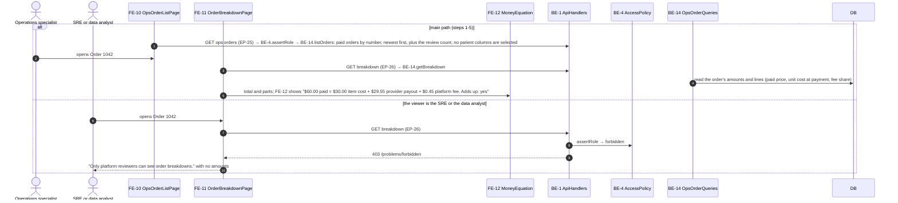
<!-- /diagram -->

- **Trigger:** Omar opens Paid orders
- **Participants:** Operations specialist (actor), SRE or data analyst (actor), FE-10 OpsOrderListPage, FE-11 OrderBreakdownPage, FE-12 MoneyEquation, BE-1 ApiHandlers, BE-4 AccessPolicy, BE-14 OpsOrderQueries, DB
- **Preconditions:** signed in as operations_specialist or finance_lead

1. FE-10 → BE-1: GET ops orders (EP-25) → BE-4.assertRole → BE-14.listOrders: paid orders by number, newest first, plus the review count; no patient columns are selected
2. Operations specialist → FE-10: opens Order 1042
3. FE-11 → BE-1: GET breakdown (EP-26) → BE-14.getBreakdown
4. BE-14 → DB: read the order's amounts and lines (paid price, unit cost at payment, fee share)
5. FE-11 → FE-12: total and parts; FE-12 shows "$60.00 paid = $30.00 item cost + $29.55 provider payout + $0.45 platform fee. Adds up: yes"

**alt the viewer is the SRE or the data analyst** (replaces steps 1-5)

- a1. SRE or data analyst → FE-11: opens Order 1042
- a2. FE-11 → BE-1: GET breakdown (EP-26)
- a3. BE-1 → BE-4: assertRole → forbidden
- a4. BE-1 → FE-11: 403 `/problems/forbidden`
- a5. FE-11 → SRE or data analyst: "Only platform reviewers can see order breakdowns." with no amounts

- **Postconditions:** nothing written
- **Invariants touched:** INV-7, INV-1 (read)

### SEQ-4 Change a price on purpose · `sequence-change-price` · covers US-4, F4, FR-017 to FR-022, AE-015 to AE-020

<!-- diagram: sequence-change-price -->
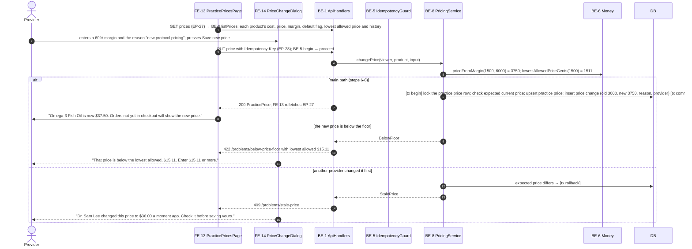
<!-- /diagram -->

- **Trigger:** Dr. Chen chooses Change price on Omega-3
- **Participants:** Provider (actor), FE-13 PracticePricesPage, FE-14 PriceChangeDialog, BE-1 ApiHandlers, BE-5 IdempotencyGuard, BE-8 PricingService, BE-6 Money, DB
- **Preconditions:** signed in as a provider

1. FE-13 → BE-1: GET prices (EP-27) → BE-8.listPrices: each product's cost, price, margin, default flag, lowest allowed price and history
2. Provider → FE-14: enters a 60% margin and the reason "new protocol pricing"; presses Save new price
3. FE-13 → BE-1: PUT price with Idempotency-Key (EP-28); BE-5.begin → proceed
4. BE-1 → BE-8: changePrice(viewer, product, input)
5. BE-8 → BE-6: priceFromMargin(1500, 6000) = 3750; lowestAllowedPriceCents(1500) = 1511
6. BE-8 → DB: [tx begin] lock the practice price row; check expected current price; upsert practice price; insert price change (old 3000, new 3750, reason, provider) [tx commit]
7. BE-1 → FE-13: 200 PracticePrice; FE-13 refetches EP-27
8. FE-13 → Provider: "Omega-3 Fish Oil is now $37.50. Orders not yet in checkout will show the new price."

**alt the new price is below the floor** (replaces steps 6-8)

- a1. BE-8 → BE-1: BelowFloor
- a2. BE-1 → FE-13: 422 `/problems/below-price-floor` with lowest allowed $15.11
- a3. FE-14 → Provider: "That price is below the lowest allowed, $15.11. Enter $15.11 or more."

**alt another provider changed it first** (replaces steps 6-8)

- a1. BE-8 → DB: expected price differs → [tx rollback]
- a2. BE-8 → BE-1: StalePrice
- a3. BE-1 → FE-13: 409 `/problems/stale-price`
- a4. FE-14 → Provider: "Dr. Sam Lee changed this price to $36.00 a moment ago. Check it before saving yours."

- **Postconditions:** one updated `practice_prices` row and one new `price_changes` row; open orders not yet in checkout show the new price with a notice (FR-022), orders in checkout keep their held prices (FR-024)
- **Invariants touched:** INV-4, INV-6, INV-8

### SEQ-5 Check orders, sales and stock · `sequence-practice-dashboard` · covers US-5, US-1, F5, FR-028, FR-029, FR-045 to FR-047, FR-066, FR-067, FR-069, AE-025, AE-026, AE-042 to AE-044, AE-063, AE-064 (changed)

<!-- diagram: sequence-practice-dashboard -->
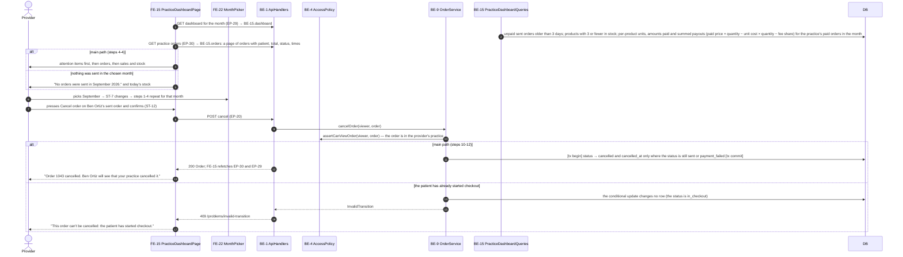
<!-- /diagram -->

- **Trigger:** Dr. Chen opens the practice dashboard
- **Participants:** Provider (actor), FE-15 PracticeDashboardPage, FE-22 MonthPicker, BE-1 ApiHandlers, BE-4 AccessPolicy, BE-9 OrderService, BE-15 PracticeDashboardQueries, DB
- **Preconditions:** signed in as a provider

1. FE-15 → BE-1: GET dashboard for the month (EP-29) → BE-15.dashboard
2. BE-15 → DB: unpaid sent orders older than 3 days; products with 3 or fewer in stock; per-product units, amounts paid and summed payouts (paid price × quantity − unit cost × quantity − fee share) for the practice's paid orders in the month
3. FE-15 → BE-1: GET practice orders (EP-30) → BE-15.orders: a page of orders with patient, total, status, times
4. FE-15 → Provider: attention items first, then orders, then sales and stock
5. Provider → FE-22: picks September → ST-7 changes → steps 1-4 repeat for that month
6. Provider → FE-15: presses Cancel order on Ben Ortiz's sent order and confirms (ST-12)
7. FE-15 → BE-1: POST cancel (EP-20)
8. BE-1 → BE-9: cancelOrder(viewer, order)
9. BE-9 → BE-4: assertCanViewOrder(viewer, order) — the order is in the provider's practice
10. BE-9 → DB: [tx begin] status → cancelled and cancelled_at only where the status is still sent or payment_failed [tx commit]
11. BE-1 → FE-15: 200 Order; FE-15 refetches EP-30 and EP-29
12. FE-15 → Provider: "Order 1043 cancelled. Ben Ortiz will see that your practice cancelled it."

**alt nothing was sent in the chosen month** (replaces step 4)

- a1. FE-15 → Provider: "No orders were sent in September 2026." and today's stock

**alt the patient has already started checkout** (replaces steps 10-12)

- a1. BE-9 → DB: the conditional update changes no row (the status is in_checkout)
- a2. BE-9 → BE-1: InvalidTransition
- a3. BE-1 → FE-15: 409 `/problems/invalid-transition`
- a4. FE-15 → Provider: "This order can't be cancelled: the patient has started checkout."

- **Postconditions:** nothing written, except a cancelled order's status and cancellation time (steps 6-12)
- **Invariants touched:** INV-7, LINV-1 (read: per-product payouts add up to order payouts), INV-4 (paid orders can't be cancelled)

### SEQ-6 Record a stock change · `sequence-adjust-stock` · covers US-5, F6, FR-030, FR-038, AE-027, AE-036

<!-- diagram: sequence-adjust-stock -->
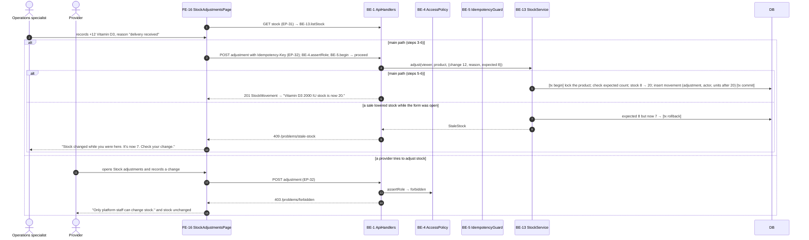
<!-- /diagram -->

- **Trigger:** a delivery arrives and Omar opens Stock adjustments
- **Participants:** Operations specialist (actor), Provider (actor), FE-16 StockAdjustmentsPage, BE-1 ApiHandlers, BE-4 AccessPolicy, BE-5 IdempotencyGuard, BE-13 StockService, DB
- **Preconditions:** signed in as operations_specialist

1. FE-16 → BE-1: GET stock (EP-31) → BE-13.listStock
2. Operations specialist → FE-16: records +12 Vitamin D3, reason "delivery received"
3. FE-16 → BE-1: POST adjustment with Idempotency-Key (EP-32); BE-4.assertRole; BE-5.begin → proceed
4. BE-1 → BE-13: adjust(viewer, product, {change 12, reason, expected 8})
5. BE-13 → DB: [tx begin] lock the product; check expected count; stock 8 → 20; insert movement (adjustment, actor, units after 20) [tx commit]
6. BE-1 → FE-16: 201 StockMovement → "Vitamin D3 2000 IU stock is now 20."

**alt a provider tries to adjust stock** (replaces steps 3-6)

- a1. Provider → FE-16: opens Stock adjustments and records a change
- a2. FE-16 → BE-1: POST adjustment (EP-32)
- a3. BE-1 → BE-4: assertRole → forbidden
- a4. BE-1 → FE-16: 403 `/problems/forbidden`
- a5. FE-16 → Provider: "Only platform staff can change stock." and stock unchanged

**alt a sale lowered stock while the form was open** (replaces steps 5-6)

- a1. BE-13 → DB: expected 8 but now 7 → [tx rollback]
- a2. BE-13 → BE-1: StaleStock
- a3. BE-1 → FE-16: 409 `/problems/stale-stock`
- a4. FE-16 → Operations specialist: "Stock changed while you were here. It's now 7. Check your change."

- **Postconditions:** product stock changed and one adjustment movement appended
- **Invariants touched:** INV-4, INV-5

### SEQ-7 Sign in and idle sign-out · `sequence-sign-in` · covers US-8, F7, FR-039 to FR-042, AE-037 to AE-039

<!-- diagram: sequence-sign-in -->
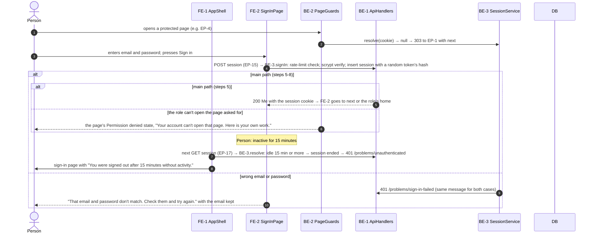
<!-- /diagram -->

- **Trigger:** anyone opens a page while signed out
- **Participants:** Person (actor), FE-1 AppShell, FE-2 SignInPage, BE-2 PageGuards, BE-1 ApiHandlers, BE-3 SessionService, DB
- **Preconditions:** a seeded fictional account exists

1. Person → BE-2: opens a protected page (e.g. EP-4)
2. BE-2 → BE-3: resolve(cookie) → null → 303 to EP-1 with `next`
3. Person → FE-2: enters email and password; presses Sign in
4. FE-2 → BE-1: POST session (EP-15) → BE-3.signIn: rate-limit check; scrypt verify; insert session with a random token's hash
5. BE-1 → FE-2: 200 Me with the session cookie → FE-2 goes to `next` or the role's home
6. Person: inactive for 15 minutes
7. FE-1 → BE-1: next GET session (EP-17) → BE-3.resolve: idle 15 min or more → session ended → 401 `/problems/unauthenticated`
8. FE-1 → Person: sign-in page with "You were signed out after 15 minutes without activity."

**alt wrong email or password** (replaces steps 5-8)

- a1. BE-3 → BE-1: 401 `/problems/sign-in-failed` (same message for both cases)
- a2. FE-2 → Person: "That email and password don't match. Check them and try again." with the email kept

**alt the role can't open the page asked for** (replaces step 5)

- a1. BE-2 → Person: the page's Permission denied state, "Your account can't open that page. Here is your own work."

- **Postconditions:** one live session, or none
- **Invariants touched:** INV-7

### SEQ-8 Find where orders get stuck · `sequence-platform-health` · covers US-6, US-10, F8, FR-032, FR-048, FR-049, FR-053, AE-029, AE-045, AE-046, AE-050

<!-- diagram: sequence-platform-health -->
```mermaid
%% diagram: sequence-platform-health
%% source: docs/architecture/lld.md#seq-8-find-where-orders-get-stuck-sequence-platform-health-covers-us-6-us-10-f8-fr-032-fr-048-fr-049-fr-053-ae-029-ae-045-ae-046-ae-050 @ ef9f129
%% drawn: 2026-10-11T14:43:16Z by draw-diagrams (claude, claude-opus-5-5)
%% render: unverified
%% render-check: mmdc not on PATH
%% missing: 0
%% Generated from the source section. Do not edit by hand: fix the section, then re-run `draw-diagrams sequence-platform-health`.
sequenceDiagram
    autonumber
    actor P1 as Data analyst
    participant FE17 as FE-17 PlatformHealthPage
    participant FE24 as FE-24 OrderFunnel
    participant BE1 as BE-1 ApiHandlers
    participant BE2 as BE-2 PageGuards
    participant BE4 as BE-4 AccessPolicy
    participant BE16 as BE-16 PlatformHealthQueries
    participant DB
    FE17->>BE1: GET health for the month (EP-33) → BE-4.assertRole → BE-16.health
    BE16->>DB: (changed) funnel counts of the month's sent orders by their current state (BE-16 Definitions)#59; median minutes from sent to paid#59; out-of-stock refusals summed from request_stats.stock_refusals (D85)#59; review count#59; paid amounts and fees per practice from ledger entries, and sent and paid order counts per practice
    BE16->>BE16: compares each measure with its alert line (A-11: review count line 1#59; others #quot;set after 30 days#quot;)
    FE17->>FE24: funnel counts → #quot;Sent 10 · Checkout started 9 · Paid 8#quot;#59; the practice list shows its first 25 rows (changed)
    alt main path (steps 5)
        FE17->>P1: #quot;1 measure needs attention: orders needing review (1)#quot; on top
    else the analyst tries to open a single order from a total
        P1->>BE2: types an order breakdown URL (EP-6)#59; FE-17 offers no link from totals
        BE2->>BE4: assertRole → forbidden
        BE2-->>P1: the page's Permission denied state, #quot;Your role shows totals only.#quot;
    end
```
<!-- /diagram -->

- **Trigger:** Dana opens Platform health
- **Participants:** Data analyst (actor), FE-17 PlatformHealthPage, FE-24 OrderFunnel, BE-1 ApiHandlers, BE-2 PageGuards, BE-4 AccessPolicy, BE-16 PlatformHealthQueries, DB
- **Preconditions:** signed in as finance_lead, operations_specialist or data_analyst

1. FE-17 → BE-1: GET health for the month (EP-33) → BE-4.assertRole → BE-16.health
2. (changed) BE-16 → DB: funnel counts of the month's sent orders by their current state (BE-16 Definitions); median minutes from sent to paid; out-of-stock refusals summed from `request_stats.stock_refusals` (D85); review count; paid amounts and fees per practice from ledger entries, and sent and paid order counts per practice
3. BE-16 → BE-16: compares each measure with its alert line (A-11: review count line 1; others "set after 30 days")
4. FE-17 → FE-24: funnel counts → "Sent 10 · Checkout started 9 · Paid 8"; the practice list shows its first 25 rows (changed)
5. FE-17 → Data analyst: "1 measure needs attention: orders needing review (1)" on top

**alt the analyst tries to open a single order from a total** (replaces step 5)

- a1. Data analyst → BE-2: types an order breakdown URL (EP-6); FE-17 offers no link from totals
- a2. BE-2 → BE-4: assertRole → forbidden
- a3. BE-2 → Data analyst: the page's Permission denied state, "Your role shows totals only."

- **Postconditions:** nothing written
- **Invariants touched:** INV-7

### SEQ-9 Close the month · `sequence-financial-report` · covers US-9, F9, FR-051, FR-060 to FR-065, AE-055 to AE-060, AE-048

<!-- diagram: sequence-financial-report -->
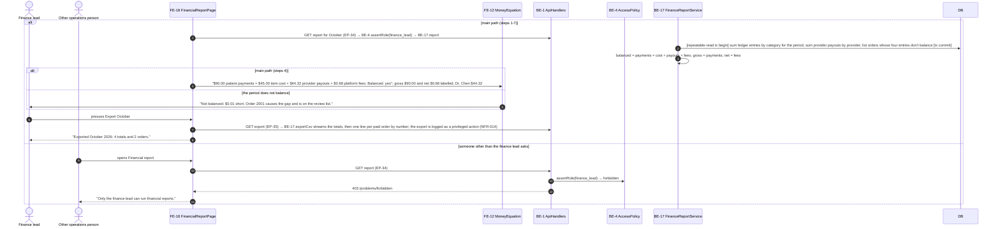
<!-- /diagram -->

- **Trigger:** Fran opens Financial report and picks October
- **Participants:** Finance lead (actor), Other operations person (actor), FE-18 FinancialReportPage, FE-12 MoneyEquation, BE-1 ApiHandlers, BE-4 AccessPolicy, BE-17 FinanceReportService, DB
- **Preconditions:** signed in as finance_lead

1. FE-18 → BE-1: GET report for October (EP-34) → BE-4.assertRole(finance_lead) → BE-17.report
2. BE-17 → DB: [repeatable-read tx begin] sum ledger entries by category for the period; sum provider payouts by provider; list orders whose four entries don't balance [tx commit]
3. BE-17 → BE-17: balanced = payments = cost + payouts + fees; gross = payments; net = fees
4. FE-18 → FE-12: "$90.00 patient payments = $45.00 item cost + $44.32 provider payouts + $0.68 platform fees. Balanced: yes"; gross $90.00 and net $0.68 labelled; Dr. Chen $44.32
5. Finance lead → FE-18: presses Export October
6. FE-18 → BE-1: GET export (EP-35) → BE-17.exportCsv streams the totals, then one line per paid order by number; the export is logged as a privileged action (NFR-014)
7. FE-18 → Finance lead: "Exported October 2026: 4 totals and 2 orders."

**alt the period does not balance** (replaces step 4)

- a1. FE-12 → Finance lead: "Not balanced: $0.01 short. Order 2001 causes the gap and is on the review list."

**alt someone other than the finance lead asks** (replaces steps 1-7)

- a1. Other operations person → FE-18: opens Financial report
- a2. FE-18 → BE-1: GET report (EP-34)
- a3. BE-1 → BE-4: assertRole(finance_lead) → forbidden
- a4. BE-1 → FE-18: 403 `/problems/forbidden`
- a5. FE-18 → Other operations person: "Only the finance lead can run financial reports."

- **Postconditions:** nothing written except the request statistics and the export's log line
- **Invariants touched:** INV-9, INV-7

### SEQ-10 Grant or remove an operations role · `sequence-change-role` · covers US-10, F10, FR-054 to FR-056, AE-051 to AE-053

<!-- diagram: sequence-change-role -->
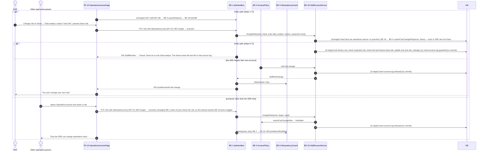
<!-- /diagram -->

- **Trigger:** Sam opens Operations access to give Dana a role
- **Participants:** SRE (actor), Other operations person (actor), FE-19 OperationsAccessPage, BE-1 ApiHandlers, BE-4 AccessPolicy, BE-5 IdempotencyGuard, BE-18 StaffAccessService, DB
- **Preconditions:** signed in as sre

1. (changed) FE-19 → BE-1: GET staff (EP-36) → BE-4.assertRole(sre) → BE-18.listStaff
2. SRE → FE-19: Change role on Dana → Data analyst, reason "new hire"; presses Save role
3. FE-19 → BE-1: PUT role with Idempotency-Key (EP-37); BE-5.begin → proceed
4. BE-1 → BE-18: changeRole(actor, Dana, {role data_analyst, reason, expected none})
5. (changed) BE-18 → DB: load Dana (an operations person: no practice); BE-18 → BE-4: assertCanChangeRole(actor, Dana) — actor is SRE and not Dana
6. BE-18 → DB: [tx begin] lock Dana's row; check expected role; check the last-finance-lead rule; update role and role_changed_at; insert access log (granted) [tx commit]
7. BE-1 → FE-19: 200 StaffMember → "Saved. Dana Ito is now Data analyst. The finance lead will see this in the access log."

**alt the SRE targets their own account** (replaces steps 6-7)

- a1. BE-4 → BE-18: self-role-change
- a2. BE-18 → DB: [tx begin] insert access log (refused) [tx commit]
- a3. BE-18 → BE-1: SelfRoleChange
- a4. BE-1 → BE-5: release(user, key)
- a5. BE-1 → FE-19: 403 `/problems/self-role-change`
- a6. FE-19 → SRE: "You can't change your own role."

**alt someone other than the SRE tries** (replaces steps 1-7)

- a1. Other operations person → FE-19: opens Operations access and saves a role
- a2. FE-19 → BE-1: PUT role with Idempotency-Key (EP-37); BE-5.begin → proceed; (changed) BE-1 does not pre-check the role, so the refusal reaches BE-18 and is logged
- a3. BE-1 → BE-18: changeRole(actor, target, input)
- a4. BE-18 → BE-4: assertCanChangeRole → forbidden
- a5. BE-18 → DB: [tx begin] insert access log (refused) [tx commit]
- a6. BE-1 → BE-5: release(user, key); BE-1 → FE-19: 403 `/problems/forbidden`
- a7. FE-19 → Other operations person: "Only the SRE can change operations roles."

- **Postconditions:** one role changed and one access log row, or one refused log row and no change
- **Invariants touched:** INV-10, INV-4

### SEQ-11 Review the access log · `sequence-access-log` · covers US-10, F11, FR-057, AE-054

<!-- diagram: sequence-access-log -->
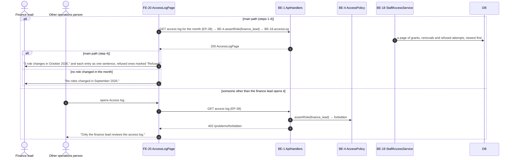
<!-- /diagram -->

- **Trigger:** Fran opens Access log for October
- **Participants:** Finance lead (actor), Other operations person (actor), FE-20 AccessLogPage, BE-1 ApiHandlers, BE-4 AccessPolicy, BE-18 StaffAccessService, DB
- **Preconditions:** signed in as finance_lead

1. FE-20 → BE-1: GET access log for the month (EP-38) → BE-4.assertRole(finance_lead) → BE-18.accessLog
2. BE-18 → DB: a page of grants, removals and refused attempts, newest first
3. BE-1 → FE-20: 200 AccessLogPage
4. FE-20 → Finance lead: "3 role changes in October 2026." and each entry as one sentence, refused ones marked "Refused"

**alt no role changed in the month** (replaces step 4)

- a1. FE-20 → Finance lead: "No roles changed in September 2026."

**alt someone other than the finance lead opens it** (replaces steps 1-4)

- a1. Other operations person → FE-20: opens Access log
- a2. FE-20 → BE-1: GET access log (EP-38)
- a3. BE-1 → BE-4: assertRole(finance_lead) → forbidden
- a4. BE-1 → FE-20: 403 `/problems/forbidden`
- a5. FE-20 → Other operations person: "Only the finance lead reviews the access log."

- **Postconditions:** nothing written
- **Invariants touched:** INV-10 (reviewed by someone other than the actor)

### SEQ-12 Check system health · `sequence-system-health` · covers US-10, F12, FR-058, FR-059, AE-061, AE-062

<!-- diagram: sequence-system-health -->
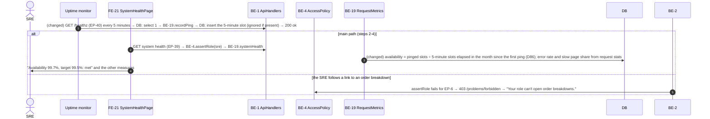
<!-- /diagram -->

- **Trigger:** Sam opens System health for October
- **Participants:** SRE (actor), Uptime monitor (external), FE-21 SystemHealthPage, BE-1 ApiHandlers, BE-4 AccessPolicy, BE-19 RequestMetrics, DB
- **Preconditions:** signed in as sre; the uptime monitor calls EP-40 every 5 minutes (changed, `docs/ops/HEALTH.md` §4)

1. (changed) Uptime monitor → BE-1: GET /healthz (EP-40) every 5 minutes → DB: `select 1` → BE-19.recordPing → DB: insert the 5-minute slot (ignored if present) → 200 `ok`
2. FE-21 → BE-1: GET system health (EP-39) → BE-4.assertRole(sre) → BE-19.systemHealth
3. (changed) BE-19 → DB: availability = pinged slots ÷ 5-minute slots elapsed in the month since the first ping (D86); error rate and slow page share from request stats
4. FE-21 → SRE: "Availability 99.7%, target 99.5%: met" and the other measures

**alt the SRE follows a link to an order breakdown** (replaces steps 2-4)

- a1. BE-2 → BE-4: assertRole fails for EP-6 → 403 `/problems/forbidden` → "Your role can't open order breakdowns."

- **Postconditions:** ping slots recorded (changed)
- **Invariants touched:** INV-7

## 6. State machines

### SM-1 Order lifecycle · `orders.status` · `state-order`

<!-- diagram: state-order -->
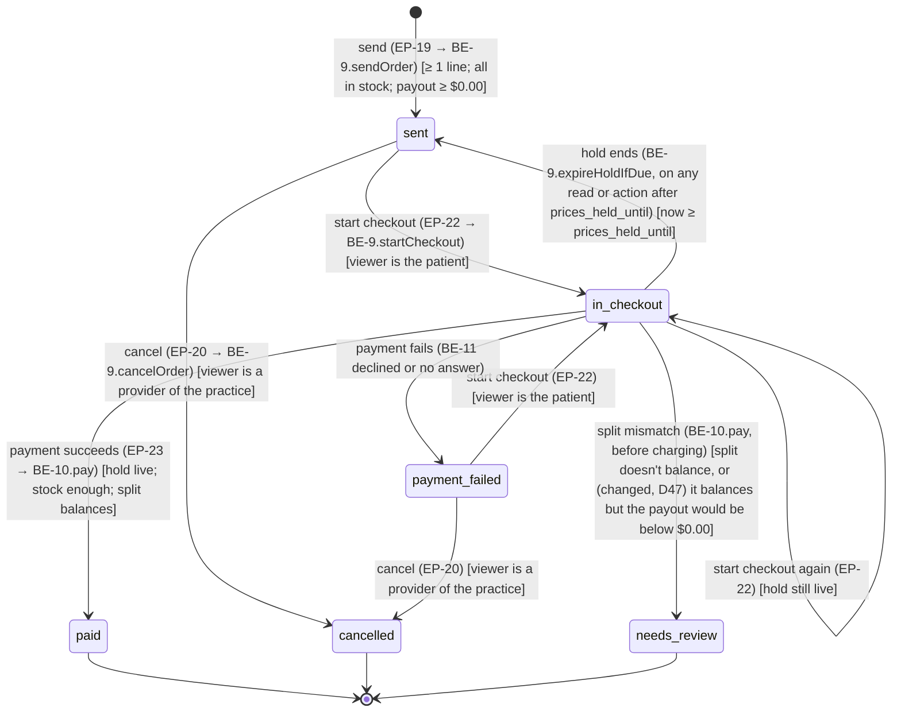
<!-- /diagram -->

- **Initial:** `sent` · **Terminal:** `paid`, `cancelled`, `needs_review` · **Stored in:** CHECK `ck_orders_status`
- **Enforced in:** BE-9 and BE-10, each transition a conditional update ("change to X only where the status is still Y", checking the affected-row count), so two racing requests can't both win; (changed, proposed D84) every 409 `/problems/invalid-transition` names `from` and `event`

| State | Meaning |
|---|---|
| `sent` | the patient can see it; prices follow the practice price, with notices for changes |
| `in_checkout` | prices held until `prices_held_until` |
| `payment_failed` | the last attempt failed; no money taken |
| `paid` | split, ledger and stock recorded; frozen |
| `needs_review` | the split didn't add up before charging; frozen until corrections exist (Later) |
| `cancelled` | the provider cancelled it before checkout (Q-1); frozen |

| From | Event (trigger) | Guard | To | Side effects | If illegal |
|---|---|---|---|---|---|
| — | send (EP-19 → BE-9.sendOrder) | ≥ 1 line; all in stock; payout ≥ $0.00 | `sent` | insert lines and the notice | 422 problems from §4 |
| `sent` | start checkout (EP-22 → BE-9.startCheckout) | viewer is the patient | `in_checkout` | copy current prices into held prices; hold 30 min | 409 `/problems/invalid-transition` |
| `payment_failed` | start checkout (EP-22) | viewer is the patient | `in_checkout` | new hold at current prices | 409 `/problems/invalid-transition` |
| `in_checkout` | start checkout again (EP-22) | hold still live | `in_checkout` | none (same hold returned) | — |
| `in_checkout` | hold ends (BE-9.expireHoldIfDue, on any read or action after `prices_held_until`) | now ≥ prices_held_until | `sent` | clear held prices | — |
| `in_checkout` | payment succeeds (EP-23 → BE-10.pay) | hold live; stock enough; split balances | `paid` | split, fee shares, ledger, stock movements, paid_at | 409 `/problems/checkout-expired` or `/problems/invalid-transition` |
| `in_checkout` | payment fails (BE-11 declined or no answer) | — | `payment_failed` | attempt failed | — |
| `in_checkout` | split mismatch (BE-10.pay, before charging) | split doesn't balance, or (changed, D47) it balances but the payout would be below $0.00 | `needs_review` | none; no charge | — |
| `sent` | cancel (EP-20 → BE-9.cancelOrder) | viewer is a provider of the practice | `cancelled` | cancelled_at | 409 `/problems/invalid-transition` |
| `payment_failed` | cancel (EP-20) | viewer is a provider of the practice | `cancelled` | cancelled_at | 409 `/problems/invalid-transition` |

### SM-2 Payment attempt · `payment_attempts.status` · `state-payment-attempt`

<!-- diagram: state-payment-attempt -->
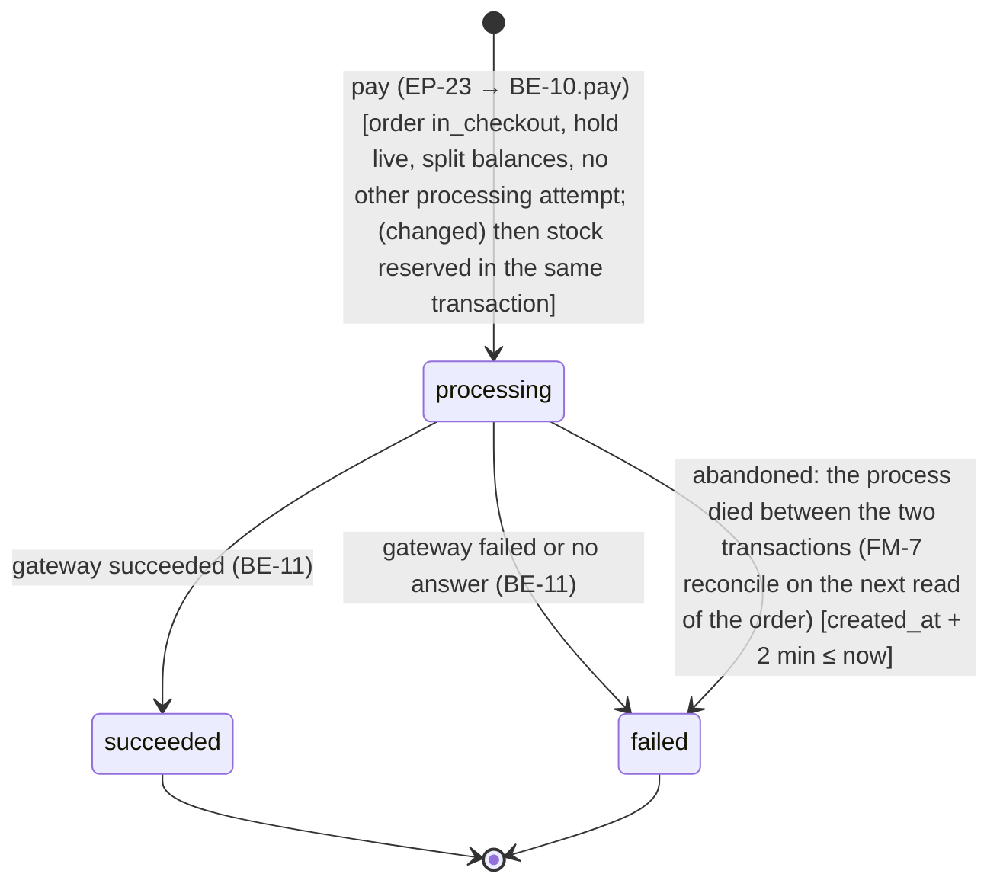
<!-- /diagram -->

- **Initial:** `processing` · **Terminal:** `succeeded`, `failed` · **Stored in:** CHECK `ck_payment_attempts_status`
- **Enforced in:** BE-10.pay with conditional updates; `uq_payment_attempts_one_processing` and `uq_payment_attempts_one_success` stop two attempts racing

| State | Meaning |
|---|---|
| `processing` | the charge was requested; outcome not yet recorded |
| `succeeded` | money taken; the order is paid in the same transaction |
| `failed` | (changed) declined or no answer (`failure_reason` set, order payment_failed), or closed by FM-3 or FM-7 (no reason); no money recorded. A sold-out item leaves no attempt at all: its insert rolls back with transaction 1 |

| From | Event (trigger) | Guard | To | Side effects | If illegal |
|---|---|---|---|---|---|
| — | pay (EP-23 → BE-10.pay) | order in_checkout, hold live, split balances, no other processing attempt; (changed) then stock reserved in the same transaction | `processing` | stock reserved with sale movements | 409 `/problems/invalid-transition` (another attempt processing); 422 `/problems/insufficient-stock` (the insert rolls back) |
| `processing` | gateway succeeded (BE-11) | — | `succeeded` | order paid; split, fee shares and ledger written | — |
| `processing` | gateway failed or no answer (BE-11) | — | `failed` | stock released; order payment_failed | — |
| `processing` | abandoned: the process died between the two transactions (FM-7 reconcile on the next read of the order) | created_at + 2 min ≤ now | `failed` | stock released; order payment_failed | — |

### SM-3 Idempotency key · `idempotency_keys.status` · `state-idempotency-key`

<!-- diagram: state-idempotency-key -->
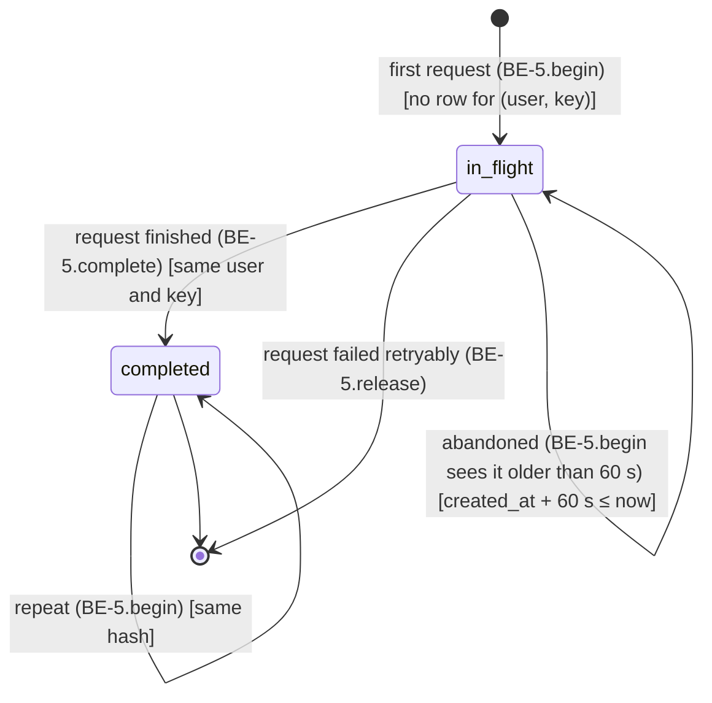
<!-- /diagram -->

- **Initial:** `in_flight` · **Terminal:** `completed` (replayed for 24 h); a released key ends its life by deletion, so a retry starts again from Initial · **Stored in:** CHECK `ck_idempotency_keys_status`
- **Enforced in:** BE-5 with an insert that fails on the primary key for a repeat, and conditional updates

| State | Meaning |
|---|---|
| `in_flight` | the first request with this key is running |
| `completed` | its response is stored and replayed for 24 h |

| From | Event (trigger) | Guard | To | Side effects | If illegal |
|---|---|---|---|---|---|
| — | first request (BE-5.begin) | no row for (user, key) | `in_flight` | store route and request hash | — |
| `in_flight` | request finished (BE-5.complete) | same user and key | `completed` | store status and body | — |
| `in_flight` | request failed retryably (BE-5.release) | — | end (row deleted; the lifecycle ends) | a retry with the same key starts at `in_flight` again | — |
| `in_flight` | abandoned (BE-5.begin sees it older than 60 s) | created_at + 60 s ≤ now | `in_flight` (taken over by the new request) | FM-6 | — |
| `completed` | repeat (BE-5.begin) | same hash | `completed` | replay the stored response | 422 `/problems/idempotency-mismatch` when the hash differs |

## 7. Invariants → enforcement

| Id | Invariant (always true) | Primary enforcer (exact) | Backup layer | Proven by | Basis |
|---|---|---|---|---|---|
| INV-1 | for every paid order, item cost + provider payout + platform fee = amount paid, to the cent | `ck_orders_split_balances` CHECK | BE-6.assertSplitBalances before charging (moves a bad split to needs_review) | integration test against PostgreSQL 16 that writes an unbalanced paid order and expects the refusal; AE-009, AE-012 | HLD §7 |
| INV-2 | an order is paid at most once | `uq_payment_attempts_one_success` partial unique | BE-5 idempotency replay; `uq_payment_attempts_one_processing` | integration test: two concurrent pays with different keys, exactly one succeeds; AE-006 | HLD §7 |
| INV-3 | every amount is whole cents | `integer` column types on every money column | BE-6 does integer-only arithmetic; Zod schemas reject non-integers | unit tests of BE-6 with half-cent cases; AE-010, AE-011 | HLD §7, AGENTS.md:57 |
| INV-4 | paid money records, ledger entries, price, stock and access history are never changed or deleted | database grants (app user: INSERT and SELECT only on history tables; no DELETE on orders and lines) + `tg_orders_paid_frozen`, `tg_order_lines_paid_frozen` | no update or delete code path exists in BE-8, BE-10, BE-13, BE-18 | integration test that tries an UPDATE and a DELETE as the app user and expects permission errors; AE-014, AE-019 | HLD §7 |
| INV-5 | stock is never below zero | `ck_products_stock_nonneg` CHECK | BE-13 locks the product row and checks before lowering | integration test: two payments for the last unit, one refused with no charge; AE-023, AE-024 | HLD §7 |
| INV-6 | a provider's payout after the fee is never below $0.00 | `ck_orders_payout_nonneg` CHECK at payment | BE-9.sendOrder and BE-8.changePrice check with BE-6.lowestAllowedPriceCents | unit tests of BE-6; integration tests AE-003, AE-018 | HLD §7 |
| INV-7 | a person sees only their own orders or their practice's; operations never see patient identity | BE-4 AccessPolicy on every API call and page (one code path) + BE-14, BE-16, BE-17 select no patient columns | composite FKs keep orders inside one practice (LINV-3) | API tests per role matrix (every EP × every role); AE-007, AE-008, AE-047, AE-061 | HLD §7 |
| INV-8 | a patient in checkout pays the prices fixed at checkout start | transaction in BE-9.startCheckout copies prices to `held_unit_price_cents`; BE-10 reads only held prices | `ck_orders_hold_when_in_checkout` | integration test: price change during checkout, payment uses held prices; AE-021 | HLD §7 |
| INV-9 | a period's report totals equal the sum of that period's ledger entries | BE-17 sums `ledger_entries` only, in one repeatable-read transaction | `ct_ledger_entries_balance` keeps each order's entries consistent | integration test building October's report; AE-055, AE-056 | HLD §7 |
| INV-10 | only the SRE changes operations roles, never their own | BE-4.assertCanChangeRole on the single path BE-18.changeRole | every attempt, refused ones included, written to `access_log` for the finance lead | API tests AE-052, AE-053 | HLD §7 |
| **LINV-1** | a paid order's line fee shares add up to its platform fee | constraint trigger `ct_order_lines_fee_shares_sum` at commit | BE-6.allocateFee (largest remainder) | unit test of allocateFee with the three-$1.00 case (shares sum to $0.02); integration test | new in LLD (Q-2) — confirm at G3 |
| **LINV-2** | each paid order's four ledger entries balance and match the order's own amounts | constraint trigger `ct_ledger_entries_balance` at commit | written in the same transaction as the order's split | integration test that inserts a mismatched entry and expects the commit to fail | new in LLD (D35) — confirm at G3 |
| **LINV-3** | an order's provider and patient both belong to the order's practice | composite FKs `fk_orders_provider_in_practice`, `fk_orders_patient_in_practice` | BE-4.assertCanActOnPatient | integration test with a patient from another practice | new in LLD (A-5) — confirm at G3 |
| **LINV-4** | an order has at most one line per product | `uq_order_lines_order_product` | BE-9 merges repeats of a product into one quantity | integration test | new in LLD — confirm at G3 |
| **LINV-5** | a patient notice never holds items, quantities or amounts | `notices` has no column for them; BE-12's input type has no such field | review of the messaging seam when a real provider is added | unit test of the notice text; AE-041 | new in LLD (FR-044) — confirm at G3 |
| **LINV-6** | at most one payment is in flight per order | `uq_payment_attempts_one_processing` partial unique | BE-5 in-flight key check | integration test: two concurrent pays, the second gets 409 | new in LLD — confirm at G3 |

## 8. Error handling & failure modes

### Error policy

- **User sees:** the screen's exact copy from `docs/design/screens.md` for each problem type (FE-23 maps type → copy) and a recovery action; never stack traces, SQL or internal ids
- **Logged:** one structured line per request: correlation id, route group, role, status, problem type, duration; never names, emails, items, amounts or tokens (NFR-010)
- **Correlation id:** `X-Request-Id`, generated at the edge when absent, echoed in every problem's `instance` (`/requests/<id>`)
- **Unexpected errors:** 500 `/problems/internal` with the correlation id; the transaction rolls back
- **Validation:** Zod schemas in BE-1 run before any service; failures return 422 `/problems/validation` with `errors[]` of JSON pointers into the body

### Failure modes

| Id | Failure | Where | Detection | Timeout / retry | User sees | Data left | Alert / log |
|---|---|---|---|---|---|---|---|
| **FM-1** | payment provider declines | L-3, BE-11 | `failed`/`declined` outcome | no automatic retry; the patient may press Pay again with a new key | "Your payment didn't go through. No money was taken. Try again." | attempt failed; stock released; order payment_failed | info log with order number |
| **FM-2** | payment provider doesn't answer | L-3, BE-11 | 10 s timeout | no blind retry (not safe); later, ask the provider for the key's status before retrying | same as FM-1 | as FM-1; later integration voids any authorisation by key | warn log + error count in request stats |
| **FM-3** | database fails during either payment transaction | L-2, BE-10 | driver error or 5 s statement timeout | transaction rolls back; (changed) the attempt closes as `failed` with no `failure_reason` and the order stays as it was; BE-5.release lets the patient retry the same key | "We couldn't complete your payment. No money was taken. Try again." (Our failure copy) | nothing half-written: each transaction is all or nothing | error log + 5xx count |
| **FM-4** | messaging fails when sending an order | L-4, BE-12 | stub can't fail; later a provider error | later: send after commit with 3 retries, backoff 1 s, 4 s, 16 s plus jitter | the provider still sees "Sent"; later the dashboard marks the notice undelivered | order sent; notice row present | warn log |
| **FM-5** | split doesn't add up | BE-10 before charging | BE-6.assertSplitBalances | none | "We couldn't complete this payment" | order needs_review; no attempt | review count alert (line 1, A-11) |
| **FM-6** | a request dies holding an in-flight idempotency key | BE-5 | in-flight row older than 60 s on the next begin | the next request with that key takes it over | normal result on retry | at most one stale in-flight row | info log |
| **FM-7** | the process dies between payment transaction 1 and 2 | BE-10 | a `processing` attempt older than 2 minutes, found by BE-9.expireHoldIfDue (changed: called at the start of BE-10.pay and BE-9.startCheckout as well as on EP-21 reads) or the next pay on that order | reconcile: in the stub treat as no answer; later ask the provider by key first | the order shows payment failed; "Try again" | stock returned with sale_release movements; attempt failed | warn log |
| **FM-8** | request statistics or ping write fails (changed) | BE-19 | driver error | none; the request still succeeds (`/healthz` still answers `ok`) | nothing | one hour's counts slightly low, or one slot unpinged (reads as down) | warn log with `errorFacts` only |
| **FM-9** | export fails part-way | EP-35, BE-17 | stream error | none | "We couldn't prepare the export. Nothing was downloaded. Try again." | nothing written | error log |

## 9. Test seams

| Id | Seam (what varies) | Real implementation | Fake in tests | Swapped where | Test levels |
|---|---|---|---|---|---|
| **SEAM-1** | clock | BE-20 returning the system time | a frozen, steppable clock | BE-20 provided through the Nitro app context; tests install the fake | unit, integration, API |
| **SEAM-2** | random tokens and keys (session tokens, notice tokens) | Node `crypto.randomBytes`, called directly by BE-3 and BE-12 | not faked (changed, D72): tokens are opaque and stored or compared only by hash, so no test needs a known value | none | unit, integration |
| **SEAM-3** | payment provider | BE-11 stub with modes succeed, decline, no_answer (real provider later) | BE-11 set to the mode each test needs | environment value `PAYMENT_STUB_MODE` per test, or a direct override in integration tests | integration, API, acceptance |
| **SEAM-4** | messaging | BE-12 writing `notices` (real email or text later) | the same stub; tests read the `notices` row | none needed in the slice | integration, acceptance |
| **SEAM-5** | signed-in person | BE-3 with a real session | a test helper that signs in a seeded account through EP-15 | test fixtures | API, acceptance |
| **SEAM-6** | password hashing cost | scrypt with production cost | scrypt with a low cost | environment value `SCRYPT_COST` | integration, API |
| **SEAM-7** | uptime monitor | an outside monitor calling EP-40 every 5 minutes (changed) | tests call EP-40 with the SEAM-1 clock frozen, or insert `health_pings` slots | none needed | integration |

**Never faked:** the PostgreSQL 16 engine in every constraint, trigger, grant and transaction test (Docker locally, the same major version as production); BE-6 Money; the component under test.

## 10. Diagram requests

| Job | Draw from | Must show | Placeholder in |
|---|---|---|---|
| `draw-diagrams erd` | `docs/architecture/lld.md#1-data-model` | every table; PK/FK columns; cardinality from Relationships | §1 |
| `draw-diagrams be-class` | `docs/architecture/lld.md#2-backend-components` | every BE id with its public methods; dependency arrows | §2 |
| `draw-diagrams fe-components` | `docs/architecture/lld.md#3-frontend-components` | the component tree; each node's owned state; props/events arrows | §3 |
| `draw-diagrams sequence-send-order` | `docs/architecture/lld.md#SEQ-1 Build and send an order` | participants and messages in order; every alt branch | §5 SEQ-1 |
| `draw-diagrams sequence-pay-order` | `docs/architecture/lld.md#SEQ-2 Review and pay an order` | participants and messages in order; every alt branch | §5 SEQ-2 |
| `draw-diagrams sequence-audit-order` | `docs/architecture/lld.md#SEQ-3 Check where every cent went` | participants and messages in order; every alt branch | §5 SEQ-3 |
| `draw-diagrams sequence-change-price` | `docs/architecture/lld.md#SEQ-4 Change a price on purpose` | participants and messages in order; every alt branch | §5 SEQ-4 |
| `draw-diagrams sequence-practice-dashboard` | `docs/architecture/lld.md#SEQ-5 Check orders, sales and stock` | participants and messages in order; every alt branch | §5 SEQ-5 |
| `draw-diagrams sequence-adjust-stock` | `docs/architecture/lld.md#SEQ-6 Record a stock change` | participants and messages in order; every alt branch | §5 SEQ-6 |
| `draw-diagrams sequence-sign-in` | `docs/architecture/lld.md#SEQ-7 Sign in and idle sign-out` | participants and messages in order; every alt branch | §5 SEQ-7 |
| `draw-diagrams sequence-platform-health` | `docs/architecture/lld.md#SEQ-8 Find where orders get stuck` | participants and messages in order; every alt branch | §5 SEQ-8 |
| `draw-diagrams sequence-financial-report` | `docs/architecture/lld.md#SEQ-9 Close the month` | participants and messages in order; every alt branch | §5 SEQ-9 |
| `draw-diagrams sequence-change-role` | `docs/architecture/lld.md#SEQ-10 Grant or remove an operations role` | participants and messages in order; every alt branch | §5 SEQ-10 |
| `draw-diagrams sequence-access-log` | `docs/architecture/lld.md#SEQ-11 Review the access log` | participants and messages in order; every alt branch | §5 SEQ-11 |
| `draw-diagrams sequence-system-health` | `docs/architecture/lld.md#SEQ-12 Check system health` | participants and messages in order; every alt branch | §5 SEQ-12 |
| `draw-diagrams state-order` | `docs/architecture/lld.md#SM-1 Order lifecycle` | every state; transitions labelled event [guard]; terminal states | §6 SM-1 |
| `draw-diagrams state-payment-attempt` | `docs/architecture/lld.md#SM-2 Payment attempt` | every state; transitions labelled event [guard]; terminal states | §6 SM-2 |
| `draw-diagrams state-idempotency-key` | `docs/architecture/lld.md#SM-3 Idempotency key` | every state; transitions labelled event [guard]; terminal states | §6 SM-3 |

## Decisions

### D38 Web framework for the one deployable  [status: superseded-by D44]

- **Question:** which framework runs the server-rendered Vue pages and the JSON API in one Node.js process.
- **Forces:** D32 (TypeScript, server-rendered Vue), D36 (one deployable, API-first), NFR-001, appetite 1-2 days
- **Reversibility:** Type 1 one-way · **Confidence:** high

| Option | Pros | Cons | Cost (build + run) | Basis |
|---|---|---|---|---|
| Do nothing / simplest: plain Node HTTP server with Vue's server renderer, wired by hand | no framework to learn; full control | routing, server rendering, hydration and asset building all hand-written; slow to build and easy to get wrong | +2 days; same hosting | D32 |
| Nuxt 4 (Vue's own full-stack framework: server-rendered pages plus server API routes in one Node app) | one process serves pages and the API on one origin, exactly D36; Vue is Cerbo's front end (R01); file-based routes map one-to-one to EP rows | a framework's conventions to follow; its server layer (Nitro) is less common than Express | baseline; same hosting | D36, R01 |
| Express API plus a Vue app built with Vite's server rendering | Express is the most familiar Node server | two halves to glue together for server rendering; more setup than Nuxt for the same result | +1 day | — |

- **Recommendation:** Nuxt 4
- **Version check:** npm registry `npm view nuxt dist-tags`, checked 2026-10-10 (Change log 2026-10-10 11:30 CDT); recorded in the journal as D44, which supersedes this block's journal entry
- **Why (Y-statement):** In the context of one deployable that must serve server-rendered Vue pages and a same-origin JSON API, facing a 1-2 day appetite, we choose Nuxt 4 over a hand-wired server or Express plus Vite to get pages and API routes in one app with no glue, accepting Nuxt's conventions.
- **In plain words:** Nuxt is Vue's own framework for exactly this: pages and an API in one app.
- **First proposal (instead of):** same as recommendation.
- **Revisit if:** Cerbo wants the API in another back end, then the API routes move and the Vue pages stay.
- **Interview line:** "Nuxt gave me server-rendered Vue and the JSON API in one process, which is the one-deployable, API-first shape I chose."
- **Default if you don't answer:** stays proposed; nothing downstream may build on it.

### D39 Database access and migrations  [status: accepted]

- **Question:** how the app talks to PostgreSQL and how the schema is created and changed.
- **Forces:** INV-1 to INV-5, LINV-1 to LINV-6 (partial unique indexes, constraint triggers, grants), D33, AGENTS.md:57
- **Reversibility:** Type 2 two-way · **Confidence:** med

| Option | Pros | Cons | Cost (build + run) | Basis |
|---|---|---|---|---|
| Do nothing / simplest: the `pg` driver with hand-written SQL strings and SQL migration files | nothing between us and PostgreSQL | no type checking of queries; column typos found only at run time | baseline | — |
| Kysely (a typed SQL query builder) plus plain SQL migration files | queries are type-checked against the schema; migrations are raw SQL, so partial indexes, constraint triggers and grants are written directly | types must be regenerated after each migration | +0.25 day | D33, §1 |
| Prisma (an ORM with its own schema language) | fast to start; generated client | partial unique indexes, constraint triggers and per-table grants need raw SQL escapes anyway; hides the transactions this design depends on | +0.5 day of workarounds | §1, §7 |

- **Recommendation:** Kysely plus plain SQL migration files
- **Why (Y-statement):** In the context of a design whose money rules live in PostgreSQL constraints, triggers and grants, facing the need to also type-check queries in TypeScript, we choose Kysely with SQL migrations over raw strings or Prisma to get typed queries without hiding the database features we rely on, accepting a type-regeneration step after each migration.
- **In plain words:** Write the database rules in plain SQL, and let TypeScript check every query against them.
- **First proposal (instead of):** same as recommendation.
- **Revisit if:** the team standardises on another data layer.
- **Interview line:** "The money rules are database constraints, so I kept the migrations in plain SQL and used a typed query builder rather than an ORM that would hide them."
- **Default if you don't answer:** stays proposed; nothing downstream may build on it.

### D40 Primary keys and order numbers  [status: accepted]

- **Question:** what kind of id every table uses, and whether the order number is the id.
- **Forces:** S3, S4, S11 show "Order 1042"; FR-009 (guessing a number must reveal nothing); HLD TH-4
- **Reversibility:** Type 1 one-way · **Confidence:** high

| Option | Pros | Cons | Cost (build + run) | Basis |
|---|---|---|---|---|
| Do nothing / simplest: bigint identity ids everywhere; the order number is the order id, starting at 1001 | small, fast, readable "Order 1042" | guessable and reveals order volume, so every read must be access-checked (it is: INV-7) | baseline | screens.md S4, INV-7 |
| UUID v7 ids everywhere, plus a separate readable order number | ids can't be guessed | two identifiers per order; larger indexes; a sequence for the number anyway | +0.5 day | — |
| bigint ids, with UUIDs only for links sent outside (notice tokens) | readable inside; unguessable where a link leaves the system | — this is what the design does: notice links use 32 random bytes, not ids | baseline | FR-044 |

- **Recommendation:** Do nothing / simplest: bigint identity ids, order number = id; unguessable random tokens only for links that leave the system (notices)
- **Why (Y-statement):** In the context of a small system where every read is access-checked and staff talk about "Order 1042", facing the risk of guessable ids, we choose bigint identity ids with random tokens for outside links over UUIDs everywhere to get readable numbers and small indexes, accepting that ids reveal volume to people who can already see orders.
- **In plain words:** Orders get plain numbers like 1042; links in messages get long random codes no one can guess.
- **First proposal (instead of):** same as recommendation.
- **Revisit if:** ids ever appear in links that skip the access check.
- **Interview line:** "Guessing an order number gets you 'not found', because every read is checked; the only link that leaves the system carries an unguessable token."
- **Default if you don't answer:** stays proposed; nothing downstream may build on it.

### D41 Where idempotency keys are kept  [status: accepted]

- **Question:** how repeated mutating requests are recognised and answered.
- **Forces:** FR-008, HLD §10 Idempotency, INV-2, EP-19, EP-23, EP-28, EP-32, EP-37
- **Reversibility:** Type 2 two-way · **Confidence:** high

| Option | Pros | Cons | Cost (build + run) | Basis |
|---|---|---|---|---|
| Do nothing / simplest: disable the button after one press | no server work | a network retry or a second tab still sends twice | baseline | — |
| One `idempotency_keys` table used by every guarded mutation, plus natural database backstops (one succeeded payment per order) | one rule, one place, same replay behaviour everywhere; the backstop catches anything the key misses | one more table and its 24-hour cleanup | +0.5 day | design-rules §API, INV-2 |
| A natural unique key per operation only (e.g. one payment per order) with no stored responses | no extra table | a retry gets an error instead of the original answer; each endpoint invents its own rule | +0.25 day | — |

- **Recommendation:** one `idempotency_keys` table plus natural backstops
- **Why (Y-statement):** In the context of five mutations that patients and staff can repeat, facing double presses and network retries on a payment, we choose one stored-key table plus database backstops over button-disabling or per-endpoint keys to get identical replay behaviour everywhere and no double charge, accepting a small table with a 24-hour life.
- **In plain words:** Every "do it" request carries a ticket number; if the same ticket comes back, we hand back the first answer instead of doing it again.
- **First proposal (instead of):** same as recommendation.
- **Revisit if:** a mutation needs a key that lives longer than 24 hours.
- **Interview line:** "Every mutation carries an Idempotency-Key, and behind it the database still allows only one successful payment per order."
- **Default if you don't answer:** stays proposed; nothing downstream may build on it.

### D42 Payment timing: who waits for the card charge, and what the database holds meanwhile  [status: accepted]

- **Question:** when, relative to the patient's Pay press and the database writes, is the card charged, and who waits for it?
- **Forces:** FR-006 (receipt on the spot), FR-035 (tell the patient no money was taken), S2 Loading state ("Don't pay again; we'll show the result here"), NFR-001, INV-2, INV-5, HLD L-3 (sync, 10 s timeout), HLD §8 (31 req/s peak); tolerance by persona (PRD P-1, P-2, P-5 to P-8): patients forgive a few seconds at checkout but not uncertainty about money, providers forgive no lag while building an order, finance forgives slow reports
- **Reversibility:** Type 2 two-way (B grows into D by adding a pending state and a webhook endpoint) · **Confidence:** high

| Option | Pros | Cons | Cost (build + run) | Basis |
|---|---|---|---|---|
| Do nothing / simplest: A — one transaction holds the order and stock locks while the provider is called | simplest code | locks and a pooled connection held up to 10 s, so a slow provider stalls every payment for those products and can exhaust the pool; a commit failure after a successful charge leaves money moved and no record | baseline | design-rules §Backend, FM-3 |
| B — synchronous with short transactions around the call: reserve stock and record a processing attempt (commit), call the provider with no locks or connection held, record the result (commit) | the patient gets a definite answer on the spot; locks last milliseconds; products locked in id order so payments can't deadlock; no new container; every intermediate state is visible (SM-1, SM-2) | three steps need crash handling (FM-7 reconciles processing attempts older than 2 minutes); a real provider's timeout is ambiguous (FM-2: ask the provider by key) | baseline | SEQ-2, BE-10, FM-2, FM-7 |
| C — fully asynchronous: Pay enqueues a job, a worker charges, the page learns the result later | web requests return instantly; absorbs provider outages and spikes | the patient leaves not knowing whether they paid; needs a broker container, a worker and a push or poll channel (an HLD change); the queue delivers at least once, so idempotency keys are still needed | +1-2 days; about $5-10 a month | HLD §3, D41 |
| D — hybrid: B for the patient's answer, plus a pending state settled by the provider's webhook or a status check when the outcome is unclear, and a background worker for work with no patient present | instant definite answers in most cases and no wrong answer when the provider is unsure; matches how card processors work | needs a real provider with webhooks, a pending state and a worker container (an HLD change) | +1-2 days when a real provider is integrated | R05, FM-2 |

- **Recommendation:** B for this slice; D is the production path
- **Why (Y-statement):** In the context of a patient who must know on the spot whether they paid and a stub provider that never answers ambiguously, facing the risk of database lock-ups from slow providers, we choose a synchronous charge with short transactions on either side over holding locks across the call, a fully queued payment, or a hybrid built now, to get a definite answer without lock contention or new infrastructure, accepting crash-recovery logic between the steps and a planned move to the hybrid when a real provider arrives.
- **In plain words:** The patient waits a few seconds for a clear yes or no; the database never waits on the card company.
- **First proposal (instead of):** B was implied by the PRD, UX and HLD L-3 but not recorded as a decision; the human asked for the comparison at G3 and for it to be written down.
- **Revisit if:** a real payment provider is integrated (move to D: pending state plus webhooks); recurring charges or refills are built (NG-6); fulfillment moves to third parties such as a partner pharmacy or a gym; insurance claims enter the flow; or payments for one product exceed about 100 a second (the product row becomes a hot spot)
- **Interview line:** "Locks live for milliseconds on either side of the card call, never across it; the patient waits for a definite answer because uncertainty about money is the one thing they won't forgive, and in production I'd add a pending state settled by the provider's webhook."
- **Default if you don't answer:** stays proposed; nothing downstream may build on it.

### D72 No test seam for random tokens  [status: accepted]

- **Question:** do session and notice tokens need a replaceable token module (SEAM-2), as the first draft said?
- **Forces:** M4 built BE-3 and BE-12 calling Node's `randomBytes` directly (review M4-pass1 R5); tokens are opaque and stored or compared only by SHA-256 hash; tests find tokens through the API or the database, never by predicting them
- **Reversibility:** Type 2 two-way · **Confidence:** high

| Option | Pros | Cons | Cost (build + run) | Basis |
|---|---|---|---|---|
| Do nothing / simplest: leave the LLD saying "token module" while the code calls `randomBytes` | no work now | the design and the code disagree; the next reviewer flags it again | none | M4-pass1 R5 |
| Drop the seam: tokens come from `randomBytes` directly; SEAM-2 says "not faked" | the LLD matches the shipped code; nothing to maintain | a future test that must know a token in advance would need the seam back | none (document only) | M4 code |
| Build the token module now and replace it in tests (first proposal) | tests could predict tokens | code and tests to write for no current test need | about 1 hour | design-rules §Test seams |

- **Recommendation:** drop the seam
- **Why (Y-statement):** In the context of opaque tokens compared only by hash, facing a design that asked for a seam no test uses, we choose to drop SEAM-2's module over building it, to keep the design true to the code, accepting that a test needing a known token would bring it back.
- **In plain words:** nobody needs to guess a token in a test, so a swappable token maker is extra code with no job.
- **First proposal (instead of):** build the token module (the first draft's SEAM-2).
- **Revisit if:** a test needs a known token value, or tokens start carrying meaning.
- **Interview line:** "Tokens are random and only compared by hash, so I dropped the planned test seam instead of building code no test needed."
- **Default if you don't answer:** stays proposed; nothing downstream may build on it.

### D81 How the M5.1 visual language reaches every screen  [status: accepted]

- **Question:** where do the VL-2 colours, fonts and shared styles live, and how are the fonts served?
- **Forces:** 18 files each carry their own scoped styles with hard-coded colours; the CSP allows styles and fonts from the app's own origin only; NFR-016 forbids third-party requests inside the EHR; adding packages is Ask-first (AGENTS.md).
- **Reversibility:** Type 2 two-way · **Confidence:** high

| Option | Pros | Cons | Cost (build + run) | Basis |
|---|---|---|---|---|
| Do nothing / simplest: restyle each file's scoped styles with system fonts | no new package | colours copied into 18 files drift apart; no serif or Geist | about 3 hours, ongoing drift | current code |
| One theme.css of custom properties and shared classes; fonts self-hosted from two fontsource packages (first proposal) | one place to change the look; fonts same-origin, CSP unchanged | two small font packages added | about 3-4 agent runs | NFR-016; screens.md VL-2 |
| Google Fonts stylesheet link | no package | a third-party request from inside the EHR; CSP must open `fonts.googleapis.com` | 1 hour | rejected by NFR-016 |
| A utility CSS framework (Tailwind) | fast styling | a large new toolchain dependency for a restyle | about 1 day | — |

- **Recommendation:** one theme.css with self-hosted fontsource fonts
- **Why (Y-statement):** In the context of a restyle across 18 files under a same-origin CSP, facing drift and third-party font requests, we choose one theme stylesheet with self-hosted fonts over per-file styles, Google Fonts or a utility framework, to change the look in one place without opening the CSP, accepting two small font packages.
- **In plain words:** all the colours and fonts live in one file, and the font files ship with the app, so nothing is fetched from anyone else.
- **First proposal (instead of):** none recorded.
- **Revisit if:** a design system package is adopted, or the EHR host supplies its own fonts.
- **Interview line:** "I put the whole look in one theme file and shipped the fonts with the app, so the restyle never calls a third party from inside the clinician's chart."
- **Default if you don't answer:** stays proposed; nothing downstream may build on it.

### D82 Upper bounds on price and stock input  [status: proposed]

- **Question:** should an absurd price or stock change be refused with a 422, or keep reaching the database and coming back as a 500?
- **Forces:** journal D77 (accepted: the 500 is harmless, staff-only, rolls back); M5-pass1 R2 and M5-pass5 R1 routed it to design twice; `integer` columns stop at 2,147,483,647; a 99.99% margin multiplies cost by 10,000 (S5 already warns at 99%); S7 asks to confirm +10,000 units
- **Reversibility:** Type 2 two-way · **Confidence:** high

| Option | Pros | Cons | Cost (build + run) | Basis |
|---|---|---|---|---|
| Do nothing / simplest: keep D77, the database refuses and the caller sees "Something went wrong on our side" | no work; no data harm | a real input error reads as our failure; reviews keep flagging it; the contract promises 422 for invalid input | none | D77 |
| Bounds in the request schemas and one computed check (first proposal): price ≤ 10,000,000 cents ($100,000.00) given or from the margin; stock change within ±1,000,000 and a resulting count ≤ 1,000,000; each 422 `/problems/validation` with a pointer | the contract and the code agree; the person sees which field is wrong; the limits sit far above any supplement price or warehouse count | two limits to explain; a real need beyond them would need a migration-free constant change | about 1 hour in M6 (two Zod bounds, one check in BE-8, one in BE-13, contract maximums) | M5-pass1 R2, M5-pass5 R1 |
| Database CHECK constraints at the same limits, mapped to 422 | the strongest enforcer | a constraint error still has to be told apart from other errors to map it to 422; migration on live history tables | about half a day | design-rules enforcement ladder |

- **Recommendation:** bounds in the request schemas plus the one computed price check, at the limits stated in PricingService and StockService; if accepted, the journal's earlier "accept the server error" entry is superseded for these inputs
- **Why (Y-statement):** In the context of staff-only inputs that can overflow an integer column, facing a 500 that reads as our failure, we choose schema bounds over keeping D77 or database constraints, to get a 422 that names the field for an hour's work, accepting two limits nobody will meet.
- **In plain words:** if someone types a price of a million dollars, tell them that number is too big instead of saying the site broke.
- **First proposal (instead of):** same as recommendation.
- **Revisit if:** a product or count legitimately approaches the limits.
- **Interview line:** "The database would have refused it anyway; the bound just turns a confusing 500 into a 422 that points at the field."
- **Default if you don't answer:** stays proposed; D77 stands and the 500 stays.

### D83 How strongly a payment locks product rows  [status: proposed]

- **Question:** which row lock should stock changes take on `products`: `FOR UPDATE` (as built) or `FOR NO KEY UPDATE`?
- **Forces:** M5-pass3 R6: `FOR UPDATE` also blocks the key-share lock every foreign-key insert takes on the product (sending an order's lines, writing a stock movement), so those wait behind payment transaction 1; the update only changes `units_in_stock`, never the key; INV-5 needs two writers of one count to serialise
- **Reversibility:** Type 2 two-way · **Confidence:** high

| Option | Pros | Cons | Cost (build + run) | Basis |
|---|---|---|---|---|
| Do nothing / simplest: keep `FOR UPDATE` | works; proven by AE-024 | providers sending orders for a product wait while a patient pays for it; a short wait, never a deadlock | none | stock.ts as built |
| `FOR NO KEY UPDATE` in `reserveForOrder`, `releaseForOrder` and `adjust` (first proposal) | same protection for the stock count (it conflicts with itself and with the update's own lock); foreign-key inserts no longer wait | one more PostgreSQL lock mode to know | one word in two places, plus the existing concurrency tests | PostgreSQL row-level lock table |
| No explicit lock: a conditional update ("lower by n where units_in_stock ≥ n") per product | no lock statement; the update's own lock serialises | the shortage must be read from affected rows, one product at a time, so naming every short product (FR-026) takes a second query | about 2 hours | — |

- **Recommendation:** `FOR NO KEY UPDATE`, still in product id order
- **Why (Y-statement):** In the context of a lock taken only to change a non-key column, facing foreign-key inserts that queue behind it, we choose `FOR NO KEY UPDATE` over the stronger lock or lock-free updates, to keep stock serialised without blocking unrelated inserts, accepting one less familiar lock name.
- **In plain words:** lock the stock number, not the whole product, so sending an order doesn't have to wait for someone else's payment.
- **First proposal (instead of):** same as recommendation.
- **Revisit if:** a product's key columns ever change inside these transactions.
- **Interview line:** "I took the weakest lock that still serialises the stock count, so foreign-key inserts don't queue behind payments."
- **Default if you don't answer:** stays proposed; the code keeps `FOR UPDATE`.

### D84 What a refused order transition tells the screen  [status: proposed]

- **Question:** should 409 `/problems/invalid-transition` carry the order's current status and the attempted event (Q-8), or should screens keep re-reading the order to find out why?
- **Forces:** the registry has promised `from` and `event` since the first G3, and the code sends neither; M5-pass7 R2 (P1): the checkout step told a patient "This order is already paid." when it was `payment_failed`, because the problem could not say why; M5-T011 fixed that one screen by going back and refetching EP-21; S6 still picks its copy from the row it loaded, which can be stale
- **Reversibility:** Type 2 two-way · **Confidence:** med

| Option | Pros | Cons | Cost (build + run) | Basis |
|---|---|---|---|---|
| Do nothing / simplest: drop `from` and `event` from the registry; every screen refetches after a 409 | matches the code today; one request more after a rare error | each screen must remember to refetch; a stale row can still pick the wrong sentence (S6) | none in code; contract edit | M5-T011 |
| Send `from` and `event` from the three places that refuse (BE-9.startCheckout, BE-9.cancelOrder, BE-10.pay), as the registry says (first proposal) | the server, which knows why, says why; screens choose the exact copy with no extra request; the class of bug behind M5-pass7 R2 goes away | three call sites and a contract schema; screens should still refetch to show the new state | about 1 hour plus a test per event | lld.md registry; M5-pass7 R2 |
| A distinct problem type per cause (`already-paid`, `checkout-started`, …) | the type alone says why | many new types for one rule; the registry grows with every state | half a day | — |

- **Recommendation:** send `from` and `event`, as the registry already says
- **Why (Y-statement):** In the context of a P1 caused by a screen guessing why the server refused, facing three refusal sites, we choose two extension members over dropping them or a type per cause, to let the server state the reason it already knows, accepting an hour of work on M5 code inside M6.
- **In plain words:** when the server says "can't do that", it also says "because the order is already paid", so the screen doesn't have to guess.
- **First proposal (instead of):** same as recommendation.
- **Revisit if:** a second state machine starts using the same problem type.
- **Interview line:** "The bug came from the client guessing a reason the server knew; the fix was to put the reason in the problem body."
- **Default if you don't answer:** stays proposed; Q-8 stays open and screens keep refetching.

### D85 Where out-of-stock refusals are counted  [status: proposed]

- **Question:** where does the platform health count "Out-of-stock refusals" (FR-048) come from, now that a sold-out payment leaves no attempt row?
- **Forces:** as built (and per SEQ-2), a sold-out Pay rolls transaction 1 back, so `payment_attempts` holds no trace and BE-16's first design (count failed attempts with reason no stock) would always show 0; the count is a total only (FR-053); it is a health signal, not money
- **Reversibility:** Type 2 two-way · **Confidence:** med

| Option | Pros | Cons | Cost (build + run) | Basis |
|---|---|---|---|---|
| Do nothing / simplest: count failed attempts with reason no stock | no new column | always 0: the rows never exist, so the measure lies | none | BE-16 first draft |
| A `stock_refusals` count on `request_stats`, added by BE-19 when EP-23 answers `insufficient-stock` (first proposal) | one integer column on a table M6 creates anyway; hourly totals are exactly the grain the page needs; nothing in the payment path changes | best effort like every request count (FM-8): a failed stats write undercounts by one | about 1 hour | FR-048, BE-19 |
| Write a `failed` attempt with reason `out_of_stock` in its own transaction after the rollback | a per-order trail | a retry with the same key then collides on `uq_payment_attempts_order_key` and answers 409 instead of 422; touches the payment path | about half a day | SM-2 |

- **Recommendation:** the `stock_refusals` count on `request_stats`, counting refusals at Pay only (a refused send in the order builder never became an order, so it is not a payment refusal)
- **Why (Y-statement):** In the context of a refusal that leaves no row by design, facing a measure that would always read 0, we choose an hourly counter beside the request counts over a refusal row in the payment path, to get a true total without touching payments, accepting best-effort counting.
- **In plain words:** keep a tally of "sold out at Pay" next to the other hourly counts, instead of leaving a fake payment record behind.
- **First proposal (instead of):** same as recommendation.
- **Revisit if:** someone needs to know which orders or products were refused (then a refusal table).
- **Interview line:** "The refusal rolls back by design, so I counted it where the request is observed instead of inventing a payment row."
- **Default if you don't answer:** stays proposed; the measure shows 0.

### D86 How finely availability is measured  [status: proposed]

- **Question:** what time slice does one uptime ping stand for: one minute (first draft) or five minutes?
- **Forces:** `docs/ops/HEALTH.md` §4 sets the probe at every 5 minutes; with one-minute slices a healthy month would read about 20%; AE-062 expects a figure like 99.7%; S14's target is 99.5%
- **Reversibility:** Type 2 two-way (no rows exist yet) · **Confidence:** high

| Option | Pros | Cons | Cost (build + run) | Basis |
|---|---|---|---|---|
| Do nothing / simplest: one-minute slices, ask for a one-minute probe | finer outages | the probe the runbook chose is five minutes; free monitors often can't go faster; until changed, availability is wrong by a factor of five | a monitor plan change | first draft |
| Five-minute slices, matching the probe (first proposal) | true with the probe as configured; about 8,600 rows a month | an outage shorter than five minutes can be missed | none (the table is not built yet) | HEALTH.md §4 |
| No pings: derive availability from `request_stats` (hours with any traffic) | no extra table | a quiet hour reads as down; a broken database with a live process reads as up | none | — |

- **Recommendation:** five-minute slices, keyed `slot`, counting from the first ping ever
- **Why (Y-statement):** In the context of a five-minute probe, facing a one-minute design that would read 20% when healthy, we choose slots that match the probe over a faster probe or traffic-based guesses, to get a figure the SRE can trust, accepting that a sub-five-minute blip may go unseen.
- **In plain words:** the monitor checks every five minutes, so each check vouches for five minutes.
- **First proposal (instead of):** same as recommendation.
- **Revisit if:** the probe interval changes (the slot must equal it).
- **Interview line:** "Availability is checked slots over elapsed slots, and the slot is the probe interval; anything else measures the monitor, not the app."
- **Default if you don't answer:** stays proposed; availability would be built on one-minute slices.

## Open questions

| Id | ⚠ Question | Blocks | Recommended answer | Who answers |
|---|---|---|---|---|
| **Q-1** | ✓ Can a provider cancel a sent order before the patient pays? | SM-1, EP-20 | the human: "yes" (sent or payment-failed orders can be cancelled by their provider, never edited; not once checkout is live or paid). PRD follow-up: clarify-spec | clarify-spec on docs/product/prd.md |
| **Q-2** | ✓ How is an order's single platform fee shared across its products on the practice dashboard (FR-028)? | `order_lines.fee_share_cents`, BE-6.allocateFee, LINV-1 | the human: "b" (proportional split, leftover cents to the largest remainders, stored at payment). PRD follow-up: clarify-spec closes FR-028's open item | clarify-spec on docs/product/prd.md |
| **Q-3** | ⚠ AGENTS.md must name the stack and commands (setup, run, test, check) before implementation; editing AGENTS.md is a human-only action | slice-tasks, implement-task | after G3, the supervisor proposes the exact AGENTS.md diff and you approve it | human |
| **Q-4** | ⚠ AGENTS.md lists no OpenAPI lint command, so the contract is not machine-validated (it parses and every reference resolves) | openapi.yaml | add an OpenAPI linter as a dev dependency at implementation time (ask-first per AGENTS.md) | human |
| **Q-5** | ⚠ How are expired `idempotency_keys` and ended `sessions` rows removed, with no scheduler container in the HLD? | `idempotency_keys`, `sessions` | delete a user's expired rows on their next write (no scheduler); `request_stats` and `health_pings` stay (about 9,000 small rows a year) | design: confirm at G3 |
| **Q-6** | ⚠ Which fictional accounts and products are seeded? | seed data, demo, acceptance tests | 2 practices (Willow Creek Wellness, one more), Dr. Maya Chen and Dr. Sam Lee, patients Ana Ruiz and Ben Ortiz, Fran Fields, Omar Ortega, Sam Reyes, Dana Ito, and the 3 PRD products plus 5 more; all `@example.test` | human at G3 |
| **Q-7** | ⚠ Broader holistic care (prescriptions through a partner pharmacy, medical supplies, services such as gym memberships or IV sessions, recurring charges) would need product types, a payee per order line and asynchronous work (D42 revisit-if). Should the PRD record these as Later scope? | future PRD scope; `products`, `order_lines`, `ledger_entries` categories | yes: add them to the PRD's Later row as a parked idea so they are not built now; design them when a milestone takes them | write-prd (Later scope), human |
| **Q-8** (changed) | ⚠ The registry gives `/problems/invalid-transition` the members `from` and `event`, but the M4 and M5 code sends neither (M4-pass6 R9; M5-pass7 R2 showed the cost: a patient told "already paid" when her payment had failed). Keep the contract and add them, or drop them from the registry? | `/problems/invalid-transition`, FE-8, FE-15, BE-9, BE-10 | now proposed as D84: keep the contract and send `from` and `event` from the three refusal sites in an M6 task | human at G3 (D84) |
| **Q-9** (new) | ⚠ S14 shows an availability target of 99.5% (`SystemHealth.availability_target_percent`), while `docs/ops/HEALTH.md` SLO-1 is 99% of probes over 30 rolling days. Which is the product's target? | EP-39 `SystemHealth`, FE-21 | keep 99.5% on S14 (the approved screen); the runbook's 99% is the demo's alerting budget, a different measure over a different window; align the runbook when the in-EHR release sets its SLO | ship-milestone (runbook), human |
| **Q-10** (new) | ⚠ NFR-014 wants report exports logged and reviewed by someone other than the actor. The design logs each export as one structured line (BE-17), which the SRE reads in the logs; S13 lists role changes only. Is the log line enough? | EP-35, BE-17, `access_log` | yes for this slice: the line names the actor, period and row count and the SRE (not the finance lead) reviews logs; an export history on S13 would need a PRD and screen change | clarify-spec on docs/product/prd.md |
| **Q-11** (new) | ⚠ What happens when an operations person whose role was removed (`none`) signs in? No screen covers it, and the site root has no home for `none`. | EP-15, BE-3.signIn, `ROLE_HOME`, S8 | refuse the sign-in with 403 `/problems/forbidden` and open no session; S8 shows "Your account has no role yet. Ask the SRE to give you one." (new copy) | clarify-spec on docs/product/prd.md (and map-ux-flows for the S8 copy) |
| **Q-12** (new) | ⚠ AE-049 says Omar can "clear" Order 2001 from the review list, but `needs_review` is terminal and corrections are Later (NG-7), so no clear action exists. What does FR-052 test? | AE-049, EP-25, SM-1 | read "work the review list" as opening it: Dana (data_analyst) gets 403 on EP-25 `status=needs_review`, Omar sees the order; reword AE-049 so it does not promise a clear action | clarify-spec on docs/product/prd.md |

## Change log

| Date | Change | Ids affected | Approval |
|---|---|---|---|
| 2026-10-09 23:54 CDT | First draft for M4-M6 | all | pending G3 |
| 2026-10-10 00:03 CDT | Draft completed before G3 (pass: finish the draft in place): gaps found by the 18 diagram jobs — Relationships rows for every FK, BE-1 dependencies by id, the component tree shows shared components under each page that uses them, ST-1/ST-8 consumers by id, every alt step in From → To form and numbered a1…, new alts (SEQ-1 retried Send, SEQ-11 not the finance lead), SM-3 release ends the lifecycle | §1 Relationships, BE-1, FE tree, ST-1, ST-8, SEQ-1 to SEQ-4, SEQ-6 to SEQ-11, SM-3 | pending G3 |
| 2026-10-10 10:44 CDT | Revise per G3 row 2026-10-10 10:44 CDT ("a, add D42"): D42 Payment timing records options A-D, the lock analysis, the tolerance by persona and the revisit triggers; Q-7 broader holistic-care scope | D42, Q-7 | pending G3 |
| 2026-10-10 11:12 CDT | Revise per G3 row 2026-10-10 11:11 CDT ("approve, then /design-lld"): trace FR-066 to FR-069 from the PRD clarify pass (prd.md@998ed94); EP-20 and BE-9 cover FR-066, FR-067; BE-6.allocateFee covers FR-069; S6 cancel in FE-15, ST-12 and SEQ-5 | Requirement trace, EP-20, BE-9, BE-6, FE-15, ST-12, SEQ-5 | pending G3 |
| 2026-10-10 11:30 CDT | Revise per G3 row 2026-10-10 11:30 CDT ("a"): D38 now Nuxt 4 (current major per the npm registry, checked 2026-10-10; Nuxt 3 is the previous major); Stack line notes Node 22.22+ | D38, Stack | pending G3 |
| 2026-10-10 20:10 CDT | Revise (M5-R01 catch-up, F20; Approvals 2026-10-10 18:31 CDT "Approve, accept all as listed" and 20:01 CDT "go ahead with check-security then M5-R01"): match the shipped M4 code and the routed review rows — users.email and password_hash (Q-1), sessions absolute limit (SEC-6), payment_attempts.failure_reason meaning (FM-3), new sign_in_attempts and pay_rate_attempts tables, database roles and migrations (Q-2 to Q-4), BE-3 clientAddress, BE-6 belowFloorProductIds and unitCostFromLowestAllowedPrice, BE-10 countPayAttempt, D47 guard and FM-3 close, new BE-21 PruneAttempts, EP-23 429, EP-25 order, EP-40 /healthz, new EP-41 /version, rate-limited row, SM-1 guard, FM-3, SEAM-2 (D72), Q-8 | users, sessions, payment_attempts, sign_in_attempts, pay_rate_attempts, INV-4, BE-3, BE-6, BE-10, BE-21, EP-23, EP-25, EP-40, EP-41, SM-1, FM-3, SEAM-2, D72, Q-8 | pending G3 |
| 2026-10-10 23:10 CDT | Revise (M5 close-out; M5-pass2 R4, M5-pass4 R4; Approvals 2026-10-10 23:10 CDT STANDING): OrderView gains `hold_ended` (EP-21, BE-9.getOrderForViewer); FM-7 reconcile also runs at the start of pay and checkout start | BE-9, EP-21, FM-7, openapi OrderView | G3 by STANDING approval 2026-10-10 23:10 CDT |
| 2026-10-10 23:57 CDT | Revise (M5 review pass 7 R4, pass 6 R9 a/b, pass 1 R3; Approvals STANDING 2026-10-10 23:09 CDT): EP-17 `Me` gains `practice_name` (string or null), read with the session's user; S5 and S6 titles use it | EP-17, BE-3, openapi Me | G3 by STANDING approval 2026-10-10 23:57 CDT |
| 2026-10-11 07:24 CDT | Delta (M5.1, D75, D80): FE-1 page frame (changed); Theme paragraph (theme.css custom properties, shared classes, self-hosted fonts); D81 proposed | FE-1, D81 | G3 by STANDING approval 2026-10-11 07:24 CDT |
| 2026-10-11 08:11 CDT | Revise (M5.1 review pass 1 R5, R9): control-border token; pill tokens listed; D81 marked accepted (journal D81); site-root page recorded | Theme, FE-2, D81 | G3 by STANDING approval 2026-10-11 08:11 CDT |
| 2026-10-11 09:25 CDT | Delta (M6-measurement-and-operations, job M6-LLD): M6 rows reconciled with the code M4, M5 and M5.1 shipped (route-file handlers, page guard, role lists, `reserveForOrder` as built, SEQ-2 attempt-before-stock order); routed M5 catch-up: attention items carry patient name and total (M5-pass6 R4), 422 for every bad cursor in the contract and one shared paging helper BE-22 (M5-pass1 R5, pass5 R5, R7, pass6 R8), price and stock bounds proposed (D82, against D77), `FOR NO KEY UPDATE` proposed (D83), invalid-transition members proposed (D84, Q-8, M5-pass7 R2); M6 design gaps closed: out-of-stock refusals counted in `request_stats` (D85), availability over 5-minute slots matching the probe (D86), EP-37 refusals reach BE-18, M6 grants; decision statuses synced with the journal (D38 superseded by D44; D39 to D42, D72 accepted); Q-9 to Q-12 | users, access_log, request_stats, health_pings, Database roles, BE-1, BE-2, BE-4, BE-8, BE-10, BE-13 to BE-19, BE-22, FE-15, FE-17 to FE-20, FE-22, FE-23, ST-7, EP-10 to EP-15, EP-25, EP-27 to EP-34, EP-37 to EP-40, Problem types, Pagination, SEQ-2, SEQ-8, SEQ-10, SEQ-12, SM-1, SM-2, FM-8, SEAM-7, D38 to D42, D72, D82 to D86, Q-8 to Q-12 | pending G3 |
