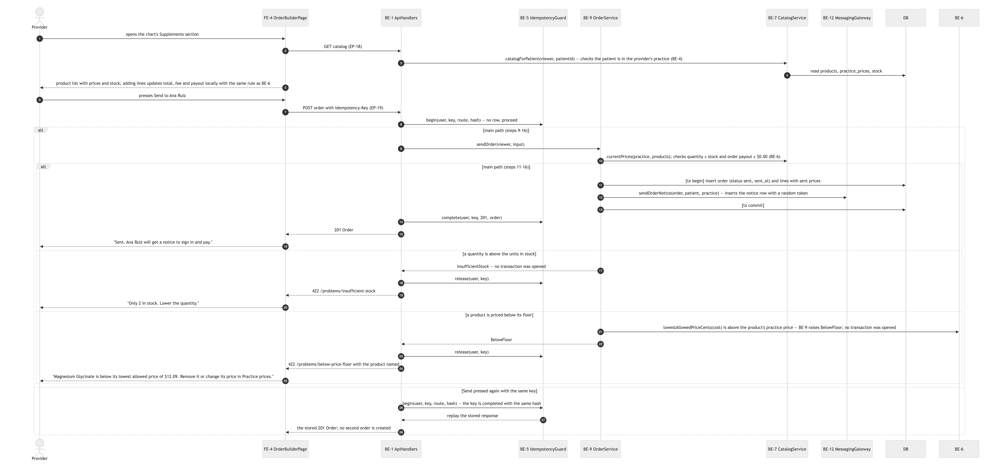
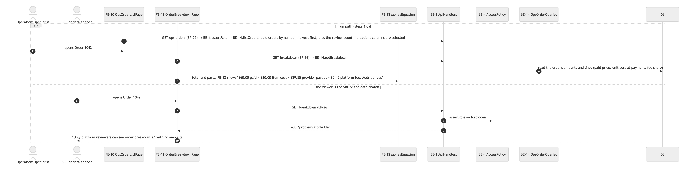
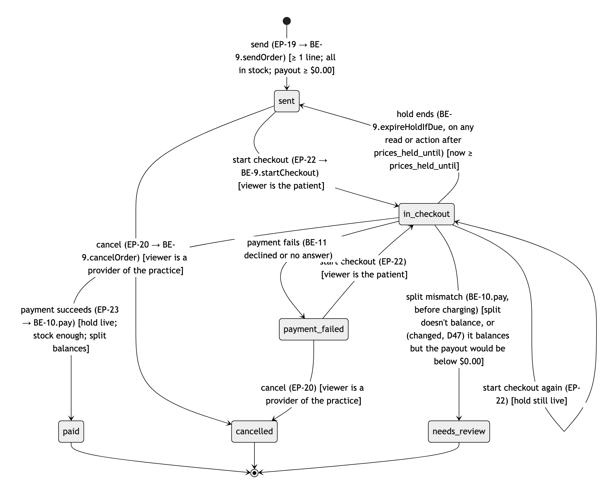
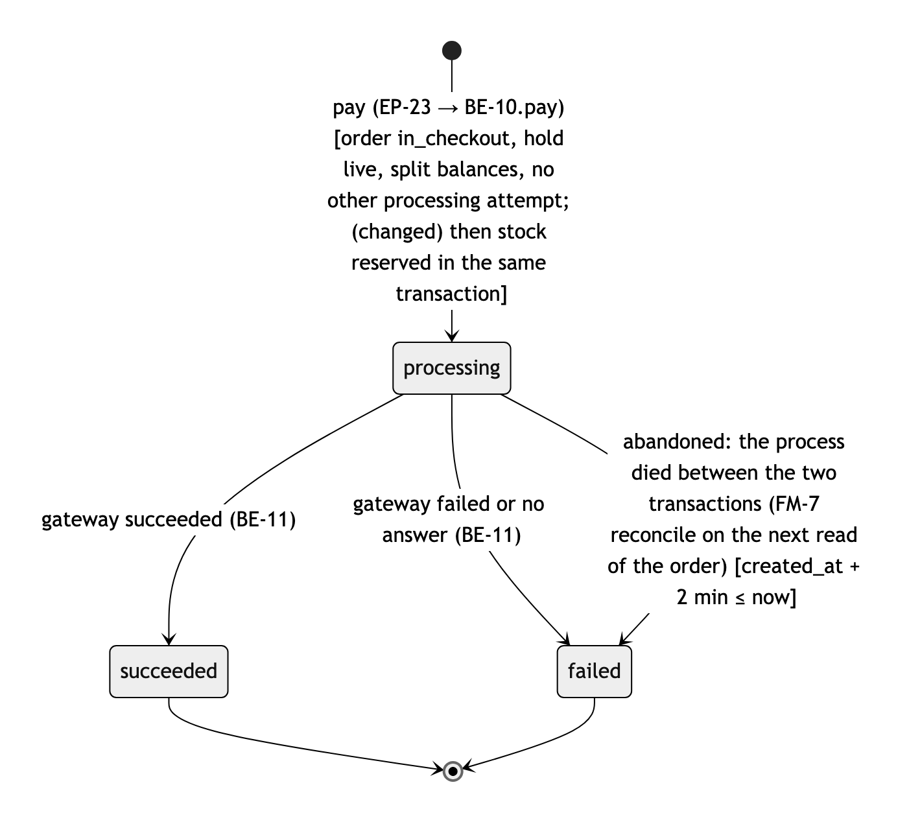
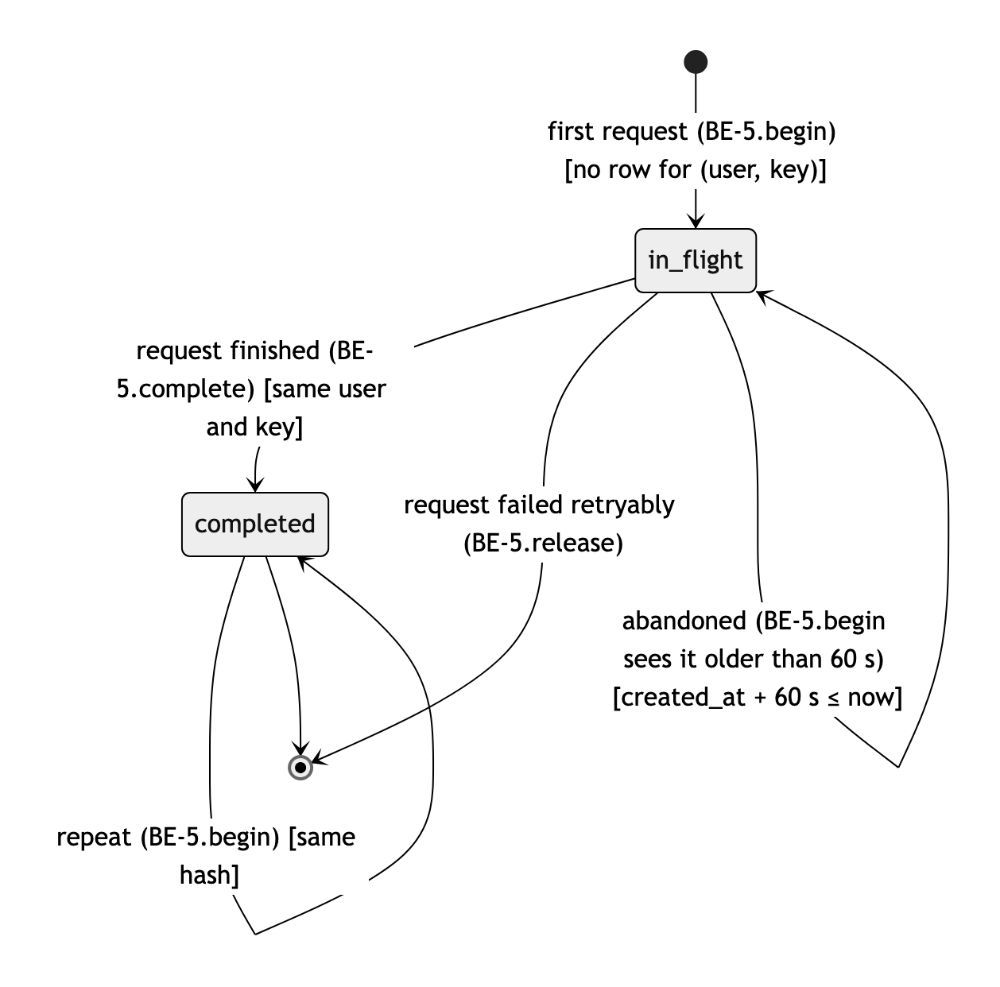

# M4 Tracer bullet — milestone report

| Field | Value |
|---|---|
| Milestone | M4 — Each person signs in; provider sends an order, patient pays once, the split is recorded and shown to the cent |
| Branch / MR | `milestone/m4-tracer-bullet` · ⚠ no MR found (recipe 11: "glab: no MR for milestone/m4-tracer-bullet, or not authenticated"; the branch has not been pushed) |
| Verified head | `33f8509` (§4.1), branched from `main` at `778e788` |
| Specs | `specs/M4-tracer-bullet/` (acceptance, tasks; frozen after merge) |
| Written | 2026-10-10 15:40 CDT by report-milestone (Claude Code, claude-opus-5-5) |
| Confidence | low — `docs/security/CHECKLIST.md` is missing, so §7 is `⚠ pending check-security` |
| G5 readiness | 2/4 clauses yes (§13, recipe 12 `g5_clauses_yes`) · recommendation: Revise |

## Summary

- Shipped (in code on the branch, all 43 M4 acceptance tests passing in a fresh `make check`): providers sign in, see a practice catalog with default and practice prices, and send an order with fee and payout shown (FR-001, FR-002, FR-017); empty and below-floor orders are refused (FR-003, FR-004); patients get a practice-name-only notice, sign in, open their own order and pay once with the test payment (FR-005 to FR-009, FR-035, FR-039 to FR-044); the split and four ledger lines are recorded to the cent and frozen (FR-010 to FR-015, FR-031, FR-036); reviewers see the money breakdown without patient identity (FR-014, FR-050); providers cancel unpaid orders (FR-066 to FR-068). Sessions end after 15 minutes idle and sign-in is rate-limited.
- Not shipped: nothing planned was cut. A patient's home page after sign-in (`/orders`) has no screen or endpoint in the design (spec gap, M5); M4-T001 and M4-T002 are `partial` only because their last worker run ended `human_review` before the supervisor committed their work on the human's word (§1, DV-4).
- Watch: no security checklist exists for this milestone (§7); the branch also carries the unmerged M1 to M3 planning milestones, which merge first per D48 (DV-1).

## 1. Delivered vs planned

| Task | Status | Squash commit | Covers | Evidence |
|---|---|---|---|---|
| M4-T001 | partial | `61c966a` | FR-001, FR-002, FR-017, FR-043, FR-044, FR-009, AE-001, AE-015, AE-041 | scope-guard exit 0 (§4.3) · its AEs pass in make check exit 0 (§4.2) · result.md status human_review (worker claim) · last worker run stopped before committing; supervisor committed on the human's word (DV-4) |
| M4-T002 | partial | `eb3f87d` | FR-006, FR-007, FR-010, FR-011, FR-012, FR-013, FR-015, FR-031, FR-009, AE-005, AE-009, AE-010, AE-011, AE-012, AE-014, AE-028 | scope-guard exit 0 (§4.3) · its AEs pass in make check exit 0 (§4.2) · result.md status human_review (worker claim) · last worker run stopped before committing; supervisor committed on the human's word (DV-4) |
| M4-T003 | delivered | `09c7f55` | FR-008, FR-035, AE-006, AE-031 | scope-guard exit 0 (§4.3) · its AEs pass in make check exit 0 (§4.2) · result.md status done (worker claim) |
| M4-T004 | delivered | `a3a582b` | FR-003, FR-004, AE-002, AE-003 | scope-guard exit 0 (§4.3) · its AEs pass in make check exit 0 (§4.2) · result.md status done (worker claim) |
| M4-T005 | delivered | `67a0315` | FR-005, FR-009, FR-068, AE-004, AE-007, AE-008, AE-065 | scope-guard exit 0 (§4.3) · its AEs pass in make check exit 0 (§4.2) · result.md status done (worker claim) |
| M4-T006 | delivered | `440d94b` | FR-039, FR-040, FR-041, FR-042, AE-038, AE-039, AE-040 | scope-guard exit 0 (§4.3) · its AEs pass in make check exit 0 (§4.2) · result.md status done (worker claim) |
| M4-T007 | delivered | `6a0e96f` | FR-014, FR-036, FR-050, FR-039, AE-013, AE-032, AE-037, AE-047 | scope-guard exit 0 (§4.3) · its AEs pass in make check exit 0 (§4.2) · result.md status done (worker claim) |
| M4-T008 | delivered | `efc39d9` | FR-066, FR-067, AE-063, AE-064 | scope-guard exit 0 (§4.3) · its AEs pass in make check exit 0 (§4.2) · result.md status done (worker claim) |
| M4-T009 | delivered | `9f8295d` | AE-001 | scope-guard exit 0 (§4.3) · its AEs pass in make check exit 0 (§4.2) · result.md status done (worker claim) |
| M4-T010 | delivered | `72ad7fa` | FR-067, FR-004, FR-042, AE-064 | scope-guard exit 0 (§4.3) · its AEs pass in make check exit 0 (§4.2) · result.md status done (worker claim) |

Unplanned commits on the milestone branch (no `Task:` trailer): 161 in total. The 122 before `538db57` are the M1 to M3 planning milestones and the v1 removal, inherited because this branch was cut from the unmerged `milestone/m1-research` (DV-1); one row stands for them. The 39 from the G4 draft on are listed one by one.

| Commit | Subject | Kind |
|---|---|---|
| `8949ae4`…`dbd5111` | 122 commits: M1 research, M2 PRD, M3 HLD/LLD, toolchain bootstrap, M4 acceptance | inherited from `milestone/m1-research` → DV-1 |
| `538db57` | docs(m4): slice M4 into 9 task contracts (draft for G4) | docs (G4 draft) |
| `f77ca89` | chore(m4): log slice-tasks result | task-file change after G4 → DV-2, DV-3 |
| `354033d` | chore(m4): type-check gate: vue-tsc 3.3.11, nuxi typecheck in make check, root tsconfig; record G4 | tooling (approved) → DV-5 |
| `298358c` | docs(decisions): D45 M4 slicing plan, D46 type-check gate | docs |
| `8a42037` | chore(m4): dispatch M4-T001 | handoff |
| `af82e39` | docs(agents): make check row names the type-check step | docs |
| `3fca7ea` | chore(m4): make check runs tests/unit (review M4-pass1 R1); record T001 dispositions | tooling (approved) → DV-5 |
| `8998911` | docs(agents): make check row names the unit-test step | docs |
| `f1cc496` | fix(m4): scope vitest to the repo's own test folders (worktree copies under .claude/worktrees were picked up) | tooling (approved) → DV-5 |
| `5dc199c` | chore(m4): T001 verified and squashed; dispatch M4-T002 | handoff |
| `e5f9fae` | docs(agents): make check row uses vitest --dir | docs |
| `fdf9d40` | docs(m4): Owns use * for Nuxt [orderId] route folders (scope-guard reads [ ] as a glob class) | task-file change after G4 → DV-2, DV-3 |
| `0199fe4` | chore(m4): record G4 Owns re-approval; T002 committed and under review | task-file change after G4 → DV-2, DV-3 |
| `802424c` | docs(m4): T003 takes review M4-pass2 R1, R4, R5; record T002 dispositions | task-file change after G4 → DV-2, DV-3 |
| `acc8a6b` | docs(decisions): D47 negative payout at payment goes to review; T003 keeps it | docs |
| `a2bc153` | chore(m4): dispatch M4-T003 | handoff |
| `578c492` | chore(m4): record review plan; T003 under review (pass 3) | handoff |
| `c284af5` | chore(m4): record T003 review dispositions (pass 3) | handoff |
| `461d5d8` | chore(m4): T003 verified and squashed; T004 takes review pass1 R8 | handoff |
| `dbd09a2` | chore(m4): dispatch M4-T004 | handoff |
| `2342ffa` | chore(m4): T004 verified and squashed; dispatch M4-T005 | handoff |
| `496502f` | chore(m4): T005 verified and squashed; dispatch M4-T006 and M4-T007 | handoff |
| `759311a` | chore(m4): T007 verified and squashed | handoff |
| `2c09b4a` | chore(m4): T006 under review (pass 4) | handoff |
| `1fe3bc7` | docs(m4): widen T006 Owns (AppShell, rate-limit migration, db-types, problem.ts) and add review pass4 fixes | task-file change after G4 → DV-2, DV-3 |
| `1800c84` | chore(m4): record T006 re-approval; relaunch | handoff |
| `837b1d7` | chore(m4): T006 relaunch under review (pass 5) | handoff |
| `08a61ae` | docs(m4): T006 takes review pass5 R1-R4 fixes | task-file change after G4 → DV-2, DV-3 |
| `3592ffe` | chore(m4): record T006 pass5 dispositions; relaunch | handoff |
| `5cb3f3d` | chore(m4): T006 verified and squashed; dispatch M4-T008 | handoff |
| `b8f7f0e` | chore(m4): T008 verified and squashed; dispatch M4-T009 | handoff |
| `f6f3714` | docs(m4): T009 Done-when checks that make check runs the acceptance suite | task-file change after G4 → DV-2, DV-3 |
| `8dd42e3` | chore(m4): record T009 re-approval; relaunch | handoff |
| `7d0514e` | chore(m4): T009 verified and squashed; milestone review (pass 6) | handoff |
| `63de7d9` | chore(m4): build complete; milestone review running | handoff |
| `75c17f0` | docs(m4): add M4-T010 milestone review fixes (pass6 R1-R4, R15) | task-file change after G4 → DV-2, DV-3 |
| `1a303cf` | chore(m4): record T010 approval; dispatch | handoff |
| `ec96fdf` | chore(m4): T010 verified and squashed; M4 build complete | handoff |
| `33f8509` | docs(decisions): D48 merge stacked milestones M1 to M4 in order | docs |

```console
$ for f in "$S"/tasks/T*.md; do …fmval id, covers…; done; ls "$S"/tasks/T*.md | wc -l; commits | cut -f2- ; … (recipe 2)
M4-T001	[FR-001, FR-002, FR-017, FR-043, FR-044, FR-009, AE-001, AE-015, AE-041]	specs/M4-tracer-bullet/tasks/T001.md
M4-T002	[FR-006, FR-007, FR-010, FR-011, FR-012, FR-013, FR-015, FR-031, FR-009, AE-005, AE-009, AE-010, AE-011, AE-012, AE-014, AE-028]	specs/M4-tracer-bullet/tasks/T002.md
M4-T003	[FR-008, FR-035, AE-006, AE-031]	specs/M4-tracer-bullet/tasks/T003.md
M4-T004	[FR-003, FR-004, AE-002, AE-003]	specs/M4-tracer-bullet/tasks/T004.md
M4-T005	[FR-005, FR-009, FR-068, AE-004, AE-007, AE-008, AE-065]	specs/M4-tracer-bullet/tasks/T005.md
M4-T006	[FR-039, FR-040, FR-041, FR-042, AE-038, AE-039, AE-040]	specs/M4-tracer-bullet/tasks/T006.md
M4-T007	[FR-014, FR-036, FR-050, FR-039, AE-013, AE-032, AE-037, AE-047]	specs/M4-tracer-bullet/tasks/T007.md
M4-T008	[FR-066, FR-067, AE-063, AE-064]	specs/M4-tracer-bullet/tasks/T008.md
M4-T009	[AE-001]	specs/M4-tracer-bullet/tasks/T009.md
M4-T010	[FR-067, FR-004, FR-042, AE-064]	specs/M4-tracer-bullet/tasks/T010.md
10
8949ae4		chore(m1): start over from scratch, remove the v1 implementation
[... trimmed: 170 commit lines; the unplanned ones are listed in the table above ...]
33f8509	docs(decisions): D48 merge stacked milestones M1 to M4 in order
M4-T001	commits=61c966a 	result=human_review
M4-T002	commits=eb3f87d 	result=human_review
M4-T003	commits=09c7f55 	result=done
M4-T004	commits=a3a582b 	result=done
M4-T005	commits=67a0315 	result=done
M4-T006	commits=440d94b 	result=done
M4-T007	commits=6a0e96f 	result=done
M4-T008	commits=efc39d9 	result=done
M4-T009	commits=9f8295d 	result=done
M4-T010	commits=72ad7fa 	result=done
```

## 2. Why (requirements covered)

- FR-001 — When a provider starts an order for a patient of their practice, the system shall list the practice's products… (`docs/product/prd.md`) — covered by M4-T001
- FR-002 — When a provider adds a product and a quantity to an order, the system shall show the line price, the order tot… (`docs/product/prd.md`) — covered by M4-T001
- FR-003 — If a provider tries to send an order with no items or with a quantity below 1, then the system shall refuse to… (`docs/product/prd.md`) — covered by M4-T004
- FR-004 — If an order's provider payout after the platform fee would be below $0.00, then the system shall refuse to sen… (`docs/product/prd.md`) — covered by M4-T004, M4-T010
- FR-005 — When a provider sends an order, the system shall show it to that patient with every item, quantity, price and … (`docs/product/prd.md`) — covered by M4-T005
- FR-006 — When a patient confirms payment for an order in checkout, the system shall mark the order paid and show the pa… (`docs/product/prd.md`) — covered by M4-T002
- FR-007 — The system shall label the payment step as a test payment that moves no real money. (`docs/product/prd.md`) — covered by M4-T002
- FR-008 — If a patient submits payment for an order that is already paid or already being paid, then the system shall sh… (`docs/product/prd.md`) — covered by M4-T003
- FR-009 — If a person opens an order that belongs to neither them nor their practice, then the system shall show that no… (`docs/product/prd.md`) — covered by M4-T001, M4-T002, M4-T005
- FR-010 — When an order is marked paid, the system shall record its split as item cost, provider payout and platform fee… (`docs/product/prd.md`) — covered by M4-T002
- FR-011 — The system shall compute the platform fee once per order as 0.75% of the amount the patient paid, rounded half… (`docs/product/prd.md`) — covered by M4-T002
- FR-012 — The system shall compute the provider payout as the amount paid minus the item cost minus the platform fee. (`docs/product/prd.md`) — covered by M4-T002
- FR-013 — If an order's item cost, provider payout and platform fee do not add up to the amount paid to the cent, then t… (`docs/product/prd.md`) — covered by M4-T002
- FR-014 — When a platform reviewer opens a paid order, the system shall show each line's quantity, unit price and unit c… (`docs/product/prd.md`) — covered by M4-T007
- FR-015 — If anyone tries to change or delete a paid order's recorded amounts, then the system shall refuse and keep the… (`docs/product/prd.md`) — covered by M4-T002
- FR-017 — The system shall start every product at a default patient price of its cost plus a 50% margin until the practi… (`docs/product/prd.md`) — covered by M4-T001
- FR-031 — The system shall record on every order its practice, provider, time sent and time paid. (`docs/product/prd.md`) — covered by M4-T002
- FR-035 — If the payment step fails or does not answer, then the system shall leave the order unpaid and tell the patien… (`docs/product/prd.md`) — covered by M4-T003
- FR-036 — The system shall record each paid line's unit cost as it stood when the order was paid. (`docs/product/prd.md`) — covered by M4-T007
- FR-039 — When a person signs in with their own account, the system shall show only the pages their role allows: a patie… (`docs/product/prd.md`) — covered by M4-T006, M4-T007
- FR-040 — If someone who is not signed in opens an order, price, stock or dashboard page, then the system shall show the… (`docs/product/prd.md`) — covered by M4-T006
- FR-041 — When a signed-in person has been inactive for 15 minutes, the system shall sign them out and show the sign-in … (`docs/product/prd.md`) — covered by M4-T006
- FR-042 — When a patient signs in after opening an order notice, the system shall open the order the notice was about. (`docs/product/prd.md`) — covered by M4-T006, M4-T010
- FR-043 — When a provider sends an order, the system shall send the patient a stand-in notice that names the practice an… (`docs/product/prd.md`) — covered by M4-T001
- FR-044 — The system shall leave item names, quantities, amounts and health details out of every notice to a patient. (`docs/product/prd.md`) — covered by M4-T001
- FR-050 — The system shall show platform staff an order number in place of any patient name or contact detail. (`docs/product/prd.md`) — covered by M4-T007
- FR-066 — When a provider cancels a sent or payment-failed order, the system shall mark it cancelled and show its patien… (`docs/product/prd.md`) — covered by M4-T008
- FR-067 — If a provider tries to cancel an order whose checkout has started or that is paid, then the system shall refus… (`docs/product/prd.md`) — covered by M4-T008, M4-T010
- FR-068 — If anyone tries to change the items or quantities of a sent order, then the system shall refuse and keep the o… (`docs/product/prd.md`) — covered by M4-T005
- AEs covered: AE-001 (M4-T001, M4-T009), AE-002 (M4-T004), AE-003 (M4-T004), AE-004 (M4-T005), AE-005 (M4-T002), AE-006 (M4-T003), AE-007 (M4-T005), AE-008 (M4-T005), AE-009 (M4-T002), AE-010 (M4-T002), AE-011 (M4-T002), AE-012 (M4-T002), AE-013 (M4-T007), AE-014 (M4-T002), AE-015 (M4-T001), AE-028 (M4-T002), AE-031 (M4-T003), AE-032 (M4-T007), AE-037 (M4-T007), AE-038 (M4-T006), AE-039 (M4-T006), AE-040 (M4-T006), AE-041 (M4-T001), AE-047 (M4-T007), AE-063 (M4-T008), AE-064 (M4-T008, M4-T010), AE-065 (M4-T005)
- Not delivered: none (the AE comparison below prints no uncovered AE)

```console
$ for f in "$S"/tasks/T*.md; do fmval covers "$f"; done | grep -oE '(N?FR|AE)-[0-9]+' | sort -u; comm -13 <(…task AEs…) <(…acceptance.md AEs…); grep -m1 -w "FR-001" docs/product/prd.md
AE-001
AE-002
AE-003
AE-004
AE-005
AE-006
AE-007
AE-008
AE-009
AE-010
AE-011
AE-012
AE-013
AE-014
AE-015
AE-028
AE-031
AE-032
AE-037
AE-038
AE-039
AE-040
AE-041
AE-047
AE-063
AE-064
AE-065
FR-001
FR-002
FR-003
FR-004
FR-005
FR-006
FR-007
FR-008
FR-009
FR-010
FR-011
FR-012
FR-013
FR-014
FR-015
FR-017
FR-031
FR-035
FR-036
FR-039
FR-040
FR-041
FR-042
FR-043
FR-044
FR-050
FR-066
FR-067
FR-068
- Requirements: FR-001, FR-002, FR-003, FR-004, FR-005, FR-066, FR-067, FR-068 · Examples: AE-001, AE-002, AE-003, AE-004, AE-063, AE-064, AE-065
```

## 3. Decisions (D-ids)

The journal diff against `main` holds 47 D-rows, because the branch carries M1 to M3 (DV-1). The rows decided for M4 itself are D44 to D48; D1 to D43 belong to the planning milestones and are listed by the recipe below. None is `proposed`.

| D-id | Title | Status | Choice in one line | Type |
|---|---|---|---|---|
| D44 | Web framework: Nuxt 4 (supersedes D38's Nuxt 3) | accepted | Nuxt 4 instead of the Nuxt 3 named from memory | Type 1 |
| D45 | Build M4 as 9 vertical slices, tracer first | accepted | vertical slices, tracer bullet first, T006 ∥ T007 | Type 2 |
| D46 | Type-check app code in make check | accepted | vue-tsc 3.3.11 with `nuxi typecheck` in the gate | Type 2 |
| D47 | Negative payout at payment goes to review | accepted | order goes to needs_review before charging | Type 2 |
| D48 | Merge stacked milestones M1 to M4 in order | accepted | M1, M2, M3, M4 merge to main in order, one MR each | Type 2 |

```console
$ git diff "$BASE..$MB" -- docs/decisions/DECISION_JOURNAL.md | grep -E '^\+### D[0-9]+' (and its count, ADR files, G4 sha, task-file drift) (recipe 5)
+### D1 Stack: Laravel 13 / PHP 8.5  [status: superseded-by D22]
+### D2 Database: Postgres in prod, SQLite in dev/tests, suite run on both  [status: superseded-by D22]
+### D3 Fee: 75 bps of the order subtotal, once per order, half-up, borne by the provider  [status: superseded-by D22]
+### D4 Persisted split on the order AND a settlement ledger  [status: superseded-by D22]
+### D5 Payment: reserve (txn) → charge (no txn) → settle (txn)  [status: superseded-by D22]
+### D6 Stock: column + movement log, conditional decrement, reserved at payment  [status: superseded-by D22]
+### D7 Stubs and their seams  [status: superseded-by D22]
+### D8 Deliberately out of scope  [status: superseded-by D22]
+### D9 Diagrams as .mmd sources plus embedded copies  [status: superseded-by D22]
+### D10 Design-review panel → accepted changes  [status: superseded-by D22]
+### D11 One stock path: `Product::adjustStock()`  [status: superseded-by D22]
+### D12 Cancel built (scope add)  [status: superseded-by D22]
+### D13 Deploy: Railway + Dockerfile (FrankenPHP) + Railway Postgres  [status: superseded-by D22]
+### D14 Neutral branding on the public demo  [status: superseded-by D22]
+### D15 GitLab visibility is the human's step  [status: superseded-by D22]
+### D16 Code-review panel → accepted changes  [status: superseded-by D22]
+### D17 Never edit a migration that already ran in prod  [status: superseded-by D22]
+### D18 Restart from scratch on a milestone branch  [status: accepted]
+### D19 Docs-only rules until the stack is designed  [status: accepted]
+### D20 Route harness findings F1-F3 at M1 close  [status: accepted]
+### D21 Adopt North Star metrics and partner lens (H1)  [status: accepted]
+### D22 Set the one-shot build in main aside  [status: accepted]
+### D23 Full track for the M1 brief  [status: accepted]
+### D24 Adopt market, competitor and load-profile research (H3)  [status: accepted]
+### D25 PRD scope: money path first, HIPAA-ready, campaigns later  [status: accepted]
+### D26 PRD revision: sign-in, patient notices without health details, dashboards, no patient identity for platform staff  [status: accepted]
+### D27 Screen layouts: live payout builder, two-step patient checkout, equation-first audit  [status: accepted]
+### D28 UX contract: 9 screens, six states each, 90-second demo  [status: accepted]
+### D29 PRD revision: financial report with gross and net, four least-privilege operations roles  [status: accepted]
+### D30 Operations layouts: order funnel, balance-first financial report, people-list access  [status: accepted]
+### D31 UX contract extended to M6: 14 screens, demo covers every key screen  [status: accepted]
+### D32 Application language: TypeScript on Node.js with server-rendered Vue  [status: accepted]
+### D33 Database: PostgreSQL managed by the host  [status: accepted]
+### D34 One app: pages and logic deploy together  [status: superseded-by D36]
+### D35 Money recording: split on the paid order plus an append-only ledger  [status: accepted]
+### D36 One deployable, built API-first  [status: accepted]
+### D37 Sign-in: seeded test accounts with server-side sessions  [status: accepted]
+### D38 Web framework: Nuxt 3  [status: superseded-by D44]
+### D39 Database access: Kysely with plain SQL migrations  [status: accepted]
+### D40 Primary keys: bigint identity, order number = id, random tokens for outside links  [status: accepted]
+### D41 Idempotency: one shared idempotency_keys table plus database backstops  [status: accepted]
+### D42 Payment timing: synchronous charge with short transactions on either side; hybrid with webhooks as the production path  [status: accepted]
+### D43 Broader holistic-care products parked as a future non-goal (NG-12)  [status: accepted]
+### D44 Web framework: Nuxt 4 (supersedes D38's Nuxt 3)  [status: accepted]
+### D45 Build M4 as 9 vertical slices, tracer first  [status: accepted]
+### D46 Type-check app code in make check  [status: accepted]
+### D47 Negative payout at payment goes to review  [status: accepted]
+### D48 Merge stacked milestones M1 to M4 in order  [status: accepted]
48
G4-approved sha: ⚠ none recorded
```

## 4. Verification

Run by report-milestone on the milestone head at 2026-10-10 15:40 CDT; nothing below is copied from a worker.

### 4.1 Head and tree

```console
$ git rev-parse --short HEAD; git branch --show-current
33f8509
milestone/m4-tracer-bullet
```
```console
$ git status --porcelain -- . ':!.handoff' ':!docs/milestones/M4.md'

```

### 4.2 make check

```console
$ make check
npx nuxi typecheck
npx vitest run --dir tests/unit --passWithNoTests

 RUN  v5.0.1 /Users/mastershefu/Desktop/gauntlet_workbench/cerbo-supplement-store


 Test Files  5 passed (5)
      Tests  96 passed (96)
   Start at  15:39:53
   Duration  383ms (import 59%, transform 29%, tests 10%, worker 1%)

embed-diagrams: docs/architecture/hld.md: 3 diagram(s) in sync
embed-diagrams: docs/architecture/lld.md: 18 diagram(s) in sync
npx vitest run --dir tests/acceptance/M4

 RUN  v5.0.1 /Users/mastershefu/Desktop/gauntlet_workbench/cerbo-supplement-store


 Test Files  5 passed (5)
      Tests  43 passed (43)
   Start at  15:39:54
   Duration  35.59s (tests 100%)

make check: OK
exit 0
```

### 4.3 Scope guard per squash commit

```console
$ commits | awk -F'\t' '$3 != "" {print $1, $2, $3}' | while read -r sha short ids; do … bash scripts/scope-guard.sh "$f" "$sha^" "$sha" …; done
61c966a M4-T001 exit=0
    scope-guard: OK — 22 changed path(s) within Owns (61c966af53bfc3398263229df2f1f67204ce2c8c^:specs/M4-tracer-bullet/tasks/T001.md)
eb3f87d M4-T002 exit=0
    scope-guard: OK — 11 changed path(s) within Owns (eb3f87dea49bb5339ac42fda1976a3074eb41189^:specs/M4-tracer-bullet/tasks/T002.md)
09c7f55 M4-T003 exit=0
    scope-guard: OK — 8 changed path(s) within Owns (09c7f5511f56f9714c5a16bbbe7051421afcbeaa^:specs/M4-tracer-bullet/tasks/T003.md)
a3a582b M4-T004 exit=0
    scope-guard: OK — 4 changed path(s) within Owns (a3a582be2d92a3a66fb9b2161c9701e8a9c5345d^:specs/M4-tracer-bullet/tasks/T004.md)
67a0315 M4-T005 exit=0
    scope-guard: OK — 3 changed path(s) within Owns (67a03156d08d8e2655d4dd9771a5ced1113d7de7^:specs/M4-tracer-bullet/tasks/T005.md)
6a0e96f M4-T007 exit=0
    scope-guard: OK — 8 changed path(s) within Owns (6a0e96f33886b19b7a2319eb5d5ec3e781ef8372^:specs/M4-tracer-bullet/tasks/T007.md)
440d94b M4-T006 exit=0
    scope-guard: OK — 12 changed path(s) within Owns (440d94bf8f11801a42d42720c642ca534b8f4933^:specs/M4-tracer-bullet/tasks/T006.md)
efc39d9 M4-T008 exit=0
    scope-guard: OK — 2 changed path(s) within Owns (efc39d921157b05f4782c61a0048d4c6835c735c^:specs/M4-tracer-bullet/tasks/T008.md)
9f8295d M4-T009 exit=0
    scope-guard: OK — 1 changed path(s) within Owns (9f8295d4a7f1da18de753f9fea624de5a449d203^:specs/M4-tracer-bullet/tasks/T009.md)
72ad7fa M4-T010 exit=0
    scope-guard: OK — 4 changed path(s) within Owns (72ad7fad145a47398c5c9be970ffdbef3c868b38^:specs/M4-tracer-bullet/tasks/T010.md)
```

### 4.4 Acceptance tests untouched by implementers

```console
$ commits -- tests/acceptance/ | awk -F'\t' '$3 != ""' | cut -f2,3,4

```

### 4.5 Diagrams in sync

```console
$ mmd=$(git diff --name-only "$BASE..$MB" -- 'docs/architecture/diagrams/*.mmd'); …; bash scripts/embed-diagrams.sh --check $docs
changed diagram sources: docs/architecture/diagrams/be-class.mmd
docs/architecture/diagrams/deployment.mmd
docs/architecture/diagrams/erd.mmd
docs/architecture/diagrams/fe-components.mmd
docs/architecture/diagrams/hld-container.mmd
docs/architecture/diagrams/hld-context.mmd
docs/architecture/diagrams/sequence-access-log.mmd
docs/architecture/diagrams/sequence-adjust-stock.mmd
docs/architecture/diagrams/sequence-audit-order.mmd
docs/architecture/diagrams/sequence-change-price.mmd
docs/architecture/diagrams/sequence-change-role.mmd
docs/architecture/diagrams/sequence-financial-report.mmd
docs/architecture/diagrams/sequence-pay-order.mmd
docs/architecture/diagrams/sequence-platform-health.mmd
docs/architecture/diagrams/sequence-practice-dashboard.mmd
docs/architecture/diagrams/sequence-send-order.mmd
docs/architecture/diagrams/sequence-sign-in.mmd
docs/architecture/diagrams/sequence-system-health.mmd
docs/architecture/diagrams/state-idempotency-key.mmd
docs/architecture/diagrams/state-order.mmd
docs/architecture/diagrams/state-payment-attempt.mmd
embed-diagrams: docs/architecture/hld.md: 3 diagram(s) in sync
embed-diagrams: docs/architecture/lld.md: 18 diagram(s) in sync
exit 0
```

### 4.6 Branch contains main

```console
$ git merge-base --is-ancestor "$MAIN" "$MB" …; git merge-base --is-ancestor "origin/$MAIN" "$MB" …
contains main
contains origin/main (as last fetched)
```

## 5. Deviations from plan

| Id | Deviation | Kind | Why (source) | Decision |
|---|---|---|---|---|
| DV-1 | `milestone/m4-tracer-bullet` was cut from the unmerged `milestone/m1-research`, so merging M4 into `main` would also merge the M1 to M3 planning work and the v1 removal (161 unplanned commits, §1) | changed | human, 2026-10-10 15:39 CDT: "a, stack and merge M1 to M4 in order" (report-milestone question 1 of 1; option a: keep the stack, merge M1, M2, M3, M4 to main in order, one MR each) | D48 |
| DV-2 | M4-T010 added after G4 to close milestone-review findings | added | Approvals 2026-10-10 15:19 CDT: "a, add T010 and run it" | none needed: recorded G4 re-approval |
| DV-3 | Task files edited after the G4 draft: T002, T003, T005, T008 Owns (`[orderId]` → `*`); T003 Ask (pass-2 R1, R4, R5) and Must-not-change (D47); T004 Ask (pass-1 R8); T006 Owns widened and two Ask additions; T009 Done-when | changed / Owns | Approvals 12:45 "a, fix the four Owns lines"; 12:51 "a, then bring me R2"; 13:01 "a, then start T003"; 12:29 "do b instead"; 14:16 "a, widen T006 Owns and relaunch"; 14:54 "a, one more T006 run"; 15:08 "a, fix T009's check and rerun" | none needed: each is a recorded G4 re-approval |
| DV-4 | The supervisor, not the worker, committed M4-T001's relaunch fixes (worker's `git add` denied by the permission classifier) and M4-T002's finished work (scope-guard false refusal on `[orderId]`) | harness | Approvals 12:33 "a, commit both"; 12:45 "a, fix the four Owns lines"; Log FAIL lines 12:32, 12:42 | none needed: human's recorded word |
| DV-5 | Tooling changed outside any task: vue-tsc 3.3.11 + `nuxi typecheck` + root tsconfig (D46), unit tests in `make check` (pass-1 R1), vitest `--dir` scoping, AGENTS.md Commands row | added | Approvals 12:06 "approve a, yes to vue-tsc, then go M4"; 12:29 "do b instead"; 12:13, 12:31, 12:36 "update AGENTS.md make check row" | D46 |
| DV-6 | No G4 sha in the MILESTONES.md row and no Approvals gate cell equal to plain `G4`, so recipe 5 prints "G4-approved sha: ⚠ none recorded" | changed | Approvals 12:06 names `specs/M4-tracer-bullet/tasks/T001-T009@538db57` in a gate cell with extra words | none needed: supervisor adds `G4@538db57` to the row at G5 |

```console
$ echo "G4-approved sha: ${g4:-⚠ none recorded}"; git log --format='%h %s' "$g4..$MB" -- "$S/tasks/" (recipe 5)
G4-approved sha: ⚠ none recorded
```

## 6. Verifier dispositions

Review file(s): `.handoff/reviews/M4-pass1.md` to `M4-pass6.md` · 6 passes · reviewer: `Reviewer: verifier (claude-opus-5-5)` on every pass · worker self-reports quoted to the verifier: none (pass 1 notes a code comment pointing to result.md, which it did not read; passes 2 to 6 say none was read or quoted) (recipe 7) · task authors: §10. Passes 1 to 5 reviewed T001, T002, T003 and T006 (twice) before each squash; pass 6 reviewed T004, T005, T007, T008 and T009 together, per the review plan approved at 13:15 ("a, and yes to that review plan").

| Row | Axis | Severity | Suggested | Disposition (human, verbatim) | Where handled |
|---|---|---|---|---|---|
| p1-R1 | tests-that-lie | P2 | fix (add `npx vitest run tests/unit` to `make check`; T009 owns the Makefile) | fix — "do b instead" (Approvals 2026-10-10 12:29 CDT) | `3fca7ea`, `f1cc496` (supervisor Makefile) |
| p1-R2 | security | P2 | fix (build the dummy hash from the configured cost) | fix — "a, commit both" (Approvals 2026-10-10 12:33 CDT) | `61c966a` (T001 relaunch) |
| p1-R3 | spec-fidelity | P3 | file | file — "do b instead" (Approvals 2026-10-10 12:29 CDT) | after-M4 list in TRACKER Resume (no issue opened) |
| p1-R4 | spec-fidelity | P3 | keep (log it as an LLD catch-up) | file (LLD catch-up) — "do b instead" (Approvals 2026-10-10 12:29 CDT) | after-M4 design-lld catch-up (TRACKER Resume) |
| p1-R5 | spec-fidelity | P3 | file | file — "do b instead" (Approvals 2026-10-10 12:29 CDT) | after-M4 list in TRACKER Resume (no issue opened) |
| p1-R6 | correctness | P3 | file | file — "do b instead" (Approvals 2026-10-10 12:29 CDT) | after-M4 list in TRACKER Resume (no issue opened) |
| p1-R7 | simplicity | P3 | fix (remove; add it with the task that covers FR-055) | fix — "a, commit both" (Approvals 2026-10-10 12:33 CDT) | `61c966a` (T001 relaunch) |
| p1-R8 | simplicity | P3 | file (T004 decides which of the two checks stays) | fix (routed to T004) — "do b instead" (Approvals 2026-10-10 12:29 CDT) | `a3a582b` |
| p2-R1 | correctness | P2 | file (give FM-7 an owner) | fix (routed to T003) — "a, then bring me R2" (Approvals 2026-10-10 12:51 CDT) | `09c7f55` |
| p2-R2 | spec-fidelity | P2 | keep, pending a D-id | keep (decision D47) — "a, then start T003" (Approvals 2026-10-10 13:01 CDT) | D47; server/services/payments.ts branch kept |
| p2-R3 | spec-fidelity | P3 | keep | keep — "a, then bring me R2" (Approvals 2026-10-10 12:51 CDT) | reason: DB-level proof accepted (acceptance Q-2) |
| p2-R4 | spec-fidelity | P3 | file (T003 owns payments.ts) | fix (routed to T003) — "a, then bring me R2" (Approvals 2026-10-10 12:51 CDT) | `09c7f55` |
| p2-R5 | security | P3 | file | fix (routed to T003) — "a, then bring me R2" (Approvals 2026-10-10 12:51 CDT) | `09c7f55` |
| p2-R6 | correctness | P3 | file (revisit with T003's BE-5) | file (milestone close-out) — "a, then bring me R2" (Approvals 2026-10-10 12:51 CDT) | not handled in T010; still open (§11) |
| p2-R7 | spec-fidelity | P3 | file | file (milestone close-out) — "a, then bring me R2" (Approvals 2026-10-10 12:51 CDT) | not handled in T010; still open (§11) |
| p3-R1 | spec-fidelity | P1 | fix (release on the LLD's retryable problems), or record a decision and update the LLD | fix — "a, relaunch T003 with R1, R2, R4" (Approvals 2026-10-10 13:28 CDT) | `09c7f55` (T003 relaunch) |
| p3-R2 | correctness | P3 | file | fix — "a, relaunch T003 with R1, R2, R4" (Approvals 2026-10-10 13:28 CDT) | `09c7f55` (T003 relaunch) |
| p3-R3 | correctness | P3 | file | file (milestone review) — "a, relaunch T003 with R1, R2, R4" (Approvals 2026-10-10 13:28 CDT) | not handled in pass 6; still open (§11) |
| p3-R4 | spec-fidelity | P3 | file | fix — "a, relaunch T003 with R1, R2, R4" (Approvals 2026-10-10 13:28 CDT) | `09c7f55` (T003 relaunch) |
| p3-R5 | spec-fidelity | P3 | file | file (milestone review) — "a, relaunch T003 with R1, R2, R4" (Approvals 2026-10-10 13:28 CDT) | not handled in pass 6; still open (§11) |
| p4-R1 | tests-that-lie | P3 | file | file (milestone review) — "a, widen T006 Owns and relaunch" (Approvals 2026-10-10 14:16 CDT) | not handled in pass 6; still open (§11) |
| p4-R2 | spec-fidelity | P1 | fix | fix — "a, widen T006 Owns and relaunch" (Approvals 2026-10-10 14:16 CDT) | `440d94b` (T006 relaunch) |
| p4-R3 | spec-fidelity | P1 | fix | fix — "a, widen T006 Owns and relaunch" (Approvals 2026-10-10 14:16 CDT) | `440d94b` (T006 relaunch) |
| p4-R4 | security | P2 | fix | fix — "a, widen T006 Owns and relaunch" (Approvals 2026-10-10 14:16 CDT) | `440d94b` (T006 relaunch) |
| p4-R5 | correctness | P2 | fix | fix — "a, widen T006 Owns and relaunch" (Approvals 2026-10-10 14:16 CDT) | `440d94b` (T006 relaunch) |
| p4-R6 | spec-fidelity | P2 | fix | fix — "a, widen T006 Owns and relaunch" (Approvals 2026-10-10 14:16 CDT) | `440d94b` (T006 relaunch) |
| p4-R7 | correctness | P3 | file | fix — "a, widen T006 Owns and relaunch" (Approvals 2026-10-10 14:16 CDT) | `440d94b` (T006 relaunch) |
| p4-R8 | security | P3 | file | fix — "a, widen T006 Owns and relaunch" (Approvals 2026-10-10 14:16 CDT) | `440d94b` (T006 relaunch) |
| p4-R9 | spec-fidelity | P3 | file | fix — "a, widen T006 Owns and relaunch" (Approvals 2026-10-10 14:16 CDT) | `440d94b` (T006 relaunch) |
| p4-R10 | security | P3 | file | fix — "a, widen T006 Owns and relaunch" (Approvals 2026-10-10 14:16 CDT) | `440d94b` (T006 relaunch) |
| p4-R11 | simplicity | P3 | keep | file (milestone review) — "a, widen T006 Owns and relaunch" (Approvals 2026-10-10 14:16 CDT) | not handled in pass 6; still open (§11) |
| p5-R1 | tests-that-lie | P3 | file | fix — "a, one more T006 run" (Approvals 2026-10-10 14:54 CDT) | `440d94b` (T006 second relaunch) |
| p5-R2 | security | P1 | fix | fix (local half; deploy half to ship-milestone) — "a, one more T006 run" (Approvals 2026-10-10 14:54 CDT) | `440d94b`; TRUST_PROXY=1 and the Railway header at ship-milestone |
| p5-R3 | security | P2 | fix | fix — "a, one more T006 run" (Approvals 2026-10-10 14:54 CDT) | `440d94b` (T006 second relaunch) |
| p5-R4 | correctness | P2 | fix | fix — "a, one more T006 run" (Approvals 2026-10-10 14:54 CDT) | `440d94b` (T006 second relaunch) |
| p5-R5 | correctness | P3 | file | file (milestone review) — "a, one more T006 run" (Approvals 2026-10-10 14:54 CDT) | not handled in pass 6; still open (§11) |
| p5-R6 | security | P3 | file | file (milestone review) — "a, one more T006 run" (Approvals 2026-10-10 14:54 CDT) | not handled in pass 6; still open (§11) |
| p6-R1 | tests-that-lie | P3 | fix (add a second product to the rounding case) | fix (T010) — "a, add T010 and run it" (Approvals 2026-10-10 15:19 CDT) | `72ad7fa` |
| p6-R2 | correctness | P1 | fix (allow only sent and payment_failed, or require no processing attempt) | fix (T010) — "a, add T010 and run it" (Approvals 2026-10-10 15:19 CDT) | `72ad7fa` |
| p6-R3 | spec-fidelity | P2 | fix (link carries the current path as `next`); file the missing patient home as a spec gap | fix (T010) — "a, add T010 and run it" (Approvals 2026-10-10 15:19 CDT) | `72ad7fa` |
| p6-R4 | spec-fidelity | P2 | fix | fix (T010) — "a, add T010 and run it" (Approvals 2026-10-10 15:19 CDT) | `72ad7fa` |
| p6-R5 | spec-fidelity | P3 | file (clarify in lld.md BE-6 or FR-020 before M5; give the order-fee case its own copy) | file (LLD/acceptance catch-up) — "a, add T010 and run it" (Approvals 2026-10-10 15:19 CDT) | after-M4 catch-up (TRACKER Resume) |
| p6-R6 | spec-fidelity | P3 | keep (align lld.md §4 with SEQ-3 for EP-25) | file (LLD/acceptance catch-up) — "a, add T010 and run it" (Approvals 2026-10-10 15:19 CDT) | after-M4 catch-up (TRACKER Resume) |
| p6-R7 | correctness | P3 | keep | ⚠ pending | — |
| p6-R8 | spec-fidelity | P3 | keep (fix the EDGE-015 text at the next define-acceptance) | file (LLD/acceptance catch-up) — "a, add T010 and run it" (Approvals 2026-10-10 15:19 CDT) | after-M4 catch-up (TRACKER Resume) |
| p6-R9 | spec-fidelity | P3 | file | file (LLD/acceptance catch-up) — "a, add T010 and run it" (Approvals 2026-10-10 15:19 CDT) | after-M4 catch-up (TRACKER Resume) |
| p6-R10 | spec-fidelity | P3 | file | file (M5) — "a, add T010 and run it" (Approvals 2026-10-10 15:19 CDT) | M5 (TRACKER Resume) |
| p6-R11 | spec-fidelity | P3 | file (add a test when FR-022 and FR-037 land in M5) | file (LLD/acceptance catch-up) — "a, add T010 and run it" (Approvals 2026-10-10 15:19 CDT) | after-M4 catch-up (TRACKER Resume) |
| p6-R12 | spec-fidelity | P3 | keep | ⚠ pending | — |
| p6-R13 | correctness | P3 | file | file (M5) — "a, add T010 and run it" (Approvals 2026-10-10 15:19 CDT) | M5 (TRACKER Resume) |
| p6-R14 | spec-fidelity | P3 | file | file (M5) — "a, add T010 and run it" (Approvals 2026-10-10 15:19 CDT) | M5 (TRACKER Resume) |
| p6-R15 | simplicity | P3 | file | fix (T010) — "a, add T010 and run it" (Approvals 2026-10-10 15:19 CDT) | `72ad7fa` |

```console
$ ls …pass*.md; grep Reviewer:; Not-reviewed self-report lines; row table; counts; P0/P1 count; scoped | grep -E 'R[0-9]+'; commits after each review (recipe 7)
.handoff/reviews/M4-pass1.md
.handoff/reviews/M4-pass2.md
.handoff/reviews/M4-pass3.md
.handoff/reviews/M4-pass4.md
.handoff/reviews/M4-pass5.md
.handoff/reviews/M4-pass6.md
.handoff/reviews/M4-pass1.md:Reviewer: verifier (claude-opus-5-5)
.handoff/reviews/M4-pass2.md:Reviewer: verifier (claude-opus-5-5)
.handoff/reviews/M4-pass3.md:Reviewer: verifier (claude-opus-5-5)
.handoff/reviews/M4-pass4.md:Reviewer: verifier (claude-opus-5-5)
.handoff/reviews/M4-pass5.md:Reviewer: verifier (claude-opus-5-5)
.handoff/reviews/M4-pass6.md:Reviewer: verifier (claude-opus-5-5)
.handoff/reviews/M4-pass1.md self-reports quoted to the verifier: - `server/services/session.ts:64` has a code comment pointing to `result.md` Questions. I did not read that file, because it is a worker self-report.
.handoff/reviews/M4-pass2.md self-reports quoted to the verifier: - Worker self-reports (`.handoff/runs/**`, result.md): not read, and none was quoted in the prompt.
.handoff/reviews/M4-pass3.md self-reports quoted to the verifier: - Worker self-reports (`.handoff/runs/**`, result.md): not read, and none was quoted in the prompt.
.handoff/reviews/M4-pass4.md self-reports quoted to the verifier: - `.handoff/runs/M4-T006/**` (result.md and the "See result.md Questions" it cites at session.ts:71): worker self-report, excluded by the verifier rules.
.handoff/reviews/M4-pass5.md self-reports quoted to the verifier: - `.handoff/runs/M4-T006/**`: worker self-report, excluded by the verifier rules.
.handoff/reviews/M4-pass6.md self-reports quoted to the verifier: none quoted
.handoff/reviews/M4-pass1.md: R1 | tests-that-lie | P2 | fix (add `npx vitest run tests/unit` to `make check`; T009 owns the Makefile) 
.handoff/reviews/M4-pass1.md: R2 | security | P2 | fix (build the dummy hash from the configured cost) 
.handoff/reviews/M4-pass1.md: R3 | spec-fidelity | P3 | file 
.handoff/reviews/M4-pass1.md: R4 | spec-fidelity | P3 | keep (log it as an LLD catch-up) 
.handoff/reviews/M4-pass1.md: R5 | spec-fidelity | P3 | file 
.handoff/reviews/M4-pass1.md: R6 | correctness | P3 | file 
.handoff/reviews/M4-pass1.md: R7 | simplicity | P3 | fix (remove; add it with the task that covers FR-055) 
.handoff/reviews/M4-pass1.md: R8 | simplicity | P3 | file (T004 decides which of the two checks stays) 
.handoff/reviews/M4-pass2.md: R1 | correctness | P2 | file (give FM-7 an owner) 
.handoff/reviews/M4-pass2.md: R2 | spec-fidelity | P2 | keep, pending a D-id 
.handoff/reviews/M4-pass2.md: R3 | spec-fidelity | P3 | keep 
.handoff/reviews/M4-pass2.md: R4 | spec-fidelity | P3 | file (T003 owns payments.ts) 
.handoff/reviews/M4-pass2.md: R5 | security | P3 | file 
.handoff/reviews/M4-pass2.md: R6 | correctness | P3 | file (revisit with T003's BE-5) 
.handoff/reviews/M4-pass2.md: R7 | spec-fidelity | P3 | file 
.handoff/reviews/M4-pass3.md: R1 | spec-fidelity | P1 | fix (release on the LLD's retryable problems), or record a decision and update the LLD 
.handoff/reviews/M4-pass3.md: R2 | correctness | P3 | file 
.handoff/reviews/M4-pass3.md: R3 | correctness | P3 | file 
.handoff/reviews/M4-pass3.md: R4 | spec-fidelity | P3 | file 
.handoff/reviews/M4-pass3.md: R5 | spec-fidelity | P3 | file 
.handoff/reviews/M4-pass4.md: R1 | tests-that-lie | P3 | file 
.handoff/reviews/M4-pass4.md: R2 | spec-fidelity | P1 | fix 
.handoff/reviews/M4-pass4.md: R3 | spec-fidelity | P1 | fix 
.handoff/reviews/M4-pass4.md: R4 | security | P2 | fix 
.handoff/reviews/M4-pass4.md: R5 | correctness | P2 | fix 
.handoff/reviews/M4-pass4.md: R6 | spec-fidelity | P2 | fix 
.handoff/reviews/M4-pass4.md: R7 | correctness | P3 | file 
.handoff/reviews/M4-pass4.md: R8 | security | P3 | file 
.handoff/reviews/M4-pass4.md: R9 | spec-fidelity | P3 | file 
.handoff/reviews/M4-pass4.md: R10 | security | P3 | file 
.handoff/reviews/M4-pass4.md: R11 | simplicity | P3 | keep 
.handoff/reviews/M4-pass5.md: R1 | tests-that-lie | P3 | file 
.handoff/reviews/M4-pass5.md: R2 | security | P1 | fix 
.handoff/reviews/M4-pass5.md: R3 | security | P2 | fix 
.handoff/reviews/M4-pass5.md: R4 | correctness | P2 | fix 
.handoff/reviews/M4-pass5.md: R5 | correctness | P3 | file 
.handoff/reviews/M4-pass5.md: R6 | security | P3 | file 
.handoff/reviews/M4-pass6.md: R1 | tests-that-lie | P3 | fix (add a second product to the rounding case) 
.handoff/reviews/M4-pass6.md: R2 | correctness | P1 | fix (allow only sent and payment_failed, or require no processing attempt) 
.handoff/reviews/M4-pass6.md: R3 | spec-fidelity | P2 | fix (link carries the current path as `next`); file the missing patient home as a spec gap 
.handoff/reviews/M4-pass6.md: R4 | spec-fidelity | P2 | fix 
.handoff/reviews/M4-pass6.md: R5 | spec-fidelity | P3 | file (clarify in lld.md BE-6 or FR-020 before M5; give the order-fee case its own copy) 
.handoff/reviews/M4-pass6.md: R6 | spec-fidelity | P3 | keep (align lld.md §4 with SEQ-3 for EP-25) 
.handoff/reviews/M4-pass6.md: R7 | correctness | P3 | keep 
.handoff/reviews/M4-pass6.md: R8 | spec-fidelity | P3 | keep (fix the EDGE-015 text at the next define-acceptance) 
.handoff/reviews/M4-pass6.md: R9 | spec-fidelity | P3 | file 
.handoff/reviews/M4-pass6.md: R10 | spec-fidelity | P3 | file 
.handoff/reviews/M4-pass6.md: R11 | spec-fidelity | P3 | file (add a test when FR-022 and FR-037 land in M5) 
.handoff/reviews/M4-pass6.md: R12 | spec-fidelity | P3 | keep 
.handoff/reviews/M4-pass6.md: R13 | correctness | P3 | file 
.handoff/reviews/M4-pass6.md: R14 | spec-fidelity | P3 | file 
.handoff/reviews/M4-pass6.md: R15 | simplicity | P3 | file 
.handoff/reviews/M4-pass1.md:8
.handoff/reviews/M4-pass2.md:7
.handoff/reviews/M4-pass3.md:5
.handoff/reviews/M4-pass4.md:11
.handoff/reviews/M4-pass5.md:6
.handoff/reviews/M4-pass6.md:15
5
| 2026-10-09 18:39 CDT | research review (no gate; gather-evidence STOP) | docs/research/R01-R07@b3966a6 | "approve, then /write-prd" |
| 2026-10-09 20:00 CDT | research review (no gate; gather-evidence STOP) | docs/research/R08-R13@8b161f6 | "approve, then /write-prd" |
| 2026-10-09 22:13 CDT | research review (no gate; gather-evidence STOP) | docs/research/R14-R15@8c5081c | "approve, these are not important gaps, dont write them, then /write-prd" |
[... trimmed ...]
```

## 7. Security

- Checklist: `docs/security/CHECKLIST.md` — ⚠ pending check-security: the file does not exist (check-security was never run for M4).
- G5 security condition (as the checklist states it): ⚠ pending check-security
- Unaccepted high/critical findings and secrets: ⚠ pending check-security (no count line exists)
- Accepted risks: ⚠ pending check-security
- Secret scan: gitleaks NOT INSTALLED: covered by no checklist yet
- Dependency changes: `package.json`, `package-lock.json` — vue-tsc 3.3.11 (Approvals 12:06 "approve a, yes to vue-tsc, then go M4", D46); the toolchain bootstrap before G4 (Approvals 11:32)

```console
$ C=docs/security/CHECKLIST.md; if [ ! -f "$C" ]; then echo "$C missing: ⚠ pending check-security"; …; command -v gitleaks … (recipe 8)
docs/security/CHECKLIST.md missing: ⚠ pending check-security
gitleaks NOT INSTALLED
```

## 8. Factory metrics

| Metric | Value | How it is counted |
|---|---|---|
| First-pass acceptance rate | 0/10 dispatched = 0% (rounded down) · 6 unknown · not dispatched: none | one DISPATCH; no FAIL/ESCALATE; no human_review/relaunch in Log or Tasks; last RESULT line `status=done timeout=no tree=clean`; squash commit landed ÷ dispatched tasks. A RESULT line without those fields is unknown, counted as not first-pass |
| Fix loops | 5 re-dispatches · worst: M4-T006 (2) | DISPATCH count − 1 per task |
| Verifier passes | 6 | review files for M4 |
| Gate Revise count | 0 of 49 gate answers (recipe 6 counts the word "Revise" in the answer column; the 7 G4 re-approvals carry "Revise" in the gate cell, not the words) | `## Approvals` rows of this milestone whose words say Revise |
| Scope-guard blocks | 0 logged as `FAIL M4-T###` · 0 failing now (§4.3); one real block (T002, `[orderId]` glob) is logged as `FAIL slice-tasks M4` | FAIL lines naming scope-guard + non-zero exits in §4.3 |
| Rework after merge | n/a — measured at the next milestone | — |

```console
$ for f in "$S"/tasks/T*.md; do … DISPATCH/RESULT/FAIL per task …; done (recipe 9)
M4-T001 dispatches=2 fail_or_escalate=1 human_review_or_relaunch=2 last_result="status=? timeout=? tree=?" squash_commits=1 first_pass=0
M4-T002 dispatches=1 fail_or_escalate=0 human_review_or_relaunch=0 last_result="status=? timeout=? tree=?" squash_commits=1 first_pass=unknown
M4-T003 dispatches=2 fail_or_escalate=0 human_review_or_relaunch=1 last_result="status=? timeout=? tree=?" squash_commits=1 first_pass=0
M4-T004 dispatches=1 fail_or_escalate=0 human_review_or_relaunch=0 last_result="status=? timeout=? tree=?" squash_commits=1 first_pass=unknown
M4-T005 dispatches=1 fail_or_escalate=0 human_review_or_relaunch=0 last_result="status=? timeout=? tree=?" squash_commits=1 first_pass=unknown
M4-T006 dispatches=3 fail_or_escalate=0 human_review_or_relaunch=2 last_result="status=? timeout=? tree=?" squash_commits=1 first_pass=0
M4-T007 dispatches=1 fail_or_escalate=0 human_review_or_relaunch=0 last_result="status=? timeout=? tree=?" squash_commits=1 first_pass=unknown
M4-T008 dispatches=1 fail_or_escalate=0 human_review_or_relaunch=0 last_result="status=? timeout=? tree=?" squash_commits=1 first_pass=unknown
M4-T009 dispatches=2 fail_or_escalate=0 human_review_or_relaunch=1 last_result="status=? timeout=? tree=?" squash_commits=1 first_pass=0
M4-T010 dispatches=1 fail_or_escalate=0 human_review_or_relaunch=0 last_result="status=? timeout=? tree=?" squash_commits=1 first_pass=unknown
first-pass acceptance: 0/10 dispatched = 0% (rounded down; 6 unknown counted as not first-pass) · fix loops (re-dispatches): 5
not dispatched: none
scope-guard blocks logged: 0
verifier passes: 6
```
```console
$ scoped | wc -l; Revise count; per-gate counts (recipe 6)
gate answers: 49
gate Revise answers: 0
gate answers per gate: G3Revise(addD42Paymenttiming;recordsthesync-vs-asyncanalysis,lockanalysis,tolerancebypersona,andtriggersforbroaderholistic-careproducts)=1 G1=4 G-init=1 G-ux=3 G4(optiona:9verticalslices,tracerbulletfirst,T006andT007parallel,allclaude;Q-5toQ-9taketherecommendationsintheSTOP)=1 3bclarify-specCQ-3=1 G4re-approval(Revise,optiona):Ownsentriesserver/api/orders/[orderId]/…→server/api/orders/*/…inT002,T003,T005,T008;supervisorcommitsT002'sfinishedwork=1 G3ReviseD38(Nuxt3→Nuxt4:thenpmregistryshows4isthecurrentmajor;D38named3frommemory)=1 G4re-approval(Revise,optiona):addM4-T010milestonereviewfixes(pass6R2cancelonlyfromsent/payment_failed,R3sign-inlinkcarriesnext=,R4nameeverybelow-flooritem,R1test,R15Makefilecomment)andrunit;patientorderlist=M5specgap;R5,R6,R8,R9,R11toLLD/acceptancecatch-up;R10,R13,R14toM5=1 G1Revise(raisedatG-uxvarianthalf,map-ux-flowsopenquestions)=1 researchreview(nogate;gather-evidenceSTOP)=3 G4acceptancepart:M4definitionofdone,incl.Q-1toQ-4answersandthe7recommendedwaivers(EDGE-003,009,015,016,042,046,047);Q-5toQ-9stayopentoclosingG4=1 G-uxRevise(bringS2,S6andflowsF2,F5inlinewithFR-066toFR-068)=1 G2decisionD35(provisionaluntilclosingG2);D34reopenedforcomparisonbythehuman=1 G3(re-approvalafterRevise"a":D38→Nuxt4,journalD44)=1 G3Revise(traceFR-066toFR-069;EP-20andBE-9coverage;S6cancelinFE-15,STandSEQ-5)=1 G3decisionD40(provisionaluntilclosingG3);journalD40=lld.mdD40=1 3bclarify-specpass1=1 G-ux(variantha
[... trimmed: per-gate list and the 49 rows; see .handoff/TRACKER.md ## Approvals ...]
```

What the numbers say: the 0% first-pass rate is mostly a measurement gap, since the supervisor never wrote delegate-style `RESULT … status= timeout= tree=` lines for in-session subagents, so six tasks read `unknown`. The four real repeat runs (T001, T003, T006 twice, T009) all trace to slicing or review gaps, not worker errors: Owns missing files (T006 AppShell and migration), a Nuxt `[orderId]` folder read as a glob (T002), a Done-when that could not fail (T009), and spec details the verifier caught (T003 key release, T006 rate limit). These FAIL lines are route-failure candidates against slice-tasks.

## 9. Cost and usage

| Run | Harness | Tokens in / cached / out | Reported cost | Source |
|---|---|---|---|---|
| M4-T001 to M4-T010 (all runs, relaunches included) | Claude Code Agent-tool subagent | not measured: in-session subagents write no `events.jsonl` | not measured | — |
| verifier passes 1 to 6 | Claude Code Agent-tool subagent | not measured: no `events.jsonl` | not measured | — |
| supervisor session | Claude Code | not measured: interactive session, no event file | not measured | — |

Totals: claude API-equivalent $0.0000 over 0 measured runs (recipe 10) · no Codex runs · every run not measured. Claude's `total_cost_usd`, where it exists, is an API-equivalent figure a Max plan does not bill.

```console
$ for d in .handoff/runs/$M-T*/; do … events.jsonl usage …; done; … total (recipe 10)
.handoff/runs/M4-T001/ no events.jsonl: not measured
.handoff/runs/M4-T002/ no events.jsonl: not measured
.handoff/runs/M4-T003/ no events.jsonl: not measured
.handoff/runs/M4-T004/ no events.jsonl: not measured
.handoff/runs/M4-T005/ no events.jsonl: not measured
.handoff/runs/M4-T006 SIGN-IN-AND-IDLE-SIGN-OUT/ no events.jsonl: not measured
.handoff/runs/M4-T006/ no events.jsonl: not measured
.handoff/runs/M4-T007 REVIEWER-SEES-WHERE-CENTS-WENT/ no events.jsonl: not measured
.handoff/runs/M4-T007/ no events.jsonl: not measured
.handoff/runs/M4-T008/ no events.jsonl: not measured
.handoff/runs/M4-T009/ no events.jsonl: not measured
.handoff/runs/M4-T010/ no events.jsonl: not measured
claude API-equivalent cost: $0.0000 over 0 runs
```

## 10. Agent disclosure (harness and model per task)

| Task | Skill | Harness (cmd.txt) | Model (events / result.md) | Checked by |
|---|---|---|---|---|
| M4-T001 | implement-task | Claude Code Agent-tool subagent (no cmd.txt) | claude-opus-5-5 (worker claim) | supervisor VERIFY Log line 2026-10-10 12:34 CDT |
| M4-T002 | implement-task | Claude Code Agent-tool subagent (no cmd.txt) | claude-opus-5-5 (worker claim) | ⚠ no VERIFY line |
| M4-T003 | implement-task | Claude Code Agent-tool subagent (no cmd.txt) | claude-opus-5-5 (worker claim) | supervisor VERIFY Log line 2026-10-10 13:37 CDT |
| M4-T004 | implement-task | Claude Code Agent-tool subagent (no cmd.txt) | claude-opus-5-5 (worker claim) | supervisor VERIFY Log line 2026-10-10 13:43 CDT |
| M4-T005 | implement-task | Claude Code Agent-tool subagent (no cmd.txt) | claude-opus-5-5 (worker claim) | supervisor VERIFY Log line 2026-10-10 13:49 CDT |
| M4-T006 | implement-task | Claude Code Agent-tool subagent (no cmd.txt) | claude-opus-5-5 (worker claim) | supervisor VERIFY Log line 2026-10-10 15:00 CDT |
| M4-T007 | implement-task | Claude Code Agent-tool subagent (no cmd.txt) | claude-opus-5-5 (worker claim) | supervisor VERIFY Log line 2026-10-10 13:56 CDT |
| M4-T008 | implement-task | Claude Code Agent-tool subagent (no cmd.txt) | claude-opus-5-5 (worker claim) | supervisor VERIFY Log line 2026-10-10 15:05 CDT |
| M4-T009 | implement-task | Claude Code Agent-tool subagent (no cmd.txt) | claude-opus-5-5 (worker claim) | supervisor VERIFY Log line 2026-10-10 15:12 CDT |
| M4-T010 | implement-task | Claude Code Agent-tool subagent (no cmd.txt) | claude-opus-5-5 (worker claim) | supervisor VERIFY Log line 2026-10-10 15:25 CDT |
| — | supervisor, report-milestone | Claude Code | claude-opus-5-5 | the human at G5 |

Gate answers recorded for this milestone in `.handoff/TRACKER.md ## Approvals`: 49 rows scoped to the branch (recipe 6), including G1, G2, G3 and the G4 approvals and re-approvals; no G5 answer yet. M4-T002 has no VERIFY line: the supervisor verified it (scope-guard, Done-when 11/11, make check) before the squash at `eb3f87d`, and logged that only in the dispatch commit, not as a VERIFY line.

```console
$ for d in .handoff/runs/$M-T*/; do … harness, model …; done; for f in tasks …; do … VERIFY line …; done (recipe 10)
M4-T001 |  | result.md model: claude-opus-5-5 | events model: 
M4-T002 |  | result.md model: claude-opus-5-5 | events model: 
M4-T003 |  | result.md model: claude-opus-5-5 | events model: 
M4-T004 |  | result.md model: claude-opus-5-5 | events model: 
M4-T005 |  | result.md model: claude-opus-5-5 | events model: 
M4-T006 SIGN-IN-AND-IDLE-SIGN-OUT |  | result.md model:  | events model: 
M4-T006 |  | result.md model: claude-opus-5-5 | events model: 
M4-T007 REVIEWER-SEES-WHERE-CENTS-WENT |  | result.md model:  | events model: 
M4-T007 |  | result.md model: claude-opus-5-5 | events model: 
M4-T008 |  | result.md model: claude-opus-5-5 | events model: 
M4-T009 |  | result.md model: claude-opus-5-5 | events model: 
M4-T010 |  | result.md model: claude-opus-5-5 | events model: 
M4-T001 checked by: 2026-10-10 12:34 CDT VERIFY M4-T001 squashed as 61c966a: scope-guard OK (22 paths); Done-when exit 0 (6 passed); make check OK (22 unit); verifier pass 1 R2, R7 fixed, R1 by supervisor (3fca7ea, f1cc4
M4-T002 checked by: ⚠ no VERIFY line
M4-T003 checked by: 2026-10-10 13:37 CDT VERIFY M4-T003 squashed as 09c7f55: scope-guard OK (8 paths); Done-when 6/6; make check OK (43 unit); M4 acceptance 26/43, no regressions
M4-T004 checked by: 2026-10-10 13:43 CDT VERIFY M4-T004 squashed: scope-guard OK (4 paths); Done-when 3/3; make check OK (49 unit); M4 acceptance 28/43, no regressions; per-task verifier skipped per review plan (mileston
M4-T005 checked by: 2026-10-10 13:49 CDT VERIFY M4-T005 squashed: scope-guard OK (3 paths); Done-when 4/4; make check OK (49 unit); M4 acceptance 32/43, no regressions
M4-T006 checked by: 2026-10-10 15:00 CDT VERIFY M4-T006 squashed: scope-guard OK (12 paths); Done-when 4/4; make check OK (96 unit); M4 acceptance 39/43 (only T008 cancel red). Milestone-review notes: pass5 R5, R6; EP-17
M4-T007 checked by: 2026-10-10 13:56 CDT VERIFY M4-T007 squashed: scope-guard OK (8 paths); Done-when 5/5; make check OK (71 unit); milestone-review notes: EP-25 sorts by id only (LLD pagination says time DESC, id DESC);
M4-T008 checked by: 2026-10-10 15:05 CDT VERIFY M4-T008 squashed: scope-guard OK (2 paths); Done-when 4/4; make check OK (96 unit); M4 acceptance 43/43 on the milestone branch. Milestone-review notes: cancel of an in_che
M4-T009 checked by: 2026-10-10 15:12 CDT VERIFY M4-T009 squashed as 9f8295d: scope-guard OK (1 path); make -n check names tests/acceptance (exit 0); make check OK (96 unit + 43 M4 acceptance)
M4-T010 checked by: 2026-10-10 15:25 CDT VERIFY M4-T010 squashed as 72ad7fa: scope-guard OK (4 paths); Done-when exit 0 (greps + 43 acceptance); make check OK (96 unit + 43 M4 acceptance). M4 build complete (T001-T010)
```

## 11. Not verified

- Security: no `check-security` run and no checklist for M4 (OWASP, secrets, dependency audit) — source: this report (§7)
- Merging M4 alone into `main` carries M1 to M3 (DV-1); the merge result against `main` is otherwise clean (branch contains main) but was never reviewed as one MR — source: this report
- The sign-in rate limit behind Railway's proxy: `TRUST_PROXY=1` and the real `X-Forwarded-For` format are unverified until deploy — source: verifier pass 5 R2, Approvals 14:54
- Cancel versus an in-flight payment, and two simultaneous cancels or payments in real browsers: covered by code reading and conditional updates, no test injects the race — source: verifier pass 6 R2, R7
- The idle countdown, the sign-in return path (`next=`), S1 to S9 layouts and copy were never opened in a real browser (no browser tool, acceptance Q-6) — source: M4-T005, T006, T007, T010 result.md (worker claim)
- A patient's home after sign-in (`/orders`) has no page: patients without a `next=` land on a 404 — source: verifier pass 6 R3 (M5 spec gap)
- Open review rows routed to the milestone review but not handled in pass 6 or T010: pass-2 R6, R7; pass-3 R3, R5; pass-4 R1, R11; pass-5 R5, R6 — source: §6
- Payment reconcile for a process that dies between the two payment transactions (FM-7) has no owner in M4 — source: verifier pass 2 R1, TRACKER Resume
- The 10-second gateway timeout is tested with fake timers only — source: M4-T003 result.md (worker claim)
- Cost and tokens for every run — source: recipe 10 (no event files)
- Stray empty run folders `.handoff/runs/M4-T006 SIGN-IN-AND-IDLE-SIGN-OUT/` and `M4-T007 REVIEWER-SEES-WHERE-CENTS-WENT/` from a supervisor shell error — source: recipe 10

## 12. Rollback

- Merge method: not checked — no MR exists and glab returned none (recipe 11)
- One command, after the merge:
  `m=$(git log main --first-parent --merges -1 --format=%H --grep="milestone/m4-tracer-bullet"); [ -n "$m" ] && git revert -m 1 "$m" || echo "no merge of milestone/m4-tracer-bullet on main yet"`
- Why one revert is enough: the merge commit has two parents, main as it was (parent 1) and this branch (parent 2); `-m 1` undoes exactly what the merge added on top of parent 1, which is this milestone's work. Syncs from main inside the branch (0, information only) are already in parent 1, so they stay. Because of DV-1, that revert would also undo M1 to M3.
- Data, migrations, config a revert does not undo: four new SQL migrations (`db/migrations/1760000001000_core-orders.sql`, `…2000_payments-ledger.sql`, `…3000_idempotency-keys.sql`, `…6000_sign-in-attempts.sql`), each with a `-- Down Migration` section; ⚠ no reverse command in AGENTS.md (node-pg-migrate's `down` is the tool's command: `npx node-pg-migrate down -m db/migrations`, run once per migration, newest first). Nothing is deployed yet, so no production data exists. `.env.example` changed (DATABASE_URL example only). The deleted v1 Laravel `config/` and `database/` files belong to DV-1.

```console
$ glab mr view "$MB" -F json …; glab api … merge_method; git rev-list --count --merges …; git diff --name-status "$BASE..$MB" | grep -iE 'migrat|schema|seed|\.env|config/' (recipe 11)
glab: no MR for milestone/m4-tracer-bullet, or not authenticated
merge method: not checked
merges inside the branch (syncs from main; information only): 0
M	.env.example
D	config/app.php
D	config/auth.php
D	config/cache.php
D	config/database.php
D	config/filesystems.php
D	config/logging.php
D	config/mail.php
D	config/queue.php
D	config/services.php
D	config/session.php
D	database/migrations/0001_01_01_000000_create_users_table.php
D	database/migrations/0001_01_01_000001_create_cache_table.php
D	database/migrations/0001_01_01_000002_create_jobs_table.php
D	database/migrations/2026_10_05_000000_create_store_tables.php
D	database/migrations/2026_10_06_000000_add_request_key_to_orders.php
D	database/seeders/DatabaseSeeder.php
A	db/migrations/1760000001000_core-orders.sql
A	db/migrations/1760000002000_payments-ledger.sql
A	db/migrations/1760000003000_idempotency-keys.sql
A	db/migrations/1760000006000_sign-in-attempts.sql
```
```console
$ m=$(git log "$MAIN" --first-parent --merges -1 --format=%H --grep="$MB"); [ -n "$m" ] && git revert -m 1 "$m" || echo "no merge of $MB on $MAIN yet"
no merge of milestone/m4-tracer-bullet on main yet
```

## 13. G5 readiness

| Clause | Answer | Evidence |
|---|---|---|
| Evidence pasted | yes | §4 run fresh on the head by report-milestone; branch contains main (§4.6); every status in §1 has its command |
| Dispositions done | no | §6: pass-6 R7 and R12 have no recorded human disposition |
| Nothing graded its own work | yes | §4.2 run by report-milestone; verifier ≠ authors (§6, §10); §4.4 empty; every task dispatched (§8) |
| One-revert rollback | no | §12: no MR, merge method not checked; until M1 to M3 are on main a revert would also undo them (DV-1, D48) |

Security (check-security's question, inside G5): ⚠ pending — no checklist (§7)

Open P0/P1 rows: 0 · Undecided deviations: 0 · Proposed D-rows: 0 (all from recipe 12 below) ·
Recommendation: Revise: (1) run `/check-security` for M4 and fix or accept each high/critical finding; (2) merge M1, M2 and M3 to `main` first, one MR each (D48), so M4's MR holds only M4; (3) give pass-6 R7 and R12 a disposition; (4) push the branch and open the draft MR so the merge method can be checked.

```console
$ sec() { … }; rows() { … }; echo planned/delivered/…; … g5_clauses_yes (recipe 12)
planned=10 delivered=8 partial=2 cut=0 missing=0
unplanned_commits=39
make check exit 0
proposed_d_rows=0
deviations=6 undecided_deviations=0
review_rows=52 recorded_dispositions=50
open_p0_p1=0
security: ⚠ pending (no check-security count pasted in §7)
pending_markers=8
first-pass acceptance: 0/10 dispatched = 0% (rounded down; 6 unknown counted as not first-pass) · fix loops (re-dispatches): 5
not dispatched: none
scope-guard blocks logged: 0
gate answers: 49
gate Revise answers: 0
not_verified_items=11
riskiest: Security: no `check-security` run and no checklist for M4 (OWASP, secrets, dependency audit) — source: this report (§7)
g5_clauses_yes=2/4
```

## Appendix A. Task ledger

n/a — `.handoff/TRACKER.md ## Tasks` holds no M4 rows: the supervisor tracked M4 tasks only through DISPATCH, RESULT and VERIFY lines in `## Log` (recipe 1's in-flight check printed nothing).

<!-- pictures:start -->
## Diagrams

The diagrams for what M4 built (click one to open it full size).

**Sequence: a provider builds and sends an order**

[](../architecture/diagrams/img/sequence-send-order.png)

**Sequence: a patient reviews and pays an order (lock, idempotency, split, ledger)**

[](../architecture/diagrams/img/sequence-pay-order.png)

**Sequence: a reviewer checks where every cent went**

[](../architecture/diagrams/img/sequence-audit-order.png)

**State machine: an order (sent, in checkout, paid, cancelled, needs review)**

[](../architecture/diagrams/img/state-order.png)

**State machine: a payment attempt**

[](../architecture/diagrams/img/state-payment-attempt.png)

**State machine: an idempotency key**

[](../architecture/diagrams/img/state-idempotency-key.png)

**Data model (ERD): every table, key and money column**

[](../architecture/diagrams/img/erd.png)
<!-- pictures:end -->
