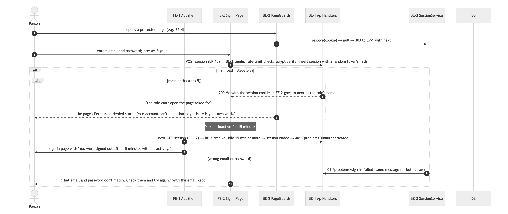

# M5.2 Safe landing — milestone report

| Field | Value |
|---|---|
| Milestone | M5.2 — Safe landing: every person lands on their work page or S15 Your home; not-found and wrong-role pages link home |
| Branch / MR | `milestone/m5.2-safe-landing` · MR !11 (draft) — https://labs.gauntletai.com/sefathchowdhury/cerbo-supplement-store/-/merge_requests/11 |
| Verified head | `0566a91` (§4.1), branched from `main` at `c956959` |
| Specs | `specs/M5.2-safe-landing/` (acceptance, tasks; frozen after merge) |
| Written | 2026-10-11 10:18 CDT by report-milestone (Claude Code subagent, dispatched by the supervisor; claude-opus-5-5); recipes and `make check` run 2026-10-11 10:13 CDT |
| Confidence | med — no browser check of M5.2 is logged: the client-side click on the error page's "Go to your home" (R5, clearError) and the S15 / error page look are proven only by server-rendered HTML in AT-001..005 |
| G5 readiness | 4/4 clauses yes (§13, recipe 12 `g5_clauses_yes`) · recommendation: Merge |

Recipe adaptations for the dotted milestone id and this checkout (references/commands.md assumes `M[0-9]+` and run dirs inside the checkout):

- §0: `case "$N" in *[!0-9]*)` became `case "$N" in *[!0-9.]*|.*|*.)`, so `N=5.2`, `M=M5.2`, `S=specs/M5.2-safe-landing` derive from the branch. `MB_ARG=milestone/m5.2-safe-landing` (dispatched). Same change as M5.1.
- Recipe 12: the task-id pattern `'^ *M[0-9]+-T[0-9]+ *$'` became `'^ *M[0-9.]+-T[0-9]+ *$'` (three places), or §1 rows would count 0. Same change as M5.1.
- Every other recipe line using `$M` inside a regex (`"$M-T[0-9]{3}"`, `"^\| *$M[ |]"`) was left as written. The `.` there matches any character, so it also accepts `M5.2`. No other id of the form `M5?2` exists, so it makes no false match.
- Run dirs: `.handoff/runs/M5.2-T00*` exist only in the main checkout, not in this worktree, so recipes 2, 9 and 10 read `$RUNS/<id>` with `RUNS=<main checkout>/.handoff/runs` instead of `.handoff/runs/<id>`.
- Not the dot, but the format (as in M5.1): recipe 5's G4 fallback `$3 ~ /^ *G4 *$/` became `$3 ~ /^ *G4( |$)/`; recipe 3's title lookup ran as `grep -m1 -E "\*\*$id\*\*"`, because `grep -w` hits a PRD summary line first; recipe 6's per-gate count also ran keyed on the first word of the gate cell.
- Recipe 11 ran with `GITLAB_HOST=labs.gauntletai.com`.

## Summary

- Shipped: a signed-in person who opens the site root now lands on their work page (provider, operations specialist, finance lead) or on the new S15 Your home page, which names them and says what to do (patient, site reliability, data analyst, and an account with no role) (FR-039). An unknown address shows a "We couldn't find that page" page with a "Go to your home" link, and a page someone's role does not allow shows the refusal plus a "Go to your home" link (FR-058). A stranger is still sent to sign in first (AE-038). This answers the human's report in Approvals 2026-10-11 09:37 CDT: "also everytime i log in, i get 404s…".
- Not shipped: nothing planned was left out. Both tasks landed. M5.2-T002 is labelled partial only because its worker stopped at `human_review`; the supervisor recorded answer A and committed the verified diff (§1, DV-3). S15's Loading and Error copy was filed, not built (R4).
- Watch: nobody has clicked the error page's "Go to your home" in a real browser. It is an `<a href="/">` with `@click="clearError(...)"` (Q1 answer A), and AT-003 checks only the server-rendered HTML (§11).

## 1. Delivered vs planned

| Task | Status | Squash commit | Covers | Evidence |
|---|---|---|---|---|
| M5.2-T001 | delivered | `2727f99` | FR-039, FR-058, AE-038 | scope-guard exit 0, 5 paths (§4.3) · make check exit 0 incl. M5.2 acceptance 5/5 (§4.2) · result.md status done (worker claim) |
| M5.2-T002 | partial | `e9b46fc` | FR-039 | scope-guard exit 0, 4 paths (§4.3) · make check exit 0 incl. M5.2_AT_005 (§4.2) · result.md status human_review (worker claim): the worker stopped on Q1 (R5 asks for a button, AT-003 pins a link) and left its diff uncommitted; the supervisor recorded answer A (Approvals 2026-10-11 09:59 CDT) and committed that diff (Log VERIFY 09:59 CDT). Partial by the report's rule (result `human_review`), not by a failing test (DV-3) |

Unplanned commits on the milestone branch (no `Task:` trailer):

| Commit | Subject | Kind |
|---|---|---|
| `34fc144` | spec(m5.2): safe landing: S15, not-found and wrong-role design, red tests, T001 | docs/spec (G1 + G-ux + G3 + G4 artifacts, define-acceptance, slice-tasks) → DV-7 |
| `49b20c4` | chore(m5.2): record T001, start review | handoff |
| `968279b` | spec(m5.2): pass 1 dispositions; tighter tests; no-role copy; T002 | docs/spec (review-fix plan; R1, R3 test fixes; AT-005) → DV-1, DV-2 |
| `562961c` | chore(m5.2): record T002 | handoff |
| `96f0864` | chore(m5.2): log a flaky check | handoff |
| `7e96344` | fix(harness): pre-push hook clears GIT_DIR so worktree pushes check the right tree | harness fix → DV-4 |
| `e94fe57` | docs(m5.2): security checklist | docs (check-security) |
| `0566a91` | chore(m5.2): G5 security; accept SEC-15 | handoff + decision (D82) |

```console
$ for f in "$S"/tasks/T*.md; do printf '%s\t%s\t%s\n' "$(fmval id "$f")" "$(fmval covers "$f")" "$f"; done
M5.2-T001	[FR-039, FR-058, AE-038]	specs/M5.2-safe-landing/tasks/T001.md
M5.2-T002	[FR-039]	specs/M5.2-safe-landing/tasks/T002.md
$ ls "$S"/tasks/T*.md | wc -l | tr -d ' '
2
$ commits | cut -f2-
34fc144		spec(m5.2): safe landing: S15, not-found and wrong-role design, red tests, T001
2727f99	M5.2-T001	feat(m5.2/t001): safe landing: S15 home, error page, wrong-role home link
49b20c4		chore(m5.2): record T001, start review
968279b		spec(m5.2): pass 1 dispositions; tighter tests; no-role copy; T002
e9b46fc	M5.2-T002	feat(m5.2/t002): no-role home, home-link target, error page link clears the error
562961c		chore(m5.2): record T002
96f0864		chore(m5.2): log a flaky check
7e96344		fix(harness): pre-push hook clears GIT_DIR so worktree pushes check the right tree
e94fe57		docs(m5.2): security checklist
0566a91		chore(m5.2): G5 security; accept SEC-15
$ commits | awk -F'\t' '$3 != ""' | wc -l | tr -d ' '
2
$ commits | awk -F'\t' '$3 == ""' | cut -f2,4
34fc144	spec(m5.2): safe landing: S15, not-found and wrong-role design, red tests, T001
49b20c4	chore(m5.2): record T001, start review
968279b	spec(m5.2): pass 1 dispositions; tighter tests; no-role copy; T002
562961c	chore(m5.2): record T002
96f0864	chore(m5.2): log a flaky check
7e96344	fix(harness): pre-push hook clears GIT_DIR so worktree pushes check the right tree
e94fe57	docs(m5.2): security checklist
0566a91	chore(m5.2): G5 security; accept SEC-15
$ for f in "$S"/tasks/T*.md; do id=$(fmval id "$f"); r=$RUNS/$id/result.md; c=$(commits | awk … ); printf '%s\tcommits=%s\tresult=%s\n' …; done   (recipe 2, run dir adapted)
M5.2-T001	commits=2727f99 	result=done
M5.2-T002	commits=e9b46fc 	result=human_review
```

Recipe 2 lists 10 first-parent commits on the branch: 2 task squashes and 8 unplanned (`git rev-list --count`, §4.6, also prints 10: no merge inside the branch).

## 2. Why (requirements covered)

- FR-039 — "When a person signs in with their own account, the system shall show only the pages their role allows: a patient their own orders, a provider their practice, platform staff the platform pages." (`docs/product/prd.md`) — covered by M5.2-T001, M5.2-T002 · M5.2_AT_001, M5.2_AT_002, M5.2_AT_003, M5.2_AT_004, M5.2_AT_005.
- FR-058 — "If an operations person opens a page or action their role does not allow, then the system shall refuse and show none of its contents." (`docs/product/prd.md`) — covered by M5.2-T001 · M5.2_AT_004 (Ana on the provider dashboard; Fran, finance lead, on stock adjustments, added for R3).
- AE-038 — a person who is not signed in is sent to sign in (`docs/product/prd.md`; acceptance.md Scope) — covered by M5.2-T001 · M5.2_AT_003 (stranger gets 303 to sign-in). The behaviour itself is the unchanged `app/middleware/auth.global.ts` (verifier coverage map).
- Not delivered: none. The AE comparison prints nothing: every AE in acceptance.md is covered by a task.

```console
$ for f in "$S"/tasks/T*.md; do fmval covers "$f"; done | grep -oE '(N?FR|AE)-[0-9]+' | sort -u
AE-038
FR-039
FR-058
$ comm -13 <(for f in "$S"/tasks/T*.md; do fmval covers "$f"; done | grep -oE 'AE-[0-9]+' | sort -u) <(grep -oE 'AE-[0-9]+' "$S/acceptance.md" | sort -u)
$ for id in FR-039 FR-058 AE-038; do grep -m1 -E "\*\*$id\*\*" docs/product/prd.md | cut -c1-220; done   # adapted lookup
- **FR-039** [Event] (US-8) When a person signs in with their own account, the system shall show only the pages their role allows: a patient their own orders, a provider their practice, platform staff the platform pages.
- **FR-058** [Unwanted] (US-10) If an operations person opens a page or action their role does not allow, then the system shall refuse and show none of its contents.
- **AE-038** (FR-040) Given nobody is signed in, When someone opens the link to Ana's order, Then they see the sign-in page and nothing about the order.
```

## 3. Decisions (D-ids)

| D-id | Title | Status | Choice in one line | Type |
|---|---|---|---|---|
| D82 | Accept S15 home without no-store caching | accepted | accept SEC-15: `/` (and `/practice/**`) keep no `Cache-Control: no-store`, so Back on a shared browser may show the previous person's own name and role; decided at G5 SEC-15 2026-10-11 10:12 CDT (STANDING row) | Type 2 |

No one-way ADR file was added. The MILESTONES.md M5.2 row's D-ids cell still reads `—` (DV-5).

```console
$ git diff "$BASE..$MB" -- docs/decisions/DECISION_JOURNAL.md | grep -E '^\+### D[0-9]+'
+### D82 Accept S15 home without no-store caching  [status: accepted]
$ git diff "$BASE..$MB" -- docs/decisions/DECISION_JOURNAL.md | grep -cE '^\+### D[0-9]+'
1
$ git diff --name-only --diff-filter=A "$BASE..$MB" -- docs/decisions/ | grep -E '/[0-9]{4}-'
```

## 4. Verification

Run by report-milestone on the milestone head at 2026-10-11 10:13 CDT. Nothing below is copied from a worker.

### 4.1 Head and tree

```console
$ git rev-parse --short HEAD; git branch --show-current
0566a91
milestone/m5.2-safe-landing
$ git status --porcelain -- . ':!.handoff' ':!docs/milestones/M5.2.md'
```

### 4.2 make check

`make check` runs typecheck, 218 unit tests, the diagram check, the M4 (43), M5 (44), M5.1 (5) and M5.2 (5) acceptance suites, and the decision-views check (first lines of the full output: `npx nuxi typecheck`, `npx vitest run --dir tests/unit --passWithNoTests`; unit lines from the same output: `Test Files  14 passed (14)`, `Tests  218 passed (218)`).

```console
$ make check
[... trimmed: typecheck, unit 218/218, embed-diagrams hld 3 / lld 18 in sync, npx vitest run --dir tests/acceptance/M4 ...]

 Test Files  5 passed (5)
      Tests  43 passed (43)
   Start at  10:13:42
   Duration  45.77s (tests 100%)

npx vitest run --dir tests/acceptance/M5

 RUN  v5.0.1 /Users/mastershefu/Desktop/gauntlet_workbench/cerbo-supplement-store/.claude/worktrees/m52-landing


 Test Files  5 passed (5)
      Tests  44 passed (44)
   Start at  10:14:29
   Duration  82.77s (tests 100%)

npx vitest run --dir tests/acceptance/M5.1

 RUN  v5.0.1 /Users/mastershefu/Desktop/gauntlet_workbench/cerbo-supplement-store/.claude/worktrees/m52-landing


 Test Files  1 passed (1)
      Tests  5 passed (5)
   Start at  10:15:52
   Duration  13.21s (tests 99%)

npx vitest run --dir tests/acceptance/M5.2

 RUN  v5.0.1 /Users/mastershefu/Desktop/gauntlet_workbench/cerbo-supplement-store/.claude/worktrees/m52-landing


 Test Files  1 passed (1)
      Tests  5 passed (5)
   Start at  10:16:06
   Duration  7.07s (tests 99%, import 1%)

bash scripts/decision-views.sh --check
decision-views: docs/decisions/REVIEW.md is current
make check: OK
exit 0
```

### 4.3 Scope guard per squash commit

```console
$ commits | awk -F'\t' '$3 != "" {print $1, $2, $3}' | while read -r sha short ids; do id=${ids%%,*}; f=$(grep -lE "(^|[[:space:]])id:[[:space:]]*$id([[:space:]]|\$)" "$S"/tasks/T*.md | head -n 1); o=$(bash scripts/scope-guard.sh "${f:-missing-task-file}" "$sha^" "$sha" 2>&1); echo "$short $id exit=$?"; printf '%s\n' "$o" | sed 's/^/    /'; done
2727f99 M5.2-T001 exit=0
    scope-guard: OK — 5 changed path(s) within Owns (2727f998fc41941ae4bdbc404df25f03d9a4ef20^:specs/M5.2-safe-landing/tasks/T001.md)
e9b46fc M5.2-T002 exit=0
    scope-guard: OK — 4 changed path(s) within Owns (e9b46fc6fd179b618dafc1c2d5f46f39029c2bfb^:specs/M5.2-safe-landing/tasks/T002.md)
```

### 4.4 Acceptance tests untouched by implementers

The command prints nothing: no task commit touched `tests/acceptance/**`. Two non-task commits did. `34fc144` is define-acceptance (AT-001..004 red). `968279b` is the supervisor tightening AT-002 (R1) and AT-004 (R3) and adding AT-005 (R2), under the 09:52 CDT dispositions row "R1, R3 fix (tests, supervisor)" (DV-2).

```console
$ commits -- tests/acceptance/ | awk -F'\t' '$3 != ""' | cut -f2,3,4
$ commits -- tests/acceptance/ | cut -f2,3,4   # all commits touching acceptance tests
34fc144		spec(m5.2): safe landing: S15, not-found and wrong-role design, red tests, T001
968279b		spec(m5.2): pass 1 dispositions; tighter tests; no-role copy; T002
```

### 4.5 Diagrams in sync

```console
$ mmd=$(git diff --name-only "$BASE..$MB" -- 'docs/architecture/diagrams/*.mmd'); echo "changed diagram sources: ${mmd:-none}"; docs=$( … ); [ -z "$docs" ] && echo "no design doc or embedded diagram changed" || { bash scripts/embed-diagrams.sh --check $docs; echo "exit $?"; }
changed diagram sources: none
embed-diagrams: docs/architecture/lld.md: 18 diagram(s) in sync
exit 0
```

### 4.6 Branch contains main

```console
$ git merge-base --is-ancestor "$MAIN" "$MB" && echo "contains $MAIN" || echo "$MAIN moved since branching: merge result untested"
contains main
$ git rev-parse -q --verify "origin/$MAIN" >/dev/null && { git merge-base --is-ancestor "origin/$MAIN" "$MB" && echo "contains origin/$MAIN (as last fetched)" || echo "origin/$MAIN moved: merge result untested"; }
contains origin/main (as last fetched)
$ date '+%F %H:%M %Z'; git branch --show-current; [ "$(git rev-parse HEAD)" = "$HEAD_SHA" ] && echo "HEAD is the head of $MB"; git status --porcelain -- . ':!.handoff' ":!$R"; grep -E "^\| *$M[ |]" MILESTONES.md; git rev-list --count "$BASE..$MB"; section Tasks | grep -E "\| *$M-T[0-9]{3} *\|" | grep -E '\| *(todo|working|input-required) *\|'   (recipe 1)
2026-10-11 10:13 CDT
milestone/m5.2-safe-landing
HEAD is the head of milestone/m5.2-safe-landing
| M5.2 | Safe landing: every person lands on their work page or S15 Your home; not-found and wrong-role pages link home | 2 tasks: T001–T002 (T002 review fixes) | — | — | planned | G1 (CQ-5) | — | — | — |
10
```

## 5. Deviations from plan

| Id | Deviation | Kind | Why (source) | Decision |
|---|---|---|---|---|
| DV-1 | M5.2-T002 (review fixes R2, R5, R6) added after the G4 answer of 09:37 CDT, which named T001 only, in `968279b` | added | Approvals 2026-10-11 09:52 CDT "M5.2 review pass 1 dispositions: R1, R3 fix (tests, supervisor); R2, R5, R6 fix (M5.2-T002; S15 no-role copy added, G-ux); R4 file; R7 keep" — words: "STANDING row 2026-10-10 23:09 CDT" (which covers "review dispositions, slice-tasks, implement-task dispatch") | none needed: recorded under the STANDING row |
| DV-2 | The supervisor edited the QA-owned `tests/acceptance/M5.2/landing.test.ts` outside define-acceptance in `968279b`: AT-002 now checks the landing page is not a refusal (R1), AT-004 adds Fran on stock adjustments (R3), and AT-005 is new (the no-role account, R2) | AE | Approvals 2026-10-11 09:52 CDT "R1, R3 fix (tests, supervisor)"; acceptance.md change row 2026-10-11 09:51 CDT "Review pass 1: AT-002 … (R1); AT-004 adds Fran … (R3, FR-058); AT-005 the no-role account (R2)" | none needed: recorded disposition |
| DV-3 | M5.2-T002's worker stopped at `human_review` on Q1: R5 asks for a `<button>`, but AT-003 pins an `<a href="/">`. It left its diff uncommitted. The supervisor recorded answer A (keep the styled link, no prevented click) and committed the verified worktree diff as `e9b46fc`, so the implementer of record did not commit its own squash | changed | Approvals 2026-10-11 09:59 CDT "M5.2-T002 Q1: A (keep the styled link; AT-003 stays green)" @ `.handoff/runs/M5.2-T002/answers.md`, words "STANDING row 2026-10-10 23:09 CDT"; Log 2026-10-11 09:59 CDT "VERIFY M5.2-T002 squashed e9b46fc: worker stopped human_review on Q1 (button vs link vs AT-003); answer A recorded; supervisor committed the verified worktree diff (scope-guard OK, 4 paths); make check exit 0 (218/43/44/5/5)" | none needed: recorded Q1 answer A; R5 is met as "no prevented click, calls clearError" rather than a literal button |
| DV-4 | Harness fix `7e96344`: `.githooks/pre-push` unsets `GIT_DIR`/`GIT_WORK_TREE`/`GIT_INDEX_FILE`/`GIT_PREFIX` before `make check`. Unlike M5.1's scope-guard fix, it has no Approvals row of its own | added | Log 2026-10-11 10:04 CDT "FAIL flaky: pre-push make check failed once on unit tests and once on M5_AT_037 … not reproducible …; route-failure candidate"; Log 2026-10-11 10:05 CDT "FIX harness: .githooks/pre-push unsets GIT_DIR/GIT_WORK_TREE before make check; inside a worktree embed-diagrams resolved doubled paths and blocked the push (the earlier 'flaky' failures came from the same broken hook run); route-failure candidate for the kit" | none needed: harness fix recorded in the Log; route-failure candidate |
| DV-5 | The MILESTONES.md M5.2 row records no G3/G4 sha (gate cell `G1 (CQ-5)`) and D-ids `—` although D82 is added. The 09:37 CDT G4 answer names paths "on milestone/m5.2-safe-landing" with no sha. Recipe 5 therefore prints "⚠ none recorded", and task-file drift after G4 is read by hand: `34fc144` created T001 (the G4 artifact) and `968279b` added T002 (DV-1) | changed | Approvals 2026-10-11 09:37 CDT "G1 (clarify CQ-5: M5.2 Safe landing) + G-ux (…) + G3 (…) + G4 (AT-001..004, T001)" — the answer exists; only its sha form is missing | none needed: recording form only (the supervisor may add `G4@34fc144` and D82 to the row, as `51822ec` did for M5.1) |
| DV-6 | `docs/security/CHECKLIST.md`@`e94fe57` still shows SEC-15 (low) as `pending G5`, and its Accepted risks line has no `D82 SEC-15`. `0566a91` recorded the acceptance in TRACKER and the journal only | changed | Approvals 2026-10-11 10:12 CDT "G5 SEC-15 … accept — STANDING row 2026-10-10 23:09 CDT"; D82 accepted | D82 (the checklist text lags it; SEC-15 is low, so the count in §7 is unaffected) |
| DV-7 | Planning work on this branch before the first task: PRD CQ-5 and the M5.2 row, screens.md S15 and the not-found/wrong-role conventions, flows.md F7, LLD ROLE_PAGES/FE-23/25/26, acceptance AT-001..004 and T001, all in one commit `34fc144` under one combined gate row | added | Approvals 2026-10-11 09:37 CDT G1 + G-ux + G3 + G4, words: "also everytime i log in, i get 404s. i dont reroute safely to a homepage, or have any info like i dont have access or get a link to a page i should be reaching, etc. lets fix that" · STANDING row 2026-10-10 23:09 CDT | none needed: the human's request plus the STANDING row |

The task file harness is `harness: claude` on both tasks, and the Log DISPATCH lines read `harness=claude-subagent`. This is the same Claude harness run as an in-session subagent, as in M5 and M5.1, so it is listed in §10 and not as a deviation. No question is pending: every deviation above cites a record.

```console
$ g4=$(grep -E "^\| *$M[ |]" MILESTONES.md | grep -oE 'G4@[0-9a-f]{7,40}' | tail -n 1 | cut -d@ -f2); [ -n "$g4" ] || g4=$(approvals | awk -F'|' -v m="$M-" '$3 ~ /^ *G4( |$)/ && index($4, m)' | grep -oE '@[0-9a-f]{7,40}' | tail -n 1 | tr -d @); echo "G4-approved sha: ${g4:-⚠ none recorded}"; [ -n "$g4" ] && git log --format='%h %s' "$g4..$MB" -- "$S/tasks/"   (recipe 5, G4 match adapted)
G4-approved sha: ⚠ none recorded
$ git log --format='%h %s' "$BASE..$MB" -- "$S/tasks/"   # DV-5: task-file history read by hand
968279b spec(m5.2): pass 1 dispositions; tighter tests; no-role copy; T002
34fc144 spec(m5.2): safe landing: S15, not-found and wrong-role design, red tests, T001
$ for f in "$S"/tasks/T*.md; do echo "$f $(grep -m1 -E '^harness:' $f)"; done
specs/M5.2-safe-landing/tasks/T001.md harness: claude
specs/M5.2-safe-landing/tasks/T002.md harness: claude
$ git show --stat --format='%h %s' 7e96344   # DV-4
7e96344 fix(harness): pre-push hook clears GIT_DIR so worktree pushes check the right tree

 .githooks/pre-push  | 3 +++
 .handoff/TRACKER.md | 1 +
 2 files changed, 4 insertions(+)
$ grep -E '^\| *SEC-15 ' docs/security/CHECKLIST.md | awk -F'|' '{print $2"|"$4"|"$9"|"$10}'   # DV-6
 SEC-15 | low | pending G5 | open 
```

## 6. Verifier dispositions

Review file(s): `.handoff/reviews/M5.2-pass1.md` · 1 pass · reviewer: `Reviewer: verifier (claude-opus-5-5)` · worker self-reports quoted to the verifier: none quoted (its Not-reviewed list names no result.md or run file) (recipe 7) · task authors: §10.

Recipe 7's `scoped | grep -E 'R[0-9]+'` prints nothing. The pass 1 disposition row names `.handoff/reviews/M5.2-pass1.md` with no sha, so the `scoped` filter cannot match it. The rows below are matched to that Approvals row by review file, as M5.1.md §6 did. The row (2026-10-11 09:52 CDT), verbatim: "M5.2 review pass 1 dispositions: R1, R3 fix (tests, supervisor); R2, R5, R6 fix (M5.2-T002; S15 no-role copy added, G-ux); R4 file; R7 keep". Its words cell is "STANDING row 2026-10-10 23:09 CDT", meaning the human's "… mark that i approve all next recommendations until project completion …".

| Row | Axis | Severity | Suggested | Disposition (human, verbatim) | Where handled |
|---|---|---|---|---|---|
| R1 | tests-that-lie | P2 | file | fix — "R1, R3 fix (tests, supervisor)" (Approvals 2026-10-11 09:52 CDT) | `968279b` (AT-002: the landed page must not show the refusal's home link) |
| R2 | correctness | P2 | fix | fix — "R2, R5, R6 fix (M5.2-T002; S15 no-role copy added, G-ux)" (Approvals 2026-10-11 09:52 CDT) | `e9b46fc` (`ROLE_PAGES.none`, S15 "Your account has no role yet…"; AT-005 green in §4.2) + `968279b` (screens.md S15 Empty copy) |
| R3 | spec-fidelity | P2 | file | fix — "R1, R3 fix (tests, supervisor)" (Approvals 2026-10-11 09:52 CDT) | `968279b` (AT-004 adds Fran, finance lead, on /ops/stock: refusal plus home link, no stock rows) |
| R4 | spec-fidelity | P3 | file | file — "R4 file" (Approvals 2026-10-11 09:52 CDT) | filed; no issue or destination named in the row (§11) |
| R5 | correctness | P3 | file | fix — "R2, R5, R6 fix (M5.2-T002; S15 no-role copy added, G-ux)" (Approvals 2026-10-11 09:52 CDT); form set by "M5.2-T002 Q1: A (keep the styled link; AT-003 stays green)" (Approvals 2026-10-11 09:59 CDT) | `e9b46fc` (error.vue: `<a href="/" class="btn-primary" @click="clearError({ redirect: '/' })">`, no `@click.prevent`) |
| R6 | spec-fidelity | P3 | file | fix — "R2, R5, R6 fix (M5.2-T002; S15 no-role copy added, G-ux)" (Approvals 2026-10-11 09:52 CDT) | `e9b46fc` (ProblemMessage.vue `home-link`, 24 px min height); parts (a) duplicate alerts and (c) error-page focus are not named in T002's change list (§11) |
| R7 | spec-fidelity | P3 | keep | keep — "R7 keep" (Approvals 2026-10-11 09:52 CDT) | no reason in the row; the verifier's own note: "Spec hygiene only" (T001 Must-not-change carried the M5.1 restyle clause) |

No verifier pass reviewed the T002 commit `e9b46fc`. It was checked by the supervisor's VERIFY line, the check-security run on `7e96344` (§7) and this report's `make check` (§11).

```console
$ ls .handoff/reviews/$M-pass*.md
.handoff/reviews/M5.2-pass1.md
$ grep -HoE 'Reviewer: [^·|]*' .handoff/reviews/$M-pass*.md
.handoff/reviews/M5.2-pass1.md:Reviewer: verifier (claude-opus-5-5)
$ for p in .handoff/reviews/$M-pass*.md; do printf '%s self-reports quoted to the verifier: ' "$p"; awk '/^## Not reviewed/{on=1; next} /^## /{on=0} on' "$p" | grep -iE 'self-report|result\.md|runs/|last-message' || echo "none quoted"; done
.handoff/reviews/M5.2-pass1.md self-reports quoted to the verifier: none quoted
$ grep -HE '^\| *R[0-9]+ *\|' .handoff/reviews/$M-pass*.md | awk -F'|' '{print $1 $2 "|" $3 "|" $4 "|" $(NF-1)}' | cut -c1-160
.handoff/reviews/M5.2-pass1.md: R1 | tests-that-lie | P2 | file 
.handoff/reviews/M5.2-pass1.md: R2 | correctness | P2 | fix 
.handoff/reviews/M5.2-pass1.md: R3 | spec-fidelity | P2 | file 
.handoff/reviews/M5.2-pass1.md: R4 | spec-fidelity | P3 | file 
.handoff/reviews/M5.2-pass1.md: R5 | correctness | P3 | file 
.handoff/reviews/M5.2-pass1.md: R6 | spec-fidelity | P3 | file 
.handoff/reviews/M5.2-pass1.md: R7 | spec-fidelity | P3 | keep 
$ grep -cE '^\| *R[0-9]+ *\|' .handoff/reviews/$M-pass*.md
7
$ grep -hE '^\| *R[0-9]+ *\|' .handoff/reviews/$M-pass*.md | grep -cE '\| *P[01] *\|'
0
$ scoped | grep -E 'R[0-9]+'
$ for p in .handoff/reviews/$M-pass*.md; do rc=$(git log -1 --format=%H -- "$p"); [ -n "$rc" ] && { echo "commits after $p (where its fix rows landed):"; git log --first-parent --format='  %h %s' "$rc..$MB"; } || echo "$p not committed"; done
commits after .handoff/reviews/M5.2-pass1.md (where its fix rows landed):
  0566a91 chore(m5.2): G5 security; accept SEC-15
  e94fe57 docs(m5.2): security checklist
  7e96344 fix(harness): pre-push hook clears GIT_DIR so worktree pushes check the right tree
  96f0864 chore(m5.2): log a flaky check
  562961c chore(m5.2): record T002
  e9b46fc feat(m5.2/t002): no-role home, home-link target, error page link clears the error
$ git show --stat --format='%h %s' 968279b   # the commit that holds the review file also holds the R1, R3 test fixes
968279b spec(m5.2): pass 1 dispositions; tighter tests; no-role copy; T002
 .handoff/TRACKER.md                   |  3 ++
 .handoff/reviews/M5.2-pass1.md        | 46 ++++++++++++++++++++++++
 MILESTONES.md                         |  2 +-
 docs/design/screens.md                |  2 +-
 specs/M5.2-safe-landing/acceptance.md |  2 ++
 specs/M5.2-safe-landing/tasks/T002.md | 67 +++++++++++++++++++++++++++++++++++
 tests/acceptance/M5.2/landing.test.ts | 21 +++++++++--
 7 files changed, 139 insertions(+), 4 deletions(-)
```

## 7. Security

- Checklist: `docs/security/CHECKLIST.md` @ `e94fe57` (frontmatter `head_sha: 7e96344…`): fresh. No code path changed after it (the diff command prints nothing; `0566a91` touches only `.handoff` and `docs/decisions`).
- G5 security condition (as the checklist states it): "met: secrets 0, unaccepted high/critical 0"
- Unaccepted high/critical findings and secrets: 0 and 0 (recipe 8 count line), none.
- Accepted risks: SEC-1 accepted (D51), SEC-2 accepted (D49), SEC-3 accepted (D50), plus D52 SEC-5, D76 SEC-10, D77 SEC-12, D78 SEC-13, as the checklist's Accepted risks line records them. SEC-15 (low, new in M5.2) is accepted as D82 by Approvals 2026-10-11 10:12 CDT "G5 SEC-15 … accept — STANDING row 2026-10-10 23:09 CDT: "i approve all next recommendations until project completion"", but the checklist row still reads `pending G5` (DV-6).
- Approvals for this milestone: 2026-10-11 10:12 CDT "G5 security part (M5.2): approve checklist (0 reachable critical/high)" @e94fe57, words "STANDING row 2026-10-10 23:09 CDT: "i approve all next recommendations until project completion"".
- Secret scan: gitleaks NOT INSTALLED, so secrets are covered only by the checklist.
- Dependency changes: none (`package.json`, `package-lock.json` unchanged).

```console
$ C=docs/security/CHECKLIST.md; cs=$(git log -1 --format=%H -- "$C"); git log -1 --format='%h %cI' -- "$C"; git diff --name-only "$cs..$MB" -- . ':!docs' ':!.handoff' ':!specs'
e94fe57 2026-10-11T10:12:17-05:00
$ grep -E '^- \*\*(G5 security condition|Accepted risks):\*\*' "$C"
- **G5 security condition:** met: secrets 0, unaccepted high/critical 0
- **Accepted risks:** D51 SEC-1, D49 SEC-2, D50 SEC-3, D52 SEC-5, D76 SEC-10, D77 SEC-12, D78 SEC-13
$ awk -F'|' '$2 ~ /^ *(CK|LLM)-[0-9]+ *$/ {…} $2 ~ /^ *SEC-[0-9]+ *$/ && $10 ~ /open/ {…} END{printf "pass=%d fail=%d na=%d critical=%d high=%d medium=%d low=%d secrets=%d unaccepted_high_critical=%d\n", …}' "$C"
pass=10 fail=4 na=0 critical=1 high=2 medium=1 low=4 secrets=0 unaccepted_high_critical=0
$ awk -F'|' '$2 ~ /^ *SEC-[0-9]+ *$/ && $10 ~ /open/ {…print "unaccepted:" …}' "$C"
$ grep -m3 -E '^(head_sha|base_sha|written_at):' "$C"
base_sha: c95695976dc9c0c60423a91cbf82f68a8d2bf063
head_sha: 7e9634415be37cb221e33a733dde2c3c8f62f8e2
$ command -v gitleaks >/dev/null && { gitleaks git --log-opts="$BASE..$MB" --redact --no-banner; echo "exit $?"; } || echo "gitleaks NOT INSTALLED"
gitleaks NOT INSTALLED
$ git diff --name-status "$BASE..$MB" -- package.json package-lock.json
```

## 8. Factory metrics

| Metric | Value | How it is counted |
|---|---|---|
| First-pass acceptance rate | 0/2 dispatched = 0% (rounded down) · 1 unknown · not dispatched: none | one DISPATCH; no FAIL/ESCALATE; no human_review/relaunch in Log or Tasks; last RESULT line `status=done timeout=no tree=clean`; squash commit landed ÷ dispatched tasks. A RESULT line without those fields is unknown, counted as not first-pass |
| Fix loops | 0 re-dispatches · worst: none | DISPATCH count − 1 per task (archived attempts included) |
| Verifier passes | 1 | review files for M5.2 |
| Gate Revise count | 0 of 2 gate answers (recipe 6; only the two G5 security rows carry a sha, the other four M5.2 rows are unscoped, §11) | `## Approvals` rows of this milestone whose words say Revise |
| Scope-guard blocks | 0 logged · 0 failing now (§4.3) | FAIL lines naming scope-guard + non-zero exits in §4.3 |
| Rework after merge | n/a — measured at the next milestone | — |

```console
$ n=0; fp=0; unk=0; loops=0; nd=""; for f in "$S"/tasks/T*.md; do … done; …   (recipe 9, run dir adapted to $RUNS)
M5.2-T001 dispatches=1 fail_or_escalate=0 human_review_or_relaunch=0 last_result="status=? timeout=? tree=?" squash_commits=1 first_pass=unknown
M5.2-T002 dispatches=1 fail_or_escalate=0 human_review_or_relaunch=1 last_result="status=? timeout=? tree=?" squash_commits=1 first_pass=0
first-pass acceptance: 0/2 dispatched = 0% (rounded down; 1 unknown counted as not first-pass) · fix loops (re-dispatches): 0
not dispatched: none
scope-guard blocks logged: 0
verifier passes: 1
$ scoped | wc -l; scoped | awk -F'|' 'tolower($5) ~ /revise/' | wc -l   (recipe 6)
gate answers: 2
gate Revise answers: 0
$ echo "gate answers per gate (first word of the gate cell): $(scoped | awk -F'|' '{g=$3; sub(/^ */, "", g); split(g, a, " "); c[a[1]]++} END {for (k in c) printf "%s=%d ", k, c[k]}')"   (recipe 6, adapted key)
gate answers per gate (first word of the gate cell): G5=2 
```

What the numbers say: T001 is `unknown`, not a failure: the supervisor logs no `RESULT` line with `status= timeout= tree=` for in-session subagents (the same recording gap as M5.1). T002 is a genuine not-first-pass: its worker stopped at `human_review` because the review fix (R5 "button") contradicted a QA-owned test (AT-003 pins a link). That is a route-failure candidate for slice-tasks: a review-fix task should check its Ask against the acceptance tests it must keep green. The Log's two route-failure candidates are the 10:04 CDT FAIL (pre-push `make check` "flaky") and the 10:05 CDT FIX, which traces both failures to the pre-push hook running with `GIT_DIR` set inside a worktree (DV-4).

## 9. Cost and usage

| Run | Harness | Tokens in / cached / out | Reported cost | Source |
|---|---|---|---|---|
| M5.2-T001 | claude (in-session subagent) | not measured: no events.jsonl | not measured | — |
| M5.2-T002 | claude (in-session subagent) | not measured: no events.jsonl | not measured | — |
| supervisor session | Claude Code | not measured: the interactive session writes no events file | not measured | — |

Totals: claude API-equivalent $0.0000 over 0 runs · codex tokens over 0 runs · 3 runs not measured. A Claude `total_cost_usd` would be an API-equivalent figure that a Max plan does not bill, and Codex on the seat reports tokens only. Here no run left an event file, so nothing is estimated.

```console
$ for d in $RUNS/$M-T*/; do e=${d}events.jsonl; [ -f "$e" ] && … || echo "$(basename $d) no events.jsonl: not measured"; done   (recipe 10, run dir adapted)
M5.2-T001 no events.jsonl: not measured
M5.2-T002 no events.jsonl: not measured
$ cat $RUNS/$M-T*/events.jsonl 2>/dev/null | grep <the result-event filter> | grep -oE '"total_cost_usd":[0-9.]+' | awk -F: '{s += $2} END {printf "claude API-equivalent cost: $%.4f over %d runs\n", s, NR}'   (recipe 10 total; event-type literal elided so no raw event key appears here)
claude API-equivalent cost: $0.0000 over 0 runs
```

## 10. Agent disclosure (harness and model per task)

| Task | Skill | Harness (cmd.txt) | Model (events / result.md) | Checked by |
|---|---|---|---|---|
| M5.2-T001 | implement-task | no cmd.txt; task file `harness: claude`, Log DISPATCH `harness=claude-subagent` | claude-opus-5-5 (worker claim) | 2026-10-11 09:48 CDT VERIFY M5.2-T001 squashed 2727f99: scope-guard OK (5 paths); supervisor make check exit 0 (218/43/44/5/4); diff read · verifier pass 1 |
| M5.2-T002 | implement-task | no cmd.txt; task file `harness: claude`, Log DISPATCH `harness=claude-subagent` | claude-opus-5-5 (worker claim) | 2026-10-11 09:59 CDT VERIFY M5.2-T002 squashed e9b46fc: worker stopped human_review on Q1; answer A recorded; supervisor committed the verified worktree diff (scope-guard OK, 4 paths); make check exit 0 (218/43/44/5/5) · check-security (no verifier pass) |
| — | supervisor, report-milestone | Claude Code | claude-opus-5-5 | the human at G5 |

Gate answers recorded for this milestone in `.handoff/TRACKER.md ## Approvals`: G5=2 (recipe 6, adapted key). Both scoped rows are the security part (SEC-15 and the checklist). Four more M5.2 rows exist without a sha and are not counted: 09:37 CDT G1 + G-ux + G3 + G4, 09:52 CDT pass 1 dispositions, 09:59 CDT T002 Q1, and 10:12 CDT deploy (pre-approved): "the M5.2 merge commit → Railway production (web-v2), once merged on green CI" @ MR !11, words "tell me when M5.2 is ready to deploy, also deploy it". No G5 Merge answer exists yet. The test edits in `968279b` (AT-002, AT-004, AT-005) and the commit of T002's diff were done by the supervisor; the verifier reviewed only T001's diff in pass 1.

```console
$ for d in $RUNS/$M-T*/; do printf '%s | %s | result.md model: %s | events model: %s\n' "$(basename "$d")" "$(grep -m1 '^# harness:' "${d}cmd.txt" 2>/dev/null | cut -c12-90)" "$(fmval model "${d}result.md")" "$(grep -m1 -oE '"model":"[^"]+"' "${d}events.jsonl" 2>/dev/null)"; done
M5.2-T001 |  | result.md model: claude-opus-5-5 | events model: 
M5.2-T002 |  | result.md model: claude-opus-5-5 | events model: 
$ for f in "$S"/tasks/T*.md; do id=$(fmval id "$f"); v=$(section Log | grep -E "[[:space:]]VERIFY[[:space:]]+$id([[:space:]]|\$)" | tail -n 1 | cut -c1-260); echo "$id checked by: ${v:-⚠ no VERIFY line}"; done
M5.2-T001 checked by: 2026-10-11 09:48 CDT VERIFY M5.2-T001 squashed 2727f99: scope-guard OK (5 paths); supervisor make check exit 0 (218/43/44/5/4); diff read
M5.2-T002 checked by: 2026-10-11 09:59 CDT VERIFY M5.2-T002 squashed e9b46fc: worker stopped human_review on Q1 (button vs link vs AT-003); answer A recorded; supervisor committed the verified worktree diff (scope-guard OK, 4 paths); make check exit 0 (218/43/44/5/5)
```

## 11. Not verified

- No browser check of M5.2 is logged (the last CHECK line is M5.1's, 08:36 CDT). So nothing proves the client-side click on the error page's "Go to your home" (the `<a href="/">` plus `clearError`, R5 / Q1 answer A), the look of S15 and the error page at 375 and 1280 px, or the 24 px link target. AT-001..005 check server-rendered HTML only — source: T001 and T002 result.md `not_verified` (worker claims), verifier Not reviewed, this report.
- T002 (`e9b46fc`) had no verifier pass. It was checked by the supervisor VERIFY line, check-security at `7e96344` and this report's `make check` — source: this report (§6, §10).
- R6 parts (a) two `role="alert"` boxes with identical home links on a page with two refused fetches, and (c) the error page not moving focus to its h1, are not named in T002's change list; only (b) the 24 px target is — source: verifier pass 1 R6, T002 result.md (worker claim).
- The non-404 error copy ("Something went wrong on our side…"): no test raises a 500 page — source: M5.2-T001 result.md (worker claim).
- S15 Loading and Error copy is not built (R4 "file"), and the row names no issue or destination for it — source: verifier pass 1 R4, Approvals 09:52 CDT.
- Wrong-role rendering on pages other than the dashboard, ops/stock and ops/orders was not checked one by one — source: verifier Not reviewed.
- The 10:04 CDT pre-push `make check` failures (unit tests, M5_AT_037) are attributed to the broken hook by the 10:05 CDT FIX line. No later Log line shows a pre-push run passing with the fixed hook. This report's `make check` (§4.2) passed once — source: Log FAIL/FIX lines, this report.
- MR !11's last pipeline (49887, status success) ran on `7e96344`, not on the head `0566a91`. The two later commits touch only docs and `.handoff` — source: `glab api projects/:fullpath/pipelines/49887` (GET), this report.
- TRACKER `## Tasks` holds no M5.2 rows, so Appendix A is empty and recipe 1's in-flight check and recipe 9's Tasks lookup ran against nothing — source: this report.
- Approvals rows without a resolvable sha: the 09:37 CDT G1 + G-ux + G3 + G4 row (paths only), the 09:52 CDT dispositions row, the 09:59 CDT T002 Q1 row (`answers.md`) and the 10:12 CDT deploy row (MR !11) — source: recipe 6, this report.
- Cost and tokens for both task runs and the supervisor session are not measured — source: recipe 10.

## 12. Rollback

- Merge method: merge (one merge commit).
- One command, after the merge:
  `m=$(git log main --first-parent --merges -1 --format=%H --grep="milestone/m5.2-safe-landing"); [ -n "$m" ] && git revert -m 1 "$m" || echo "no merge of milestone/m5.2-safe-landing on main yet"`
- Why one revert is enough: the merge commit has two parents, main as it was (parent 1) and this branch (parent 2). `-m 1` undoes exactly what the merge added on top of parent 1, which is this milestone's work. Syncs from main inside the branch: 0.
- Data, migrations, config a revert does not undo: none. No migration, seed, schema or config path changed. The `.githooks/pre-push` fix (DV-4) and the `Makefile` M5.2 suite join revert with the code. The deploy pre-approval (10:12 CDT) means production may run the merge commit; after a revert, production needs a redeploy of the reverted main (`docs/runbooks/deploy.md`, human-only).

```console
$ j=$(glab mr view "$MB" -F json 2>/dev/null) && printf '%s\n' "$j" | grep -oE '"(iid|draft|squash|web_url)":("[^"]*"|[a-z0-9]+)' | sort -u || echo "glab: no MR for $MB, or not authenticated"
"draft":true
"iid":11
"iid":31
"squash":false
"web_url":"https://labs.gauntletai.com/sefathchowdhury"
"web_url":"https://labs.gauntletai.com/sefathchowdhury/cerbo-supplement-store/-/merge_requests/11"
"web_url":"https://labs.gauntletai.com/sefathchowdhury/cerbo-supplement-store/-/pipelines/49887"
$ glab api "projects/:fullpath" 2>/dev/null | grep -oE '"merge_method":"[a-z_]+"' || echo "merge method: not checked"
"merge_method":"merge"
$ echo "merges inside the branch (syncs from main; information only): $(git rev-list --count --merges "$BASE..$MB")"
merges inside the branch (syncs from main; information only): 0
$ git diff --name-status "$BASE..$MB" | grep -iE 'migrat|schema|seed|\.env|config/' || echo none
none
```

## 13. G5 readiness

| Clause | Answer | Evidence |
|---|---|---|
| Evidence pasted | yes | §4 run fresh on `0566a91` (exit 0); the branch contains main and origin/main (§4.6); every status in §1 has its command |
| Dispositions done | yes | §6: 7 of 7 rows carry the 09:52 CDT Approvals disposition (matched by review file); every fix row has a commit (`968279b` or `e9b46fc`). Caveats: R4 "file" names no destination, R7 "keep" gives no reason (§11) |
| Nothing graded its own work | yes | §4.2 run by report-milestone; verifier ≠ task authors (§6, §10); §4.4 empty for implementer commits; both tasks dispatched (§8). Caveats: the supervisor wrote AT-005 and tightened AT-002/004 (DV-2), committed T002's diff for the worker (DV-3), and T002 had no verifier pass (§11) |
| One-revert rollback | yes | §12: merge method `merge` creates a merge commit; no migration, seed or config change |

Security (check-security's question, inside G5): 0 unaccepted high/critical, 0 secrets — yes (§7)

Open P0/P1 rows: 0 · Undecided deviations: 0 · Proposed D-rows: 0 (all from recipe 12 below) ·
Recommendation: Merge. All four clauses are yes. Recipe 12 shows 0 open P0/P1, 0 undecided deviations, 0 proposed D-rows, 0 pending markers, and `secrets=0 unaccepted_high_critical=0`. T002's `partial` comes only from its worker's `human_review` stop, which Approvals 09:59 CDT answered, and its tests pass in §4.2. The Not-verified risk you accept is §11: no browser has clicked the error page's home link or looked at S15 and the error page, and T002 had no verifier pass. Optional tidy-ups for the supervisor that need no new decision: add `G4@34fc144` and D82 to the MILESTONES row (DV-5), and mark SEC-15 `accepted (D82)` in the checklist (DV-6).

```console
$ sec() { …; }; rows() { …; }; echo "planned=… delivered=…"; …   (recipe 12, task-id pattern adapted to M[0-9.]+)
planned=2 delivered=1 partial=1 cut=0 missing=0
unplanned_commits=8
make check exit 0
proposed_d_rows=0
deviations=7 undecided_deviations=0
review_rows=7 recorded_dispositions=7
open_p0_p1=0
security: secrets=0 unaccepted_high_critical=0 
pending_markers=0
first-pass acceptance: 0/2 dispatched = 0% (rounded down; 1 unknown counted as not first-pass) · fix loops (re-dispatches): 0
not dispatched: none
scope-guard blocks logged: 0
gate answers: 2
gate Revise answers: 0
not_verified_items=11
riskiest: No browser check of M5.2 is logged (the last CHECK line is M5.1's, 08:36 CDT). So nothing proves the client-side click on the error page's "Go to your home" (
g5_clauses_yes=4/4
```

## Appendix A. Task ledger

n/a — `.handoff/TRACKER.md ## Tasks` holds no M5.2 rows (the supervisor tracked M5.2-T001 and M5.2-T002 through Log DISPATCH/VERIFY lines only; §11). Command: `awk '/^## Tasks/,/^## Approvals/' .handoff/TRACKER.md | grep -c 'M5\.2'` → 0.

| id | ask (link) | track/phase | harness+model | state | since | owns | result |
|---|---|---|---|---|---|---|---|
| n/a — no M5.2 rows in TRACKER ## Tasks | — | — | — | — | — | — | — |

<!-- pictures:start -->
## Diagrams

The diagrams for what M5.2 built (click one to open it full size).

**Sequence: sign in and idle sign-out**

[](../architecture/diagrams/img/sequence-sign-in.png)
<!-- pictures:end -->
