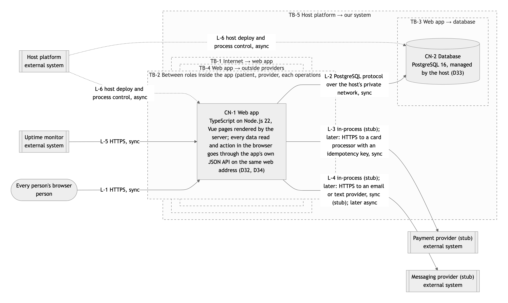
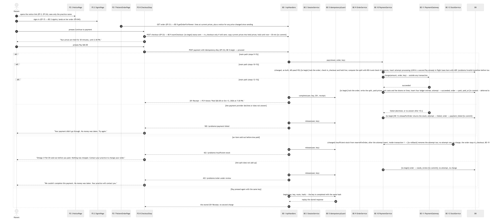

# M7.1 Hardening — milestone report

| Field | Value |
|---|---|
| Milestone | M7.1 — Hardening: the M7 threat model's cheap gaps (CQ-11) |
| Branch | `milestone/m7.1-hardening` |
| Written | 2026-10-11 18:35 CDT by the supervisor (Claude Code, claude-opus-5-5) |
| Confidence | high in tests; the Origin check against Railway's proxy is confirmed only by the post-deploy live write check (§11) |
| G5 readiness | 4/4 · recommendation: Merge |

## Summary

- BE-23 OriginGuard (`server/middleware/origin-guard.ts`, D91 supersedes D52 in part, NFR-017): any /api write whose Origin is another host, or whose Sec-Fetch-Site is cross-site, is refused 403 before a handler runs. Closes the EP-22 start-checkout gap found in M7.
- Acceptance tests M7.1_AT_001 to 004: forged price refused (T-5), no cost, payout or fee in anything a patient receives (T-13), cross-site write refused (T-16), Pay waits for the order lock (AE-070).
- Docs: THREAT_MODEL gaps 4-6 closed; CHECKLIST SEC-5 and N7 corrected; MUTATION.md records MUT-1 as a surviving mutant, accepted (no fault-injection seam).

## 1. Delivered vs planned

All four planned items delivered. MUT-1 not killed: AT-004 cannot reach the window between expireHoldIfDue's lock and Pay's (documented).

## 2. Why (requirements covered)

AE-068 (FR-002), AE-069 (FR-039), AE-070 (FR-008), NFR-017.

## 3. Decisions (D-ids)

D91 Refuse API writes whose Origin is another site (accepted, STANDING); D52 superseded-by D91.

## 4. Verification

Red: AT-003 got 200 at 612c5bf. Green: unit origin-guard 7/7, M7.1 4/4; full `make check` on the branch head before merge (MR pipeline and pre-push hook).

## 5. Deviations from plan

AT-004 pins the wait but does not kill MUT-1.

## 6. Verifier dispositions

`.handoff/reviews/M7.1-pass1.md`: R1-R6 fixed.

## 7. Security

SEC-5 now accepted under D91 (no anti-CSRF token; a request with no Origin passes). Token still due before the cookie goes SameSite=None (embedding-plan E1).

## 8. Factory metrics

Supervisor-built (one code file); no dispatch.

## 9. Cost and usage

Not measured.

## 10. Agent disclosure (harness and model per task)

Supervisor and verifier: Claude Code, claude-opus-5-5.

## 11. Not verified

Railway's Host/X-Forwarded-Host shape before deploy; checked after deploy by a wrong-password sign-in POST from the site's own Origin (expects 401, not 403).

## 12. Rollback

Revert the merge; no migration. Production rollback target: 612c5bf (deployment 6773f61f).

## 13. G5 readiness

make check green · verifier rows fixed · no unaccepted critical/high · report written → Merge.

## Appendix A. Task ledger

b77f663 tests (QA) · 7a10bb2 OriginGuard + docs · review fixes (this commit)

<!-- pictures:start -->
## Diagrams

The diagrams for what M7.1 built (click one to open it full size).

**Containers: one web app and one database, with the trust boundaries between them**

**Sequence: a patient reviews and pays an order (lock, idempotency, split, ledger)**

<!-- pictures:end -->
